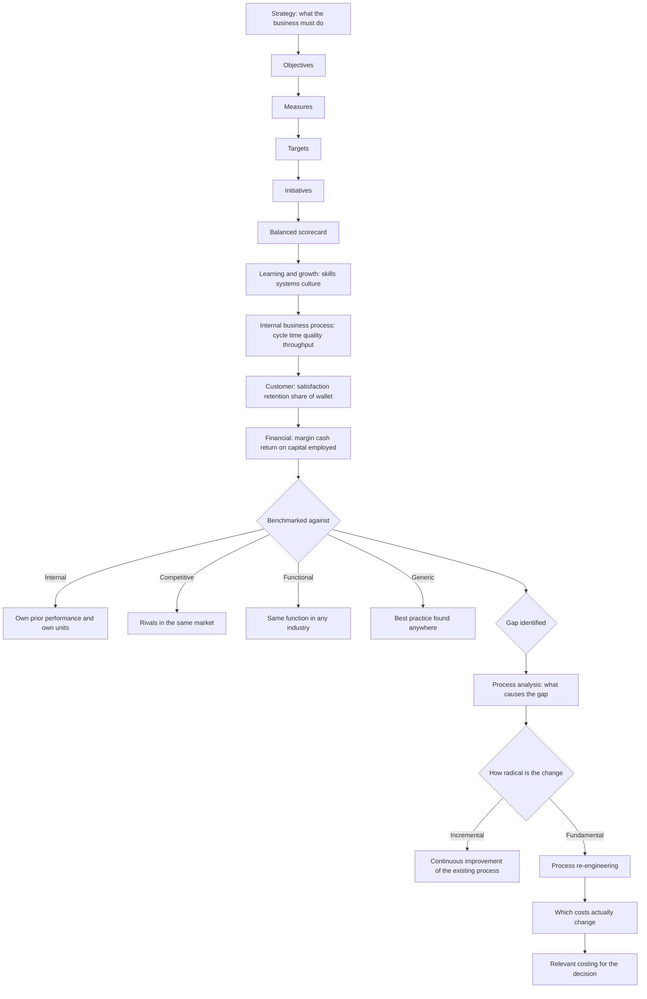

# E2 Managing Performance

E2 Managing Performance is one of the nine Objective Tests in the CGMA Professional Qualification, and one of the three that sit at Management Level. Each Objective Test is 90 minutes, computer-based and computer-marked, available on demand at Pearson VUE centres or online throughout the year, and AICPA & CIMA states that the items "test all component learning outcomes across the entire subject" — so the paper samples across business analysis, performance measurement and balanced scorecards, benchmarking and process re-engineering, and cost and management accounting at the level of decision support, rather than testing the chapter you have just read.

Two consequences follow. First, breadth pays: a candidate who has covered every part of E2 thinly will outscore one who has mastered two parts. Second, the item formats compound it. AICPA & CIMA lists short multiple-choice questions, number-entry questions and drag-and-drop formats among the Objective Test items, so a candidate who has only practised multiple choice loses marks on format alone.

The third thing to hold on to is that this module supplies the analytical language for everything above it. The Management Case Study is human-marked, three hours, on pre-seen material, and its questions are answered with the vocabulary built here: which measure answers the question, what a benchmark actually proves, what a process change buys, and which costs are relevant to the decision. Passing the examinations is not the end of the designation either — three years of verified relevant professional experience are also required — and the judgement about performance is what carries you through both.

### 🟢 Lite — Quick Review (1h–1d)

**Every E2 item is one of four moves.** Measure, Benchmark, Re-design, Decide. Decide which move the stem is making before you read the options, because the same fact is the answer in one move and a distractor in another.

**Memory hook — M-B-R-D.**
- **M** — Measure: which performance measure fits this objective, and which perspective does it belong to?
- **B** — Benchmark: compared with what, and is that comparison valid?
- **R** — Re-design: is this continuous improvement or fundamental process re-engineering?
- **D** — Decide: which costs are relevant, and what opportunity cost is being ignored?

| The stem asks | The answer lives in |
|---|---|
| "Which measure belongs in which perspective?" | The causal chain from learning and growth through to financial results |
| "Is this performance acceptable?" | A benchmark, not an absolute number — always ask compared with what |
| "What will re-engineering change?" | The process itself, not the headcount or the org chart |
| "Which cost is relevant to this decision?" | Incremental cash flows, plus opportunity cost |
| "Which return measure is best here?" | ROI against RI, and the asset-age distortion that breaks ROI |
| "Why does the cost differ between products?" | Cost drivers and activities, not volume allocation |
| "What is the target cost?" | Selling price less target profit, then the cost reduction programme |
| "Which project should we take?" | NPV, with the cash flow pattern that breaks IRR |

**Facts worth a mark each.**
- ROI divides operating profit by capital employed; RI subtracts capital employed multiplied by the cost of capital from operating profit.
- RI is an absolute amount and therefore additive across divisions; ROI is a ratio and is not.
- RI promotes goal congruence — a division manager cannot improve RI by rejecting a project that would raise it. Ranking divisions on ROI invites exactly that.
- The asset-age trap: ROI rises on its own as an asset ages and its book value falls, so a division can "improve" without doing anything at all.
- EVA adjusts accounting profit for economic depreciation and for research and development before charging capital, and it is treated in the same way as RI.
- Financial measures are largely lagging; non-financial measures such as defect rates, delivery time, staff turnover and training days are largely leading.
- A balanced scorecard translates strategy into objectives, measures, targets and initiatives across the financial, customer, internal business process, and learning and growth perspectives.
- The perspectives are causal in sequence: learning and growth drives internal process, which drives customer, which drives financial results — so a training initiative is defended by the financial measure at the end of the chain.
- Benchmarking has four sources: internal, competitive, functional and generic, and only the last three are external.
- Benchmarking tells you where you are; it does not tell you what to do. Process analysis is what turns a gap into a project.
- Process re-engineering is a fundamental rethink of how work is done. Incremental improvement of the existing process is the alternative being rejected.
- Value analysis asks what the customer will pay for and what the function must cost; value engineering asks whether that function can be delivered more cheaply without loss of performance.
- Activity-based costing assigns overheads by the activities that cause them, and those activities sit at unit, batch, product and customer level.
- Target costing sets the target cost as selling price less target profit and then attacks the gap through value analysis and value engineering.
- Throughput accounting treats selling price less direct variable costs as the only figure that matters when a resource is constrained, and puts the focus on the bottleneck.
- Relevant costs are incremental cash flows; sunk costs are irrelevant; opportunity cost is relevant even though it is not a cash flow.
- NPV discounts the cash flows at the cost of capital and is the criterion that matches the objective of maximising shareholder wealth.
- IRR is the discount rate at which NPV is nil, and it misleads when the cash flow pattern changes sign more than once.
- Payback ignores the time value of money and everything after the payback point, so it is a liquidity measure rather than a value measure.

**The traps that catch most candidates.**
- Ranking divisions on ROI and concluding that the highest return is the best manager, when asset age or a project already paid for explains the difference.
- Using a single financial measure to judge performance and calling it a balanced scorecard.
- Treating a balanced scorecard as a scoreboard — measures with no targets, targets with no initiatives.
- Treating re-engineering as cutting headcount, which is a cost-reduction exercise wearing a strategy's clothes.
- Benchmarking a unit against another unit that differs in scale, location, product range or market, and treating the gap as a performance failure.
- Applying a generic benchmark from another industry without adjusting for what the business is actually for.
- Including allocated overheads in a relevant-cost decision, and omitting the opportunity cost of capacity used elsewhere.
- Using IRR to rank projects whose cash flow patterns differ.
- Answering "which measure is better" when the stem asked "which measure is relevant to this objective".
- Forgetting that a benchmark without a process analysis produces a number and no project.

**Where this tier takes you next.**
- [the other topics in this level](/notes/cima-cgma/management-level/)
- [where this topic sits in a month-long plan](/roadmap/?exam=cima-cgma&duration=1mo)

### 🟡 Standard — Regular Study (2d–2mo)

**The four syllabus headings are the four ways an item is built**

| Heading in the syllabus | The question it answers | Typical item |
|---|---|---|
| Business analysis | What does this activity cost, what does it contribute, and where is the waste? | Value chain, value analysis, cost driver items |
| Performance measurement and balanced scorecards | How do we know whether the strategy is working, and for whom? | Perspective, measure and cause-and-effect items |
| Benchmarking and process re-engineering | Where are we against others, and what should we change? | Benchmark validity and re-engineering items |
| Cost and management accounting for decision support | Which costs matter for this decision, and which project adds value? | Relevant cost, limiting factor and appraisal items |

#### Performance measurement: why one number fails

A single profit figure cannot answer the question a manager actually has. It arrives after the period it describes, it is almost always a lagging indicator, and it can be moved by accounting policy — a change in depreciation life, a decision to capitalise rather than expense an item, or the timing of a write-down. It also tells the board nothing about the customers who will decide next year's result, and nothing at all about whether the organisation is capable of delivering it.

That is why measurement in E2 is a two-part answer. The financial measure stays, because it is the only measure that speaks the language of the shareholders. Alongside it sit non-financial measures that are closer to the cause of the financial result: defect rates and returns for quality, delivery time for responsiveness, order book or pipeline for demand, training days and staff turnover for the learning and growth perspective. The point is not that financial measures are bad; it is that they are late, and a late measure cannot be acted on.

Two questions are worth asking of any measure. Does it tell you what happened, or does it tell you what is happening now? And whose behaviour does it change? A measure that nobody can influence changes nothing, and a measure that changes behaviour in a direction the organisation does not want is worse than no measure at all, because it will be gamed.

#### The balanced scorecard: strategy translated into measures

The balanced scorecard, from Kaplan and Norton, exists because a strategy statement is not an operating plan. It forces each objective to be given measures, targets and initiatives, and it spreads them across four perspectives so that no single perspective can be satisfied in isolation.

| Perspective | The question it answers | Typical measures | The trap |
|---|---|---|---|
| Financial | Are we delivering the financial result the strategy promised? | Revenue growth, operating margin, cash flow, return on capital employed | Treating it as the only perspective that matters |
| Customer | How do customers see us, and what do they value? | Satisfaction, retention, share of wallet, complaint and return rates | Using satisfaction scores that nothing in the business acts on |
| Internal business process | Which processes must we be excellent at for the strategy to work? | Cycle time, throughput, defect rate, capacity utilisation, order fulfilment | Measuring processes that do not drive the customer measure |
| Learning and growth | What must we build to improve the rest? | Training days, staff turnover, systems delivered, skills coverage | Treating it as a training budget rather than an enabler of the chain |

The order is not cosmetic. Learning and growth feeds internal process, internal process feeds customer outcomes, and customer outcomes feed financial results. Read as a causal chain, the scorecard stops being a reporting pack and becomes a strategy: an investment in learning can be defended because of what it does further along the chain, and a fall in financial results can be traced back to the process measure that deteriorated first. Items test this by asking which measure is a leading indicator and which is lagging, and by asking what belongs in the internal business process perspective — where the usual wrong answers are financial outcomes borrowed from the wrong end of the chain.

#### ROI, RI and EVA: three answers to "is this creating value?"

ROI divides operating profit by capital employed. RI subtracts capital employed multiplied by the cost of capital from operating profit. EVA is the same shape as RI with the accounting profit refined first — economic depreciation in place of accounting depreciation, research and development treated as an investment, and other adjustments — before capital is charged.

The difference that matters is between a ratio and an amount. RI is an absolute figure, so it can be added up across divisions and compared with the group's cost of capital in a way that ROI cannot. ROI's weakness is subtler and it is the one examiners like: because the denominator is capital employed, a division's ROI rises mechanically as its assets age and their book value falls, and falls when a division is given capital for a new investment that has not yet produced. The division with the higher ROI is not necessarily the division creating more value, and a manager judged on ROI will reject projects that raise group profit but dilute their own ratio. That is sub-optimisation, and it is the standard argument for RI on goal-congruence grounds. The argument against RI is that it needs a defensible cost of capital and it can encourage the replacement of assets near the end of their lives, because replacing them lowers the capital charge.

#### Benchmarking: four sources and what each can prove

| Source | Compared with | What it proves | Where it breaks |
|---|---|---|---|
| Internal | Another unit of the same organisation | That performance varies inside the business, and by how much | Units that differ in scale, market, location or product range are not comparable |
| Competitive | Direct rivals | That the gap to the market is real | Data is rarely available or like-for-like; rivals may be in a different cycle |
| Functional | The same function in any industry | That good practice exists somewhere and has been identified | Best practice is rarely transferable without adaptation |
| Generic | The best practice found anywhere | The ceiling, and the starting point for a target | The comparison is so general that it cannot be turned into a project on its own |

The productive step is the pairing. A benchmark tells you the size of a gap; process analysis tells you what causes it. Benchmarking on its own produces a number and no action, which is why it is often presented as the enabler of process re-engineering rather than as the activity itself.

#### Process re-engineering: what changes and what does not

Process re-engineering is a fundamental rethink of how work is done, with the aim of large improvements in cost, quality and service. The distinguishing feature is the rethink: the question is not how to do the existing process better but why the process exists in that form at all. Incremental improvement — the opposite approach — keeps the process and works on it.

It fails for predictable reasons, and the reasons are examinable. Objectives that are not stated in measurable terms; a change programme that exceeds the organisation's capacity to absorb change; investment in information technology that automates a process nobody has questioned, so the waste is digitised rather than removed; and a re-engineered process that is not aligned with strategy, so the organisation is faster at the wrong thing. The enablers that make it work are the mirror image: clearly stated objectives, external benchmarking to identify the target, process measurement to establish the baseline, and technology chosen after the redesign rather than before it.

#### Cost and management accounting at the level of decision support

For decisions, the only relevant costs are the incremental cash flows. Costs that have already been incurred are sunk and irrelevant, whether or not they were good decisions when they were taken. Opportunity costs are relevant and are not cash flows: if a resource is used on the new option it cannot be used elsewhere, and the value of the best alternative use belongs in the comparison. Allocated overheads are irrelevant unless they actually change with the decision, which is exactly when they are stepped or avoidable.

The classic applications: make-or-buy, where the make option must be charged with the opportunity cost of capacity that will not be used if the decision is to buy; limiting factor analysis, where the scarce resource is identified and the contribution per unit of that resource decides the order; pricing, where cost-plus, market-based and value-based approaches each answer a different question and produce different prices; and investment appraisal, where NPV is the criterion that matches the shareholders' objective and payback is a liquidity test that ignores the time value of money.

#### Business analysis: where the cost comes from

Activity-based costing exists because conventional absorption distorts product costs when a significant share of overhead is driven by activities that do not rise with volume: setups, inspections, order handling and the cost of serving a customer. ABC assigns overhead by the activities that cause it, and it recognises the hierarchy of cost drivers — unit-level activities scale with units, batch-level activities scale with batches, product-level activities scale with the number of products, and customer-level activities scale with the number of customers. Products that share volume but differ in batch count and complexity look profitable under absorption and unprofitable under ABC.

Target costing runs the logic in reverse. The target cost is the selling price less the target profit, and the gap between the target cost and the current cost has to be closed by design: value analysis from the customer side, asking what the customer will actually pay for and what each function must therefore cost, and value engineering from the supply side, asking whether each function can be delivered more cheaply without losing performance. Throughput accounting takes a third stance in the same family: when a resource is constrained, the only figure that matters is the selling price less direct variable costs, because that is what the constrained resource produces per unit.

#### Worked example 1 — ROI ranks the wrong division

A division reports a high return on capital employed because its plant was bought years ago and is now carried at a small book value. A second division, which has just completed a major investment in the same industry, reports a lower return on a much larger capital base. The board asks which division is the better performer.

The answer is that the comparison is invalid, and the working is the point: ROI puts two divisions with different asset ages and different investment stages on the same scale by accident. Subtract capital employed multiplied by the cost of capital from each division's operating profit instead, and the picture changes, because a divisional manager judged on ROI is also invited to reject projects that raise profit for the group but lower the ratio. The trap in the item is the answer that says "the division with the higher ROI is better managed", because that treats a denominator artefact as a performance result.

#### Worked example 2 — which measure belongs in which perspective

A company states an objective of "reducing order-to-delivery time". The options offered are a lead-time measure, a customer satisfaction score, a training days measure, and a cash flow measure.

The lead-time measure belongs in the internal business process perspective, because the process is what must improve. Customer satisfaction is the downstream consequence in the customer perspective. Training days sit in learning and growth and are only defensible if the redesign needs new skills. Cash flow is the financial perspective and is the lagging result of the whole chain, not the thing being managed. The mark comes from naming the perspective and the reason, not from the name of the measure.

#### Worked example 3 — the benchmark that cannot be used

A hotel group compares the occupancy rate of a city-centre hotel with the occupancy rate of an airport hotel. The question asks what can be concluded.

Very little. The two units face different demand drivers, different customer mixes and different rate structures, so the internal benchmark is invalid because the units are not comparable, and no conclusion can be drawn about the performance of either. The legitimate next step is to benchmark against a comparable competitor set, or to compare like with like within the city-centre portfolio across a period, and then to run process analysis on the gap rather than assuming the manager is at fault.

#### Worked example 4 — the make-or-buy decision with an opportunity cost

A group makes a component that a supplier offers to make more cheaply. The make option shows a lower cost per unit than the buy option, so the item asks which figure decides it.

The answer turns on whether the released capacity has a use. If the freed capacity has no alternative use, the make option's lower cost stands and the relevant comparison is incremental cash flow. If the freed capacity can be used to make something the group sells, the opportunity cost of that use is relevant even though no cash moves, and it can easily exceed the supplier's price advantage — which is the classic reason the answer is "buy". Allocated overhead, which is already sunk regardless of the decision, is the distractor that appears in most versions of this item.

#### Why these answers are right

Each worked example is the same argument in different clothing: name the purpose of the measure, the comparability of the comparison, the nature of the change, and the cash flow that actually differs. The E2 items are not looking for the formula — they are looking for the discrimination. Why is ROI not the answer here? Why is this benchmark not evidence? Why is this cost irrelevant? Why is this the bottleneck rather than the busy process? Answer the question that is actually being asked, in terms of what the number means, and the option falls out.

**Where this tier takes you next.**
- [the other topics in this level](/notes/cima-cgma/management-level/)
- [where this topic sits in a month-long plan](/roadmap/?exam=cima-cgma&duration=1mo)

### 🔴 Extended — Deep Study (3mo+)

#### From strategy to a number the board can act on

The diagram is the revision aid for the whole module. Every branch is a question an item can ask, and the discipline is to follow the chain down to the decision rather than stopping at the measure.

#### Edge cases that separate a correct answer from a safe one

- **A division that improves ROI by doing nothing.** Capital employed falls as assets depreciate, so the ratio rises without any management action. If an item offers "the division has become more efficient" as the explanation of a rising ROI on an old asset base, it is the wrong answer.
- **RI that flatters a division with a poor cost of capital estimate.** RI is only as good as the charge applied to capital, and a division manager can argue for a rate that flatters the division. An item may test the requirement that the same group cost of capital is applied to all divisions.
- **EVA presented as a separate idea from RI.** The exam treats EVA as the refined version of the same logic: adjust the profit for economic depreciation and for research and development, then charge capital. Candidates who have only memorised "EVA is better than RI" without the adjustments lose the mark.
- **A balanced scorecard with no targets.** Objectives and measures without targets is a scoreboard, not a scorecard. Targets are what turn the causal chain into something that can be managed and compared.
- **Measures that cannot be influenced.** A metric that changes with market conditions and not with performance is a lagging indicator dressed as a driver, and it should not sit in the leading part of the chain.
- **Benchmarking that flatters the business.** A generic benchmark from another industry, unadjusted, can make a well-run operation look poor and a poorly-run one look respectable. The validity check comes before the comparison.
- **Re-engineering reported as a headcount reduction.** Headcount reduction is an outcome that may follow from a redesign; it is not the definition of one. An item asking what re-engineering is aims at the rethink, and the wrong options are cost cutting and staff cuts.
- **Automation standing in for redesign.** Digitising a process nobody has questioned preserves the waste and adds a capital cost. The technology step follows the process question, not the other way round.
- **ABC used where volume really is the driver.** ABC is not automatically more accurate. If overhead genuinely scales with units produced, the traditional volume-based allocation is adequate, and the item that says ABC is always preferable is wrong.
- **The bottleneck that is not the busiest activity.** A constraint is the resource that limits throughput, which is not necessarily the one with the longest queue or the highest utilisation. Choosing the bottleneck by appearance is the classic error.
- **Opportunity cost left out of a make-or-buy item.** If capacity released has an alternative use, its contribution is relevant and can reverse the decision.
- **Allocated overheads included in a relevant-cost decision.** They change only if the decision changes them, and if they do, they are a step cost rather than a fixed one.
- **IRR ranking projects with different cash flow patterns.** The IRR of each project is the rate at which its NPV is nil, but ranking on IRR can prefer the smaller project when the cash flow patterns differ. The exam asks for the criterion that matches the shareholders' objective, which is NPV.
- **Payback treated as a value measure.** Payback ignores the time value of money and everything after the payback point; it is a liquidity and risk measure, and the answer to a question about shareholder wealth is never payback.

#### Memory anchors you can hold under time pressure

- **M-B-R-D** — Measure, Benchmark, Re-design, Decide. The four moves every E2 item makes, and the order in which you should read a stem.
- **Ratio versus amount.** ROI is a ratio and cannot be added; RI is an amount and can. When a question asks which to use to compare two divisions, that sentence is the answer.
- **The perspective chain, forwards.** Learning and growth, then internal business process, then customer, then financial. A measure belongs to the perspective it influences, and the financial measure belongs at the end.
- **B-I-F-G for benchmarking** — internal, competitive, functional, generic. Only the last three are external, and only a competitive or well-adjusted comparison can support a performance conclusion about a unit.
- **Rethink is not refine.** Re-engineering throws the process open; continuous improvement works inside it. If the stem says "reduce headcount", that is not the definition.
- **Sunk, incremental, opportunity.** Sunk is irrelevant, incremental is relevant, opportunity is relevant and is not a cash flow. Three words, three different treatments.
- **The bottleneck is the limit, not the queue.** Throughput per unit of the constrained resource decides the ranking.
- **Target cost = selling price less target profit.** Everything after that is cost reduction by design, not by hope.
- **NPV is the wealth test.** Payback is the liquidity test, IRR is the rate test, and the question about shareholder value is always answered with NPV.

#### ⚡ Quick Exam Checklist

- Purpose of the measure identified before the measure is chosen: lagging versus leading, and whose behaviour it changes
- Balanced scorecard treated as objectives, measures, targets and initiatives, not as a list of numbers
- Perspective assigned by causal position, with financial measures at the end of the chain
- ROI compared with RI on any question about divisional performance, and the asset-age distortion stated
- RI applied with a common group cost of capital, and its additivity used as the reason for preferring it
- EVA described as the refined version of the same capital-charging logic, with its adjustments named
- Benchmark source identified as internal, competitive, functional or generic, and comparability checked before any conclusion is drawn
- Benchmarking paired with process analysis rather than left as a gap on its own
- Re-engineering distinguished from incremental improvement, and from headcount reduction
- Value analysis and value engineering kept on their own sides of the target cost gap
- Activity-based costing used only where overhead is genuinely driven by non-volume activities
- Relevant costs limited to incremental cash flows, with opportunity cost included and allocated overheads excluded
- Limiting factor identified by the constraint rather than by activity levels
- Investment appraisal answered with NPV where shareholder wealth is the objective, and payback rejected as a value measure
- IRR recognised as unreliable where cash flow patterns differ
- Item format handled on its own terms: number-entry answered with the unit and rounding the question asked for, drag-and-drop read as a set of pairings

#### Common mistakes

- Ranking divisions on ROI and calling the highest ratio the best performance.
- Treating a balanced scorecard as a reporting pack, with measures and no targets.
- Stopping at the financial measure and never asking what drives it.
- Benchmarking units that differ in scale, market or customer mix, and reading the gap as a management failure.
- Applying a generic benchmark from another industry without adjustment.
- Describing re-engineering as cost cutting or staff reduction.
- Digitising an unquestioned process and calling it transformation.
- Treating the busiest activity as the bottleneck.
- Using allocated overheads in a relevant-cost decision and forgetting the opportunity cost of released capacity.
- Ranking projects on IRR when their cash flow patterns differ.
- Answering a question about shareholder wealth with payback.
- Assuming ABC is automatically more accurate than absorption, regardless of how the overhead behaves.
- Attempting a number-entry item without the units the question specified.

**Where this tier takes you next.**
- [the Management Case Study](/notes/cima-cgma/management-level/) — where this material is applied on pre-seen material rather than recalled
- [a one-day sprint over the highest-weight topics](/roadmap/?exam=cima-cgma&duration=1d)

## Internal links

- [CIMA CGMA exam hub](/exams/cima-cgma/) — the nine Objective Tests, the three Case Studies, the four annual windows and the tiered fees.
- [P1 Management Accounting](/notes/cima-cgma/operational-level/) — the costing foundations that E2 builds on for decision support.
- [P2 Advanced Management Accounting](/notes/cima-cgma/management-level/) — standard costing, transfer pricing and appraisal techniques at the next level.
- [F2 Advanced Financial Reporting](/notes/cima-cgma/management-level/) — where the reported numbers behind every performance measure are taken apart.
- [Management Case Study](/notes/cima-cgma/management-level/) — the three-hour paper that turns this module into applied judgement.

The assessment facts stated here — the nine Objective Tests of 90 minutes each, the three Case Study Examinations of three hours each, the mixed item formats including number-entry and drag-and-drop, the provisional result within the session confirmed in the profile within 48 hours, the requirement that items test all component learning outcomes across the entire subject, and the three years of verified relevant professional experience required for the designation — come from AICPA & CIMA's own CGMA Exams page (https://www.aicpa-cima.com/resources/landing/exams) and the CGMA Professional Qualification syllabus, as recorded in this exam's data file and retrieved on 9 October 2026. AICPA & CIMA publishes no per-topic weightage for E2; the weight on this page is StudyRoadmap's own prioritisation.

---

## Continue your study

- **[View this topic in your CIMA CGMA (Chartered Global Management Accountant) roadmap](/roadmap/?exam=cima-cgma&duration=1mo)** — see where this topic sits in your personalised plan
- **[Build a quick revision plan](/roadmap/?exam=cima-cgma&duration=1d)** — 1-day sprint covering the highest-weight topics
- **[CIMA CGMA (Chartered Global Management Accountant) exam overview](/exams/cima-cgma/)** — pattern, eligibility, and syllabus
- **[All Management Level notes](/notes/cima-cgma/management-level/)** — browse sibling topics in this subject
