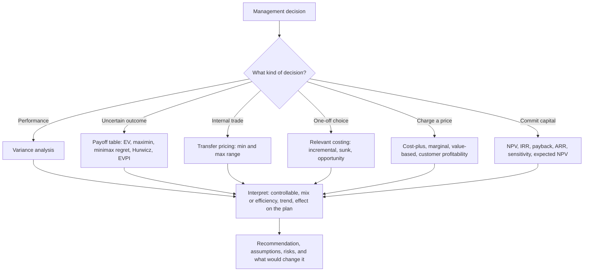

# P2 Advanced Management Accounting

P2 is one of the nine Objective Tests in the CGMA Professional Qualification and one of the three at Management Level. Each Objective Test is 90 minutes, computer-based and computer-marked, available on demand at Pearson VUE centres or online throughout the year, and AICPA & CIMA states that the items "test all component learning outcomes across the entire subject" — so the paper samples standard costing and variance analysis, decision-making under uncertainty, transfer pricing, relevant costing, and pricing and investment appraisal, rather than testing the chapter you read last night. The item formats compound it: short multiple-choice questions, number-entry questions and drag-and-drop formats, so a candidate who has only practised multiple choice loses marks on format alone.

That is also the second thing to hold on to. P2 is not the arithmetic of variance analysis that E2 introduced; it is the judgement behind the arithmetic. Every area on this syllabus has a version that is easy to compute and a version that is wrong, and the exam tests the second one. A candidate who can compute a material price variance but has not thought about whether a favourable price variance might be hiding a quality problem will score on the mechanics and lose on the interpretation.

The five syllabus areas, in the order they are usually taught:

| Area | The move it makes |
|---|---|
| Standard costing and variance analysis | What happened, compared with the plan, and what does the difference tell us? |
| Decision-making under uncertainty | What should we do when we cannot know the outcome? |
| Transfer pricing | What should it cost internally to move a product between divisions? |
| Relevant costing | Which costs actually matter for this decision? |
| Pricing and investment appraisal techniques | What should we charge, and is the investment worth making? |

### 🟢 Lite — Quick Review (1h–1d)

**V-U-T-R-P** — Variance, Uncertainty, Transfer, Relevant, Price. Five moves, five sets of formulas, five different kinds of mistake.

**The variance formulas, in one place.**

| Variance | Formula | Watch out for |
|---|---|---|
| Material price | (SP − AP) × quantity purchased | Purchased, not used — reconcile if the two differ |
| Material usage | (SQ − AQ) × SP | Mix and yield split it further |
| Labour rate | (SR − AR) × actual hours | Is the rate controllable, or is the overtime premium a policy? |
| Labour efficiency | (SH − AH) × SR | A mix change and a pure efficiency loss look identical here |
| Variable overhead expenditure | (standard rate − actual rate) × actual hours | Nil does not mean good — check the hours |
| Variable overhead efficiency | (SH − AH) × standard rate | Same trap as labour efficiency |
| Fixed overhead expenditure | budget − actual | The only fixed overhead variance that is about spending |
| Fixed overhead volume | overhead absorbed in actual output − budget | Contains both an efficiency effect and a capacity effect |
| Sales price | (SP − AP) × units sold | Was the price cut deliberate? |
| Sales volume | (actual units − budget units) × standard contribution | Not (actual units − budget units) × selling price |

**Under uncertainty.**
- Expected value is the probability-weighted average of the payoffs, and it is only as good as the probabilities.
- Maximax, maximin, minimax regret and the Hurwicz criterion are the non-probabilistic rules; each embeds a different attitude to risk.
- EVPI, the expected value of perfect information, is EV with perfect information minus EV with the best available imperfect information. It is the ceiling on what better information is worth.

**Transfer pricing.**
- Minimum transfer price = incremental cost to the supplier + opportunity cost to the supplier.
- Maximum transfer price = the buyer's net revenue less the buyer's incremental costs other than the transfer.
- A range, not a number. Negotiating inside the range is goal-congruent.
- Where there is spare capacity the opportunity cost is nil, so the minimum is the marginal cost.

**Relevant costing.**
- Relevant costs are incremental cash flows. Sunk costs are irrelevant.
- Opportunity cost is relevant even though it never appears in the cash flow statement.
- Allocated overheads are irrelevant to a decision unless they are incremental.
- The limiting factor is the scarce resource, and the decision rule is contribution per unit of that factor.

**Pricing and appraisal.**
- NPV discounts the cash flows at the cost of capital; accept if positive. It is the criterion that matches maximising shareholder wealth.
- IRR is the rate at which NPV is nil. It misleads when the cash flow pattern changes sign more than once, and when projects are of unequal size.
- Payback ignores the time value of money and everything after the payback point. It is a liquidity measure.
- ARR is accounting profit over average investment, so it ignores the time value of money and the project's risk.
- Under capital rationing, the profitability index ranks by NPV per pound invested, but only if projects are divisible — check the feasible combinations before you commit.

**Traps that catch most candidates.**

- Treating a favourable variance as good news without asking why it is favourable.
- Putting allocated fixed overheads into a relevant-cost decision.
- Setting a transfer price at cost when the supplying division could have sold the output externally.
- Ranking projects on IRR when their cash flow patterns differ.
- Using a probability you have not tested when the whole answer rests on it.
- Ignoring the behavioural effect of a standard that is set too tight.
- Choosing the project with the highest NPV when the budget is capped and the projects are indivisible.

**Memory anchors.**

- **V-U-T-R-P** — the five moves, in syllabus order.
- **Relevant = incremental.** Sunk is dead; opportunity is alive.
- **Minimum TP = incremental + opportunity.** The maximum comes from the buyer's side.
- **NPV decides; IRR explains.** IRR is a rate, and rates rank badly.
- **Favourable is not the same as good.**

**Where this tier takes you next.**

- [the Management Case Study](/notes/cima-cgma/management-level/mg-004/)
- [E2 Managing Performance](/notes/cima-cgma/management-level/mg-001/)
- [the CIMA CGMA exam hub](/exams/cima-cgma/)

### 🟡 Standard — Full Coverage (1–2d)

#### Variance analysis: computing it and reading it

**The standard cost build-up.** A standard cost is built from standard quantity and standard price for each element: materials at a standard quantity per unit at a standard rate, labour at standard hours per unit at a standard rate, variable overhead at a standard rate per standard hour of labour, and fixed overhead absorbed at a standard rate per standard hour of the activity driver. Everything else in the analysis is a comparison of what happened against this build-up.

**Worked example.** A company makes one product. The standard for each unit is: materials 4 kg at £3.00 per kg; labour 2 hours at £9.00 per hour; variable overhead £5.00 per labour hour; fixed overhead £8.00 per labour hour on 3 hours of fixed activity per unit. The standard selling price is £90. Budget output is 1,000 units, and budgeted fixed overhead is 3,000 hours × £8 = £24,000.

In the period, 1,100 units were produced and sold. Materials used were 4,300 kg at £3.15 per kg. Labour was 2,150 hours at £9.30 per hour. Variable overhead was £10,750. Fixed overhead was £27,000. All 1,100 units sold at £88.

**Standard cost of actual output:** materials 4,400 kg × £3.00 = £13,200; labour 2,200 h × £9.00 = £19,800; variable overhead 2,200 h × £5.00 = £11,000; fixed overhead 3,300 h × £8.00 = £26,400. Total **£70,400**.

**Actual cost:** materials 4,300 × £3.15 = £13,545; labour 2,150 × £9.30 = £19,995; variable overhead £10,750; fixed overhead £27,000. Total **£71,290**.

**The variances.**

| Variance | Working | Result |
|---|---|---|
| Material price | (£3.00 − £3.15) × 4,300 kg | £645 A |
| Material usage | (4,400 − 4,300) kg × £3.00 | £300 F |
| Labour rate | (£9.00 − £9.30) × 2,150 h | £645 A |
| Labour efficiency | (2,200 − 2,150) h × £9.00 | £450 F |
| Variable overhead expenditure | actual rate £5.00 = standard rate, × 2,150 h | £nil |
| Variable overhead efficiency | (2,200 − 2,150) h × £5.00 | £250 F |
| Fixed overhead expenditure | £24,000 − £27,000 | £3,000 A |
| Fixed overhead volume | £26,400 absorbed − £24,000 budgeted | £2,400 F |
| Sales price | (£90 − £88) × 1,100 | £2,200 A |
| Sales volume | (1,100 − 1,000) × £26 standard contribution | £2,600 F |

**The reconciliation to actual profit.** Budget profit was 1,000 × (£90 − £12 − £18 − £10 − £24) = £26,000. Add the sales volume variance of £2,600 F, subtract the sales price variance of £2,200 A, subtract the cost variances of £890 A in total, and the result is **£25,510**, which is the actual profit of £96,800 revenue less £71,290 cost. A candidate who cannot reproduce that reconciliation has not understood the analysis, and the number-entry items test exactly this.

**Two things the numbers do not tell you.** The fixed overhead volume variance of £2,400 favourable hides two different effects: the hours actually worked (2,150) were 50 fewer than the standard hours for the output (2,200), so overhead was over-absorbed by £400, and the total activity of 3,150 hours exceeded the budgeted 3,000 hours by 150, so more overhead was absorbed than the budget allowed. And the nil variable overhead expenditure variance is not good news on its own — it means spending per hour matched the standard, and the efficiency variance of £250 favourable is doing the work.

**Reading a variance.** Four questions turn a number into information. Is the variance **controllable** by the person whose performance it measures — a labour rate variance caused by a company-wide pay award is not the supervisor's failure? Is it a **mix** problem or an **efficiency** problem — a shift running a different product mix will show adverse labour efficiency variance with no loss of efficiency at all? Is it a **one-off** or a **trend** — one adverse material price variance is noise, three in a row is a purchasing problem? And what does it say about the **plan**: a standard that produces constant adverse usage variances is probably a standard that was set without observing the work.

**The behaviour of a standard.** A standard is a target, and targets change behaviour. Set too tight, it produces buffer creation: the manager deliberately under-uses capacity to protect the standard, and the business loses profit to hit a number. Set too loose, it stops being informative. And a standard that is used for performance evaluation changes behaviour in a way that is not always in the company's interest — which is why more than one approach has grown up around the same data.

#### Decision-making under uncertainty

When outcomes cannot be predicted with confidence, the tools change from calculation to preference.

**Expected value** multiplies each payoff by its probability and adds. It is the right tool when the probabilities are credible, and it is meaningless when they are invented, because the answer then inherits every assumption in the probabilities.

**The non-probabilistic criteria.** **Maximax** picks the option with the highest possible payoff. **Maximin** picks the option with the highest worst-case payoff. **Minimax regret** works in a second table: for each state of the world, the regret is the payoff forgone against the best option in that state; you then pick the option with the lowest worst regret. **The Hurwicz criterion** blends the best and worst payoffs with a coefficient of optimism, so an optimistic decision-maker weights the best outcome more heavily.

**Worked example.** A manufacturer must decide whether to launch a product before it knows whether a competitor will respond.

| Payoff (£000) | Competitor responds | No response |
|---|---|---|
| Launch | 20 | 80 |
| Do not launch | 50 | 30 |

The probability of a strong response is 0.4, and no response 0.6.

- EV(launch) = 0.4 × 20 + 0.6 × 80 = **£56,000**
- EV(not launch) = 0.4 × 50 + 0.6 × 30 = **£38,000**, so launch on expected value.
- Maximax: launch (best £80,000). Maximin: do not launch (worst £30,000). The two point in opposite directions, which is exactly what a risk-neutral and a risk-averse decision-maker should see.
- Minimax regret: launching risks £30,000 (if the competitor responds, forgoing the £50,000 from not launching); not launching risks £50,000 (if there is no response, forgoing the £80,000). Launch has the lower worst regret.
- Hurwicz with a coefficient of optimism of 0.7: launch scores 0.7 × 80 + 0.3 × 20 = £62,000; not launching scores 0.7 × 50 + 0.3 × 30 = £44,000. Launch.

**EVPI.** With perfect information you would take the best payoff in each state: £50,000 if the competitor responds, £80,000 if not. EV with perfect information = 0.4 × 50 + 0.6 × 80 = £68,000. EVPI = 68,000 − 56,000 = **£12,000**. That is the maximum worth paying for better information, and it is the number to quote when someone proposes buying a market research report.

#### Transfer pricing

Transfer pricing has one job: to induce the divisions to make the decisions that are best for the organisation as a whole, while still letting each division be evaluated on its own performance.

**The range, and where each end comes from.** The **minimum** the supplier will accept is its incremental cost plus its opportunity cost — what it forgoes by supplying internally instead of selling externally or using the capacity elsewhere. The **maximum** the buyer will pay is what the finished product earns less the buyer's own incremental costs other than the transfer. Any price inside the range leaves both divisions better off than the alternatives.

**Worked example.** Division A makes a component. Its variable cost is £20 per unit, it sells externally at £60 per unit and has capacity for 5,000 units with 3,000 already sold. Division B uses 2,000 units and can sell the finished product at £150, with variable costs of £95 including the component bought externally at £35.

- With spare capacity, A forgoes nothing, so the minimum transfer price is **£20**, its marginal cost.
- B's maximum is £150 less its other variable costs of £60, so **£90**.
- The range is therefore **£20 to £90**, and a price at or near the external market price of £35 leaves both divisions better off than either alternative.
- If A had no spare capacity, its opportunity cost per unit would be the contribution forgone on an external sale, £60 − £20 = £40, and the minimum transfer price would rise to **£60**.

**When no transfer price works.** If the supplying division cannot profitably transfer at any price the buyer will pay, or if the buyer's maximum is below the supplier's minimum, the organisation should not be trading internally at all. That is a real answer, and it is sometimes the correct one.

**Goal congruence.** A transfer price set at cost penalises the supplying division for its own success and rewards the buying division for its own inefficiency. A price set at market removes that distortion but ignores the genuine cost saving from internal supply. And a transfer price used for performance evaluation can make a division manager reject a transfer that would benefit the company as a whole.

#### Relevant costing

The rule is short: **only incremental cash flows are relevant**. Everything else is a distraction, however important it may be for other purposes.

- **Sunk costs are irrelevant.** Money already spent cannot be changed by the decision.
- **Opportunity cost is relevant** even though it is not a cash flow, because it is the benefit forgone.
- **Allocated overheads are irrelevant** unless they change if the decision changes.
- **Relevant revenue is the incremental revenue**, so a decision to accept a special order at a reduced price depends on whether there is spare capacity and whether the order displaces other sales.

**The classic decisions.** *Make or buy*: make if the avoidable cost of making is lower than the purchase price plus any opportunity cost. *Special order*: accept if the contribution from the order exceeds the variable cost, provided capacity is spare and no normal sales are displaced. *Sell or process further*: continue processing if the incremental revenue exceeds the incremental cost. *Product mix with a limiting factor*: rank products by contribution per unit of the scarce factor and make the mix accordingly.

#### Pricing and investment appraisal

**Pricing.** Cost-plus is the simplest: full absorption cost plus a mark-up, or marginal cost plus a mark-up. Both are weak because both ignore what the customer will pay. Marginal costing pricing is better for setting prices where variable cost is a meaningful proportion of the price, and it is the right basis for short-run pricing decisions. Customer profitability analysis, usually built on activity-based costing, is what shows you that the customer consuming most of your service capacity may be the least profitable.

**Investment appraisal.** NPV is the criterion: discount the incremental cash flows at the cost of capital and accept if the total is positive.

**Worked example.** An investment of £500,000 produces annual cash inflows of £150,000 for five years, and the cost of capital is 10%.

- NPV = −500,000 + 150,000 × 3.7908 = **£68,617 favourable**.
- IRR: the annuity factor required is 500,000 ÷ 150,000 = 3.3333, which for five years gives an IRR of about **15.3%**, comfortably above the 10% cost of capital.
- Payback = 500,000 ÷ 150,000 = **3.33 years**, which ignores both the time value of money and the £150,000 still coming after year three.
- ARR: average annual accounting profit of £50,000 over average investment of £250,000 = **4%**, a figure that looks pathetic next to the NPV and is misleading precisely because it ignores the timing and the capital charge.

**Risk.** A sensitivity analysis varies one input at a time and finds the switch values at which the decision flips; it shows how much slack the decision has, not how likely the bad case is. The expected NPV weights the outcome of each scenario by its probability, which is more informative than either the optimistic or pessimistic case alone. Monte Carlo simulation runs the model many times with randomly varying inputs and produces a distribution of outcomes rather than a single number. A risk-adjusted discount rate adds a premium for risk and is simple, but it mixes the risk into the discount rate rather than showing it, and it understates the effect of risk that is diversifiable.

**Capital rationing.** When the budget is capped, rank by the profitability index, NPV per pound invested, rather than by total NPV.

| Project | Outlay | NPV | Profitability index |
|---|---|---|---|
| A | £600,000 | £78,000 | 1.130 |
| B | £550,000 | £77,000 | 1.140 |
| C | £400,000 | £52,000 | 1.130 |

With a cap of £1,000,000, the index ranking puts B first, and B plus C costs £950,000 for £129,000 of NPV. But A plus C costs exactly £1,000,000 and gives £130,000, and B plus A is not feasible at all. Profitability index ranking assumes divisibility; with indivisible projects you must test the feasible combinations. This is the single most examinable trap in the area.

### 🔴 Deep — Mastery (3–5d)

#### The five errors that generate the wrong answer

**Variance analysis: treating favourable as good.** A favourable material price variance means the material was cheaper than standard, and the questions are why and at what cost. A cheaper input from a new supplier may be a quality problem that shows up later as adverse usage variances, warranty claims or scrap. The correct reading of a variance always includes asking what it will cost elsewhere in the system, and P2 items frequently pair a favourable price variance with an adverse usage variance to test exactly that.

**Variance analysis: ignoring the behavioural effect of the standard.** A standard set at a level the workforce believes is achievable gets treated as a target; one set beyond it gets treated as a target to negotiate. A standard used for performance evaluation creates the incentive to create slack, to under-report capacity use, and to reject work that is profitable for the business but awkward for the number. The sophisticated answer is to separate the standard used for planning and performance evaluation from the standard used for pricing and product decisions, and to use flexible budgets so that volume is not confounded with efficiency.

**Decision-making under uncertainty: importing a probability.** The most common error in a payoff-table item is not a bad multiplication. It is a probability that was never justified. Ask where the probability came from: an observed base rate, a test-market result, an expert judgement with a stated basis, or nothing. If nothing, then the expected value is a number with no evidential content, and the decision should be argued on maximin or minimax regret grounds instead, with the uncertainty stated.

**Transfer pricing: the divisional optimum that destroys company value.** The classic case is a division whose profit is maximised by a decision that is disastrous for the group, and it is worth recognising in both directions. A selling division that refuses to supply internally because the transfer price is below its external price destroys group profit when the group could have made it. A buying division that insists on buying externally at market price when internal marginal cost is far lower also destroys group profit. The transfer price exists to move both divisions towards the group optimum, and where no single price achieves that, the answer is to change the performance measurement system rather than to argue about the price.

**Investment appraisal: comparing projects with different lives, sizes or timing.** Equal lives can be compared directly. Unequal lives need an equivalent annual annuity or a replacement chain assumption. A small project and a large project compared on IRR will usually select the small one, because IRR is a percentage and percentages reward small bases. And any project whose cash flow pattern changes sign more than once — an initial outflow, an inflow, then a further outflow for a closure or a refurbishment — can produce more than one IRR, which makes the method meaningless for that project.

#### Real options and the value of flexibility

NPV assumes the decision is made once and the cash flows follow the plan. In practice many strategic decisions can be staged: you can expand, delay, abandon or switch. Each of these is an option with a value that NPV does not show.

A project with a negative NPV can still be worth doing if the option to expand later has enough value, because the option means you commit only a small amount now and learn before committing the rest. An investment with a positive NPV can be worth rejecting if the option to abandon has enough value and the downside is severe. The framework is the same every time: identify the option, identify the volatility of the underlying, identify the time in which you can exercise it, and treat the option as a real option in the appraisal. P2 items often present a negative-NPV project with an explicit option and ask whether the option changes the decision; the answer is that a project with no option is judged on NPV alone, while a project with a genuine, exercisable option is not.

#### Post-appraisal: why the numbers are right and the project still fails

The appraisal is done at the start with the best available forecasts, and the forecasts are systematically wrong in known directions. **Optimism bias** inflates the early cash flows and understates the cost overruns. **Slack and sandbagging** mean the first estimate of a cost or a schedule was padded, and the project manager is judged against the padded number, so the real performance looks good until it is too late to act. **Sunk cost escalation** means the project keeps absorbing money because it has already absorbed a lot.

Three practical responses, and they are examinable as management actions rather than as calculations: build a **post-appraisal** stage into every significant project, comparing actual cash flows with the appraisal and asking why they differ; use **real options** to stage commitment so that the early numbers are cheap to test and the expensive commitment comes after the information arrives; and manage with **sensitivity analysis and switch values** so that the trigger points for reappraisal are identified before the project starts rather than after it has gone wrong.

#### How this reaches the Case Study

The Management Case Study is human-marked, three hours, computer-based, on pre-seen material, and it assesses integrated application across the three pillars of the qualification. That means the variance analysis, the transfer price and the appraisal never arrive as clean single-topic items. They arrive as a memo from a divisional manager, a board paper with an appendix, or an email with a spreadsheet attached, and the marks are for what you recommend and why.

The move that transfers from the Objective Test to the case study is the same one that transfers from any exam question to real management: identify the decision, identify the relevant information, quantify the effect of the options, and state the recommendation with its assumptions and its risks. A candidate who writes a polished NPV calculation and stops has done a third of the job. The remaining marks are for the interpretation, the recommendation and the limitations.

#### Common mistakes

- Comparing actual cost with budget cost and calling the difference a variance, instead of comparing with the standard cost of what was actually produced.
- Computing the material price variance on quantity used and losing the reconciliation with the purchase.
- Treating the fixed overhead volume variance as a performance measure when it is mostly an activity-volume effect.
- Accepting a favourable variance as good news without asking what it costs elsewhere.
- Using a probability nobody has justified in an expected value calculation.
- Reporting EVPI without saying what information it refers to.
- Setting a minimum transfer price at full cost rather than at incremental cost plus opportunity cost.
- Omitting the buyer's maximum transfer price, and so describing a single number as the transfer price.
- Treating the capacity used as a cost when it is an opportunity cost.
- Including allocated overheads in a make-or-buy or special order decision.
- Ranking projects on IRR, or on payback, for a decision with a long time horizon.
- Using the profitability index without checking whether the projects are divisible and whether the combination is feasible.
- Forgetting that the appraisal is an estimate and that post-appraisal and switch values are part of the job.

> ⚠️ **Examiner Trap.** P2 items frequently present a textbook-looking calculation whose answer is correct arithmetic and wrong management. A favourable price variance with an adverse usage variance alongside it, a transfer price set at cost where there is an external market, and a project with a negative NPV but a genuine option to expand all appear in the syllabus with the same shape: the number works and the decision is wrong. The marks are in the interpretation.

#### Memory anchors

- **V-U-T-R-P** — variance, uncertainty, transfer, relevant, price and appraisal. The five moves in syllabus order.
- **Variance = actual against the standard for what was produced**, not against the budget.
- **Controllable, mix or efficiency, one-off or trend, what it says about the plan** — the four questions behind every variance.
- **Minimum transfer price = incremental plus opportunity; maximum comes from the buyer.**
- **Relevant means incremental.** Sunk is dead, opportunity is alive, allocations are usually dead.
- **NPV decides; IRR explains; payback measures liquidity; ARR measures accounting profit.** They answer different questions and are not interchangeable.
- **Divisibility before the profitability index.** Then test the feasible combinations.

#### ⚡ Quick Exam Checklist

- Standard cost built from standard quantity and price for each element
- Variances computed against the standard cost of actual output
- Material price variance on quantity purchased, and the purchase-versus-usage reconciliation understood
- Labour efficiency variance interrogated for mix before being called inefficiency
- Fixed overhead split into expenditure and volume, and the volume variance understood as efficiency plus capacity
- Sales volume variance on standard contribution, not on selling price
- Every variance tested for controllability, cause, trend and effect on the plan
- Expected value used only with probabilities that have a stated basis
- Maximax, maximin, minimax regret and Hurwicz each applied with the right attitude to risk
- EVPI computed as EV with perfect information minus EV with the best imperfect information
- Minimum transfer price as incremental cost plus opportunity cost
- Maximum transfer price derived from the buyer's net revenue less its other incremental costs
- Transfer price presented as a range inside which both divisions benefit
- Relevant costs identified as incremental cash flows, with sunk and allocated costs excluded
- Opportunity cost included even though it is not a cash flow
- Limiting factor identified before any product mix decision
- NPV used as the decision criterion, with the cash flows discounted at the cost of capital
- IRR cross-checked for non-conventional cash flows and for projects of different sizes
- Payback used only as a liquidity measure
- Capital rationing: profitability index ranking checked for divisibility and for feasible combinations
- Risk handled with sensitivity analysis, expected NPV or simulation rather than a single point estimate
- Real options recognised where the decision can be staged, expanded, delayed or abandoned
- Post-appraisal and switch values included in the recommendation
- Item format handled on its own terms: number-entry answered with the unit and rounding asked for, drag-and-drop read as a set of pairings

**Where this tier takes you next.**

- [the Management Case Study](/notes/cima-cgma/management-level/mg-004/)
- [E2 Managing Performance](/notes/cima-cgma/management-level/mg-001/)
- [a one-day sprint over the highest-weight topics](/roadmap/?exam=cima-cgma&duration=1d)

## Internal links

- [CIMA CGMA exam hub](/exams/cima-cgma/) — the nine Objective Tests, the three Case Studies, the four annual windows and the tiered fees.
- [E2 Managing Performance](/notes/cima-cgma/management-level/mg-001/) — the performance measurement and decision support that P2 takes into variance analysis, transfer pricing and appraisal.
- [P1 Management Accounting](/notes/cima-cgma/operational-level/op-002/) — the cost behaviour, absorption and marginal costing and budget variances that P2 assumes you already own.
- [F2 Advanced Financial Reporting](/notes/cima-cgma/management-level/) — where the reported numbers behind every variance and appraisal figure are taken apart.
- [Management Case Study](/notes/cima-cgma/management-level/mg-004/) — the three-hour paper that turns this module into applied judgement.

The assessment facts stated here — the nine Objective Tests of 90 minutes each, the mixed item formats including number-entry and drag-and-drop, the provisional result within the session confirmed in the profile within 48 hours, the requirement that items test all component learning outcomes across the entire subject, the three-hour human-marked Case Study on pre-seen material, and the three years of verified relevant professional experience required for the designation — come from AICPA & CIMA's own CGMA Exams page (https://www.aicpa-cima.com/resources/landing/exams) and the CGMA Professional Qualification syllabus, as recorded in this exam's data file and retrieved on 24 October 2026. AICPA & CIMA publishes no per-topic weightage for P2; the weight on this page is StudyRoadmap's own prioritisation. All figures in the worked examples are illustrative.

---

## Continue your study

- **[View this topic in your CIMA CGMA (Chartered Global Management Accountant) roadmap](/roadmap/?exam=cima-cgma&duration=1mo)** — see where this topic sits in your personalised plan
- **[Build a quick revision plan](/roadmap/?exam=cima-cgma&duration=1d)** — 1-day sprint covering the highest-weight topics
- **[CIMA CGMA (Chartered Global Management Accountant) exam overview](/exams/cima-cgma/)** — pattern, eligibility, and syllabus
- **[All Management Level notes](/notes/cima-cgma/management-level/)** — browse sibling topics in this subject
