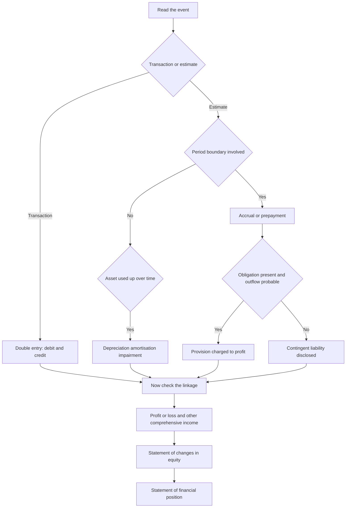

# F1 Financial Reporting

F1 is one of nine Objective Tests in the CGMA Professional Qualification, and one of the three that sit at Operational Level alongside E1 Managing Finance in a Digital World and P1 Management Accounting. Each Objective Test is 90 minutes, computer-based and computer-marked, available on demand at Pearson VUE centres or online throughout the year, and AICPA & CIMA states that the items "test all component learning outcomes across the entire subject" — a short multiple-choice question and a drag-and-drop item, drawing on every part of the syllabus rather than on the chapter you have just read.

That has one practical consequence: breadth pays. A candidate who has covered every part of F1 thinly will outscore one who has mastered two parts, because the paper samples across all of it rather than testing the chapter you have just finished. The item formats compound this. AICPA & CIMA lists short multiple-choice questions, number-entry questions and drag-and-drop formats among the Objective Test items, so a candidate who has only practised multiple choice loses marks on format alone.

F1's territory is the reporting half of Operational Level: the conceptual framework and accounting standards, the primary statements and their linkage, double-entry bookkeeping, and the adjustments that produce a statutory result. Those four headings are also the four ways a question can be built, and every item you meet is a rearrangement of them. The underlying skills are old-fashioned and durable — if you can say what a number is, where it belongs and what makes it move, you can answer most of the paper.

### 🟢 Lite — Quick Review (1h–1d)

**Every F1 item is one of four moves.** Recognition, measurement, allocation, linkage. Decide which move the stem is making before you read the options, because the same fact is the answer in one move and a distractor in another.

**Memory hook — R-M-A-L.**
- **R** — Recognition: has the event happened, and does it meet the definition of the item?
- **M** — Measurement: at what amount is it carried?
- **A** — Allocation: which reporting period does it belong to?
- **L** — Linkage: where does it appear, and which other figure must it agree with?

| The stem asks | The answer lives in |
|---|---|
| "Has this been earned yet?" | The recognition criteria, and the accrual basis of accounting |
| "At what amount is it carried?" | The measurement basis for that item |
| "Which period does it belong to?" | Cut-off, and the allocation of income and expenditure |
| "Does this hit profit or other comprehensive income?" | The classification of gains and losses |
| "Does this figure appear somewhere else?" | The linkage between the primary statements |
| "What is the effect on cash?" | The classification of operating, investing and financing flows |

**Facts worth a mark each.**
- The accounting equation holds after every transaction: assets equal liabilities plus equity.
- A trial balance balances by construction, so a balancing trial balance proves arithmetic, not correctness.
- Accrual accounting recognises income when it is earned and expenditure when it is incurred, not when cash moves.
- Closing equity on the statement of financial position equals closing equity on the statement of changes in equity.
- Total comprehensive income is profit or loss plus other comprehensive income.
- Depreciation allocates the depreciable amount — cost less residual value — across the periods in which the asset is used.
- An adjusting entry never touches cash.
- A provision is recognised when there is a present obligation, a probable outflow and a reliable estimate; a contingent liability is disclosed instead.
- Prior period errors are corrected retrospectively, and the comparative figures are restated.
- The notes are part of the financial statements, not an appendix to them.

**The traps that catch most candidates.**
- Treating the trial balance as proof that the reported result is right.
- Posting an adjustment to cash.
- Confusing an accrued income, which is an asset, with a bill receivable, which is a liability.
- Recognising revenue because cash was received.
- Leaving depreciation out because the asset was paid for in an earlier period.
- Calling a contingent liability a provision, or the other way round.
- Forgetting that closing equity must agree across two statements.
- Adding depreciation back when deriving operating cash flow but omitting the cash spent on the asset, which belongs in investing activities.

**Where this tier takes you next.**
- [the other topics in this level](/notes/cima-cgma/operational-level/)
- [where this topic sits in a month-long plan](/roadmap/?exam=cima-cgma&duration=1mo)

### 🟡 Standard — Regular Study (2d–2mo)

> The working understanding — where the numbers come from, and why each answer is right.

**The four headings in the syllabus are the four ways an item is built**

| Heading in the syllabus | The question it answers | Typical item |
|---|---|---|
| Conceptual framework and accounting standards | What is this, and what must be true for it to be in the accounts? | Definition and recognition items |
| The primary statements and their linkage | Where does it go, and what must it agree with? | Presentation and cross-statement items |
| Double-entry bookkeeping | Which accounts move, and in which direction? | Debit, credit and trial balance items |
| The adjustments that produce a statutory result | What has to be corrected before a result is reported? | Accrual, depreciation, inventory and provision items |

#### The conceptual framework: what a number must be before it is a number

A balance only goes on a statement of financial position if it meets the definition of an asset — a resource controlled by the entity as a result of past events, from which future economic benefits are expected to flow — or a liability, a present obligation arising from past events that will require an outflow of resources where the amount can be measured reliably. Anything that is neither is equity.

Two framework concepts do most of the work. Prudence means judgements are applied with caution, but it does not permit deliberate understatement of income or assets, nor deliberate overstatement of liabilities or expenses; it constrains judgement, it is not a licence to cook the result. Materiality asks whether information could change the decisions of a reasonable user: if it could, it cannot be omitted or misstated, and if it could not, it can be summarised.

The accrual basis is the framework's practical engine — income and expenditure are recognised when they are earned and incurred, not when cash is received or paid. Almost every adjustment in F1 exists to enforce that one sentence.

#### The primary statements and the rule that links them

Four statements, plus the notes: the statement of financial position, the statement of profit or loss and other comprehensive income, the statement of changes in equity, and the statement of cash flows.

The linkage rule is the one that earns marks: closing equity on the statement of financial position must equal closing equity on the statement of changes in equity. Everything else follows from that agreement.

- Profit or loss for the period comes from the income statement and flows into the statement of changes in equity, and from there into the balance sheet's retained earnings.
- Total comprehensive income is profit or loss plus other comprehensive income, and it is total comprehensive income, not just profit, that moves the equity roll-forward.
- Closing cash and cash equivalents on the cash flow statement must equal the cash figure on the statement of financial position.
- The balance sheet separates non-current from current items, and current assets are ordered by how quickly they convert to cash, because that statement is read for liquidity.

A common item asks you to trace an error through the statements. If depreciation is understated, profit is overstated, the carrying amount of the asset is overstated, and retained earnings at the closing date is overstated. One error appears in several places, and finding all of them is the mark.

#### Double entry: the machinery that produces the trial balance

Every transaction carries a debit and an equal and opposite credit. Debit and credit are not "bad" and "good", and not "decrease" and "increase" — they are the left and the right of an account. Debits increase assets, expenses and drawings; credits increase liabilities, equity and income. The trial balance is the list of balances that results, and it balances because double entry works, which is exactly why a balancing trial balance proves only that the arithmetic is right and not that the treatment is.

The classic traps in this area are directional. Revenue received in advance is a credit to a liability, not income. An accrued income is a debit to receivables and a credit to revenue. Depreciation is a debit to depreciation expense and a credit to accumulated depreciation, which is a contra-asset shown alongside the asset rather than an expense on the face of the income statement. A purchase of inventory on credit is a debit to inventory and a credit to trade payables, with no effect on profit until that inventory is sold.

#### The adjustments: where a statutory result differs from a ledger

The ledger records transactions as they were recorded; the statutory result requires them recorded as they should be. The adjustment families are accruals and prepayments; depreciation, amortisation and impairment; inventory; provisions and contingent liabilities; tax; foreign currency; and post balance sheet events. Each family exists to enforce the accrual basis or a recognition rule, and each has a defined home on a specific statement.

| Adjustment family | The question it answers | Where it lands |
|---|---|---|
| Accrual / prepayment | Was it earned, or was it paid for? | Revenue or expenditure, and a receivable or a prepayment |
| Depreciation, amortisation, impairment | How much of the asset has been used or lost? | Expense in profit, contra-asset on the balance sheet |
| Inventory | What is still on hand, and at what amount? | Closing inventory and cost of sales |
| Provision / contingent liability | Is there an obligation now, and is the estimate reliable? | Provision and expense, or disclosure only |
| Tax | What is the current charge, and what are the timing differences? | Tax expense, tax payable, deferred tax |
| Foreign currency | Which rate applies to which transaction? | Exchange differences, normally in profit or loss |
| Post balance sheet events | Does the event give evidence about the reporting period? | Adjustment, or disclosure only |

**Worked example 1 — cut-off, and which number moves.** A company delivers services in one period and invoices the customer in the next. Recognition says the revenue is earned in the period of delivery, not the period of invoice. So the period being reported needs an accrued income: debit receivables, credit revenue. The invoice arriving next period is then not income at all — it settles a receivable already recognised. The trap in a drag-and-drop item is the pairing that says the next period's invoice increases that period's revenue; recognising it twice overstates revenue in total, and that is the error a reader of the statements would catch.

**Worked example 2 — the inventory error that reverses.** If closing inventory is overstated, profit in the period is overstated because cost of sales is understated; when that stock is sold in the next period, cost of sales is overstated there, and the error self-corrects across the two periods. That is why an inventory error is qualitatively different from most others: it reverses, and it reverses because the cost of the goods sits in inventory rather than in an expense. Write the direction down — profit overstates now and understates later, never twice in the same direction.

**Worked example 3 — the adjustment that never moves cash.** Depreciation is the clearest case. Nothing leaves the bank account, so there is no cash flow to report; the charge reduces profit and reduces the carrying amount of the asset, and accumulated depreciation grows on the balance sheet. It is also the most commonly misread line in the cash flow statement, because the indirect method starts from profit and adds back the non-cash charge. That add-back is not a receipt, and the cash spent on the asset belongs in investing activities.

**Worked example 4 — provision against contingent liability.** The test is not "is this likely to happen" but "is there a present obligation, is an outflow probable, and can the amount be measured reliably". If all three hold, recognise a provision and charge the expense. If the obligation is only possible rather than probable, or if the amount cannot be measured reliably, it is a contingent liability and it is disclosed rather than recognised. Items test the word "probable" specifically, because that is exactly where the two treatments diverge.

**Why these answers are right.** Each worked example is the same argument in different clothing: identify the event, identify the measurement basis, decide the period, then place the number. Recognition comes first, because a number that should not be on the statement cannot be rescued by any later adjustment. Measurement errors can be corrected, allocation errors can be corrected, and a misclassification between profit and other comprehensive income can be corrected — but recognition is the gate. When an item feels ambiguous, ask whether it is really about recognition, and the rest usually falls out.

**Where this tier takes you next.**
- [the other topics in this level](/notes/cima-cgma/operational-level/)
- [where this topic sits in a month-long plan](/roadmap/?exam=cima-cgma&duration=1mo)

### 🔴 Extended — Deep Study (3mo+)

#### The adjustment map: one question, one adjustment

#### The linkage, drawn

| Statement | Carries forward | Must agree with |
|---|---|---|
| Statement of profit or loss and other comprehensive income | Total comprehensive income | Statement of changes in equity |
| Statement of changes in equity | Closing equity | Closing equity on the statement of financial position |
| Statement of cash flows | Closing cash and cash equivalents | Cash and cash equivalents on the statement of financial position |
| Statement of financial position | Closing equity | Statement of changes in equity |
| Notes | The detail behind every line | The face of the statements |

#### Edge cases that separate a correct answer from a safe one

- **Revenue before the obligation is satisfied.** If the entity has been paid but has not yet performed, the receipt is a contract liability, not revenue. Recognition of revenue follows performance, not payment.
- **Accrued income against bills receivable.** An accrued income is an asset — earned and unbilled. An advance from a customer is a liability — cash received before performance. They are opposites, and an item that flips them is testing the accrual basis directly.
- **Depreciation on the wrong base.** The charge is the depreciable amount, which is cost less residual value, spread over the useful life, and it is allocated to the parts of the asset that consume the benefits where those parts can be measured reliably.
- **Impairment against recoverable amount.** Where an asset's carrying amount exceeds its recoverable amount — the higher of fair value less costs of disposal and value in use — it is written down. Writing down to fair value alone is the classic wrong answer.
- **Inventory below cost.** Where net realisable value falls below cost, the difference is recognised as an expense immediately, not held back as a reserve for later, and it may reverse when net realisable value recovers.
- **Warranties and refunds.** These are estimates of the cost of an obligation on goods already sold, so they are provisions charged in the period of the sale.
- **Post balance sheet events.** An event that provides evidence about conditions existing at the end of the reporting period is adjusting; an event arising after the period is non-adjusting and is disclosed rather than recognised.
- **Tax.** Current tax is the charge for the period; deferred tax arises from temporary differences between the carrying amount of an asset or liability and its tax base, and it moves with the temporary difference rather than with the cash tax paid.
- **Prior period error against a change in policy.** Both are applied retrospectively where practicable — the comparatives are restated for an error, and a change in policy is applied across the periods presented.

#### Errors, policies, and the retrospective question

An error is an omission or misstatement of an amount that was issued. A change in policy is a change in the accounting treatment adopted, and the general rule is retrospective application. Examiners like this distinction because the trap is the candidate who answers "errors are restated, policies are prospective" — a rule that belonged to an earlier standard and is not the answer now. The test to apply is what the statement of financial position looked like at the start of the comparative period, and whether reported performance for that period has changed.

#### Memory anchors you can hold under time pressure

- **R-M-A-L** — Recognition, Measurement, Allocation, Linkage. The four moves every item makes.
- **The provision test — present, probable, precise.** Present obligation, probable outflow, reliable estimate. Miss any one and you have a contingent liability, not a provision.
- **Accrued income, bill receivable, prepayment, trade payable.** The first pair is timing differences in opposite directions; the second pair is cash in and cash out before the goods or services move.
- **Depreciation never touches cash.** A non-cash charge, a contra-asset, added back in the operating section and then corrected for the capital spend in investing.
- **Equity ties out.** Closing equity on the statement of financial position equals closing equity on the statement of changes in equity. Find one closing figure in an item and go and check the other.
- **The inventory reversal rule.** Overstated closing inventory overstates profit now and understates it later — never twice the same way.

#### ⚡ Quick Exam Checklist

- Balance sheet items identified by definition before any adjustment is attempted
- Accrual basis applied consistently: earned and incurred, not paid and received
- Debit and credit directions checked on the individual account, not on the transaction as a whole
- Trial balance treated as proof of arithmetic only
- Adjustments never posted to cash
- Depreciation based on the depreciable amount over the useful life, with accumulated depreciation presented as a contra-asset
- Inventory at the lower of cost and net realisable value, and the reversal rule remembered
- Provision separated from contingent liability on present obligation, probable outflow and reliable estimate
- Profit separated from other comprehensive income before the equity roll-forward is built
- Closing equity agreed across the statement of financial position and the statement of changes in equity
- Closing cash agreed with the cash flow statement
- Notes treated as part of the financial statements rather than as an appendix
- Number-entry items answered with the unit and the rounding convention the question asked for
- Drag-and-drop items read as a set of pairings rather than as isolated definitions

#### Common mistakes

- Believing a balancing trial balance proves the reported result is right.
- Treating cash received as revenue received.
- Recognising revenue before the performance obligation is satisfied, or recognising it twice across the cut-off.
- Posting depreciation to an expense account and a cash account rather than to accumulated depreciation.
- Calling a contingent liability a provision, and the reverse.
- Using profit rather than total comprehensive income in the equity roll-forward.
- Forgetting that the closing statement of financial position must agree with the closing statement of changes in equity.
- Treating a prior period error as though it were a change in accounting policy.

**Where this tier takes you next.**
- [the Operational Case Study](/notes/cima-cgma/operational-level/) — where this material is applied on pre-seen material rather than recalled
- [a one-day sprint over the highest-weight topics](/roadmap/?exam=cima-cgma&duration=1d)

## Internal links

- [CIMA CGMA exam hub](/exams/cima-cgma/) — the nine Objective Tests, the three Case Studies, the four annual windows and the tiered fees.
- [P1 Management Accounting](/notes/cima-cgma/operational-level/) — the costing module that shares the Operational Level papers.
- [E1 Managing Finance in a Digital World](/notes/cima-cgma/operational-level/) — the third Operational Level Objective Test.
- [F2 Advanced Financial Reporting](/notes/cima-cgma/management-level/) — where the reporting material is taken further.

The assessment facts stated here — the nine Objective Tests of 90 minutes each, the three Case Study Examinations of three hours each, the mixed item formats including number-entry and drag-and-drop, the provisional result within the session confirmed in the profile within 48 hours, and the requirement that items test all component learning outcomes across the entire subject — come from AICPA & CIMA's own CGMA Exams page (https://www.aicpa-cima.com/resources/landing/exams) and the CGMA Professional Qualification syllabus, as recorded in this exam's data file and retrieved on 9 October 2026. AICPA & CIMA publishes no per-topic weightage for F1; the weight on this page is StudyRoadmap's own prioritisation.

---

## Continue your study

- **[View this topic in your CIMA CGMA (Chartered Global Management Accountant) roadmap](/roadmap/?exam=cima-cgma&duration=1mo)** — see where this topic sits in your personalised plan
- **[Build a quick revision plan](/roadmap/?exam=cima-cgma&duration=1d)** — 1-day sprint covering the highest-weight topics
- **[CIMA CGMA (Chartered Global Management Accountant) exam overview](/exams/cima-cgma/)** — pattern, eligibility, and syllabus
- **[All Operational Level notes](/notes/cima-cgma/operational-level/)** — browse sibling topics in this subject
