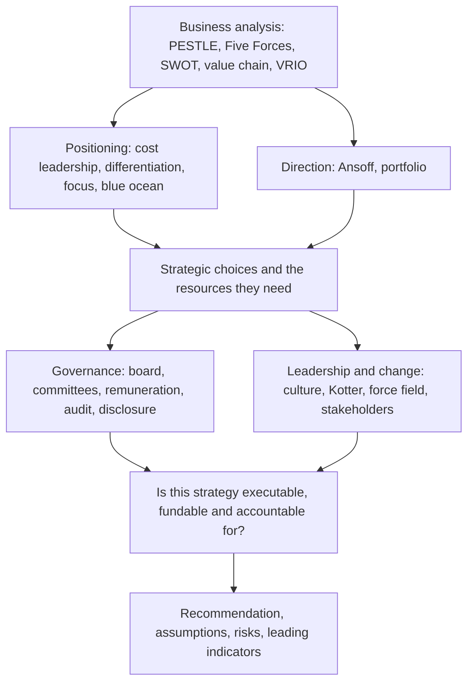

# E3 Strategic Management

E3 Strategic Management is one of the nine Objective Tests in the CGMA Professional Qualification, and the first of the three that sit at Strategic Level. Each Objective Test is 90 minutes, computer-based and computer-marked, available on demand at Pearson VUE centres or online throughout the year, and AICPA & CIMA states that the items "test all component learning outcomes across the entire subject" — so the paper samples business analysis and the strategic environment, corporate governance and ethics, strategic positioning and competitive advantage, and the leadership and change skills the module assesses, rather than testing the chapter you read last night. The item formats compound it: short multiple-choice questions, number-entry questions and drag-and-drop formats, so a candidate who has only practised multiple choice loses marks on format alone.

What makes Strategic Level different is the level of question. Operational and Management Level ask what the numbers say and what to do with them. Strategic Level asks why the organisation exists, who is supposed to hold it to account, where it should compete, and whether it can actually change anything. The marks sit in the argument: the candidate who applies a framework accurately but cannot connect it to a decision will lose them.

The module also has a hard deadline attached to it in a way the earlier levels do not. Passing all three papers does not confer the designation: the CGMA additionally requires three years of verified relevant professional experience, assessed through CIMA's Practical Experience Requirements process. Strategic Level is where the case studies that carry that assessment sit, and the judgement they test is exactly what E3 teaches.

### 🟢 Lite — Quick Review (1h–1d)

**The four questions of E3, in order.** Each syllabus area is one question, and every item belongs to one of them.

| Area | The question | The frameworks that answer it |
|---|---|---|
| Business analysis and the strategic environment | Where are we, and what is changing around us? | PESTLE, Porter's Five Forces, SWOT, the value chain, VRIO |
| Corporate governance and ethics | Who holds the organisation to account, and how should it behave? | Agency theory, board and committee structures, ethical frameworks |
| Strategic positioning and competitive advantage | Where should we compete, and how do we win? | Cost leadership, differentiation, focus, strategic groups, blue ocean, Ansoff |
| Leadership and change | How do we make any of this happen? | Lewin, Kotter, force-field analysis, stakeholder mapping, culture |

**The frameworks, one line each.**

- **PESTLE** — the macro environment: political, economic, social, technological, legal, environmental. Use it to find the pressure, not to fill six boxes.
- **Five Forces** — rivalry, new entrants, buyers, suppliers, substitutes. The forces set the profitability of the industry, and they are diagnosed from evidence, not assumed.
- **SWOT** — internal strengths and weaknesses against external opportunities and threats. Keep the two halves apart; the commonest error is putting an internal weakness in the opportunity box.
- **Value chain** — primary activities (inbound logistics, operations, outbound logistics, marketing and sales, service) and support activities (infrastructure, human resources, technology development, procurement), used to find where margin is made and lost.
- **VRIO** — is a resource valuable, rare, inimitable, and organised to be exploited? A resource that is valuable and rare but not inimitable will be competed away.
- **Ansoff** — market penetration, product development, market development, diversification, in that order of increasing risk.
- **Generic strategies** — cost leadership, differentiation, or focus; being in the middle is a position, not a strategy.
- **BCG matrix** — cash generation and cash use by market growth and relative market share; useful as a portfolio view, dangerous as a single-product view.

**Governance in five points.** The core problem is agency: managers control the organisation but do not own it, so the governance system exists to control the opportunity to diverge from the owners' interests. The mechanisms are a board with independent non-executive directors, an audit committee, a remuneration structure aligned with long-term value, external audit, and disclosure. The board's role is strategic and supervisory; the executive runs the business; the audit committee's role is financial reporting, internal controls and the external auditor.

**Ethics in three steps.** Identify the stakeholders and the alternatives; test the alternatives against the principles you are bound by (the law, the professional code, and your own duty of competence and integrity); and take the action that is defensible to yourself and disclosable to others.

**Change in three stages.** Lewin's unfreeze, change, refreeze. Kotter's sequence adds the practical detail: urgency, coalition, vision, communication, obstacles removed, early wins, acceleration, institutionalisation.

**Traps that catch most candidates.**

- Writing a SWOT where the opportunities are things the organisation should do rather than things outside it.
- Listing the five forces without diagnosing any of them.
- Using Ansoff without saying which quadrant and what risk it carries.
- Confusing corporate governance with management: governance is the framework of accountability, not the running of the business.
- Describing an ethics failure as a failure of character rather than as a control failure that a stronger system would have caught.
- Treating culture as something to change by announcement.
- Producing a strategy that lists frameworks without a single point where the organisation is actually different from its rivals.

**Memory anchors.**

- **The four Ws** — Where are we, Who governs, Where do we play, How do we change.
- **SWOT: S and W inside, O and T outside.**
- **VRIO: value, rare, inimitable, organised.**
- **Porter: cost leadership, differentiation, focus, and the trap of the middle.**
- **Agency: control the opportunity to diverge.**
- **Lewin: unfreeze, change, refreeze.**
- **Governance is the framework; management is the business.**

**Where this tier takes you next.**

- [the Strategic Case Study](/notes/cima-cgma/strategic-level/)
- [P3 Risk Management](/notes/cima-cgma/strategic-level/)
- [the CIMA CGMA exam hub](/exams/cima-cgma/)

### 🟡 Standard — Full Coverage (1–2d)

#### Business analysis and the strategic environment

**The macro environment (PESTLE).** A useful PESTLE analysis identifies a small number of *pressures* and says what each one does to the organisation's options, rather than listing every factor. An item usually turns on one pressure with a clear direction: a tariff change, a change in interest rates, a data protection regulation, an energy price, a demographic shift. The discipline is to state the pressure, then the mechanism, then the strategic response. "Interest rates may rise" is an observation; "rising rates raise the cost of debt on floating-rate facilities, which reduces the tolerance for a long payback project" is an analysis.

**Industry analysis (Five Forces).** The forces determine how much profit the industry can generate in the long run, and they have to be diagnosed.

| Force | Diagnose it by asking |
|---|---|
| Rivalry | Is there a large number of competitors, is growth slow, are fixed costs high, are products easily differentiated, and are exit barriers high? |
| Threat of new entrants | How much capital, regulation, brand and distribution are needed to get in? |
| Bargaining power of buyers | Are buyers concentrated, price-sensitive, well informed, and able to switch? |
| Bargaining power of suppliers | Are suppliers concentrated, and is the input scarce or switching costly? |
| Threat of substitutes | Are there alternative products or services that solve the same customer need? |

The payoff of the analysis is not the diagram. It is the implication: forces that are strong squeeze profit, so the strategic response is either to change the forces — differentiate so the industry becomes less price-competitive, or build a cost advantage — or to move to a more attractive position.

**Internal analysis.** The value chain finds where margin is created and destroyed, and it is the most useful tool for a cost-leadership agenda because it says which activities to attack. The resource-based view asks the opposite question: not what does the industry look like, but what does this organisation have that competitors cannot copy. **VRIO** is the test — a resource that is **v**alable, **r**are, **i**nimitable and **o**rganised to exploit is a source of sustained advantage. Drop any letter and the advantage weakens: rare but not valuable is irrelevant, valuable but common is a commodity, and valuable and rare but not organised is a missed opportunity.

**SWOT.** Keep the halves apart, because the discipline is the point. Strengths and weaknesses are internal capabilities measured against the competition; opportunities and threats are external conditions. The most useful output of a SWOT is not the four lists but the **crosses**: the strengths that let the organisation exploit an opportunity, and the weaknesses that expose it to a threat.

**Direction (Ansoff and the BCG matrix).** Ansoff gives four routes with a rising risk gradient: market penetration (existing products, existing markets — the safest), product development, market development, and diversification (new products, new markets — the most dangerous and the one most often chosen by management who want to look ambitious). Diversification is only sensible where the organisation has something transferable, and the classic failure is the conglomerate that diversifies out of a strength it has already lost.

#### Corporate governance and ethics

**The agency problem.** Managers control the organisation without bearing the consequences of their decisions, so wherever their interests diverge from the owners', some control is needed. The mechanisms are a board of directors with independent non-executive members, board committees — particularly audit and remuneration — a remuneration structure that rewards long-term value rather than short-term results, external audit, internal control systems, and disclosure to the market. Governance is a framework of accountability, not a synonym for management.

**The board and the executive.** The board sets strategy, monitors performance, provides succession planning and holds the executive to account. The executive manages the business day to day. The chairman leads the board; the chief executive runs the company; combining the two roles removes the strongest single check on the chief executive, which is why the separation is a recurring governance theme. The audit committee's responsibilities are financial reporting, internal controls and the external audit relationship, and it is where the independence that the board as a whole lacks is concentrated.

**Governance failure.** The anatomy is recognisable: information that reached no one, a board that did not ask the question, remuneration that paid for the outcome that was reported, an audit relationship that was too comfortable, and a warning that was raised and not heard. Where you are asked to diagnose a governance failure in a case study, look for the missing information and the misaligned incentive, not for a villain.

**Ethics.** The professional frameworks in place are the law, the regulator's rules, the professional body's code of conduct, and the organisation's own policies, in that order of authority. CIMA requires its members to comply with a professional code, and the code is the reference point for the items that test professional judgement. A workable decision sequence: identify the stakeholders and who will be affected; list the alternatives; test each against the code, the law and the duty of competence and integrity; consider the consequences and how the decision would be explained if it became public; act, and document the reasoning.

#### Strategic positioning and competitive advantage

**Cost leadership, differentiation and focus.** Cost leadership wins on cost and loses on differentiation; differentiation wins on uniqueness and loses on cost; focus wins by serving a segment very well and loses if the segment's needs change or the segment is too small to carry the fixed costs. Being in the middle is the classic error, and it is not resolved by "being a bit of both".

**Strategic groups.** Plotting competitors on the dimensions they compete on shows the industry as clusters rather than a list, and identifies **mobility barriers** — the reasons a firm cannot move from one position to another, such as scale, brand, distribution or accumulated learning.

**Blue ocean.** The alternative to competing in a crowded space is to create uncontested space through value innovation: raise buyer value while reducing cost, simultaneously rather than by trading one against the other. The tool associated with it is the three-fours grid, which asks what an industry takes for granted and what it costs the customer, and the test of a blue ocean strategy is whether it creates new demand rather than taking share from rivals.

**International strategy.** The grid that organises the whole area is global standardisation against local responsiveness: how much must be common worldwide, and how much must be adapted locally. The entry modes, in increasing commitment and control: indirect or direct export, licensing or franchising, joint venture, and wholly owned subsidiary by acquisition or greenfield. The trade-off is risk against control, and the choice is often driven by how much the strategy depends on local knowledge and relationships.

#### Leadership and change

**Culture.** Organisational culture has three layers: the artefacts that are visible, the espoused values that are stated, and the basic underlying assumptions that are usually unstated. You change artefacts easily and assumptions hardly at all, which is why a rebrand that nobody behaves differently has changed nothing. National culture matters too: the dimensions that are usually examined are power distance, individualism, uncertainty avoidance, masculinity and long-term orientation, and each predicts how differently a strategy is likely to be interpreted in different parts of an international organisation.

**Change models.** Lewin's unfreeze, change, refreeze remains the basic sequence. Kotter's is the practical one: create urgency, build a guiding coalition, create and communicate a vision, remove obstacles, create short-term wins, sustain acceleration, and institutionalise the change. Force-field analysis identifies the driving forces pushing for change and the restraining forces pushing against it, and a change plan that ignores the restraining forces is a plan that will be blocked by them. Stakeholder mapping with power and interest tells you who to involve and who to manage.

**Resistance** is rarely irrational. It comes from loss of status, loss of a job, loss of a skill, or a belief that the change will not work, and each has a different answer: involvement in the design, retraining, redeployment, and evidence.

### 🔴 Deep — Mastery (3–5d)

#### Strategy is a chain, not a set of frameworks

The single most common failure in a Strategic Level answer is a set of analyses that do not connect. The chain that connects them is:

**Where are we** (business analysis) → **where could we be** (positioning and direction) → **how do we get there** (the strategic choices) → **how do we make it happen** (leadership, change, governance and ethics).

Every framework belongs at a point on the chain, and the question for each is what it feeds. A Five Forces analysis that does not change a strategic choice is decoration. An Ansoff choice that is not tested against capability, funding and the governance structure is a wish. Governance and ethics are not a separate appendix: they determine whether a strategy can be executed at all, since a strategy that cannot be approved, financed or staffed is not a strategy.

**How to write it in a case.** Situation in two sentences, including the constraint that actually binds. Then the analysis in the order of the chain. Then two or three options with the reasoning for each, the numbers where the numbers exist. Then a recommendation with its assumptions stated. Then the risks and the leading indicator you would watch. Then the governance and change implications, because the case studies reward a candidate who notices that the strategy depends on a board decision or a cultural change, and penalise one who notices nothing.

#### Diagnosing Five Forces properly

The forces are not scored; they are diagnosed from evidence in the case, and the evidence differs by industry.

**A supermarket.** Buyer power is high because a small share of customers generates most of the volume and switching is trivial; supplier power is low because most categories can be sourced from many suppliers; rivalry is intense because products are barely differentiated and the cost of switching for the customer is almost nothing; new entry is easy in a small format but scale economies make national entry hard; substitutes exist in convenience stores, online delivery and eating out. The strategic implication is that the business competes on cost and location, and that any differentiation must be visible on the shelf.

**A specialist pharmaceutical.** Rivalry is limited by patents and regulatory barriers; new entry is extremely difficult because of trials and approval; supplier power depends on whether the key ingredient has few sources; buyer power is high because a small number of payers negotiate hard; substitutes are slow to arrive because of approval timelines. The strategic implication is that the returns come from the pipeline, and the strategy is about research and regulatory execution rather than cost.

The point of the second example is not the forces themselves but the reasoning: the same framework produces a completely different strategic answer depending on the evidence, and an item that gives you industry facts and expects a framework-driven conclusion is testing the diagnosis, not the list.

#### The anatomy of a governance failure

When you are asked to identify what went wrong in a governance scenario, work through four layers in order.

**Information.** Was the information available to the board at all, and in a form they could act on? The classic failure is a risk that was quantified somewhere and never escalated, because escalation depended on an individual noticing.

**Incentive.** What did the remuneration actually pay for? If the bonus rewarded a reported number that was later restated, then the failure was in the design, not in someone's character. Long-term, deferred and equity-linked remuneration exists to make the interests of the directors and the owners move together over time.

**Assurance.** Did the audit function test the right thing? Audit committees are the point at which independence is concentrated, and the question is whether they exercised it — did they ask the question nobody else asked, and did they get a straight answer.

**Voice.** Was there a route for a concern to reach the board other than through the chain that caused the problem, and was it used? Where the whistleblowing route does not reach the board independently, the failure repeats.

**Ethics in a professional accountancy context.** The framework you will be asked to apply is the professional code, and the reasoning has to be visible: what the code requires, what the facts are, what the options are, what each option does to the affected parties, and why the chosen option is defensible. Where the item is about a conflict of interest — an audit client also being a supplier, a recruitment client bidding for the same role — the analysis is about disclosure and independence rather than about whether the conflict is real.

#### Change fails politically, not technically

The most useful thing to understand about change management is that the plan is rarely the binding constraint. Change fails because the change has winners and losers, and the losers have more power than the winners have patience.

Four questions separate a change that will survive from a change that will be announced and reversed.

**Who loses what?** Status, territory, a job, a skill that was their identity, a budget they controlled. Loss of status and loss of a skill are the ones most often ignored, and they are the ones most likely to produce quiet non-cooperation that no project plan can see.

**Who has the power to stop it?** Map stakeholders on power and interest. Sponsors and high-power/high-interest people need managing; high-power/low-interest people need persuading early because they can obstruct; high-interest/low-power people need information because they carry the implementation.

**What are the driving and restraining forces?** A change that adds driving forces and does not address the restraining forces will stall at the first resistance, and it will stall at whatever point the restraining forces are strongest.

**Where are the short-term wins?** Momentum in a change comes from visible early success, and the visible early success is usually something the people affected will experience as a gain. A plan whose first deliverable is a cost-saving target rather than something the staff want has chosen the wrong first deliverable.

#### Common mistakes

- Producing a SWOT with internal factors in the external boxes.
- Listing the five forces without diagnosing any of them from the evidence.
- Reaching for the Ansoff matrix without a stated rationale for the quadrant chosen.
- Describing governance as what the board does, rather than as the framework of accountability that constrains management.
- Explaining a governance failure as bad character rather than as missing information and misaligned incentives.
- Treating corporate social responsibility as separate from strategy, when the items that test it usually ask what a responsible position does to the commercial answer.
- Claiming a cost advantage without a value chain analysis to show where the cost comes from.
- Treating national culture as a stereotype to be applied rather than as a set of tendencies to be tested.
- Writing a change plan with no restraining forces in it.
- Producing a strategy with no point at which the organisation is different from its competitors.
- Confusing the designation with the examinations: the CGMA additionally requires three years of verified relevant professional experience, assessed through CIMA's Practical Experience Requirements process.

> ⚠️ **Examiner Trap.** The Strategic Level distractor is rarely a factually wrong framework. It is the right framework applied in the wrong place — a Five Forces analysis of an industry the organisation is not in, an Ansoff choice that the organisation has no capability for, a governance mechanism proposed for a problem that is not a governance problem. The mark is in asking what the analysis is *for* before you name it.

#### Memory anchors

- **The four Ws** — Where are we, Who governs, Where do we play, How do we change.
- **Chain, not collection** — analysis, direction, choice, execution.
- **SWOT halves** — inside for S and W, outside for O and T. Then cross them.
- **VRIO** — value, rare, inimitable, organised. Any letter missing, the advantage is weaker.
- **Porter's trap** — cost leadership, differentiation, focus, and the middle.
- **Agency** — control the opportunity to diverge, not the presence of rules.
- **Lewin then Kotter** — three stages, eight steps, and never forget the restraining forces.
- **Governance is a framework; management is the business.**

#### ⚡ Quick Exam Checklist

- The four areas of E3 identified, and the area each item belongs to named
- Macro environment analysed to a small number of pressures with mechanisms and responses
- Five forces diagnosed from evidence, not listed
- SWOT with internal and external kept apart, and the crosses used
- Value chain used to locate where margin is made and lost
- VRIO applied with all four letters tested
- Ansoff quadrant named, with the risk it carries and the capability it needs
- Portfolio view used with its limitation acknowledged
- Agency problem identified as the origin of governance mechanisms
- Board, executive, committees and the chairman and chief executive roles kept distinct
- Governance analysed through information, incentive, assurance and voice
- Ethical decision reasoned through the code, the law and the duty of integrity
- Cost leadership, differentiation and focus distinguished, with the trap of the middle named
- Strategic groups and mobility barriers used to explain why a firm cannot move
- International entry mode matched to the need for local knowledge and control
- Culture analysed in three layers, and national culture treated as tendencies to test
- Lewin's three stages and Kotter's eight steps both available and used for different purposes
- Force-field analysis used to find the restraining forces, not only the driving ones
- Stakeholder power and interest mapped before the change plan is written
- Strategy presented as a chain from analysis to execution, not as a list of frameworks
- Recommendation stated with assumptions, risks and a leading indicator
- Designation requirement understood: three years of verified relevant professional experience on top of the examinations
- Item format handled on its own terms: number-entry answered with the unit and rounding asked for, drag-and-drop read as a set of pairings

**Where this tier takes you next.**

- [the Strategic Case Study](/notes/cima-cgma/strategic-level/)
- [P3 Risk Management](/notes/cima-cgma/strategic-level/)
- [F3 Financial Strategy](/notes/cima-cgma/strategic-level/)
- [a one-day sprint over the highest-weight topics](/roadmap/?exam=cima-cgma&duration=1d)

## Internal links

- [CIMA CGMA exam hub](/exams/cima-cgma/) — the nine Objective Tests, the three Case Studies, the four annual windows and the tiered fees.
- [P3 Risk Management](/notes/cima-cgma/strategic-level/) — the governance, control and assurance content that sits next to E3's.
- [F3 Financial Strategy](/notes/cima-cgma/strategic-level/) — the financing and appraisal decisions that turn a strategic choice into a funded one.
- [Strategic Case Study](/notes/cima-cgma/strategic-level/) — the three-hour paper that turns this module into applied judgement.
- [Practical Experience and the CGMA Designation](/notes/cima-cgma/strategic-level/st-005/) — what the three years of verified relevant professional experience require.

The assessment facts stated here — the nine Objective Tests of 90 minutes each, the mixed item formats including number-entry and drag-and-drop, the provisional result within the session confirmed in the profile within 48 hours, the requirement that items test all component learning outcomes across the entire subject, the three-hour human-marked Case Study on pre-seen material taken in four annual windows with results 6 to 8 weeks after the window closes, and the three years of verified relevant professional experience required for the designation — come from AICPA & CIMA's own CGMA Exams page (https://www.aicpa-cima.com/resources/landing/exams) and the CGMA Professional Qualification syllabus, as recorded in this exam's data file and retrieved on 24 October 2026. AICPA & CIMA publishes no per-topic weightage for E3; the weight on this page is StudyRoadmap's own prioritisation.

---

## Continue your study

- **[View this topic in your CIMA CGMA (Chartered Global Management Accountant) roadmap](/roadmap/?exam=cima-cgma&duration=1mo)** — see where this topic sits in your personalised plan
- **[Build a quick revision plan](/roadmap/?exam=cima-cgma&duration=1d)** — 1-day sprint covering the highest-weight topics
- **[CIMA CGMA (Chartered Global Management Accountant) exam overview](/exams/cima-cgma/)** — pattern, eligibility, and syllabus
- **[All Strategic Level notes](/notes/cima-cgma/strategic-level/)** — browse sibling topics in this subject
