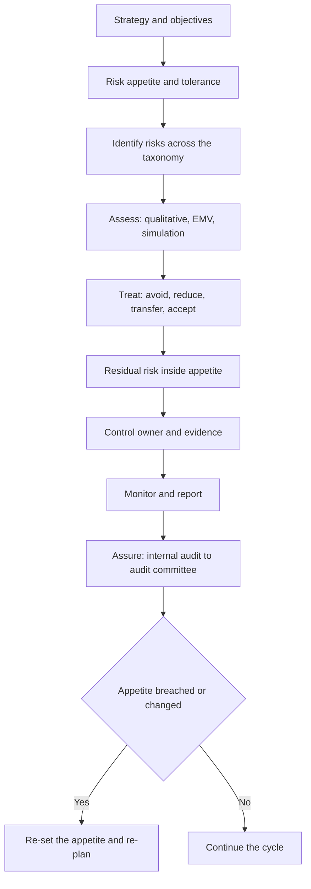

# P3 Risk Management

P3 is the risk paper of the Strategic Level, and it asks one question repeatedly: what could go wrong, what do we do about it, who is accountable, and how would we know it is working? The marks sit in the argument, not in the label, and a candidate who names six frameworks and never connects them to a decision loses them.

Risk is also where the Strategic Level separates from Management Level. Management Level asks whether a control is operating. Strategic Level asks whether the organisation's risk appetite matches its strategy, whether the governance structure can carry the risk, and whether the board can be told the truth about it in time to act. AICPA & CIMA publishes no per-topic weightage, and this note states no item counts, timings or pass rates; the topic split is StudyRoadmap's own organisation of the module.

### 🟢 Lite — Quick Review (1h–1d)

**The vocabulary that carries the marks.**

| Term | Meaning |
|---|---|
| Hazard | A source of potential loss without any element of exposure |
| Exposure | The extent to which an organisation is subject to a hazard |
| Risk | The combination of likelihood and impact of an uncertain event |
| Inherent risk | Exposure before controls are applied |
| Residual risk | Exposure after controls are applied |
| Gross risk | Inherent risk before the effect of existing controls |
| Risk appetite | The amount of risk an organisation will accept to achieve objectives |
| Risk tolerance | The variation around an objective that management accepts before action |
| Risk capacity | The maximum risk an organisation can bear before it fails |
| Risk owner | The person accountable for a specific risk |

The relationship to memorise: gross risk is inherent risk adjusted for existing controls; residual risk is what remains after further controls; appetite is the boundary residual risk must sit inside. A common error is treating appetite as a target. Appetite is a ceiling, and a well-run organisation operates well inside it.

**Risk taxonomy.** Five families: strategic risk (wrong strategy, new technology, disruption), operational risk (process failure, people, systems, fraud), financial risk (market, credit, liquidity, funding), compliance risk (law, regulation, internal policy), and reputational risk. Reputational risk is nearly always the consequence of another category rather than an independent source.

**Identification tools.** Risk register, risk heat map, PESTLE, SWOT, scenario analysis, Delphi technique, brainstorming, process mapping, audit findings, near-miss reports, interviews, and loss data. Each has a blind spot. Brainstorming generates breadth and misses dependencies. Loss data captures only events that have happened and understates near misses. Scenario analysis explores plausible futures and handles uncertainty better than a point estimate.

**Assessment.** Qualitative scales put likelihood against impact on a matrix and colour the cells. Semi-quantitative scoring multiplies a numeric likelihood by a numeric impact. Quantitative methods compute expected value, run Monte Carlo simulation, and use sensitivity analysis to see which inputs the answer depends on.

**Expected monetary value.** EMV = Σ (probability × impact) across outcomes. Worked: a project costs 100,000 with outcomes of +150,000 at probability 0.4, +40,000 at 0.4 and −80,000 at 0.2. EMV = 60,000 + 16,000 − 16,000 = 60,000, which exceeds the cost, so on expected value the project is worth doing. EMV ignores the risk attitude of the decision maker, which is why it must sit alongside the appetite statement.

**Treatment options.** Four, plus the mirror image for opportunities.

- **Avoid**: stop the activity that carries the risk. Highest control, highest cost.
- **Reduce**: lower likelihood or impact through controls.
- **Transfer**: move the financial consequence to a third party through insurance, outsourcing or hedging. The exposure stays; the financial consequence moves.
- **Accept**: take the risk consciously, with reserves or contingency in place.
- **Exploit, share, enhance**: the opportunity equivalents, where the aim is to capture upside rather than damp it down.

**Governance and the three lines model.** The first line owns the risk: operations, front line, process owners. The second line sets the framework and monitors: risk, compliance, legal, quality. The third line provides independent assurance: internal audit reporting to the audit committee or board. The model separates ownership from oversight from assurance, and the line candidates miss is that management owns the risk even where a second-line function wrote the policy.

**Internal control and COSO.** The COSO framework has five components and seventeen principles: control environment, risk assessment, control activities, information and communication, and monitoring. Control activities follow preventive, detective and corrective logic, and the three tests applied to any control are design, operation and evidence.

**Assurance.** Internal assurance comes from internal audit, external assurance from the statutory auditor, and third-party assurance from consultants and specialists. The engagement ladder is an audit, which gives reasonable assurance, a review, which gives limited assurance, and a compilation, which gives no assurance. Note the direction: reasonable assurance is a high but not absolute level of confidence, limited assurance is a lower confidence, and no assurance is only an observation of facts.

**Financial risk and treasury.** Market risk splits into price risk, interest rate risk and foreign exchange risk. Credit risk is the risk that a counterparty fails to pay. Liquidity risk is the risk of failing to meet obligations as they fall due, and it is the risk that kills businesses in a crisis. A forward fixes a rate for a future date, a futures contract is a standardised exchange-traded forward, an option gives the right but not the obligation to transact at a cost called the premium, and a swap exchanges cash flows. Hedging reduces the variability of a cash flow; speculation accepts variability in the hope of gain; arbitrage exploits price differences between markets with no net exposure.

**Memorise for the Lite tier.**

- Gross risk, residual risk, appetite, tolerance, capacity are five different words.
- Transfer moves the financial consequence, not the exposure.
- Expected monetary value multiplies probability by impact and sums.
- The first line owns risk; the second line monitors; the third line assures.
- Prevention, detection, correction: know which one a control is.
- Audit gives reasonable assurance, review gives limited assurance, compilation gives none.
- Hedging reduces variability; speculation accepts it to chase gain.

### 🟡 Standard — Full Coverage (1–2d)

#### Worked example: building a risk register for a manufacturer

**The situation.** A mid-sized manufacturer sells through a single distributor, sources raw material from one overseas supplier, and takes orders through a system that has not been patched in four years. The board asks for the top risks and the treatment for each.

**The reasoning.** Work through the taxonomy rather than listing what comes to mind. *Strategic risk*: the single distributor holds a large share of the business, so if it terminates, revenue stops and the plant is idle; treatment is reduction through a second qualified distributor and direct sales to large accounts. *Operational risk*: the unpatched order system is a single point of failure, and a cyber incident stops order intake while the fallback is manual; treatment is reduction through patching, a supported platform and a tested manual fallback with a named owner. *Financial risk*: raw material priced in a foreign currency, so a weaker currency raises input costs; treatment is transfer through forward contracts for a defined share of forecast purchases, with a stated proportion left open, because hedging everything removes the benefit of a favourable rate move. *Compliance risk*: product safety and labelling requirements differ between markets while the company applies one standard globally; treatment is reduction through a compliance register with named owners. *Reputational risk*: a consequence of the operational and compliance risks, so it is addressed through them.

**The final step.** Add the owner, the date and the residual rating for each line. A register without owners is a list of worries, and the board's question is always whether anything is going to happen.

#### Worked example: choosing a treatment for currency exposure

**The situation.** A company will pay a supplier in US dollars in three months for an invoice of 500,000 dollars. The treasury manager can buy dollars forward at 0.79 units of home currency per dollar, and the board has approved an appetite permitting no more than 200,000 home currency units of adverse movement on a single exposure.

**The reasoning.** The exposure is a known, quantifiable, forecast transaction, which makes it the easiest kind of risk to hedge. Doing nothing leaves the full 500,000 dollars exposed and breaks policy. Buying the whole amount forward fixes the cost but gives up the benefit if the currency moves favourably, and locking everything against a policy that permits a band of exposure leaves money on the table. Hedging a defined proportion, for example 300,000 dollars forward and leaving 200,000 open, satisfies the policy.

**The reasoning that earns the marks.** The proportion is chosen from the appetite and tolerance statements, not from a rule of thumb, and the residual exposure is documented as within tolerance. Hedging is not profit: a hedge locks in a rate in exchange for removing the uncertainty, and a hedging policy judged on the profit it produced ends up taking speculative positions the strategy cannot support.

#### Worked example: a control that is in name only

**The situation.** A company requires purchase orders above a threshold to be approved by a manager before the order is placed. A recent audit finds that orders above the threshold were placed routinely, the approvals were signed retrospectively, and several purchases split into smaller orders to stay below the threshold.

**The reasoning.** This is not a knowledge gap: the control was documented, communicated and understood. It failed on three counts. **Design**: the threshold could be avoided by splitting, so the design did not address the risk. **Operation**: approvals were signed after the fact, so the control never prevented anything. **Evidence**: the retrospective signatures produced records that would have satisfied a superficial review.

Corrective action has to address all three. Raise or restructure the threshold, require approval before the purchase order is released in the system, and add a system control that flags split orders by supplier, amount or timing. Writing a new policy without changing the system would repeat the failure.

### 🔴 Deep — Mastery (3–5d)

**Enterprise risk management.** ERM has two ambitions. Value preservation protects the organisation from threats to its survival and to its compliance position, while value creation uses controlled risk-taking to generate returns, such as entering a new market with a capped pilot. A governance structure that only preserves will never create, and one that only creates will eventually fail on a compliance or liquidity event.

**Risk appetite in practice.** A risk appetite statement is written as an objective plus a boundary plus the consequence of breaching it, for example: "we will operate with no single customer representing more than a set share of revenue, because losing one customer at that concentration would threaten liquidity". The statements are set by the board, owned by the chief executive, translated into limits for each business unit, tested against the risk profile, and reported against. A gap between the stated appetite and the measured exposure is a governance failure the audit committee should escalate.

**Aggregation, heat maps and stress testing.** Risks do not add linearly. A currency exposure, a demand collapse and a supply interruption can arise from the same cause, so summing their expected values overstates the total, while treating them as independent understates the damage in a correlated scenario. Aggregation needs judgement about dependency, and the tool for it is scenario analysis. A heat map is a communication device rather than a measurement: its scales are unvalidated, the categories hide the underlying distribution, the axes are hard to read, and aggregating many small risks into one cell loses information. Stress testing asks what happens under specified severe scenarios, while reverse stress testing asks what has to happen for the organisation to fail, which produces the scenarios that matter and the warning indicators to monitor.

**Financial risk in depth.** Value at risk states a loss threshold at a confidence level over a horizon, and it has three well-known weaknesses: it says nothing about losses beyond the threshold, it depends on assumptions about the distribution and the holding period, and it is not sub-additive across portfolios, so adding two positions' value at risk can exceed the value at risk of the combined position. Credit risk has three components: probability of default, loss given default and exposure at default. Expected loss multiplies them, with an unexpected loss on top when the unexpected default happens. Concentration matters as much as the arithmetic, because a portfolio of small exposures to one counterparty is not diversified, and credit scoring models carry model risk because the score is only as good as the historical data behind it. Liquidity risk has to be reported as cash flow mismatches rather than cash balances, because the mismatch of borrowing long and lending short is the pattern that converts a market shock into insolvency.

**Business continuity and governance.** A business continuity plan sets out how critical processes continue during disruption, supported by a disaster recovery plan for the technology estate, and the two metrics that matter are recovery time objective, the target time to restore a process, and recovery point objective, the acceptable data loss measured in time. An untested plan is a document. On governance, the board sets the risk appetite and provides assurance that the framework works, while management runs it day to day, and separating the roles of chairman and chief executive stops one person chairing the board while also running it. Audit committee independence matters because the committee is the board's own check on financial reporting and internal control.

**Assurance over non-financial information.** As sustainability reporting moves into mandatory regimes, the question of who assures a climate claim becomes a governance question in its own right. The assurance provider needs independence, the metrics need definitions and boundaries that do not shift between periods, and the internal control over the data has to be tested, not assumed. This is where risk management and the finance function now meet.

**Common mistakes.** Treating risk appetite as a target; confusing transfer with elimination; presenting a heat map as the assessment; claiming the second line owns the risk; treating a documented control as an operating control; hedging judged on profit; ignoring the aggregate; and confusing an audit with a review.

**Exam traps.** A company that reduced its risk rating by writing a policy staff had not read has failed on control activities and on information and communication, because a policy nobody applies is not a control. A board that approved an appetite and never revisited it while the business entered a new market has allowed the gap between appetite and profile to open. A team that hedged every foreign currency receipt has locked in the cost and given up the benefit, contradicting an appetite that accepts a band of risk. Internal audit reporting to the finance director breaches the independence principle, since it must report functionally to the board or audit committee. A company with an excellent register and no incidents for years, then a large loss from an unregistered event, is showing poor identification rather than the absence of risk.

#### 🧠 Memory Anchors

- **Gross risk, residual risk, appetite, tolerance, capacity: five different words.**
- **Transfer moves the financial consequence, not the exposure.**
- **EMV = probability × impact, summed across outcomes.**
- **First line owns, second line monitors, third line assures.**
- **Audit: reasonable assurance. Review: limited. Compilation: none.**
- **Hedging reduces variability; speculation accepts it to chase gain.**
- **Flashcard Q&A:**
  - *Is appetite a target or a ceiling?* → A ceiling.
  - *Which line owns a risk?* → The first line, the business unit.
  - *What are the three tests of a control?* → Design, operation, evidence.
  - *Why is value at risk criticised?* → It ignores tail loss, depends on assumptions, and is not sub-additive.
  - *What is the difference between a heat map and an assessment?* → A heat map communicates; it does not measure reliably.

#### Internal links

- [CIMA CGMA exam hub](/exams/cima-cgma/) — the nine Objective Tests, the three Case Studies and the designation requirements.
- [E3 Strategic Management](/notes/cima-cgma/strategic-level/st-001/) — the governance and ethics material that shares this module's language.
- [F3 Financial Strategy](/notes/cima-cgma/strategic-level/) — capital structure and appraisal decisions that set the risk exposures here.

The assessment facts stated here, and the requirement for three years of verified relevant professional experience on top of the examinations, come from AICPA & CIMA's own CGMA Exams page (https://www.aicpa-cima.com/resources/landing/exams) and the CGMA Professional Qualification syllabus, as recorded in this exam's data file and retrieved on 24 October 2026. AICPA & CIMA publishes no per-topic weightage for P3; the weight on this page is StudyRoadmap's own prioritisation.

---

## Continue your study

- **[View this topic in your CIMA CGMA (Chartered Global Management Accountant) roadmap](/roadmap/?exam=cima-cgma&duration=1mo)** — see where this topic sits in your personalised plan
- **[Build a quick revision plan](/roadmap/?exam=cima-cgma&duration=1d)** — 1-day sprint covering the highest-weight topics
- **[CIMA CGMA (Chartered Global Management Accountant) exam overview](/exams/cima-cgma/)** — pattern, eligibility, and syllabus
- **[All Strategic Level notes](/notes/cima-cgma/strategic-level/)** — browse sibling topics in this subject
