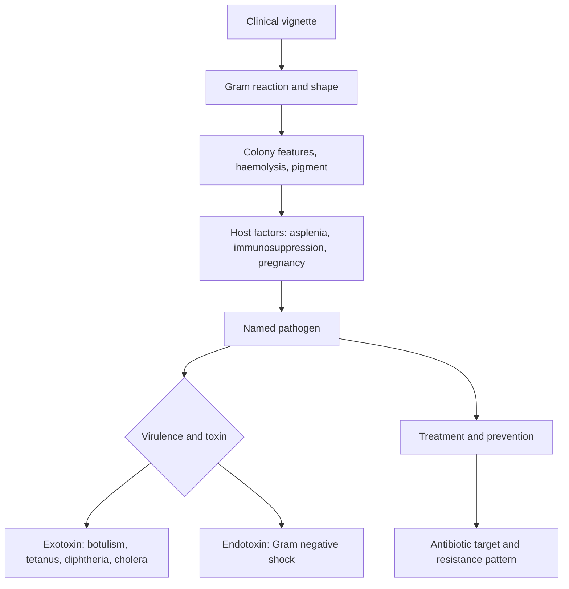

# Microbiology and Disease Processes

Microbiology items on the Survey of the Natural Sciences reward recognition plus mechanism. A stem hands you a Gram stain, a colony morphology, a clinical vignette and a susceptibility panel, and it asks which organism, which drug or which process explains what the patient has. The ADA publishes no per-topic weightage for the section, so treat the areas below as a coverage checklist rather than a forecast. Every clinical detail in the stem is a clue pointing at one organism, and a candidate who knows the hallmarks of the top twenty pathogens answers quickly.

### 🟢 Lite — Quick Review (1h–1d)

**Bacterial structure, and why the Gram stain matters.**

| Feature | Gram positive | Gram negative |
|---|---|---|
| Peptidoglycan | thick, multilayered | thin, in the periplasm |
| Outer membrane | absent | present, with lipopolysaccharide |
| Teichoic acids | present | absent |
| Stain colour | purple | pink |
| Lysozyme and penicillin | more susceptible | less susceptible |
| Endotoxin | none | lipid A of lipopolysaccharide |

**Spores, capsules and other structures.** Spores are made by Bacillus and Clostridium species, survive boiling and disinfectants, and appear in anthrax, tetanus, botulism and gas gangrene. Capsules are antiphagocytic and appear in Streptococcus pneumoniae, Haemophilus influenzae type b, Neisseria meningitidis, Klebsiella pneumoniae and Bacillus anthracis. Flagella confer motility, and pili confer attachment, with Neisseria gonorrhoeae pili also driving antigenic variation.

**The pathogen hall of fame.**

| Organism | Hallmarks |
|---|---|
| Staphylococcus aureus | Gram positive cocci in clusters, catalase and coagulase positive, golden colonies, abscesses, osteomyelitis, endocarditis, toxic shock |
| Streptococcus pneumoniae | Gram positive diplococci, alpha-haemolytic, optochin sensitive, capsule, lobar pneumonia, meningitis |
| Streptococcus pyogenes | Gram positive cocci in chains, beta-haemolytic, bacitracin sensitive, scarlet fever, rheumatic fever, post-streptococcal glomerulonephritis |
| Neisseria gonorrhoeae | Gram negative diplococci, oxidase positive, no capsule, purulent urethritis, pelvic inflammatory disease, septic arthritis |
| Neisseria meningitidis | encapsulated Gram negative diplococci, petechial rash, meningococcemia, endotoxin shock |
| Haemophilus influenzae type b | encapsulated Gram negative coccobacillus, epiglottitis, meningitis, cellulitis, Hib vaccine |
| Mycobacterium tuberculosis | acid-fast bacilli in cords, caseating granulomas, latent versus active infection |
| Mycoplasma pneumoniae | no cell wall, fried-egg colonies, cold agglutinins, walking pneumonia |
| Clostridium difficile | anaerobic spore former, pseudomembranous colitis after antibiotics, toxins A and B |
| Clostridium perfringens | myonecrosis and gas gangrene, alpha toxin lecithinase, double zone of haemolysis |
| Clostridium botulinum | flaccid descending paralysis with fixed dilated pupils, blockade of acetylcholine release |
| Clostridium tetani | spastic paralysis, trismus, risus sardonicus, no fever |
| Bacillus anthracis | large square-ended rods, bamboo colonies, painless black eschar, wool sorter's disease |
| Yersinia pestis | bipolar safety-pin staining, flea-borne, buboes, pneumonic and septicaemic plague |
| Vibrio cholerae | comma-shaped, rice-water stools, cholera toxin raising cyclic AMP |
| Bordetella pertussis | paroxysmal cough with inspiratory whoop, lymphocytosis, nasopharyngeal PCR |
| Legionella pneumophila | charcoal yeast extract agar with iron and cysteine, hyponatraemia, hypokalaemia |

**Viruses.** Structure is nucleic acid plus capsid, with an envelope in a number of families; replication depends on the genome type. Hepatitis B is DNA with reverse transcriptase and has a vaccine; hepatitis C is RNA with no vaccine; HIV is a retrovirus that infects CD4 cells; influenza is a segmented RNA virus that shifts; HPV is DNA with E6 and E7 and has a vaccine; Epstein-Barr virus links mononucleosis, Burkitt lymphoma and nasopharyngeal carcinoma; measles shows Koplik spots; rabies shows Negri bodies; norovirus causes outbreaks; rotavirus causes gastroenteritis in infants; and dengue has four serotypes with antibody-dependent enhancement.

**Fungi.** Candida forms pseudohyphae and germ tubes. Aspergillus has septate hyphae branching at acute angles. Histoplasma lives inside macrophages and is found in the Ohio and Mississippi river valleys with bird and bat droppings. Blastomyces buds broadly. Coccidioides forms spherules in the south-western United States. Cryptococcus is encapsulated, stains with India ink, and leads the causes of meningitis in advanced HIV. Pneumocystis causes pneumonia in patients with low CD4 counts and is treated with trimethoprim-sulfamethoxazole.

**Disinfection and sterilisation.** Sterilisation destroys all spores; disinfection does not. Physical methods: moist heat above 100 degrees Celsius under pressure in an autoclave, boiling, pasteurisation at 63 degrees Celsius for 30 minutes or 72 for 15 seconds, dry heat ovens, incineration, gamma radiation and filtration. Chemical agents: phenol, hypochlorite, 70% alcohol, quaternary ammonium compounds, iodine, formaldehyde, glutaraldehyde and peracetic acid. High-level agents kill spores and are used on instruments that enter tissue; intermediate-level agents kill mycobacteria, viruses and vegetative bacteria; low-level agents kill vegetative bacteria and enveloped viruses.

**Antimicrobial classes and their targets.**

| Class | Target | Notes |
|---|---|---|
| Beta-lactams, glycopeptides | cell wall synthesis | broken down by beta-lactamases; vancomycin for MRSA |
| Aminoglycosides, macrolides, tetracyclines | protein synthesis | aminoglycosides are ototoxic and nephrotoxic; tetracyclines are avoided in pregnancy |
| Fluoroquinolones, rifampin | nucleic acid synthesis | rifampin turns body fluids orange |
| Sulfonamides, trimethoprim | folate synthesis | combined as trimethoprim-sulfamethoxazole |
| Polymyxins, daptomycin | cell membrane | daptomycin fails in pneumonia |
| Metronidazole | anaerobes and protozoa | disulfiram reaction and a metallic taste |

**Inflammation and shock.** Acute inflammation brings neutrophils, vasodilation, increased vascular permeability, swelling, heat, redness and pain, with mediators including histamine, bradykinin, complement fragments, and the cytokines interleukin-1, interleukin-6 and tumour necrosis factor. Chronic inflammation replaces neutrophils with macrophages and lymphocytes, adds fibroblasts and new vessels, and can form granulomas in tuberculosis, sarcoidosis and fungal infection. Fever arises when pyrogens reset the hypothalamic set point. Shock is hypovolaemic, cardiogenic, obstructive, neurogenic or distributive, and septic shock is distributive: warm and vasodilated early, then cold and shut down once myocardial depression and capillary leak take hold.

**Memorise for the Lite tier.**

- Gram positive is thick peptidoglycan and purple; Gram negative has lipopolysaccharide and an outer membrane.
- Capsule means antiphagocytic: pneumococcus, meningococcus, Hib, Klebsiella, anthrax.
- Spore formers are Bacillus and Clostridium, and boiling will not kill them.
- Catalase positive staphylococci; Gram negative cocci are oxidase positive.
- Sterilisation destroys spores; high-level disinfection destroys spores.
- Beta-lactams hit the wall, macrolides and tetracyclines hit the ribosome, fluoroquinolones hit DNA gyrase.
- mecA means methicillin resistance, and septic shock is distributive.

### 🟡 Standard — Full Coverage (1–2d)

#### Worked example: reading a Gram stain

**The stem.** A wound swab shows Gram positive cocci in clusters, golden-yellow colonies on blood agar, and a positive coagulase test. The patient has a prosthetic joint.

**The reasoning.** Gram positive cocci in clusters narrow the field to Staphylococcus or Micrococcus. Golden colonies and a positive coagulase test confirm Staphylococcus aureus, because coagulase converts fibrinogen to fibrin and causes the sticky colonies that define the species. In a prosthetic joint it is the leading cause of infection, and any antibiotic choice has to cover methicillin-resistant strains until susceptibility is known.

**What the item is testing.** The reasoning chain: Gram reaction, arrangement, colony pigment, coagulase. Each step narrows the field, and the item expects you to name what each step eliminated as well as what it confirmed.

#### Worked example: choosing between anaerobes and aerobes

**The stem.** A patient develops foul-smelling discharge after dental extraction, with gas in the tissue and a rapidly spreading myonecrosis. The wound culture grows a large Gram positive rod with swarming colonies on blood agar and a double zone of haemolysis.

**The reasoning.** The presentation is Clostridium perfringens. The foul smell and gas point to anaerobic fermentation; the double zone of haemolysis comes from the alpha toxin lecithinase, which hydrolyses egg yolk; swarming colonies on blood agar are characteristic. This is gas gangrene, a surgical emergency needing debridement plus clindamycin and penicillin.

**Why clindamycin appears.** It suppresses toxin production, which is the point in a disease driven by toxin rather than by bacterial load alone. The item is testing that the antibiotic choice follows the pathogenesis.

#### Worked example: a susceptibility report

**The stem.** A urine culture grows Escherichia coli. The report shows resistance to ampicillin and trimethoprim-sulfamethoxazole, and susceptibility to ciprofloxacin and ceftriaxone. The patient has pyelonephritis with fever and vomiting.

**The reasoning.** Two mechanisms explain the pattern: extended-spectrum beta-lactamases for ampicillin, and acquired or mutated folate pathways for trimethoprim-sulfamethoxazole, with ciprofloxacin and ceftriaxone newer and further from that pressure. For a febrile pyelonephritis with vomiting, an oral drug is not appropriate until the patient can keep medication down, so intravenous ceftriaxone is the sensible choice, and the culture then guides the switch to oral ciprofloxacin once the patient improves.

**The general rule.** Resistance to one class raises the chance of resistance to others, including fluoroquinolones and aminoglycosides, so a susceptibility report overrides the textbook.

### 🔴 Deep — Mastery (3–5d)

**Pathogenesis in detail.** Exotoxins are secreted proteins, highly specific and often neutralised by antitoxin, so they produce dramatic syndromes such as botulism, tetanus, diphtheria and cholera. Endotoxin is the lipid A component of lipopolysaccharide, released when Gram negative bacteria die, and it triggers interleukin-1, interleukin-6 and tumour necrosis factor release, producing fever, vasodilation, capillary leak and shock, which is why every Gram negative septicaemia carries an endotoxin load. Invasiveness has its own steps: reach the tissue, adhere, avoid clearance, then damage, with adherence pili for the first, capsules blocking phagocytosis, and enzymes such as hyaluronidase and collagenase spreading infection. Mycobacterium tuberculosis, Legionella, Chlamydia, Rickettsia and the viruses survive inside cells, which is why cell-mediated immunity dominates the defence and why antibodies cannot reach them. A biofilm is a community attached to a surface in self-produced polymer, and organisms in it tolerate antibiotics that kill the planktonic form, which explains persistent infection on catheters and prosthetic joints and why antibiotics alone fail without removing the device.

**Genetic variation and resistance.** Mutation, transformation with uptake of free DNA, transduction by bacteriophage and conjugation by plasmid transfer. Conjugation is the route by which resistance plasmids move between organisms and across species. Mechanisms worth recalling: beta-lactamase production; the mecA-encoded altered penicillin-binding protein in MRSA; vancomycin resistance through a thickened cell wall that sequesters the drug; efflux pumps in tetracycline and macrolide resistance; and porin loss in Pseudomonas aeruginosa, which combines with beta-lactamase to give carbapenem resistance.

**Diagnostics and stewardship.** Culture remains the reference method, with selective and differential media guiding which grows: MacConkey agar selects for Gram negative enteric organisms and differentiates lactose fermenters, which turn pink; chocolate agar grows Haemophilus and Neisseria; charcoal yeast extract agar with iron and cysteine supports Legionella. Rapid methods include nucleic acid amplification for gonorrhoea, chlamydia and respiratory viruses, MALDI-TOF mass spectrometry for identification from a colony, 16S ribosomal RNA sequencing for organisms that do not grow, and antigen detection such as the pneumococcal and Legionella urinary antigens. Stewardship means choosing the narrowest agent that covers the organism, the right dose and the right duration, and de-escribing once cultures return.

**Sepsis and its complications.** Septic shock involves endothelial injury, capillary leak, vasodilation with low systemic vascular resistance, myocardial depression, and microvascular thrombosis that produces disseminated intravascular coagulation. The clinical picture moves from warm, flushed skin with high cardiac output and low systemic vascular resistance in the early phase, to cool extremities, poor capillary refill, falling blood pressure and rising lactate in the late phase. Organ failures follow a pattern: the lungs first with acute respiratory distress syndrome, then the kidneys, then the brain, then the liver with coagulation derangement.

**Common mistakes.** Reading Gram status as Gram reaction, since Gram positive means the cell wall retains the crystal violet after decolorisation. Forgetting that Mycoplasma has no cell wall, so beta-lactams fail because there is nothing to inhibit. Assuming every Gram negative organism is sensitive to ciprofloxacin, which a susceptibility report overrides. Confusing exotoxin diseases with endotoxin diseases. Missing the asplenia clue, since asplenia predisposes to encapsulated organisms. Treating a spore-former with an agent that does not cover it, which is why Clostridium difficile after antibiotics needs oral vancomycin or fidaxomicin.

**Exam traps.** A burn patient with a characteristic lesion and black eschar points at Bacillus anthracis, which is non-motile and produces a bamboo or Medusa head appearance. A child with a barking cough and lymphocytosis needs a nasopharyngeal PCR or culture for Bordetella pertussis, not serum serology. An immunocompromised patient with ring-enhancing brain lesions brings toxoplasmosis against lymphoma, and the answer turns on the CD4 count and an eccentric target. A pregnant patient with a lacy rash and joint pain points at parvovirus B19, for which no vaccine exists and fetal hydrops is the feared complication.

#### 🧠 Memory Anchors

- **Gram positive: thick peptidoglycan, teichoic acids, purple.**
- **Gram negative: outer membrane, lipopolysaccharide, pink.**
- **Encapsulated: pneumococcus, meningococcus, Hib, Klebsiella, anthrax.**
- **Spore formers: Bacillus and Clostridium, and boiling will not kill them.**
- **mecA means methicillin resistance; vancomycin covers it.**
- **Cholera toxin raises cyclic AMP; botulinum toxin blocks acetylcholine release.**
- **Flashcard Q&A:**
  - *What does coagulase positive mean?* → Staphylococcus aureus.
  - *Which organism has bipolar safety-pin staining?* → Yersinia pestis.
  - *What medium grows Legionella?* → Charcoal yeast extract with iron and cysteine.
  - *Why do beta-lactams fail against Mycoplasma?* → No cell wall to inhibit.
  - *What is the target of aminoglycosides?* → The 30S ribosomal subunit.

#### Internal links

- [DAT exam hub](/exams/dat/) — the four sections of the Dental Admission Test.
- [General Biology and Physiology](/notes/dat/natural-sciences/ns-004/) — the host systems and immunology that this pathogen list attacks.
- [Biochemistry and Metabolism](/notes/dat/natural-sciences/ns-003/) — the enzymatic detail behind antimicrobial action and resistance.

The ADA publishes no per-topic weightage for the Survey of the Natural Sciences, so the weight on this page is StudyRoadmap's own prioritisation. The pathogen and antimicrobial content follows standard microbiology teaching as taught in dental preparatory programmes.

---

## Continue your study

- **[View this topic in your DAT (Dental Admission Test, United States) roadmap](/roadmap/?exam=dat&duration=1mo)** — see where this topic sits in your personalised plan
- **[Build a quick revision plan](/roadmap/?exam=dat&duration=1d)** — 1-day sprint covering the highest-weight topics
- **[DAT (Dental Admission Test, United States) exam overview](/exams/dat/)** — pattern, eligibility, and syllabus
- **[All Survey of the Natural Sciences notes](/notes/dat/natural-sciences/)** — browse sibling topics in this subject
