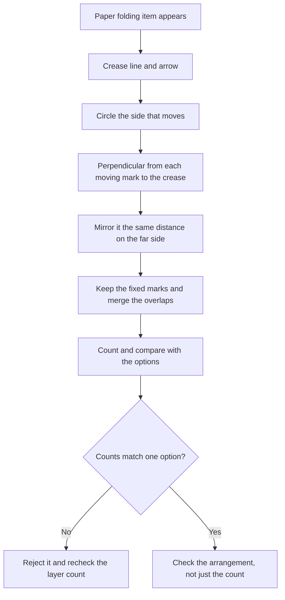

# Paper Folding

Paper folding is the item type in the DAT Perceptual Ability Test that most candidates get wrong, and the reason is rarely that they cannot see the fold. It is that they treat the sheet as if the pattern vanishes when it moves. A transparent sheet does not behave that way. The marks stay visible, they land somewhere new, and they sit on top of whatever was already there.

The Perceptual Ability section is 90 of the 280 items in the DAT, and the ADA gives it 60 minutes in a five hour fifteen minute administration. The ADA publishes no per-item-type breakdown, so nobody knows how many of those 90 items are folding items. What is knowable is that folding items are the ones where a candidate's accuracy drops fastest under time pressure, because every one of them demands a fresh mental picture built from scratch.

The good news is that folding items are not a talent test. They are a procedure. The procedure is short, it is identical for every item, and once it is automatic you stop losing marks to it.

### 🟢 Lite — Quick Review (1h–1d)

**The single rule: folding reflects across the crease.** A mark on the part that moves ends up on the other side of the crease, at the same perpendicular distance from it, in the same position along it. It does not slide. It does not rotate. It mirrors.

Everything else in this topic follows from that one sentence.

**The four-step method.**

1. **Find the crease and the arrow.** The dashed line is the crease. The arrow tells you which side of that line moves and which side stays put.
2. **Work only on the moving side.** Ignore the marks on the fixed side for now. They will not move.
3. **Mirror each moving mark across the crease.** Draw the perpendicular from the mark to the crease, then carry it the same distance to the other side.
4. **Combine and count.** The final pattern is the fixed marks plus the mirrored copies. Then check the total against the options.

**What each element of the item does.**

| Element | What it tells you | What it does not tell you |
|---|---|---|
| Dashed line | Where the crease is | Which side moves |
| Arrow | Which side folds over onto the other | Anything about the pattern |
| Existing marks on the sheet | The marks you are working with | How many will be in the answer |
| A punched hole symbol | That a hole goes through the sheet at that point | How many layers it pierced |

**The count check.** Marks never disappear, and one punch through a folded stack makes one hole per layer. So the number of visible marks in the correct answer is usually larger than the number of marks on the flat sheet, and never smaller. If an option shows fewer marks than the flat sheet has, it is wrong before you check anything else.

**Memorise for the Lite tier.**

- Folding reflects across the crease. Translation and rotation are both wrong.
- The arrow decides which side moves; the crease only decides where the reflection happens.
- Marks already on the sheet remain visible. Nothing is erased by a fold.
- Overlapping marks count once in the picture but still exist as separate layers.
- A punch through two layers produces two holes in the answer.
- Two folds are done in the order they are shown, and each one folds the current configuration.
- The final count is fixed marks plus mirrored copies, minus the overlaps counted twice.
- A diagonal crease is easier handled by rotating the sheet until the crease is horizontal or vertical.

### 🟡 Standard — Full Coverage (1–2d)

#### Worked example 1: one fold, four dots

A square sheet carries four dots. One dot sits near the top-left corner, two sit along a horizontal line in the lower half, and one sits at the bottom-right corner. A vertical dashed crease runs down the middle of the sheet, and an arrow on the right side curves leftwards across the crease, so the right half folds onto the left half.

Step 1 fixes the crease and the moving side: crease vertical, right half moves.

Step 2 isolates the marks that travel. The single dot at the bottom-right corner travels, and so does the right-hand member of the horizontal pair, because it lies to the right of the crease. The top-left dot and the left-hand member of the pair stay where they are.

Step 3 mirrors them. A dot one unit right of the crease lands one unit left of it, on the other side. A dot sitting exactly on the crease stays on the crease. The bottom-right corner dot, four units right of the crease, lands four units left of it.

Step 4 combines. The final pattern holds the two fixed dots on the left plus two mirrored dots, so four visible marks in total. Any option that shows the two mirrored dots missing, or shows them on the right-hand side instead of the left, is the "forgot to fold" or "folded the wrong way" trap.

The detail that catches people here is that the horizontal pair straddles the crease. One of those two dots stays where it is and the other one moves. Students who mirror the whole pair, or mirror the one on the wrong side, produce a plausible-looking pattern with the right total count and the wrong arrangement. This is why step 2 exists: you decide per mark, not per group.

#### Worked example 2: the punch

Same sheet, but this time a small punched hole is drawn on the lower-left region, well away from the crease.

The hole symbol marks where a hole goes through the sheet. After the fold, the folded-over layer covers the left half of the sheet. A punch in the lower-left region therefore goes through two layers: the original sheet and the layer that folded on top of it. The answer must show two holes, mirrored across the crease from one another.

If the punch had been drawn in the right-hand half, before the fold, it would have pierced only one layer at that moment, and the answer would show one hole travelling to its mirrored position. If the punch were drawn in a region the folded flap does not reach, it pierces one layer only.

The count check catches this instantly: two layers under the punch means two holes in the picture, and any option showing one hole is wrong.

#### Worked example 3: two folds in sequence

The sheet has a vertical crease with the right half folding left, and then a horizontal crease with the top half folding down. Marks sit in each of the four quadrants.

The order matters and it is given. First vertical, then horizontal.

Start with the vertical fold. The right-hand marks mirror to the left, so all marks now sit on the left half. The pattern at this stage is: original left-hand marks, plus mirrored right-hand marks, and the two sets may overlap.

Now the horizontal fold acts on that result. The top half of the current configuration folds down, so every mark currently in the top half mirrors downward. Marks already in the bottom half stay.

The final picture is the bottom half only, and it is denser than a single fold would produce. The common error is to mirror the original top-right mark down and left in one step, which is a diagonal translation rather than two reflections. Reflections do not commute with each other in that way, so a two-fold item is where the "reflect properly" habit gets tested rather than assumed.

#### Worked example 4: a diagonal crease

A crease runs at 45 degrees across a square sheet, and the top-left triangle folds down onto the bottom-right.

Working in the tilted axes is error-prone. Instead, rotate your mental picture 45 degrees until that crease becomes horizontal. Now the fold is an ordinary vertical or horizontal reflection, the marks mirror cleanly, and you rotate back. If you have a phone or a sheet of paper, physically rotating the page is faster and more reliable than imagining the rotation.

#### How the merging works

Two situations come up constantly.

**Coincidence.** A mirrored mark lands exactly on a mark that was already there. In the finished pattern you see one mark at that position, because the two are stacked and the sheet is transparent. So the visible count is one lower than the naive sum. This is where the count check earns its keep: the answer option that shows two dots side by side at that spot is wrong, and the one showing a single dot is right.

**Near miss.** A mirrored mark lands just next to an existing mark without touching it. You then see two marks close together. Students who assume the answer "should" look tidy often merge these by eye and lose the item.

### 🔴 Deep — Mastery (3–5d)

#### The five distractor families

Once you can name the way an option is wrong, you stop being tempted by it.

| Distractor | What it is | How you catch it |
|---|---|---|
| No fold | The original flat pattern, unchanged | The count matches the sheet, and nothing is mirrored |
| Translated | The marks slid across without flipping | A mark that crossed the crease keeps its orientation relative to the page instead of turning away from it |
| Mirrored in the wrong direction | Reflected along the crease instead of across it, or across the wrong axis | Check one mark: its distance along the crease should not change, only its distance from it |
| Wrong side folded | The crease is right, the moving side is wrong | The mirrored copies sit on the side that was supposed to stay put |
| Merged wrongly | Overlapping marks shown as one, or separate marks drawn as two | Use the count: fixed marks plus mirrored copies, minus double-counted overlaps |

#### A full item, start to finish

**Item.** A transparent sheet carries six marks. Two sit in the top-left corner region, one sits just to the left of a vertical crease near the bottom of the sheet, one sits just to the right of that same crease near the bottom, and one sits in the middle of the right-hand half. A vertical crease runs down the centre. An arrow shows the left half folding rightwards onto the right half. A punched hole is drawn in the lower-right region, clear of the crease.

**Step 1, crease and arrow.** Vertical crease down the centre. Left half moves, right half stays.

**Step 2, isolate the movers.** The two top-left marks and the mark just left of the crease travel, so three marks travel. The mark just right of the crease and the middle-right mark stay, so two stay.

**Step 3, mirror.** Each of the three travelling marks reflects across the vertical crease. The two corner marks land in the top-right region at mirrored distances. The mark just left of the crease lands just right of it, directly on top of the stationary mark that was already there.

**Step 4, the punch.** The punched hole sits in the lower-right region, in the half that stays put. After the fold the folded-over flap covers the entire right half, so the punch pierces the flap and the sheet underneath it. Two layers means two holes, and the two holes sit as mirror images across the crease.

**Step 5, count.** Two stationary marks plus three mirrored marks, minus the one overlap counted twice, gives four visible marks, plus the two holes from the punch. Options showing the top-right corner marks missing are the "forgot to mirror" family; an option showing five separate dots where the crease-adjacent pair should be stacked is the "forgot to merge" family; an option showing a single punch hole is the "missed the second layer" family.

The point of running the item end to end is not to memorise the answer. It is to make each step automatic, so that under time pressure you still execute all five.

#### Practice that actually moves the score

The skill responds to volume, not to reading. A sensible routine is a block of folding items every day, untimed for the first stretch, then timed once you can execute the four steps without pausing.

Two rules make the practice count. First, always write the intermediate step: mark the crease, mark the moving side, mirror one mark, and only then look at the options. Candidates who look at the options first anchor on a plausible pattern and then justify it. Second, when you get one wrong, do not simply move on. Redraw it correctly from the flat sheet. The error is usually one misread instruction, and redoing the item converts that error into a rule.

If you are getting most of them right but slowly, the problem is execution, not comprehension: the step that usually eats time is deciding, mark by mark, which side moves. Write the moving side on the sheet before you start. One scribble, then every mark decision is already half made.

#### Common mistakes

- **Erasing the marks that move.** On a transparent sheet they stay visible. The answer holds both the originals and the mirrored copies.
- **Reflecting in the direction of travel.** The mark moves perpendicular to the crease, and its position along the crease does not change.
- **Counting marks instead of layers for a punch.** Two layers means two holes, and the count check is the fastest way to catch this.
- **Doing both folds at once.** Fold one, then fold the result. Reflections in sequence are not the same as a single diagonal move.
- **Assuming an option is right because the count matches.** The count rules options out. It never rules one in.

> ⚡ **Examiner Trap.** An option showing exactly the right number of marks but arranged as a translated rather than a reflected copy. Count alone cannot separate it, which is why the method includes mirroring one mark by hand before you read the options.

#### 🧠 Memory Anchors

- **"Reflect, don't slide."** A fold is a mirror image across the crease, never a translation.
- **"Arrow first, crease second."** The arrow tells you what moves; the crease only tells you where the mirror line runs.
- **"Nothing disappears."** Original marks stay; mirrored copies are added.
- **"Two layers, two holes."** A punch through a folded stack makes one hole per layer.
- **Flashcard Q&A:**
  - *A mark ends up on the crease. Where does it go?* → Nowhere. It is on the mirror line, so it stays put.
  - *The answer has fewer marks than the flat sheet. Possible?* → No. Marks are never lost in a fold.
  - *Two folds. Do you mirror both in one step?* → No. Fold, then fold the result.
  - *Why does a 45-degree crease cause errors?* → Because it hides the perpendicular; rotate the sheet until the crease is axis-aligned.

#### Internal links

- [DAT exam hub](/exams/dat/) — the four sections, the 280 items and the five-hour fifteen-minute administration.
- [Keyhole Problems](/notes/dat/perceptual-ability/pa-001/) — the other item type in this section that candidates find hardest.
- [Quantitative Reasoning](/notes/dat/reading-quantitative/rq-003/) — the fastest of the four sections to move if spatial practice has plateaued.

The facts about this section — 90 Perceptual Ability items, the 60 minutes the ADA Candidate Guide gives the section, and the five hour fifteen minute total administration time — come from the American Dental Association's DAT pages (https://www.ada.org/education/testing/exams/dental-admission-test-dat) and the ADA DAT Candidate Guide, as recorded in this site's DAT exam data. The ADA publishes no per-item-type breakdown, so the weight on this page is StudyRoadmap's own prioritisation.

---

## Continue your study

- **[View this topic in your DAT (Dental Admission Test, United States) roadmap](/roadmap/?exam=dat&duration=1mo)** — see where this topic sits in your personalised plan
- **[Build a quick revision plan](/roadmap/?exam=dat&duration=1d)** — 1-day sprint covering the highest-weight topics
- **[DAT (Dental Admission Test, United States) exam overview](/exams/dat/)** — pattern, eligibility, and syllabus
- **[All Perceptual Ability Test notes](/notes/dat/perceptual-ability/)** — browse sibling topics in this subject
