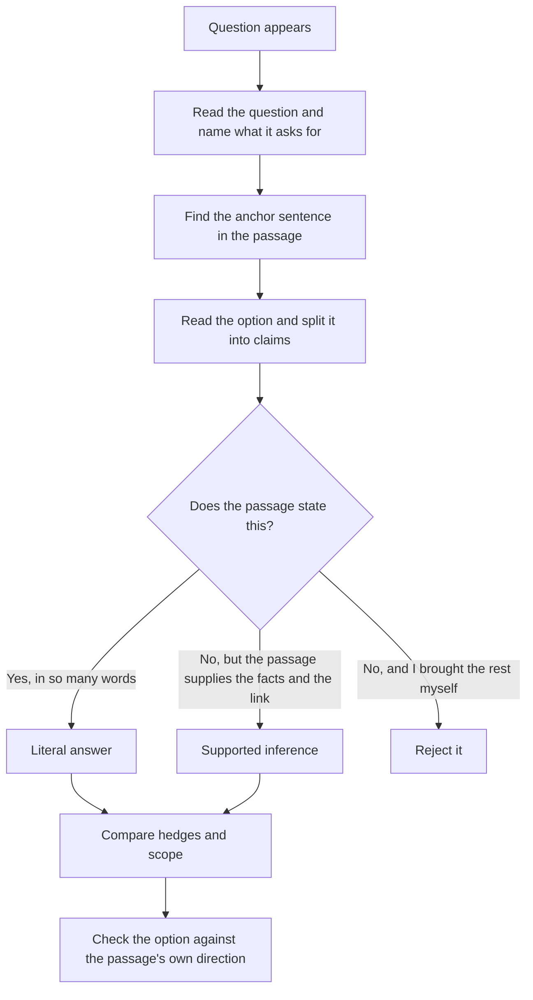

# Reading Comprehension: Comprehension and Inference

The DAT Reading Comprehension section is 50 of the 280 items in the examination, and the ADA Candidate Guide gives it 60 minutes inside a five hour fifteen minute sitting. It is the only section where reading speed and reading discipline are the same skill: the passages are dense, and the questions are all about what the passage does and does not license you to conclude.

This topic covers the two things the section asks you to do. Comprehension is retrieval with precision, and inference is reasoning that stays inside the text. Both are broken by the same habit, which is letting your own knowledge fill the gap when the passage is unclear. A passage about fluoride and enamel will give you an answer whether or not you know anything about dentistry, and if you answer from your knowledge of dentistry instead of from the passage, you will sometimes be right for the wrong reason and wrong for no reason at all.

The good news is that the section is the most trainable of the four. Technique does most of the work.

### 🟢 Lite — Quick Review (1h–1d)

**The one test that separates the two halves of the section.** For every option ask: *does the passage say this, or does the passage let me conclude this?*

- **Literal** — the passage states it. You can point at the sentence.
- **Inference** — the passage supports it, and the passage itself supplies the reasoning.
- **Outside knowledge** — you know it, the passage does not. Wrong, however true.

An option in the third category is wrong even when it is scientifically correct. That is the single most common way marks are lost in this section.

**The four-question types you will meet, and what each demands.**

| Type | The question you are answering | Where the answer lives |
|---|---|---|
| Detail | Which of these does the passage state? | One sentence, located |
| Inference | What follows from what the passage states? | Two sentences plus the link between them |
| Main idea | What is the passage arguing? | The topic sentence of each paragraph, read together |
| Vocabulary | What does this word mean here? | The sentence around it, plus the sentences after it |

**The method for a detail or inference question.**

1. Read the question before you read the options. Know what you are hunting.
2. Find the anchor sentence. The answer is almost always in one or two sentences, not spread across the passage.
3. Read the option and check each part of it. Detail options often carry two claims, and one true claim and one false claim together is still wrong.
4. If the option needs a word the passage never used and never implied, it is too strong.

**The method for vocabulary in context.** Substitute your candidate meaning back into the sentence and read it. If the sentence still parses, you have narrowed to two senses. Then check the sentence that follows, which normally confirms one of them. Never answer a vocabulary question from a definition you remember from elsewhere.

**Memorise for the Lite tier.**

- Literal, inference, outside knowledge. Only the first two can be right.
- An option with two claims is judged on both claims.
- "All", "always", "never", "only", "proves", "causes" are the words that turn a supportable statement into an unsupportable one.
- Main idea is a claim with a verb. Topic is a subject with a noun.
- A passage that hedges ("may", "is associated with", "in this sample") cannot support an answer that hedges less.
- The author's opinion is not in the passage unless the passage reports it.
- Answer the question asked. If the question asks for the reason, the cause, the exception, pick the option that matches that noun.

### 🟡 Standard — Full Coverage (1–2d)

#### A worked set

The passage below is written for this page, in the register the section uses: short paragraphs, a stated problem, a mechanism, a caveat.

> **Passage**
>
> Fluoride was first added to municipal water supplies in the 1940s because observational studies had linked higher natural fluoride levels in drinking water with lower rates of tooth decay in communities. Fluoride works topically: it is absorbed into the surface of enamel and forms a mineral layer that resists acid dissolution. Because enamel cannot regrow once it has dissolved, the benefit of fluoride is preventive rather than restorative.
>
> The mechanism is not equally effective at all ages. Enamel is still forming in children, and fluoride incorporated into developing enamel is more stable than fluoride sitting on the surface of a mature tooth. This is the basis for the recommendation that fluoride be applied topically to children as well as swallowed, since swallowed fluoride reaches teeth that have not yet erupted.
>
> Several questions remain open. The relationship between fluoride exposure and skeletal fluorosis depends on total intake, which includes food as well as water, and the concentration at which harm begins is not the same in every community. Public health studies differ in how they measure the benefit, and part of the apparent disagreement is that some count cavities avoided in children while others count changes in adult teeth. Fluoride does not reverse existing decay, so any measure of its effect must account for the baseline level of decay in the population being studied.

**Question 1.** According to the passage, how does fluoride prevent decay?

- (A) By dissolving damaged enamel so it can be replaced.
- (B) By forming a mineral layer that resists acid dissolution.
- (C) By increasing the amount of enamel produced in childhood.
- (D) By reversing decay that has already started.

**Answer: B.** The second paragraph states that fluoride "is absorbed into the surface of enamel and forms a mineral layer that resists acid dissolution". Option A contradicts the passage, which says enamel cannot regrow. Option C is a plausible-sounding invention that connects two separate sentences. Option D contradicts the last paragraph.

The teaching point is C. It reads as if it were drawn from the passage, because the passage does mention developing enamel, and it fails only because no sentence links fluoride to increased enamel production. Two true statements about a passage do not make a third true statement.

**Question 2.** Which inference does the passage support?

- (A) Communities with more decay in their children have less need for fluoride.
- (B) Measuring fluoride's benefit can depend on how the benefit is defined.
- (C) Fluoride in water is more effective than fluoride applied topically.
- (D) Skeletal fluorosis is caused by drinking water with fluoride.

**Answer: B.** The third paragraph says studies "differ in how they measure the benefit" and that some count cavities avoided in children while others count adult teeth. The inference is one step further than the literal statement, and it is supported by it.

Option A inverts the relationship the passage is about. Option C compares two things the passage never ranks against each other, and it does so in the direction that sounds less plausible, which is a common way to make a wrong option feel safer. Option D misreads a statement about how the threshold for harm depends on intake as a claim about causation.

**Question 3.** The word "topically" in the first paragraph most nearly means:

- (A) In a form applied directly to the tooth surface.
- (B) In a form swallowed and absorbed by the stomach.
- (C) In a form given as a daily supplement.
- (D) In a form applied to the whole community.

**Answer: A.** Substitute it: "Fluoride is absorbed into the surface of enamel" — so fluoride is applied to the tooth. The second paragraph confirms the contrast, since it recommends fluoride applied topically *as well as* swallowed, which only makes sense if topical and swallowed are different routes. Option B is the opposite route, and the passage uses it in the same paragraph, which rules it out.

**Question 4.** The passage's main idea is best described as:

- (A) Fluoride prevents cavities but its benefits and risks are more complicated than a single statistic suggests.
- (B) Fluoride was added to water supplies in the 1940s after convincing experimental trials.
- (C) Fluoride is most effective for adults because their teeth have fully formed.
- (D) Public health studies about fluoride have failed to produce useful evidence.

**Answer: A.** The passage runs from how fluoride works, through the age dependence, to the unresolved questions about measurement and risk.

Option B is false on the passage's own terms: it says the original evidence was observational, not experimental. Option C reverses the age relationship. Option D overstates the disagreement — the passage says studies differ in how they measure the benefit, which is a different claim from saying the evidence has failed.

#### The inference ladder

When you are unsure whether an option is supportable, place it on the ladder and ask which rung it is on.

| Rung | What it looks like | Verdict |
|---|---|---|
| Rung 1: stated | The passage says it in so many words | Correct |
| Rung 2: supported | The passage supplies the facts and the logic that leads to it | Correct |
| Rung 3: plausible | It fits, but the passage does not supply the missing step | Wrong |
| Rung 4: contradicts | The passage says the opposite | Wrong |

Most wrong inferences are rung 3. They feel like rung 2 because they are reasonable and the passage is nearby. The test is whether you can name the two sentences and the link. If you cannot, it is rung 3.

#### Reading a dense passage for structure

Structure reading is the difference between two minutes on an item and four. Do it once per passage, not once per question.

- Read the first sentence of each paragraph as a heading in your own words. If the paragraph begins "However, several questions remain open", that paragraph is about caveats.
- Notice what the passage does at the end. A passage that ends on a caveat is a passage whose conclusion is hedged. Every question in it will be more cautious than a simple summary.
- Watch for the pivot words: *however, therefore, in contrast, this suggests, the reason, a consequence*. They mark where the argument turns, and they are usually where the questions turn too.

A passage written like the one above has an obvious shape: mechanism, then a complication, then a limit on measurement. Most of its questions can be placed in one of those three buckets before you read any option.

#### Pacing the section

Fifty items in 60 minutes leaves you about a minute per item if you use the whole time, and most candidates run short. The practical approach is to give the passage a fixed budget: skim the structure, answer, move on. If you have spent three minutes on a passage with five questions, you have already lost the section.

Two habits pay for themselves. Read the questions before the passage when the questions are short and specific, because they tell you what to look for. Read the passage first when the passage is dense and technical, because otherwise you will spend the first minute decoding vocabulary you did not need to decode yet.

### 🔴 Deep — Mastery (3–5d)

#### The trap families, and how each is built

| Trap | How it is built | The catch |
|---|---|---|
| True but not the answer | Restates something true in the passage, but not what was asked | Read the stem's noun: reason, exception, result, method |
| Two claims | One true claim and one false claim in the same option | Check each clause separately |
| Reversed comparison | The relationship runs the other way | Restate the passage's direction in your own words |
| Too strong | "All", "proves", "causes", "only" where the passage says "may" or "is associated with" | Compare the hedges |
| Outside knowledge | True in the world, not in the passage | Apply the literal/inference/outside test |
| Author's opinion | An attitude the item writer thinks is sensible | The author's view counts only if the passage reports it |
| Part of the passage | True of one part of a multi-part passage, presented as true of the whole | Check the scope words in the option |

#### A distractor dissected

Take option C from question 2 above: "Fluoride in water is more effective than fluoride applied topically."

Three things are wrong with it at once, and they are worth separating because items are built from exactly this kind of stacking.

**First, it compares two things the passage never ranks.** The passage says fluoride is absorbed into enamel and resists acid dissolution, and it later recommends topical application for children alongside swallowed fluoride. Two routes, both endorsed, no comparison drawn.

**Second, the direction is chosen for plausibility.** A student who assumes the item writer wants them to reject the least sensible option will read "water is more effective" as obviously wrong and tick it without thinking. The passage actually makes topical application especially relevant for children, so the direction of the comparison in the option is not even the one the reader's instinct is pulling towards.

**Third, and this is the part that carries the mark, the option is unanswerable from the passage.** If the passage had said that topical fluoride works better for erupted teeth, then option C would be wrong-but-answerable, which is a legitimate distractor. Instead the passage is silent, which makes it a rung-3 inference: reasonable, unfalsifiable from the text, and therefore not the answer.

The habit to build is to check rung first and direction second. Many candidates already notice that an option contradicts their sense of the world, and they mark it wrong for that reason, which is exactly the reasoning the section is designed to punish.

#### Common mistakes

- Answering from knowledge of the subject instead of the passage. Correct answers get chosen for the wrong reason, and wrong answers get defended for the wrong reason.
- Accepting an option because no sentence contradicts it. Silence is not support.
- Dropping a qualifier while matching. Options often differ only in whether "may" became "will".
- Missing the scope. "In children" and "in adults" are different claims even when the rest of the option is identical.
- Spending the first thirty seconds of the section deciding what a technical word means. Glossary hunting in a timed section is the most expensive habit a candidate can have.
- Re-reading the whole passage for every question. Read it once, note the structure, and answer from the structure.

> ⚡ **Examiner Trap.** A passage whose final paragraph is entirely about unresolved questions, followed by an item whose correct answer is a firm conclusion. The passage's hedge is the answer. Always check the ending before you trust an option that sounds decisive.

#### 🧠 Memory Anchors

- **"Said or supported, never known."** Outside knowledge is wrong however true it is.
- **"Check every clause."** One false clause kills a two-clause option.
- **"Hedges must match."** May, might and is associated with do not support will, proves and causes.
- **"Topic is a noun, main idea is a claim."**
- **"Read the ending first."** A passage that ends hedged will not support a confident answer.
- **Flashcard Q&A:**
  - *An option is scientifically true but the passage never says it. Is it the answer?* → No. Only the passage decides.
  - *The passage says a factor is "associated with" an outcome. Can an option say it "causes" the outcome?* → No. The hedge does not match.
  - *What is the fastest way to eliminate half the options?* → Ask whether each one restates something stated elsewhere in the passage.
  - *How do you find the answer to a detail question?* → Find the sentence the question paraphrases, then read only that sentence.

#### Internal links

- [DAT exam hub](/exams/dat/) — the four sections, the 280 items and the five-hour fifteen-minute administration.
- [General Biology and Physiology](/notes/dat/natural-sciences/ns-004/) — the biological content the passages are usually built from.
- [Pacing Across a Five-Hour Examination](/notes/dat/reading-quantitative/rq-005/) — how the hours and the breaks fit around this section.

The facts about this section — 50 Reading Comprehension items, the 60 minutes the ADA Candidate Guide gives the section, and the five hour fifteen minute total administration time — come from the American Dental Association's DAT pages (https://www.ada.org/education/testing/exams/dental-admission-test-dat) and the ADA DAT Candidate Guide, as recorded in this site's DAT exam data. The ADA publishes no per-topic weightage, so the weight on this page is StudyRoadmap's own prioritisation.

---

## Continue your study

- **[View this topic in your DAT (Dental Admission Test, United States) roadmap](/roadmap/?exam=dat&duration=1mo)** — see where this topic sits in your personalised plan
- **[Build a quick revision plan](/roadmap/?exam=dat&duration=1d)** — 1-day sprint covering the highest-weight topics
- **[DAT (Dental Admission Test, United States) exam overview](/exams/dat/)** — pattern, eligibility, and syllabus
- **[All Reading Comprehension and Quantitative Reasoning notes](/notes/dat/reading-quantitative/)** — browse sibling topics in this subject
