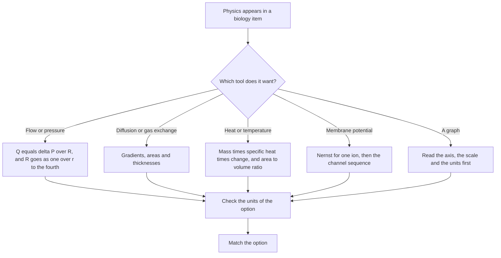

# Physics for the Biological Sciences

ACER describes the Biological and Physical Sciences section as assessing the ability "to identify knowledge in new contexts, and analyse and interpret data", and places the knowledge ceiling at a level that "generally corresponds to the first year of university studies". Physics enters that section in two ways: as the handful of relationships that explain how a body works, and as the tool for reading the graphs, axes and units that a data question puts on the page. ACER publishes no per-topic weightage for the section, so the split below is StudyRoadmap's own study organisation.

The physics worth carrying is short. Almost every biological question that uses it comes back to one of four ideas: pressure drives flow, gradients drive diffusion, energy is conserved, and everything is measured in units you can check.

### 🟢 Lite — Quick Review (1h–1d)

**The toolbox.**

| Tool | The relation | Where a biology question uses it |
|---|---|---|
| Force | F = ma, F in newtons, a in metres per second squared | muscle contraction, pressure in a vessel |
| Work and power | W = F × d in joules; P = W ÷ t in watts | the heart's work, basal metabolic rate |
| Pressure | P = F ÷ A in pascals | blood pressure, alveolar pressure |
| Hydrostatic pressure | P = ρgh | the pressure at the bottom of a column of blood |
| Flow and resistance | Q = ΔP ÷ R | blood flow, airflow |
| Poiseuille's law | R = 8ηL ÷ πr⁴ | why arterioles are the control point for blood flow |
| Gas law | PV = nRT | respiratory volumes, gas exchange |
| Partial pressure | the pressures of a mixture add up to the total | alveolar, arterial and venous gases |
| Diffusion | rate rises with area and concentration difference, and falls with distance | gas exchange across the alveolar membrane |
| Membrane potential | V = (RT ÷ zF) ln([outside] ÷ [inside]) | the resting potential, the action potential |
| Heat | Q = mcΔT, with c ≈ 4.2 kJ per kg per °C for water | heat loss, fever, cooling an animal |
| Wave speed | v = fλ | ultrasound and sound, and why frequency sets resolution |

**Units worth knowing by heart.**

| Quantity | Unit | Quantity | Unit |
|---|---|---|---|
| Length | metre (m) | Energy | joule (J) |
| Mass | kilogram (kg) | Power | watt (W) |
| Time | second (s) | Pressure | pascal (Pa) |
| Force | newton (N) | Volume | litre (L), 10⁻³ m³ |
| Amount of substance | mole (mol) | Electric potential | volt (V) |

A dimensional check is the fastest way to catch a manipulated option. Work and energy are in joules and power is in watts, so a "power" answer quoted in joules is wrong before you read the rest of it. Pressure is force per unit area, and a blood pressure quoted in millimetres of mercury is a height used as a unit of pressure, which works only because mercury is dense.

**Memorise for the Lite tier:**
- F = ma; weight is a force (mg) and mass is not.
- Work = force × distance, in joules; power = work per second, in watts.
- Pressure = force per unit area; pressure at depth is ρgh.
- Flow = pressure difference divided by resistance.
- Poiseuille: resistance ∝ 1/r⁴, so radius dominates everything else.
- PV = nRT, with R = 8.314 J per mol per kelvin.
- Partial pressures add; a dissolved gas follows its partial pressure (Henry's law).
- Diffusion rate ∝ surface area × concentration difference, and falls with membrane thickness.
- The Nernst equation gives the equilibrium potential of one ion; the membrane potential sits near the potassium value.
- Heat = mass × specific heat × temperature change; water's specific heat is about 4.2 kJ per kg per °C.
- Wave speed = frequency × wavelength; a shorter wavelength means finer resolution.

### 🟡 Standard — Full Coverage (1–2d)

#### Worked example: why an arteriole decides the flow

A vessel of radius 4 mm is narrowed to a radius of 2 mm. What happens to the flow through it?

Start with the flow relation, Q = ΔP ÷ R, and take the resistance from Poiseuille's law, R = 8ηL ÷ πr⁴. Viscosity and length are unchanged, so the only variable is r⁴. The radius halves, so r⁴ falls by a factor of 16, so resistance rises sixteen-fold, and with the same pressure difference the flow falls to one-sixteenth.

That single relationship explains a chain of clinical facts. Arterioles have the smallest radius of all the vessels, so they carry the largest share of the resistance and are the main site of vascular resistance. It is why the radius is the variable the body controls when it redistributes flow: arteriolar constriction in one organ and dilatation in another is how blood is shifted to a working muscle. And it is why a stenotic valve or a narrowed artery creates a pressure drop across the narrowing. The same law applies to the airways, where smooth muscle tone sets the radius.

#### Worked example: reading a blood gas

An arterial sample from a healthy adult at sea level gives oxygen partial pressure 95 mmHg, carbon dioxide partial pressure 40 mmHg and pH 7.40. Alveolar air gives an oxygen partial pressure of 100 mmHg, and mixed venous blood gives an oxygen partial pressure of 40 mmHg.

The arterial value sits slightly below the alveolar value because a small amount of venous blood mixes with the pulmonary venous outflow, and the difference across the alveolar membrane is the diffusion gradient oxygen needs. Carbon dioxide runs the other way, leaving the blood into the alveolus, so venous carbon dioxide is higher than arterial.

Why does carbon dioxide move so much faster than oxygen, when the arteriovenous difference for carbon dioxide is the smaller of the two? Two physical reasons. Carbon dioxide is far more soluble in plasma, so it carries more per unit of partial pressure change. And it is converted to bicarbonate inside the red cell by carbonic anhydrase, which removes the dissolved form and keeps the gradient steep. Oxygen has no conversion reaction to keep its gradient up, so a diffusion problem hits oxygen first.

#### Worked example: Laplace's law in the alveolus

An alveolus is a sphere, so the pressure inside it needed to keep it open is P = 2T ÷ r, where T is the surface tension of the lining film and r the radius. Rearranged, the pressure needed to hold an alveolus open falls as the radius rises, and the consequence of that is the point.

Two alveoli of different radii in contact with the same air will not stay that way. The smaller one needs a higher internal pressure to stay open, so it empties into the larger one, and the larger grows. Left alone the lung would collapse into a few large balloons. Two features prevent this. Surfactant from type II pneumocytes lowers the surface tension, and lowers it more in small alveoli, which equalises the pressure. Negative intrapleural pressure holds the lung against the chest wall and keeps the airways open during inspiration.

The clinical consequences run straight from the law. When surfactant is deficient, as in neonatal respiratory distress syndrome, the pressure needed to keep small alveoli open rises and they collapse into atelectasis. When surfactant is destroyed, as in emphysema, the surface tension of the remaining tissue rises and large alveoli rupture, letting air into the pleural space.

#### Worked example: the membrane potential and the action potential

A neuron's resting membrane potential sits at about −70 mV, inside negative relative to outside. Two ion gradients explain most of it: potassium is roughly 40 times more concentrated inside the cell, and sodium roughly 10 times more concentrated outside.

The equilibrium potential of an ion is what that ion's concentration gradient alone would produce. For potassium it is about −90 mV, for sodium about +60 mV. The resting membrane potential sits near the potassium value because at rest the potassium channels are open and potassium dominates, which is why the resting potential changes when extracellular potassium changes.

An action potential follows a threshold in a fixed sequence. Voltage-gated sodium channels open, sodium moves in down its electrochemical gradient, and the inside goes positive; that is depolarisation. Sodium channels inactivate and potassium channels open, potassium leaves, and the inside goes negative again; that is repolarisation. The potassium channels close slowly, which produces the after-hyperpolarisation. Each phase has a refractory period, and that is the point of the arrangement: the refractory period makes an action potential travel one way and stops the cell firing again immediately. In myelinated axons the action potential jumps between nodes of Ranvier, which is faster than continuous conduction.

#### The four areas physics keeps showing up in

**Fluids and pressure in the circulation.** Capillary filtration depends on the balance between the hydrostatic pressure pushing fluid out and the oncotic pressure pulling it in, and albumin contributes most of the oncotic pressure. Fluid leaves the capillary at the arteriolar end, where hydrostatic pressure is highest, and most of it returns along the venous side, with the rest collected by the lymphatics. When hydrostatic pressure rises, as in heart failure or in standing for a long time, more fluid leaves than returns and oedema develops. Low albumin produces oedema with a normal heart.

**Heat and temperature regulation.** Body temperature is a set point in the hypothalamus, defended within a narrow band. Heat is produced by metabolism and by muscle contraction, including shivering, and it is lost by radiation, conduction, convection and evaporation. Radiation rises steeply with absolute temperature, so it dominates at body temperature. Evaporation is the only route that removes heat without a temperature gradient, which is why sweating works in a dry climate and fails in a humid one.

**Why a mouse eats more than a cow.** Heat production scales with body mass, because metabolically active tissue scales with mass, while heat loss depends on surface area, and surface area scales with mass to the two-thirds power. So the ratio of heat loss to heat production rises as size falls, and a small animal raises heat production to compensate, which means eating more. A newborn faces the same geometry with less insulation and a large brain proportion consuming a large share of the energy.

**Electricity and waves.** The electrocardiogram records summed cardiac depolarisation: the P wave is atrial depolarisation, the QRS complex ventricular depolarisation, the T wave ventricular repolarisation. A defibrillator delivers an unsynchronised shock so the myocardium depolarises all at once; cardioversion delivers a synchronised shock timed to the R wave. For imaging, ultrasound frequency sets wavelength through v = fλ, and a higher frequency gives finer resolution but less penetration, while x-ray attenuation rises with density and thickness and magnetic resonance imaging uses fields and radio waves for soft tissue with no ionising radiation.

### 🔴 Deep — Mastery (3–5d)

#### Common mistakes

Treating mass and weight as the same quantity. Weight is a force, the product of mass and gravitational acceleration, measured in newtons.

Mixing up pressure with force. Pressure is force per unit area, which is why a sharp needle hurts more than a blunt one for the same force.

Dropping the radius term in Poiseuille's law. Halving a radius does not halve the flow; it cuts the flow to a sixteenth.

Reading a graph axis as a linear scale when it is logarithmic. On a log axis equal distances represent equal ratios, so read the axis label before the shape of the curve.

Treating the ideal gas law as exact at body temperature. It is an approximation, and a gas that dissolves in liquid behaves differently from one that does not, which is the basis of blood gas measurement.

Assuming heat loss is the same at every temperature. Radiation rises with the fourth power of absolute temperature, so a hot animal radiates far more than a cold one.

#### Exam traps

Work in a biology question means force multiplied by distance, so a heart ejecting blood against a pressure does work equal to pressure multiplied by volume.

The Nernst equation gives the equilibrium potential for a single ion, and the resting membrane potential is not any one of them. It is dominated by potassium at rest and by sodium during the rising phase of an action potential.

Surface area to volume ratio, not body size on its own, explains heat loss, and the exponent two-thirds is what makes the comparison work.

A respiratory quotient above 1 means more oxygen is being used than the carbon dioxide produced predicts, as on a high-fat diet and in diabetes; below 1 means carbohydrate is being used.

#### Integrated mini-cases

**Case one.** A ventilated patient has a rising peak airway pressure and a falling tidal volume despite an unchanged ventilator setting. What physics explains this? Airway resistance rises steeply as the radius of the airway falls, and the same r⁴ relationship from Poiseuille's law applies to the airway as to a blood vessel. A thick, bronchospastic airway or a mucus plug produces a large rise in resistance for a small change in radius, which shows up as a higher pressure needed to move the same volume of gas. That is also why bronchodilators work.

**Case two.** A runner has a high maximal oxygen consumption, and training has increased the arterioles in the muscle. Why does that matter? Because arterioles hold the bulk of the resistance to flow, so changing their radius changes total resistance more than changing any other vessel in the chain. Widening them lowers the resistance of the muscle bed, which allows more blood to reach the muscle at the same pressure, and it does so at the cost of diverting flow from other organs.

#### 🧠 Memory Anchors

- **"Radius to the fourth."** The reason a narrowed artery starves a tissue and a narrowed airway raises pressure fast.
- **"Gradient drives diffusion, difference drives flow."** One sentence covers gas exchange and the circulation.
- **Flashcard Q&A:**
  - *Work done by the heart?* → Pressure multiplied by volume, in joules.
  - *Resting membrane potential of about minus 70 mV?* → The potassium equilibrium potential, because potassium dominates at rest.
  - *Why does surfactant matter?* → It lowers surface tension more in small alveoli, so they do not empty into large ones.
  - *Specific heat capacity of water?* → About 4.2 kJ per kg per °C, so body temperature changes slowly.

#### Internal links

- [GAMSAT exam hub](/exams/gamsat/) — the three sections and how ACER builds the paper.
- [Data Analysis and Graph Interpretation](/notes/gamsat/bio-physical-sciences/bps-001/) — the axis-and-scale work that every graph question needs.
- [Chemistry Foundations](/notes/gamsat/bio-physical-sciences/bps-005/) — concentration, pH and energy changes in the same applied context.

The section structure and the quoted description of what ACER assesses come from ACER's GAMSAT materials (https://www.acer.edu.au/gamsat and https://gamsat.acer.org/). ACER publishes no per-topic weightage for the Biological and Physical Sciences section, so the weights on this page are StudyRoadmap's own prioritisation.

---

## Continue your study

- **[View this topic in your GAMSAT (Graduate Medical School Admissions Test) roadmap](/roadmap/?exam=gamsat&duration=1mo)** — see where this topic sits in your personalised plan
- **[Build a quick revision plan](/roadmap/?exam=gamsat&duration=1d)** — 1-day sprint covering the highest-weight topics
- **[GAMSAT (Graduate Medical School Admissions Test) exam overview](/exams/gamsat/)** — pattern, eligibility, and syllabus
- **[All Biological and Physical Sciences notes](/notes/gamsat/bio-physical-sciences/)** — browse sibling topics in this subject
