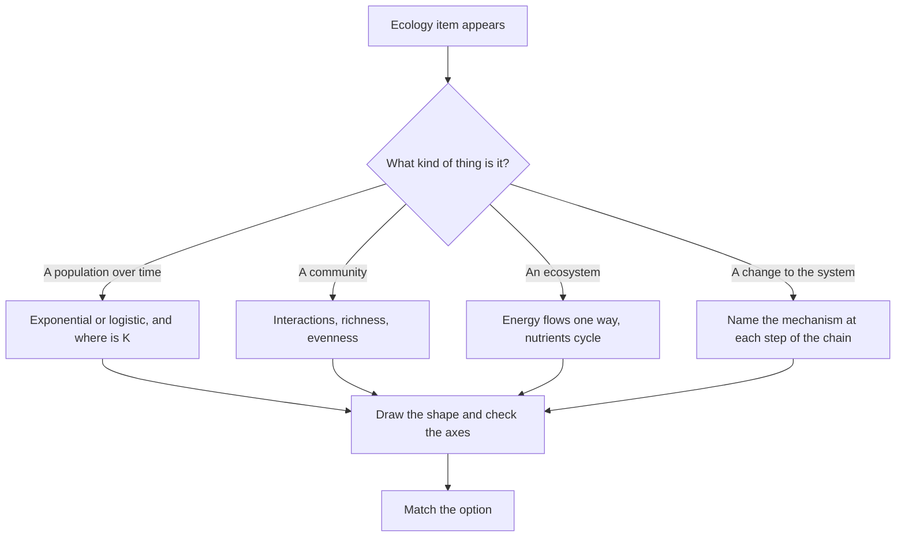

# Ecology and Environment

ACER states that the Biological and Physical Sciences section assesses the ability "to identify knowledge in new contexts, and analyse and interpret data", and that its knowledge ceiling "generally corresponds to the first year of university studies". Ecology turns up in that paper in three forms: as a curve to read off a graph, as a cycle to trace, and as a chain of consequences to follow after something changes. It rarely turns up as a list to memorise.

ACER publishes no per-topic weightage for the section, so the split below is StudyRoadmap's own study organisation.

### 🟢 Lite — Quick Review (1h–1d)

**Population growth.**

| Idea | What it means | The number that matters |
|---|---|---|
| Exponential growth | unlimited resources, no limit reached; the curve is J-shaped | the intrinsic rate of increase, r |
| Logistic growth | resources become limiting; the curve is S-shaped and levels off | the carrying capacity, K, and r |
| Carrying capacity | the population size the environment sustains indefinitely | K |
| Density-dependent regulation | crowding: competition, predation, disease, waste | stronger as density rises |
| Density-independent regulation | weather: drought, fire, freeze, storm | acts regardless of density |
| r-selected and K-selected traits | many small offspring and fast growth, or few large offspring and investment | unpredictable versus stable environments |

In the logistic model the growth rate peaks at half the carrying capacity, and that half-way point is where the net addition is greatest. A population that overshoots K crashes; a population below K grows, and a population above K shrinks.

**Interactions between species.**

| Interaction | Effect on A | Effect on B | Example |
|---|---|---|---|
| Competition | − | − | two species for the same nitrogen source |
| Predation | + | − | a fox and a rabbit |
| Parasitism | + | − | a tapeworm and its host |
| Mutualism | + | + | mycorrhizal fungi and plant roots |
| Commensalism | + | 0 | cattle and egrets at a waterhole |
| Amensalism | − | 0 | a large tree shading out a seedling |
| Neutralism | 0 | 0 | rare; the two organisms still interact somehow |

**Energy and nutrients.**

| Concept | What it means |
|---|---|
| Producers | autotrophs that capture energy from sunlight through photosynthesis |
| Trophic levels | producers, then primary, secondary and tertiary consumers, with decomposers on every level |
| Energy transfer | only a fraction of the energy at one level reaches the next, roughly a tenth by the usual rule of thumb, and the figure is an approximation rather than a constant |
| Energy pyramid | always upright, because energy is lost at every step |
| Biomass pyramid | upright in most systems, but inverted in some aquatic ones where phytoplankton have a small standing biomass and a fast turnover |
| Nutrient cycling | elements move round a cycle with no loss, while energy flows in from the sun and leaves as heat |

**The cycles.**

| Cycle | Where the reservoir is | The key processes |
|---|---|---|
| Carbon | the atmosphere and the oceans | photosynthesis removes carbon dioxide, respiration and decomposition return it, combustion adds it |
| Nitrogen | the atmosphere, which holds most of it as unreactive nitrogen gas | fixation by bacteria makes it usable, nitrification makes it into nitrate, denitrification returns it to the air |
| Phosphorus | rocks and sediments, with no gas phase | weathering of rock releases it, and sedimentation returns it to rock |
| Water | the oceans | evaporation powered by the sun, condensation, precipitation, runoff |

**The other core ideas.**
- **Liebig's law of the minimum**: growth is set by the scarcest essential resource, not by the total supply. Nitrogen limits most terrestrial systems and phosphorus limits many fresh waters.
- **Redfield ratio**: marine plankton grow in roughly the proportions 106 carbon to 16 nitrogen to 1 phosphorus.
- **Species richness versus evenness**: richness counts how many species are present, evenness describes how equally the individuals are spread among them.
- **Species-area relationship**: a larger area holds more species, and the relationship is a power law rather than a straight line.
- **Soil horizons**: organic layer, topsoil, leached layer, accumulated layer, weathered parent material, bedrock. Sand drains fast and holds few nutrients, clay holds water and cations, loam sits between them.
- **Biodiversity loss drivers**: the HIPPO list, habitat destruction, invasive species, pollution, population growth and overexploitation.

**Memorise for the Lite tier:**
- Exponential growth is J-shaped, logistic growth is S-shaped, and the logistic rate peaks at half the carrying capacity.
- Energy flows one way and is lost as heat at every trophic level; nutrients cycle.
- The energy pyramid is always upright; the biomass pyramid is not.
- Nitrogen is the limiting nutrient in most land systems, phosphorus in most fresh waters.
- Nitrogen fixation is bacteria only, and nitrification is a two-step oxidation by two different bacterial groups.
- Phosphorus has no atmospheric phase, so its cycle is slow.
- The two ozone questions are different: ozone depletion is ultraviolet radiation reaching the surface, and the greenhouse effect is infrared radiation retained by atmospheric gases.
- Eutrophication is nutrient enrichment, and the oxygen crash that follows the bloom comes from decomposition, not from the algae themselves.
- Mutualism benefits both, commensalism benefits one and harms neither.

### 🟡 Standard — Full Coverage (1–2d)

#### Worked example: reading a population curve

A graph shows a population that starts low, rises slowly, then steepens, then bends over and levels off. It never overshoots and never falls.

That shape is logistic growth. The rising part is the population moving toward the carrying capacity, and the horizontal line at the top is the carrying capacity itself, the population size the environment sustains. The curve is telling you that resources are now limiting, because it has stopped steepening and started flattening.

Change one thing in the question. Suppose a drought cuts the water supply, so K falls. Two things follow on the graph. The population, which sits above the new carrying capacity, will crash, because the number of individuals exceeds what the environment supports. And the whole curve shifts down, so a student who remembers the old K and reads the new one off the same graph answers wrongly. That is why K is a property of the environment rather than of the population, and why a graph with two plateaus at different heights is a K-change question rather than a growth-rate question.

A curve that rises and then falls without plateauing is the overshoot-and-crash pattern, and the crash can go well below K, because the damage to the resource is sometimes permanent.

#### Worked example: the lake that turned green

A farmer fertilises fields beside a lake, and a week later the lake develops a green surface scum, then loses its submerged plants, then a fish kill leaves dead fish along the shore.

The sequence has a chemical cause at every step. Fertiliser runoff carries nitrogen and phosphorus into the lake, and phosphorus is the limiting nutrient in most fresh waters, so the surplus is taken up by algae and cyanobacteria. The bloom shades the submerged plants, which die because they cannot photosynthesise. The algae then die, and decomposition of that algal mass is what consumes the dissolved oxygen. The oxygen crash kills the fish, so the fish kill is the last step of the chain rather than the first.

The recovery story is the reverse. When fertiliser input is cut, the algal biomass falls, the plants return, and the system moves back toward its former state. That works because phosphorus bound in lake sediments is slowly released, so recovery takes longer than the damage does. A lake in this state is called eutrophic, and the human-driven version is cultural eutrophication, as distinct from the natural slow enrichment that moves a lake from oligotrophic to eutrophic over geological time.

The exam question in this area takes the form of a chain: given a change, name the step that comes next. The discipline is to name the mechanism each time, because the options differ by mechanism and not by adjective.

#### Worked example: biomagnification

In the classic teaching example of a persistent organochlorine pesticide, the concentration in a food chain runs: plankton at about 0.03 parts per million, small fish at about 0.5, fish-eating birds at about 2, and birds of prey at about 25.

Each step up multiplies the concentration rather than adding to it, and two properties produce that. The compound is not broken down, so it persists in the environment for years, and it is not excreted, so it stays in the animal. It also moves from water into producers and from prey into predators, so each level inherits the entire load of the level below it plus its own uptake.

Bioaccumulation is the build-up inside one organism over time, and biomagnification is the increase up the food chain. The distinction matters because the control differs, and because biomagnification explains why the top of the food chain suffers most. The clinical endpoint of the classic example is eggshell thinning and reproductive failure in the birds of prey, because the shell depends on calcium metabolism, which the pesticide disrupts.

#### Worked example: biodiversity data

A table lists five species with abundances of 40, 25, 20, 10 and 5, and a second list shows the same total of individuals spread across ten species.

The first list has higher richness and the second has higher evenness, and a question asking "which community is more diverse" turns on which definition it wants. Richness counts species; evenness measures how equally the individuals are distributed. The Shannon index combines both by weighting each species by its proportion, so a community dominated by one species scores lower than an even one with the same richness. The Simpson index works from the other direction, using the sum of the squared proportions, so it reads high when the community is dominated by one species, and it is reported as one minus that sum so that larger means more diverse.

Species-area data is read the same way. Plot the number of species against the area sampled and the relationship is a power law, so a doubling of area gives a smaller proportional increase in species. Extrapolating that curve to an area nobody has surveyed is the classic overreach, and it is the point of a question about how much forest remains after a road is built through it.

#### Soils and succession

Primary succession starts on bare rock with no soil, and lichens are the colonisers. They weather the rock and add organic matter as they die, which is how the first soil forms. Mosses and herbs follow, then shrubs, then trees, and the system moves toward a climax community. Secondary succession starts where soil is already present, which is why it is faster, and it is the normal path after a fire or a flood.

Connell's work on Douglas fir gave the standard sequence of models. Facilitation comes first: lichens and mosses improve conditions for seedling establishment. Inhibition comes next: grasses and shrubs shade out the tree seedlings. Tolerance comes last: the shade-tolerant fir seedlings survive under the canopy and replace the pioneers. The intermediate disturbance hypothesis adds that diversity peaks at intermediate levels of disturbance, because severe disturbance excludes the competitive dominants and mild disturbance lets them exclude everything else.

Soil is read from the top down: organic layer, topsoil with its humus and biology, the leached layer, the accumulated layer holding clay, iron and aluminium moved down from above, then weathered parent material and bedrock. Texture then decides what the soil can do.

### 🔴 Deep — Mastery (3–5d)

#### Common mistakes

Treating carrying capacity as a property of the species rather than of the environment. The same species reaches a different K on a different island, and K changes when the environment changes.

Reading an energy pyramid as if it were a biomass pyramid or a pyramid of numbers. Energy is always lost upward, so the energy pyramid is always upright, while a forest has a small number of large producers and many insects, and an aquatic system can invert its biomass pyramid.

Confusing the nitrogen cycle with the phosphorus cycle. Nitrogen has a large atmospheric reservoir and can be fixed from the air; phosphorus cannot leave the rock cycle quickly and has no gas phase.

Calling the ozone hole global warming. Depletion of stratospheric ozone lets more ultraviolet radiation reach the surface, and the greenhouse effect is a separate mechanism about infrared radiation and retained heat.

Assuming eutrophication kills fish because the algae block the light. Blocking the light kills the plants; the fish die from the oxygen consumed when the biomass decomposes.

#### Exam traps

A question about limiting nutrients in a lake and one about limiting nutrients in a forest have different answers, because phosphorus is the limiting nutrient in fresh water while nitrogen is limiting in most terrestrial systems and in the ocean.

Denitrification returns nitrogen to the atmosphere and is anaerobic, carried out by bacteria. Nitrification is two separate aerobic steps, ammonia to nitrite and then nitrite to nitrate, each with its own bacterial group.

Ecosystem services, such as pollination, water purification and carbon storage, are what make biodiversity loss a management question rather than an aesthetic one.

Mark-recapture estimates a population size from the proportion of marked animals that reappear in a second sample, and it assumes the marked animals have mixed back into the population, that the population is closed between samples, and that marking did not change the chance of being caught or of surviving.

Acidification works through the soil, not only through the leaves. Hydrogen ions displace calcium and magnesium from soil particles and mobilise aluminium, which is toxic to aquatic organisms, so the first species lost from an acidified stream are those sensitive to low pH.

#### Integrated mini-cases

**Case one.** A city introduces grass strips between farm fields and a river. Within a few years the algal bloom stops and submerged plants return. Explain the change and its limits. The strips intercept nutrient-rich runoff before it reaches the lake, so less phosphorus enters and the algae lose their advantage. The limits matter as much as the mechanism: phosphorus already bound in lake sediments is released slowly, so recovery lags behind the reduction in input, and the scheme does nothing about the nutrients already in the water column.

**Case two.** A bird population has halved over ten years while the insect population its chicks eat is stable. Suggest a hypothesis and name the test. A trophic effect rather than a food shortage is one candidate, and so is a contaminant that affects the birds alone, such as an organochlorine pesticide that biomagnifies and disrupts reproduction. The test is to measure the contaminant in birds and in soil or water, and to look at breeding success rather than numbers alone, since a population can fall through failed reproduction while the adults survive.

#### 🧠 Memory Anchors

- **"Energy in, heat out, nutrients round."** One sentence separates the two systems.
- **"Liebig's minimum, Redfield's ratio."** The scarcest resource rules, and marine plankton grow near 106:16:1.
- **"Fix it, nitrify it, denitrify it."** Nitrogen moves from the air into a plant-usable form and back again.
- **"HIPPO for the drivers."** Habitat, invasives, pollution, people, overharvest.
- **"Ozone out, greenhouse in."** Ozone loss is ultraviolet arriving; the greenhouse effect is infrared staying.
- **Flashcard Q&A:**
  - *Where does logistic growth peak?* → At half the carrying capacity, where the net addition is greatest.
  - *Which pyramid can be inverted?* → Biomass, and sometimes numbers, but never energy.
  - *Which nutrient limits most fresh waters?* → Phosphorus.
  - *Primary or secondary succession after a wildfire?* → Secondary, because the soil survives.

#### Internal links

- [GAMSAT exam hub](/exams/gamsat/) — the three sections and how ACER builds the paper.
- [Data Analysis and Graph Interpretation](/notes/gamsat/bio-physical-sciences/bps-001/) — where the growth curves and diversity indices get read.
- [Chemistry Foundations](/notes/gamsat/bio-physical-sciences/bps-005/) — the pH and concentration work behind acidification and nutrient limits.

The section structure and the quoted description of what ACER assesses come from ACER's GAMSAT materials (https://www.acer.edu.au/gamsat and https://gamsat.acer.org/). ACER publishes no per-topic weightage for the Biological and Physical Sciences section, so the weights on this page are StudyRoadmap's own prioritisation.

---

## Continue your study

- **[View this topic in your GAMSAT (Graduate Medical School Admissions Test) roadmap](/roadmap/?exam=gamsat&duration=1mo)** — see where this topic sits in your personalised plan
- **[Build a quick revision plan](/roadmap/?exam=gamsat&duration=1d)** — 1-day sprint covering the highest-weight topics
- **[GAMSAT (Graduate Medical School Admissions Test) exam overview](/exams/gamsat/)** — pattern, eligibility, and syllabus
- **[All Biological and Physical Sciences notes](/notes/gamsat/bio-physical-sciences/)** — browse sibling topics in this subject
