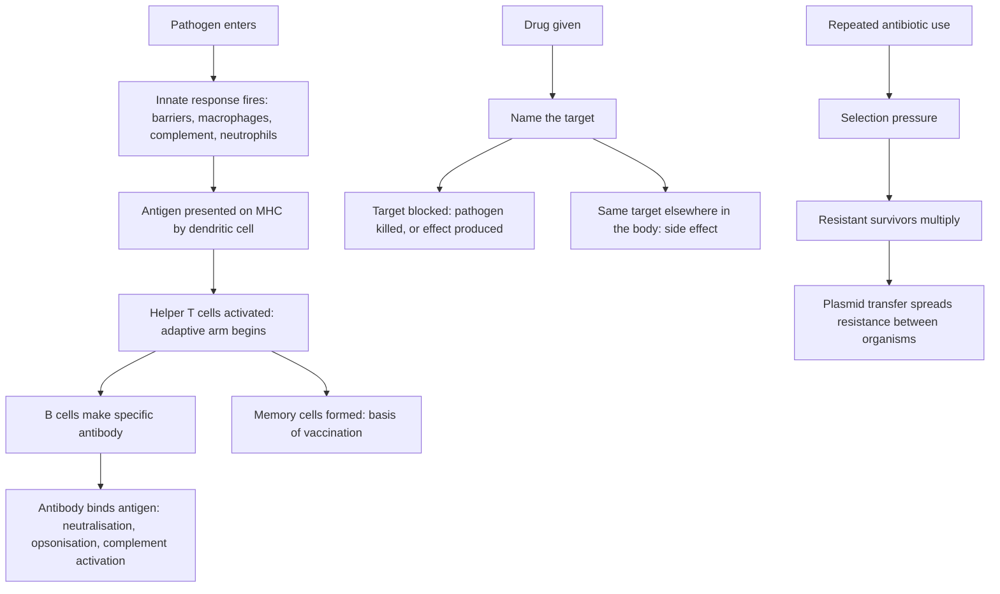

# Disease, Immunity and Pharmacology

The Biological and Physical Sciences section of GAMSAT is 75 multiple-choice questions in 150 minutes, and ACER says it assesses the ability "to identify knowledge in new contexts, and analyse and interpret data". The knowledge ceiling is the biology and chemistry that "generally corresponds to the first year of university studies".

That framing changes what to study. A question in this topic rarely asks you to name an immune cell. It gives you a scenario, a trace or a result, and asks you to work out which process is running and why the patient looks the way they do. So immunity is worth learning as a set of decision rules — what happens first, what triggers what, which failure produces which clinical sign — and pharmacology is worth learning as a set of targets: the drug, the molecule it binds, the consequence of that binding, and the side effect that falls out of the same mechanism. Pharmacology is the easier of the two, because a mechanism, once you know it, generates its own side effects and you never have to memorise them separately.

ACER publishes no per-topic weightage for this section, so the split between immunity, disease mechanisms and drug classes below is StudyRoadmap's own study organisation.

### 🟢 Lite — Quick Review (1h–1d)

**Innate versus adaptive immunity.** Both are needed and they cover different jobs.

| | Innate | Adaptive |
|---|---|---|
| Speed | Immediate, minutes to hours | Days, because it needs clonal expansion |
| Specificity | Pattern-based, recognises classes of danger | Recognises one specific antigen |
| Cells | Neutrophils, macrophages, dendritic cells, mast cells, natural killer cells | B cells producing antibody, plus helper, cytotoxic and regulatory T cells |
| Memory | None | Yes, which is the basis of vaccination |
| Compartments | Barriers, body fluids, tissues | Blood, lymph, spleen, lymph nodes |

The two are linked. An antigen-presenting cell such as a dendritic cell takes up material in infected tissue, travels to a lymph node, and presents peptide on MHC class II to helper T cells. That bridge is what converts a nonspecific response into a specific one.

**The five antibodies, by job.**

| Class | Where it lives | Job |
|---|---|---|
| IgM | Blood | First responder; pentamer, so it binds hard |
| IgG | Blood and tissues | Most abundant; crosses the placenta; gives long-term immunity |
| IgA | Mucosal surfaces and secretions | Guards the entry points: gut, airway, breast milk |
| IgE | Bound to mast cells | Triggers allergy and parasite defence |
| IgD | Surface of naive B cells | Receptor that sits there and does very little |

**Inflammation, in order.** Damage is detected by resident macrophages, which release TNF and IL-1 and other mediators. Blood vessels dilate and their walls become more permeable, so the tissue becomes red, warm, swollen and painful. White cells roll along the vessel wall, stick to it, squeeze through the wall and move into the tissue. They engulf the damaged material and the invaders. Then the process resolves, or it fails to and becomes chronic.

**The five cardinal signs of inflammation, with their Latin names.** Rubor (redness), calor (heat), tumor (swelling), dolor (pain), functio laesa (loss of function). If a stem lists signs, match each sign to the mechanism: redness and heat to vasodilation, swelling to increased permeability plus fluid shift, pain to nerve ending irritation and pressure, loss of function to the tissue being damaged rather than to any immune step.

**Disease mechanisms, three families.**

- **Infection** — a pathogen enters, multiplies and damages. The questions ask about transmission route, the incubation period, and which defences act at each stage.
- **Inflammation** — the response itself becomes the disease when it is excessive or misdirected, as in allergy, autoimmunity and chronic inflammatory disease.
- **Neoplasia** — cells escape normal growth control. The questions ask about what the tumour is doing that normal tissue does not.

**Neoplasia: what makes a tumour malignant.** Not one feature but a set. Sustained proliferation. Evasion of the signals that normally stop division, which usually means loss of function in tumour suppressor genes such as RB1 and TP53. Replicative immortality, achieved by reactivating telomerase so the telomere no longer shortens with each division. Invasion through the basement membrane into surrounding tissue. Metastasis to distant sites. Angiogenesis, because a tumour growing past a couple of millimetres needs a blood supply. Altered metabolism, favouring fermentation of glucose even where oxygen is available. Evasion of immune attack.

**Benign versus malignant, and how tumours are named.**

- Carcinoma — from epithelium. Sarcoma — from connective tissue, muscle or bone. Leukaemia and lymphoma — from blood cells and lymphatic tissue.
- Benign tumours usually stay put and do not recur after removal. Malignant tumours invade and can seed elsewhere.
- Tumours are often named for the cell of origin plus the behaviour, and the "-oma" ending by itself tells you nothing reliable about whether a tumour is dangerous.

**Pharmacology: the target map.** Learn the class by the molecule it hits, because that is what an item will ask.

| Drug class | Target | Effect | Side effect that falls out of the same mechanism |
|---|---|---|---|
| Beta-lactam antibiotics | Penicillin-binding proteins; block peptidoglycan cross-linking | Cell wall synthesis stops, bacterium lyses | Killing gut flora; rash; anaphylaxis |
| Macrolides | 50S ribosomal subunit | Protein synthesis stops | GI upset;QT prolongation risk |
| Aminoglycosides | 30S subunit, causes misreading of mRNA | Bactericidal | Ototoxicity and nephrotoxicity; ineffective against anaerobes |
| Fluoroquinolones | DNA gyrase and topoisomerase IV | DNA replication stops | Tendon damage; QT prolongation; convulsions |
| Sulfonamides plus trimethoprim | Folate synthesis, two steps in sequence | Bacteria cannot make folate | Rash; blood dyscrasias; trimethoprim causes hyperkalaemia |
| NSAIDs | Cyclooxygenase, so less prostaglandin | Less pain and less inflammation | Gastric bleeding and kidney injury; COX-1 inhibition also hits platelets |
| Paracetamol | Mainly central cyclooxygenase | Analgesic, weak anti-inflammatory | Liver necrosis in overdose, because the toxic metabolite is normally cleared by glutathione |
| Opioids | Mu, kappa and delta receptors | Less pain, slower gut, lower cough reflex | Respiratory depression, constipation, dependence |
| ACE inhibitors | Conversion of angiotensin I to angiotensin II | Less vasoconstriction, less aldosterone, less sodium retention | Dry cough, hyperkalaemia, hypotension; dangerous in bilateral renal artery stenosis |
| Beta blockers | Beta-1 receptors in the heart | Slower rate, less contractility | Masks the warning signs of hypoglycaemia; bronchospasm if non-selective |
| Calcium channel blockers | L-type calcium channels | Less calcium entry, so less contraction and less vasoconstriction | Dihydropyridines cause reflex tachycardia; non-dihydropyridines slow the heart and reduce contractility |
| Loop diuretics | NaKCl cotransporter in the thick ascending limb | More salt and water out | Hypokalaemia, hypotension |
| Thiazide diuretics | NaCl cotransporter in the distal tubule | More salt and water out | Hypokalaemia, hypercalcaemia, gout |
| Potassium-sparing diuretics | Aldosterone receptor | Less sodium and water out | Hyperkalaemia |
| Statins | HMG-CoA reductase | Less cholesterol made by the liver | Muscle pain; rarely severe muscle breakdown with kidney injury |

**How resistance develops.** A population of bacteria is already varied. An antibiotic kills the susceptible ones and leaves the resistant ones, so the population shifts toward resistance. Four mechanisms do the work: destroying the drug (beta-lactamase cleaves penicillins), changing the target (altering the binding site), reducing uptake, or pumping the drug out. What accelerates it is unnecessary antibiotic use, because that is the selection pressure. What spreads it fastest is horizontal gene transfer, where a bacterium picks up a resistance plasmid from another bacterium or from free DNA in the environment, which is how a single resistant organism can become a whole hospital problem. Biofilms, which are communities of bacteria attached to a surface and wrapped in a shared matrix, are also hard to treat because the matrix limits drug penetration and the cells in the middle are slow-growing.

**Memorise for the Lite tier.**

- Innate is fast and non-specific with no memory; adaptive is slow, specific and remembers.
- Antibodies in the first responder order: IgM, then IgG for long-term protection, IgA at mucosal surfaces, IgE on mast cells.
- Inflammation mediators come from resident macrophages first; neutrophils arrive second.
- Rubor, calor, tumor, dolor, functio laesa — and the mechanism behind each.
- A tumour is malignant when it invades and metastasises, not merely when it is large.
- Carcinoma is epithelial, sarcoma is mesenchymal.
- Every drug class in the table has a target. If you cannot name the target, you cannot answer the item.
- ACE inhibitors cause a dry cough because they also block bradykinin breakdown.
- ACE inhibitors and potassium-sparing diuretics cause hyperkalaemia; loop and thiazide diuretics cause hypokalaemia.
- Resistance is not the drug failing; it is the population changing, and the mechanism matters because it decides whether the drug still has any use.
- Horizontal gene transfer, not mutation, is what turns one resistant bacterium into a resistant population fast.

### 🟡 Standard — Full Coverage (1–2d)

#### Worked example: a patient with fever, a rash and a stiff neck

The stem describes a young adult with a fever, a non-blanching rash and neck stiffness, and asks which host response is contributing to the illness.

**Step one: separate the pathogen's effect from the host's effect.** The pathogen is causing the direct damage. The fever and the stiffness are the host's response. So the item is testing whether you can distinguish them.

**Step two: place the signs on the innate/adaptive axis.** Fever is innate: it is driven by cytokines from macrophages and monocytes resetting the hypothalamic set point. The stiffness is the host's inflammatory response in the meninges, which is also largely innate, though the specific pathogen recognition that triggers it may involve antibodies from an adaptive response if the patient has been exposed before. The rash itself is a vascular phenomenon, so it is innate in mechanism.

**Step three: check the option against that.** An option saying "the rash reflects adaptive immune memory" is wrong. An option saying "the fever is produced by the pathogen directly" is wrong, because pyrogens come from the host's own cells. An option saying "the inflammatory response is contributing to the patient's condition" is right, and note how carefully it is worded: contributing to, not causing. That hedging is the clue that the writer wants you to see the host response as a second actor alongside the pathogen.

**What you actually memorise here is the shape of the reasoning:** which signs come from the invader, which come from the response, and which come from the treatment.

#### Worked example: mechanism-of-action items, three shapes

**Shape one — "Which class of drug is the patient most likely to be receiving?"** The stem gives you the organism and the site of infection. A patient with a lower respiratory infection needing cover for atypicals, or a patient with a penicillin allergy, points you toward a macrolide. Ask yourself what the drug blocks, and the side effects in the stem become a confirmation rather than a hint.

**Shape two — "Which mechanism best explains this side effect?"** This is the most common form and it is pure mechanism. A patient on an ACE inhibitor with a persistent dry cough: the answer is bradykinin accumulation, because ACE also degrades bradykinin. A patient on a loop diuretic with low potassium and a weak pulse: the mechanism is increased potassium loss at the loop, and the mechanism also predicts the hypotension. A patient who gets a widespread rash and wheeze within minutes of a first dose of a penicillin: the mechanism is IgE-mediated mast cell degranulation, an allergic reaction rather than a pharmacological effect.

**Shape three — "Which change would make the drug less effective?"** For an aminoglycoside, the answer is anaerobiosis, because uptake into the bacterium depends on an oxygen-dependent transport process. For a beta-lactam, prior non-selective beta-lactamase production in the isolate. For an antibiotic in general, anything that slows bacterial growth: the drug kills dividing cells, so a drug given to a patient whose infection is already controlled loses its target.

That third shape is worth ten minutes of extra practice, because it tests the mechanism at the level of the whole system rather than a single bond.

#### Worked example: a resistance question, step by step

**Stem.** A hospital outbreak of a bacterium shows the following: the organism grows on a plate, and the isolate that grows in the presence of a beta-lactam carries a plasmid. The plasmid carries a gene for an enzyme that cleaves the beta-lactam ring. Other bacteria in the same patient also carry the plasmid.

**Answer path.**

1. The enzyme is a beta-lactamase. The mechanism of resistance is enzymatic degradation of the drug, not alteration of the target.
2. The plasmid tells you the gene was acquired horizontally, so this bacterium did not develop the resistance on its own — it received it.
3. Other bacteria carrying the same plasmid in the same patient tells you the plasmid has transferred between organisms, which is why treating one site can fail and why infection control matters more than individual prescribing.
4. The clinical consequence: beta-lactamase producers need a beta-lactamase inhibitor, a different class, or an antibiotic that is not a beta-lactam.

**What makes the item work.** Every clue in the stem maps onto one of four ideas: mechanism, mode of acquisition, transfer, and consequence. Look for the clue that is doing the most work and start there.

#### Inflammation, resolved and unresolved

Resolution is an active process, not a passive one. Neutrophils that have done their job are cleared by apoptosis and by macrophages that eat them, anti-inflammatory mediators switch off the vasodilation, and the tissue returns to baseline. Failure at any of these steps turns acute inflammation into chronic inflammation, which is the mechanism behind rheumatoid arthritis, inflammatory bowel disease and many chronic skin conditions.

Chronic inflammation is also the mechanism of interest in a second direction. A persistently present antigen, such as an ongoing infection or a material that cannot be cleared, keeps the immune response switched on. This matters for tumours, because the inflammatory microenvironment around a tumour promotes new blood vessel growth and tissue remodelling, which helps the tumour invade.

#### Pharmacology principles that show up in items

**Agonist versus antagonist.** An agonist binds a receptor and activates it. A full agonist produces the maximum response; a partial agonist produces less at the same occupancy, and can actually oppose a full agonist if both are present. An antagonist blocks the receptor without activating it. A competitive antagonist is overcome by raising the agonist concentration; a non-competitive one is not, because it binds at a different site or changes the receptor's shape. Items often test whether the effect of a drug is surmountable.

**Dose-response and the therapeutic window.** The dose-response curve rises, plateaus, and then toxicity appears as the dose continues to rise. The usable range sits between the two, and that gap is the therapeutic window. A drug with a narrow window requires careful dosing and monitoring; a drug with a wide one tolerates a wide range of doses. The same curve explains why doubling the dose of a drug that has already plateaued adds toxicity and no further effect.

**Tolerance, dependence, addiction.** Tolerance is a reduced response to the same dose, so the dose has to rise to produce the original effect. Physical dependence is the body's adaptation producing withdrawal when the drug stops. Addiction is the compulsive seeking behaviour, and it is a behavioural and psychological state rather than a physiological one. All three can occur together, and none requires the other. An item that says "a patient requires an increasing dose to obtain the same pain relief and experiences shaking when the drug is stopped" is describing tolerance and physical dependence, and the correct answer depends on whether the stem includes compulsive use.

**Placebo effect and nocebo effect.** Expectation changes reported symptoms without any active ingredient. In trials this is why blinding matters, and why an untreated control group exists.

### 🔴 Deep — Mastery (3–5d)

#### Integrating immunity and pharmacology in a single patient

A patient with community-acquired pneumonia is started on an intravenous antibiotic and is improving, but develops a widespread itchy rash on day six and then facial swelling and wheezing.

**Work the timeline.** The antibiotic was working, so the pneumonia is not the cause of the new signs. The rash appeared after several days of exposure, not immediately. That pattern points away from a pharmacological effect of the drug itself and toward a drug reaction mediated by the immune system.

**Work the mechanism.** A rash that is itchy, with swelling and airway involvement, spreading after days of exposure, is the classic pattern of a type I hypersensitivity reaction: the drug or a metabolite acts as a hapten, forms a covalent antigen with a protein, and the resulting antigen stimulates B cells to produce specific IgE. The IgE binds to FcεRI receptors on mast cells and basophils, which are already loaded with the mediator. On re-exposure, cross-linking of the IgE triggers degranulation and release of histamine, which produces vasodilation, increased vascular permeability and bronchoconstriction.

**Work the pharmacology.** Stop the drug. Antihistamines block the H1 receptor and reduce the histamine-driven symptoms. Adrenaline acts on alpha-1 receptors to constrict vessels and reduce mucosal swelling, and on beta-2 receptors to relax airway smooth muscle. Corticosteroids suppress the immune response more broadly and take longer to work because they act by changing gene transcription rather than by occupying a receptor.

**Work the classification.** This is an immediate-type hypersensitivity reaction and it is antibody-mediated, so it is adaptive immunity engaging with the innate effector machinery of the mast cell. That single sentence is what the topic is really about: innate and adaptive are not two separate subjects, they are two layers that call each other.

#### The common mistakes

**Treating innate and adaptive as a choice rather than a sequence.** The best answer is usually that innate acts first and adaptive takes over and remembers. "Which immune response is responsible for the rapid onset of symptoms?" is asking about innate; "which explains why a second infection is milder?" is asking about adaptive memory.

**Calling every inflammation drug an anti-inflammatory.** Paracetamol relieves pain without much anti-inflammatory effect, because its cyclooxygenase inhibition is mainly central. Aspirin and ibuprofen are anti-inflammatory. The stem about a sore throat or a fever should not be read as evidence of anti-inflammatory action.

**Forgetting that immunosuppressants are themselves immunologically active.** A transplant patient on a calcineurin inhibitor is not simply "not rejecting" — the drug works by blocking the signalling that T cells need to activate, which is why the same drug class can cause nephrotoxicity and why infection risk rises.

**Assuming antibiotics work on viruses.** They do not, and an item that offers an antibiotic for a viral illness is asking you to spot that. The distinction that earns marks is that bacterial cells have cell walls and ribosomes of a different size and structure, which is what gives selective toxicity.

**Ignoring the dose-response plateau.** "Increasing the dose of this drug will produce a greater effect" is false once the curve has plateaued. The gain is toxicity, not effect.

**Treating a drug's side effect as unrelated to its mechanism.** Almost always it is related. If you can name the target, you can usually derive the side effect, and you should try to do so rather than recall a list.

#### Exam traps

**The stem that describes a mutation in a receptor and asks which drug class is affected.** If the mutation reduces receptor affinity, a full agonist may be less effective while a partial agonist becomes comparatively more useful. This is the only way pharmacology items go beyond recall.

**The stem that describes a competitive antagonist and asks whether more of the agonist will overcome it.** Yes. A non-competitive antagonist, no. The distinction is the whole point of the item.

**The stem that gives a graph of incidence against vaccine coverage.** The curve has a threshold above which transmission falls away, because each vaccinated person removes susceptible individuals from the pool. The threshold sits higher when the infection spreads easily and lower when it does not, and the item usually wants you to identify that reasoning rather than quote a number.

**The stem that describes an outbreak confined to a hospital unit with the same organism in multiple patients, and asks about the single most effective intervention.** Hand hygiene and contact precautions, because the resistant clone is already spreading between patients, and prescribing an antibiotic to one patient does nothing about the transmission.

#### 🧠 Memory Anchors

- **Innate first, adaptive second, memory last.** That order explains almost every immune item.
- **Mast cell is the effector of an allergy; the antibody is IgE.** Both halves get asked separately.
- **Every drug question reduces to: what is the target?**
- **Side effect is mechanism leaking into another tissue.**
- **Resistance is selection plus horizontal transfer.** Two ideas, and items test them separately.
- **Flashcard Q&A:**
  - *Which antibody crosses the placenta?* → IgG.
  - *Which class of antibiotic is useless against anaerobes?* → Aminoglycosides, because uptake needs oxygen.
  - *Why does an ACE inhibitor cause a cough?* → ACE also breaks down bradykinin.
  - *Which cells are the first responders in acute inflammation?* → Neutrophils.
  - *What distinguishes a full agonist from a partial one?* → The size of the response at the same receptor occupancy.
  - *Why are combination antibiotics that block folate sequentially better than one alone?* → Blocking two steps in the same pathway makes resistance much less likely to succeed.

#### Internal links

- [GAMSAT exam hub](/exams/gamsat/) — the three sections and how ACER builds the paper.
- [Scientific Method and Experimental Design](/notes/gamsat/bio-physical-sciences/bps-010/) — the trial-design skill behind any drug-efficacy item.
- [Data Analysis and Graph Interpretation](/notes/gamsat/bio-physical-sciences/bps-001/) — reading the dose-response and incidence curves these questions use.

The section structure and the quoted description of what ACER assesses come from ACER's GAMSAT materials (https://www.acer.edu.au/gamsat and https://gamsat.acer.org/), as recorded in this site's GAMSAT exam data. ACER publishes no per-topic weightage for the Biological and Physical Sciences section, so the weight on this page is StudyRoadmap's own prioritisation.

---

## Continue your study

- **[View this topic in your GAMSAT (Graduate Medical School Admissions Test) roadmap](/roadmap/?exam=gamsat&duration=1mo)** — see where this topic sits in your personalised plan
- **[Build a quick revision plan](/roadmap/?exam=gamsat&duration=1d)** — 1-day sprint covering the highest-weight topics
- **[GAMSAT (Graduate Medical School Admissions Test) exam overview](/exams/gamsat/)** — pattern, eligibility, and syllabus
- **[All Biological and Physical Sciences notes](/notes/gamsat/bio-physical-sciences/)** — browse sibling topics in this subject
