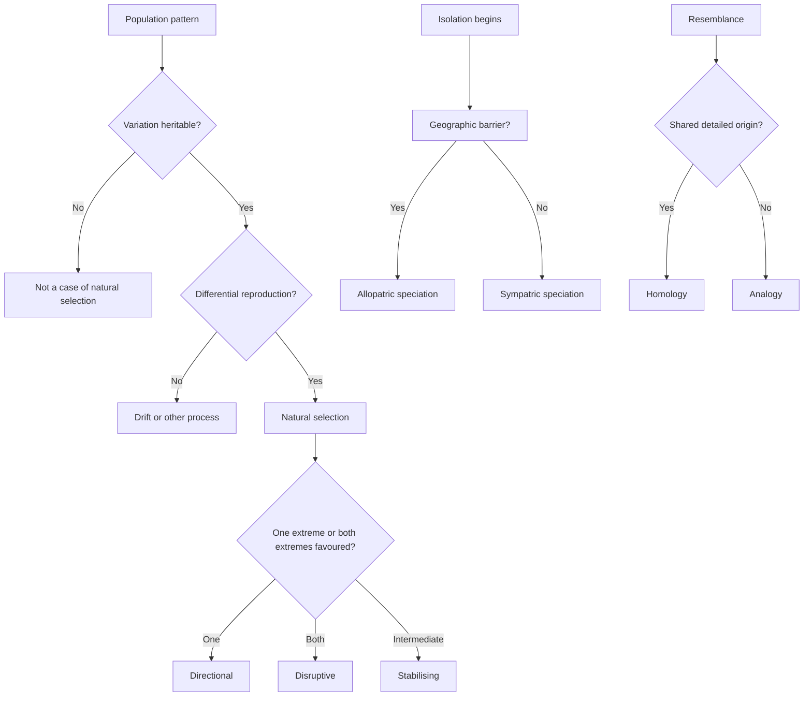

# Evolution and Classification

Evolution is the change in the heritable characteristics of populations across generations. A population evolves when the frequencies of inherited variants change; an individual does not evolve. This distinction drives most questions in this topic. A bacterium that acquires resistance is one bacterium with a new trait. A population of bacteria that becomes resistant has undergone natural selection.

Selection does not act with a goal. It changes the frequencies of traits that alter reproductive success in the current environment. Those traits happen to make an organism suited to that environment, but they do not make it better in every environment. Classification applies the same discipline: names are tools for expressing a theory of relationship, not ranks that exist independently of evidence.

GAMSAT biology questions in this area tend to give you a population, an environment, a pedigree, a fossil or a set of anatomical features and ask you to explain the pattern. The useful answer names the mechanism, predicts what else should be found, and distinguishes homology from superficial resemblance.

### 🟢 Lite — Quick Review (1h–1d)

**The core definitions.**

- **Fitness** means relative reproductive success, not physical strength. The fitter individual leaves more surviving, reproducing offspring.
- **Natural selection** acts on heritable variation. Without inherited variation, selection has nothing to sort.
- **Adaptation** is a trait shaped by selection. A trait that arose by chance and persists by drift is not an adaptation.
- **Genetic drift** is a random change in allele frequency, strongest in small populations.
- **Gene flow** moves alleles between populations through migration or reproduction, and it tends to make populations genetically similar.
- **Mutation** creates new alleles. Selection, drift and flow change their frequencies.
- **Speciation** is the formation of distinct species, marked by reproductive isolation.

**The three patterns of natural selection.**

| Pattern | Environment | Resulting trait distribution | Example |
|---|---|---|---|
| Directional | One extreme is favoured | Mean shifts toward that extreme | Industrial melanism in moths |
| Disruptive | Both extremes are favoured over the intermediate | Two peaks, with the intermediate selected against | Distinct beak forms where intermediate feeding is inefficient |
| Stabilising | Intermediate is favoured | Mean narrows around the existing optimum | Selection against extreme birth weights in a stable population |

Sexual selection is a related but distinct route to differential reproductive success. Traits that help an individual attract mates or compete with rivals can spread even when they reduce survival. Peacock tails illustrate the conflict between mating success and predator avoidance.

**The three requirements for natural selection.** There must be variation among individuals; that variation must be heritable; and variants must differ in reproductive success. A drug-resistant bacterium fails the first test if the resistance appears only after exposure. A darker moth fails the second if colour is produced by an environmental condition rather than inherited variation. An immune response fails the third if carriers do not reproduce more than non-carriers.

**Isolation and speciation.**

- **Allopatric speciation** begins with a geographic barrier that stops gene flow. The isolated populations experience different selection and drift until reproductive isolation develops.
- **Sympatric speciation** occurs without a physical barrier. Polyploidy, host shift and disruptive sexual selection can separate populations within the same region.
- **Prezygotic barriers** prevent mating or fertilisation: different mating behaviour, timing, mechanical incompatibility or gamete incompatibility.
- **Postzygotic barriers** act after fertilisation: hybrid sterility, hybrid inviability or hybrid breakdown.

**Evidence for evolution.** Each kind of evidence answers a different objection.

| Evidence | What it shows | Classic example |
|---|---|---|
| Comparative anatomy | Descent with modification | The same bone plan in a human arm, whale flipper and bat wing |
| Embryology | Shared developmental patterns | Similarities in vertebrate pharyngeal arches |
| Genetics | Change in shared inherited material | Orthologous genes and conserved sequences across organisms |
| Fossil record | Chronology and extinct intermediates | Fossils connecting land mammals with whales |
| Biogeography | Past movement and isolation | Island species resemble species on the nearest mainland |

**Homology and analogy.** Homologous structures share an origin, even when their functions differ: a human forearm bone and a whale flipper bone. Analogous structures evolved independently for similar functions: the wings of birds and insects. Embryonic similarity and detailed structural correspondence support homology. Superficial function alone supports analogy.

**The taxonomic hierarchy.** Domain, kingdom, phylum, class, order, family, genus and species. A binomial name gives the genus and species, such as *Homo sapiens*. Genus names begin with a capital letter and species names with a lower-case letter.

**Phylogenetic classification.** Cladistics groups organisms by shared derived characters, or synapomorphies. A clade contains an ancestor and all its descendants. A group built from ancestral rather than derived traits is not a clade. Molecular sequences provide characters for constructing and testing trees.

**Memorise for the Lite tier.**

- Populations evolve; individuals do not.
- Fitness is relative reproductive success.
- Selection needs variation, heredity and differential reproduction.
- Directional, disruptive and stabilising selection produce different distributions.
- Allopatric speciation needs geographic isolation; sympatric speciation does not.
- Prezygotic barriers act before fertilisation; postzygotic barriers act after it.
- Homology means shared origin; analogy means similar function with separate origin.
- Classification reflects evidence about relationships, not a ladder of progress.
- A clade contains an ancestor and every descendant.

### 🟡 Standard — Full Coverage (1–2d)

#### Worked example: why a drug-resistant clone spreads

A patient receives an antibiotic that kills most bacteria in a wound. A small group of bacteria already carries a plasmid with an enzyme that breaks down the drug. During treatment, the susceptible cells die and the resistant cells multiply, so the resistant proportion rises.

This is natural selection, not the antibiotic causing resistance in each bacterium. Three facts establish the mechanism: the variants existed before exposure; the resistance is genetic and carried on a plasmid; and resistant cells leave more descendants in this environment. The mechanism also predicts that stopping the antibiotic early can leave a larger susceptible population to compete with the resistant fraction, and that using a drug to which the organism is already resistant imposes selection without producing a cure.

The same reasoning applies at the level of gene flow. If a mobile genetic element carrying resistance moves between bacteria, the trait spreads without the selective advantage generating it. Selection explains why the variant dominates; horizontal transfer explains why it reached the population at all.

#### Worked example: separating homology from analogy

A bat wing, a bird wing and an insect wing all permit flight. Their surfaces perform the same broad function, so superficial comparison suggests analogy. The forelimb bones of the bat and bird, however, have the same arrangement of humerus, radius, ulna and digits, despite different proportions and uses. This structural correspondence points to a common ancestor with a forelimb. Insect wings arose separately from the body wall.

The method for future examples is fixed. First identify the claimed function. Then inspect the underlying structure and developmental pattern. Shared detailed structure and developmental origin support homology. Independent origin plus similar function supports analogy. A useful clue is that evolutionary changes modify an inherited structure, so the wing of a bat retains bones rather than becoming a new organ built from scratch.

#### Worked example: reading a fossil transition

A sequence of fossil limbs is described. Early forms have short limbs and weight-bearing digits. Later forms have longer limbs and reduced toes. Still later forms have a joint that permits powerful extension of the rear body.

The explanation is a change in function across the sequence: earlier forms moved weight; later forms generated thrust. To argue that the sequence represents evolution, the fossils need correct geological age, enough anatomical detail to exclude a deceptive combination, and a plausible continuity of form. A fossil supports evolution when it fits a predicted transition in both structure and time.

The reasoning also shows why an isolated unusual fossil does not overturn a large evidence base. Evolution predicts nested relationships and many imperfect forms, not a tidy ladder. A sequence that fills a predicted morphological gap strengthens the case for transition. An anomalous specimen calls for investigation of age, anatomy and classification.

#### Worked example: a pedigree and a mode of inheritance

A trait skips generations. Affected people occur in sibling pairs, and an affected mother transmits it to half of her children. The pattern is compatible with an X-linked recessive allele.

The steps are not "spot the pedigree and name it". They are: identify who is affected, note sex and transmission, compare candidate patterns, and check whether the proposed mode predicts every case. An X-linked recessive pattern predicts affected males, no male-to-male transmission, and affected daughters when the father is affected and the mother carries the allele. If the pedigree violates a prediction, the proposed mode is wrong even if it looked plausible.

#### How adaptation and phylogeny connect

A trait can support classification only if its distribution is explained. Similar feathers in birds and a non-avian dinosaur support the idea that flightless dinosaurs were part of the bird lineage. Similar swimming shapes in fish, marine mammals and extinct reptiles show that streamlined bodies evolve under similar hydrodynamic pressures, but they do not make those organisms close relatives.

Classification seeks to reconstruct branching history. A cladogram is read by looking for nodes that define common ancestry and character changes. Synapomorphies diagnose clades; shared primitive traits do not. Molecular data add another character system, and conflicts between morphological and molecular trees often reveal incomplete lineage sorting, horizontal transfer or convergent evolution rather than a simple error in one data set.

#### Evidence and its limits

Each evidence type has a characteristic weakness. Comparative anatomy can show homology, but similar function creates analogies. Embryology is powerful because early development is conservative, but some organisms have modified developmental patterns. Genetic homology is strongest when sequence similarity exceeds what function alone predicts. Fossil evidence is incomplete by nature, and its gaps leave room for hypotheses, though the age and anatomy of each specimen remain testable. Biogeography explains distributions through history, although dispersal and extinction can mimic isolation.

None of these lines requires another to prove the central claim. Their independence is the strength: anatomy, development, molecules, fossils and geography point to the same branching history.

### 🔴 Deep — Mastery (3–5d)

#### Common mistakes

**Calling an individual adapted.** Selection changes population frequencies. The language should be "the allele increased in frequency because carriers reproduced more successfully".

**Treating fitness as health.** A trait can reduce survival and still increase fitness if it improves mating success. Fitness is measured against competitors in a specified environment.

**Using "purpose".** Natural selection has no foresight. A mutation does not appear because the organism needs it, and the population does not become more advanced over time.

**Confusing drift with selection.** Drift concerns sampling error and has no mechanism that favours a trait. A useful test is whether the allele's frequency change tracks its selective advantage or fluctuates unpredictably, especially in a small population.

**Equating a clade with a grade.** Taxonomic rank is not the same as branch order. A group called a class need not be a clade, and a clade can include species assigned to different traditional ranks.

**Confusing absence of a barrier with absence of isolation.** Reproductive isolation can arise through behavioural, genetic or hybrid-sterility mechanisms while populations share a range.

**Calling a vestigial structure useless.** Vestigial structures often retain reduced or altered functions, and their shared anatomy can be stronger evidence of ancestry than their present role.

#### Exam traps

A species is introduced to an island where its usual predator is absent. The founder population contains variation in camouflage, and darker individuals survive better in shaded habitat. The best answer describes natural selection acting on inherited variation; the wrong answers say the island caused the mutation, the individuals adapted during their lifetimes, or the mutation arose because the population needed camouflage.

An organism has a structure with the same bones as a different structure in another animal, but the functions are unrelated. The item asks whether the structures are homologous. Shared skeletal plan is the deciding evidence, not the current function.

A phylogeny places a species outside a group that a textbook calls by a familiar name. Ask whether the group contains an ancestor and all descendants. If not, it is not a clade, and the familiar name is being used as a grade.

A table lists four fossils with features and asks which sequence best fits the evidence. Read dates and structural transitions together. A younger form with an older feature is anomalous; an intermediate form with the wrong age is not evidence of a transition.

#### 🧠 Memory Anchors

- **Population, not individual.**
- **Variation + heredity + reproductive difference = selection.**
- **Homology is origin; analogy is function.**
- **A clade is an ancestor plus all descendants.**
- **Flashcard Q&A:**
  - *What does fitness mean?* → Relative reproductive success.
  - *Which selection pattern favours both extremes?* → Disruptive.
  - *What separates allopatric from sympatric speciation?* → Geographic isolation.
  - *What is a synapomorphy?* → A shared derived trait that diagnoses a clade.
  - *Why is genetic drift strongest in a small population?* → Random sampling changes allele frequency more readily.

#### Internal links

- [GAMSAT exam hub](/exams/gamsat/) — the section in which unfamiliar biological data are analysed.
- [Molecular Biology and Genetics](/notes/gamsat/bio-physical-sciences/bps-002/) — the molecular mechanisms underlying mutation, heredity and shared ancestry.
- [Ecology and Environment](/notes/gamsat/bio-physical-sciences/bps-007/) — population processes and environmental conditions that alter selection.

The topic name, subject organisation and weight come from the GAMSAT Biological and Physical Sciences data in this repository. ACER publishes no per-topic weightage for the section, so the weight is StudyRoadmap's own prioritisation.

---

## Continue your study

- **[View this topic in your GAMSAT (Graduate Medical School Admissions Test) roadmap](/roadmap/?exam=gamsat&duration=1mo)** — see where this topic sits in your personalised plan
- **[Build a quick revision plan](/roadmap/?exam=gamsat&duration=1d)** — 1-day sprint covering the highest-weight topics
- **[GAMSAT (Graduate Medical School Admissions Test) exam overview](/exams/gamsat/)** — pattern, eligibility, and syllabus
- **[All Biological and Physical Sciences notes](/notes/gamsat/bio-physical-sciences/)** — browse sibling topics in this subject
