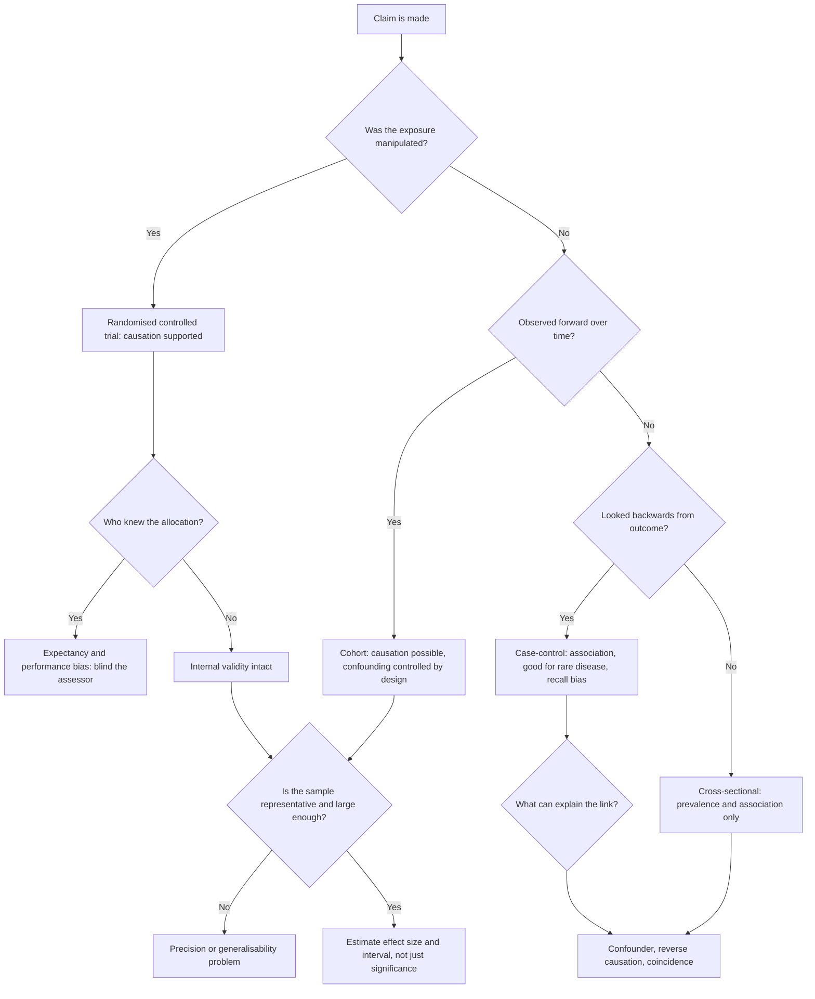

# Scientific Method and Experimental Design

ACER says the Biological and Physical Sciences section of GAMSAT assesses the ability "to identify knowledge in new contexts, and analyse and interpret data". Nothing in that sentence mentions facts, and this topic is where that sentence bites hardest. A question can hand you a table, a bar chart or a paragraph describing an experiment and ask you what the study can and cannot support. You are not being asked what the answer to the scientific question is. You are being asked whether the design earns the conclusion.

That is a learnable skill, because almost every design question is really asking one of four things: was the comparison fair, was the measurement trustworthy, can the result have happened anyway, and does the causal claim follow from the data. This topic sits at the front of the section because a question like it needs no specialist content, and ACER's own materials put "scientific method" in the same breath as data analysis.

ACER publishes no per-topic weightage for this section, so the organisation below is StudyRoadmap's own.

### 🟢 Lite — Quick Review (1h–1d)

**The cycle, and the words that are constantly confused.**

- **Observation** — what you notice. No explanation attached.
- **Question** — a focused, answerable question. "Why do the seedlings differ?" is better than "What is going on with the seedlings?"
- **Hypothesis** — a proposed explanation, stated so it can be wrong. "The taller seedlings received more light" is a hypothesis. "The seedlings are growing" is not.
- **Prediction** — what you would see if the hypothesis were true. The prediction is testable; the hypothesis becomes testable only once it produces a prediction.
- **Experiment** — the test, arranged so that the prediction can fail.
- **Analysis** — what the data show, including the parts you did not expect.
- **Conclusion** — the claim the data actually support, which can be narrower than the hypothesis.
- **Theory** — a well-tested explanation that has survived repeated attempts at falsification. Not a guess.
- **Law** — a description of a consistent pattern in nature, with no mechanism attached. The law says what happens; the theory says why.

**The three variable types. Get these straight and half the design items collapse into easy.**

| Variable | Definition | Example in a study of plant growth and light |
|---|---|---|
| Independent | The one the researcher changes | Amount of light given |
| Dependent | The one measured as the outcome | Mass of the plant at the end |
| Controlled | Held the same for every group | Soil, species of seed, watering, temperature |

The trap is a variable that is called controlled but is actually varying. If the plants on the sunny bench were also watered twice as frequently, watering is a confounding variable, not a controlled one.

**What makes a comparison fair.**

- **Control group.** A group that receives no treatment, so you know what happens without it. A negative control shows what happens with nothing. A positive control uses something known to work, which proves the experiment can have detected an effect at all.
- **Random allocation.** Assigning participants or samples to groups at random, so systematic differences between them do not pile up in one group by chance or by the researcher's preference.
- **Blinding.** The participant does not know which group they are in. The researcher assessing the outcome does not know either, so their expectations cannot shape the measurement. Where blinding is impossible, at least blind the assessor.
- **Replication.** Repeating the measurement, and repeating the whole study with a different sample, to see whether the effect survives.
- **Counterbalancing.** Changing the order in which conditions are run, so that an effect caused by order rather than by the treatment shows up.

**The three questions to ask of any study, in this order.**

1. **Is the comparison fair?** Randomised, blinded, properly controlled.
2. **Is the measurement trustworthy?** Calibrated instruments, consistent method, known precision, enough repeats.
3. **Could the result have happened anyway?** Chance, confounding, bias, or the arithmetic of small samples.

**Random error versus systematic error, and accuracy versus precision.** Random error scatters results in different directions and shrinks with more repeats. Systematic error pushes every result the same way and does not shrink with more repeats, so averaging will not remove it. A biased instrument gives precise but inaccurate readings; an unstable instrument gives accurate but imprecise ones. More repeats fix precision and do nothing for accuracy. That asymmetry is the single most tested idea in the topic.

**Confounding and bias.** A **confounder** is a variable associated with both the exposure and the outcome, and it offers an alternative explanation for the result. A **bias** is a systematic distortion built into how the study was set up or analysed. The common kinds:

| Type of bias | What goes wrong |
|---|---|
| Selection bias | Groups differ at the start, before anything is done |
| Information bias | Data are recorded or interpreted differently between groups |
| Recall bias | People remember past events differently depending on their current state |
| Attrition bias | People drop out of the study, and the ones who leave differ from the ones who stay |
| Publication bias | Studies with positive results are more likely to be published |
| Observer expectancy | The researcher's expectation changes what they record or measure |
| Confounding | A third variable explains the association |

**Study designs, and what each one can support.**

| Design | How it works | Supports | Cannot support |
|---|---|---|---|
| Randomised controlled trial | Random allocation to treatment or control | Causation | Rare harms, long-term effects, anything needing huge numbers |
| Cohort | Follow exposed and unexposed groups forward in time | Causation, incidence, prognosis | Ethical problems when the exposure is harmful |
| Case-control | Start with cases and controls, look backwards at exposure | Association, rare diseases, quick studies | Incidence rates, direct risk estimates |
| Cross-sectional | Measure everything at one moment | Prevalence, snapshots | Causation, direction of effect |
| Systematic review and meta-analysis | Pool all comparable studies | Best available estimate, with precision | Anything the included studies share a bias in |
| Case study | One case in depth | Mechanisms, rare presentations | Generalisation |

**Correlation versus causation.** Correlation is a relationship between two measured variables. Causation requires more: the cause must come before the effect, a plausible mechanism must exist, and the alternative explanations must be excluded. A correlation can arise from a confounder, from reverse causation, or by coincidence, especially in small samples. An item will normally give you a pair of correlated variables and ask you which observation would do most to establish causation.

**Uncertainty in a result.** A confidence interval expresses the range of values consistent with the data at a stated confidence level; a wide interval means the data do not pin the answer down. A p-value is the probability of seeing data at least this extreme if the null hypothesis were true. It is not the probability that the null hypothesis is true, and it is not the probability that the result is a fluke. Statistical significance is not practical significance: a very large study can produce a statistically significant result for an effect too small to matter clinically, and a small study can miss a large effect simply by lacking power. **Type I error** is a false positive, rejecting a true null. **Type II error** is a false negative, failing to reject a false null. **Power** is the probability of detecting a real effect if one is present, and power depends on sample size, effect size and variability.

**Ethics, in three principles.** Respect for persons, beneficence and justice: autonomy, do no harm and maximise benefit, and distribute the burdens and benefits fairly. In practice these produce informed consent, the right to withdraw, confidentiality, independent ethics review, and honest reporting of results including the null ones.

**Memorise for the Lite tier.**

- A hypothesis must be falsifiable. If no result can count against it, it is not a hypothesis.
- The prediction is the testable form of the hypothesis.
- Independent variable is changed, dependent variable is measured, controlled variable is kept the same.
- A variable that varies between groups and tracks the outcome is a confounder, whatever the method called it.
- Randomisation controls for systematic differences. Blinding controls for expectation. They are not interchangeable.
- More repeats improve precision and never accuracy. Systematic error survives averaging.
- Cross-sectional gives prevalence, cohort gives incidence, case-control finds associations with rare disease.
- A p-value is about the data, not about the hypothesis.
- Statistical significance and practical importance are separate questions.
- Correlation plus plausibility plus temporality plus exclusion of confounders, and only then causation.
- Publication bias means the literature systematically over-represents findings that worked.

### 🟡 Standard — Full Coverage (1–2d)

#### Worked example: critique a flawed study

**The study.** A researcher wants to know whether drinking caffeinated coffee raises resting heart rate. They recruit volunteers, ask each how many cups of coffee they drink per day, and also record each volunteer's resting heart rate measured in a clinic. They find a positive relationship and conclude that coffee causes a higher resting heart rate.

**Question one: is the comparison fair?** No. There is no intervention and no control. Groups are formed by a self-reported habit, which is exactly the situation in which selection bias enters: people who drink a lot of coffee can differ in many other ways.

**Question two: what is the confounder?** Caffeine intake is associated with coffee, but also with less sleep, more shift work, more stress, younger age in many samples, higher caffeine tolerance, and different baseline fitness. Any of these can raise resting heart rate on its own. Pick the strongest candidate in a stem — the one that is both associated with the exposure and independently affects the outcome.

**Question three: is the measurement trustworthy?** Resting heart rate measured in a clinic is not the same as resting heart rate in daily life. People are anxious in a clinic, and anxiety alone raises heart rate. The measurement condition differs systematically between people who drink a lot of coffee and people who drink none, because heavy coffee drinkers are more likely to be measured as "regular" patients. That is information bias.

**Question four: can the result have happened anyway?** Yes. Reverse causation is possible if anxious people drink more coffee, and coincidence is possible in a small sample. And a cross-sectional snapshot cannot establish which came first.

**The fix.** Randomly assign volunteers to a caffeine supplement or a placebo, blinded, with the caffeine dose and timing fixed, measure heart rate in the same conditions for everyone, and ideally use your own heartbeat as the control (same person, before and after) to remove between-person variation. Measure the change within each person rather than comparing groups. Keep the sample large enough to detect the effect you care about.

#### Worked example: reading error bars

You are given four results, each with an error bar: A, 12 ± 1; B, 12 ± 4; C, 16 ± 1; D, 16 ± 4.

**What the error bar represents matters.** If it is a standard deviation, it describes the spread of individual measurements. If it is a standard error, it describes the precision of the mean and shrinks as the sample grows. If it is a confidence interval, it describes uncertainty around the estimate. A stem that says "error bars show the standard error of the mean" is telling you the answer before you start.

**Compare A and C.** Both have tight error bars and their intervals do not overlap, so the difference between 12 and 16 is larger than the uncertainty in either estimate. This is the clearest case.

**Compare A and D.** Same central values for A and C but D has wide error bars. A and D overlap heavily, so the data are compatible with no real difference. D's wide bars also mean D is a less precise estimate even if its true value can be higher.

**Compare B and D.** Same spread, different centres. The centres differ by 4 and each bar is ±4, so they overlap. You cannot claim a difference from this figure alone.

**The trap.** "Error bars overlap, therefore there is no difference" is a common option and it is wrong. Overlapping bars do not prove the absence of a difference; a formal test is needed. What overlapping bars do tell you is that the data are not obviously separating the two groups, so a strong claim of difference is not supported by the figure alone.

#### Worked example: identifying the design from a stem

Read the stems below and name the design, then state what it can support.

1. "Researchers recruited 400 workers in a manufacturing plant. Exposure to a solvent was recorded at baseline. Ten years later, 30 of the exposed workers and 12 of the unexposed workers had developed a particular neurological condition." → **Cohort.** It can support causation and give an incidence rate, because exposure was measured before outcome and the groups were followed forward.

2. "Forty patients with a rare form of neuropathy and forty control patients attending the same clinic were interviewed about their previous use of a particular medication." → **Case-control.** It can support an association and is the right design for a rare disease, but it cannot give incidence, and recall bias operates on the exposure history.

3. "A randomisation assigned patients with mild hypertension to either an active drug or a placebo, and blood pressure was recorded before and after by staff who did not know the allocation." → **Randomised controlled trial.** It supports causation, and the before-and-after within-person measurement plus the blinding make it a strong design.

4. "A national survey measured blood pressure, diet and income in a sample of adults in a single week." → **Cross-sectional.** It supports prevalence and association, not causation and not direction of effect.

5. "A systematic review pooled the results of all randomised trials of the same intervention published in a named database up to a stated date." → **Meta-analysis.** It supports a pooled estimate, and it inherits the bias of its included studies.

#### Worked example: the strongest evidence for causation

A study reports that people who drink two or more coffees a day have a lower risk of a particular condition. Which single additional piece of evidence would most strengthen the causal claim?

Work through the candidates in this order. **Temporality** — evidence that coffee drinking preceded the outcome, and that risk changed when people stopped or started. **A dose-response pattern** — risk that falls consistently as exposure rises, which argues against coincidence. **A mechanism** — a plausible biological pathway by which coffee can produce the effect. **Consistency** — the same relationship found in other populations, other measures and by other methods. **Experimental evidence** — the strongest, because randomisation removes the confounding that observational data cannot.

A randomised trial that shows the same direction beats all of these. So the strongest option in most stems is the experimental one, and the next strongest is the one that addresses temporality or dose-response. What never strengthens a causal claim is finding the same correlation again in a similar sample, because that adds consistency without removing any confounding.

#### Reading a graph for design flaws

The other common shape of question gives a figure and asks what it fails to show.

- **A truncated y-axis** exaggerates the apparent size of a difference.
- **A bar chart with no error bars** presents point estimates as certain.
- **A line graph of a single run over time** confuses time trend with causation.
- **Two groups that differ at baseline** on a variable that also affects the outcome invalidate the comparison.
- **A scatter plot with a correlation drawn through it** can hide subgroups, and the relationship can be driven by a few influential points.
- **A table of percentages without denominators** can hide that one group's sample is tiny.
- **A figure with no y-axis units** is unreadable, and if the stem says the units were omitted, that is the answer.

### 🔴 Deep — Mastery (3–5d)

#### Evaluating a study end to end

Take a headline claim from a news report: "People who eat breakfast perform better at memory tasks." Run it through the whole chain, and notice how many links can fail.

**Is the outcome the right one?** A memory test score in a laboratory at one point in time is a proxy for cognitive performance. If the claim is about "cognition", the measurement can be too narrow, and narrow measurement is a quiet form of invalidity.

**Is the exposure measured accurately?** Self-reported breakfast frequency is recall-prone, and people who skip breakfast can differ in many ways beyond nutrition.

**Is there a comparison group?** If the comparison is with people who eat breakfast, fine. If it is with people who ate something else, then the claim is about breakfast rather than about breakfast versus fasting, which is a narrower claim than the headline.

**What are the confounders?** Sleep quantity and quality, time of day, caffeine, socioeconomic status, health status, and interest in breakfast as a proxy for a broader routine. Any of these can produce the association on its own.

**Is the design observational or experimental?** Observational means confounding survives no matter how large the sample is.

**Could it be reverse causation?** Memory problems can reduce appetite and appetite for breakfast, rather than breakfast improving memory.

**Is the sample representative?** A sample drawn from one university, one clinic or one online panel carries selection effects that do not disappear with a large number of participants.

**Is the effect big enough to matter?** Statistical significance says the result is unlikely to be chance. It says nothing about whether a two-point memory difference changes any decision a person makes.

**Has it been replicated?** A single study, however well designed, is one result. Replication, especially by a different group with a different method, is what turns a finding into knowledge.

Almost every real claim survives the first four questions and fails somewhere later. That is why the questions are ordered that way.

#### Common mistakes

**Treating randomisation as the only control.** Blinding controls expectation. Randomisation controls pre-existing differences. Random allocation without blinding still leaves the researcher's expectations shaping the measurement.

**Saying a controlled group is unnecessary when a historical comparison is available.** Comparing a treated group with records from before the treatment existed puts the intervention and every other change of the period together.

**Assuming a non-significant result means no effect.** It means the study did not detect one. With a small sample, a real and important effect can go undetected, and the confidence interval will normally show you that.

**Reading a p-value as a measure of effect size.** A p-value depends on sample size. A tiny p-value can accompany a trivial effect in a huge study. Always ask for the effect size and the interval.

**Assuming consistency means validity.** A result that appears in every publication is more likely to be publication bias plus a consistent bias in the methods than it is to be solid.

**Treating informed consent as the whole of ethics.** Consent is one requirement. It does not cover a design so burdensome or risky that it should not proceed, and it does not cover unfair distribution of who bears the risk.

#### Exam traps

**The stem that describes a study where the researcher knew which group each participant was in.** That is not necessarily fatal, but it does mean any judgement about outcome is at risk of observer expectancy, so the fix is to blind the assessor rather than to discard the study.

**The stem that gives a scatter plot with two clusters of points.** The overall correlation is a mixture of two separate relationships, or of a Simpson's paradox situation where the trend reverses within each group. An item that asks whether the data support the conclusion normally wants you to notice the clustering.

**The stem that describes random allocation but no blinding, with an outcome measured by a clinician.** The likely bias is that the clinician treats the treatment group differently, or that participants who suspect their assignment report symptoms differently. Both are expectancy effects and both reduce internal validity.

**The stem that describes a study stopped early because the result was significant.** Early stopping inflates the apparent effect, because the random chance of an extreme result is higher when you keep looking. This is a real and examinable point about repeated testing on the same data.

**The stem that asks which single change would most improve the study's validity.** Adding participants improves precision. Adding a control group improves the comparison. Randomising removes confounding. Blinding removes expectancy. Adding a control group normally improves validity most, because without it there is nothing to compare against.

#### 🧠 Memory Anchors

- **Manipulated means causal. Observed means associative until proven otherwise.**
- **Randomisation removes confounding. Blinding removes expectancy. Nothing else does either job.**
- **More data fixes precision. Only calibration fixes accuracy.**
- **Cross-sectional is a photograph. Cohort is a film.**
- **A p-value describes the data, not the hypothesis.**
- **Flashcard Q&A:**
  - *What is the difference between accuracy and precision?* → Whether you are close to the truth, versus whether repeated readings agree with each other.
  - *Which design is best for a rare disease?* → Case-control.
  - *Which design gives incidence?* → Cohort.
  - *Why does a large sample not remove systematic error?* → Because the error is pushed in the same direction every time.
  - *What does a wide confidence interval mean?* → The data do not pin the estimate down.
  - *Can a non-significant result still be clinically important?* → Yes, if the study was underpowered.
  - *Which variable is the one being changed?* → The independent variable.
  - *Why is double blinding described as the gold standard?* → Because both the participant and the assessor are shielded from expectation.

#### Internal links

- [GAMSAT exam hub](/exams/gamsat/) — the three sections and how ACER builds the paper.
- [Data Analysis and Graph Interpretation](/notes/gamsat/bio-physical-sciences/bps-001/) — reading the figures these design questions use.
- [Disease, Immunity and Pharmacology](/notes/gamsat/bio-physical-sciences/bps-008/) — the trial-design skill behind any drug-efficacy item.

The section structure and the quoted description of what ACER assesses come from ACER's GAMSAT materials (https://www.acer.edu.au/gamsat and https://gamsat.acer.org/), as recorded in this site's GAMSAT exam data. ACER publishes no per-topic weightage for the Biological and Physical Sciences section, so the weight on this page is StudyRoadmap's own prioritisation.

---

## Continue your study

- **[View this topic in your GAMSAT (Graduate Medical School Admissions Test) roadmap](/roadmap/?exam=gamsat&duration=1mo)** — see where this topic sits in your personalised plan
- **[Build a quick revision plan](/roadmap/?exam=gamsat&duration=1d)** — 1-day sprint covering the highest-weight topics
- **[GAMSAT (Graduate Medical School Admissions Test) exam overview](/exams/gamsat/)** — pattern, eligibility, and syllabus
- **[All Biological and Physical Sciences notes](/notes/gamsat/bio-physical-sciences/)** — browse sibling topics in this subject
