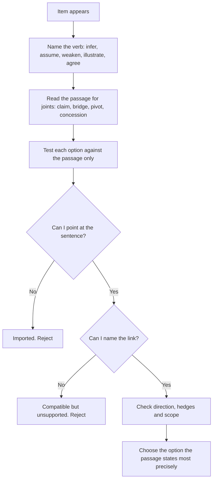

# Reading Comprehension and Inference

The Humanities and Social Sciences section of GAMSAT is 62 multiple-choice questions in 100 minutes. ACER describes what the section tests as the "interpretation and understanding of ideas in social and cultural contexts", and it publishes no per-topic weightage for the section, so no one can tell you how many of those 62 items are pure reading items. In practice most of them are.

This topic is the engine underneath the section. Even when an item looks like a sociology question or a philosophy question, most of the marks sit in the reading: working out what the passage claims, what it assumes, and how far you may push it. A candidate who can parse an argument quickly can usually get most of an item right without any subject knowledge at all, and a candidate with deep subject knowledge who misreads the argument will lose the item anyway.

The section is also where the "identify knowledge in new contexts" framing that ACER applies to the science paper quietly applies here too. The passage supplies unfamiliar material; the item tests whether you can handle it.

### 🟢 Lite — Quick Review (1h–1d)

**The single test.** For every option: *does the passage support this, or do I support it?*

- **Stated** — the passage says it. You can point at the sentence.
- **Supported** — the passage supplies the reasoning, and you can name the link.
- **Imported** — you brought it. True in the world, absent from the text. Wrong.

**The item types in this section, and what each one asks.**

| Item type | The verb in the stem | What you must do |
|---|---|---|
| Main idea or purpose | "The passage is primarily concerned with..." | Name the claim, not the subject |
| Inference | "It can be inferred from the passage that..." | Show the passage's own reasoning |
| Author's view | "The author would most likely..." | Find the stance the passage actually reports |
| Assumption | "The argument depends on which of the following?" | Name what must be true for the argument to work |
| Strengthen or weaken | "Which would most weaken the claim?" | Find the statement that attacks the load-bearing link |
| Application | "Which of the following illustrates the same idea?" | Recognise the structure, not the topic |
| Evidence | "Which of the following best supports the passage's claim?" | Find what the passage treats as its warrant |

**The four-step method for any item.**

1. Read the stem. Name the verb: infer, assume, weaken, illustrate, agree.
2. Read the passage once for structure, not for detail. Mark the claim, the warrant and the qualifier.
3. Test each option against the passage alone.
4. If two options both look supportable, find the one the passage makes more precisely and pick that.

**What makes an option wrong, in order of how often it happens.**

- It is true of the world but not of the passage.
- It reverses the passage's direction.
- It drops a hedge the passage keeps.
- It changes the scope: one group, one period, one case becomes "always".
- It answers a different question from the one asked.
- It describes a plausible reading the passage never endorses.

**Memorise for the Lite tier.**

- Point at the sentence. If you cannot, the option is imported.
- Main idea is a claim with a verb; topic is a subject with a noun.
- An assumption is something that must be true, not something that would be nice.
- To weaken an argument, attack the link between the claim and the evidence, not the evidence you find inconvenient.
- "The author would agree" needs the author to have said something. A passage reporting a debate is not the author taking a side.
- An illustration item is about the structure of the idea, not the subject matter of the example.
- Two supportable options means one of them is stated and the other is merely compatible.

### 🟡 Standard — Full Coverage (1–2d)

#### A worked set

The passage below is written for this page in the register the section uses.

> **Passage**
>
> Predictions that an algorithm will misbehave are difficult to make because the behaviour of a trained system depends on the data it was trained on, the context in which it is used, and the decisions of the people who build around it. A system that sorts photographs is not the same system once people begin to upload photographs of themselves, and the errors that appear later are often a consequence of use rather than of design.
>
> This has made automated decisions hard to audit. Auditing is not simply a question of testing whether the system produces the output it was designed to produce; it is a question of whether producing that output is appropriate in the situation it has ended up in. Institutions that have adopted these systems report that they replace administrative discretion rather than supplement it, and the people affected by a decision frequently cannot tell whether it was made by a person following a rule or by a system applying an estimate.
>
> Some have argued that opacity is a feature rather than a defect, because a system that explains itself can be gamed and a system that does not can be applied consistently. This defence is weakened by the observation that consistency and fairness are different properties. A rule that is applied identically to everyone can still produce unequal outcomes if the situations it treats as similar are not similar.

**Item 1.** The passage's primary purpose is to:

- (A) Show that automated decision-making is unlikely to be improved by auditing.
- (B) Examine an argument for automated decision-making and identify where it fails.
- (C) Report that institutions have replaced administrative discretion with automated systems.
- (D) Compare the accuracy of automated systems with that of human decision-makers.

**Answer: B.** The passage raises a defence of opacity in its final paragraph and then weakens it with the distinction between consistency and fairness. The structure is "here is a common argument, and here is the problem with it".

Option C is a true statement from the middle of the passage, which is the classic true-but-not-the-purpose distractor. Option A inverts the passage's thrust: the passage says auditing is hard, not that it will not help. Option D asks about accuracy, which the passage never raises.

**Item 2.** Which of the following can be inferred from the passage?

- (A) The behaviour of a trained system cannot be fully known in advance.
- (B) Systems that explain themselves are routinely gamed in practice.
- (C) Consistency between outcomes and consistency in procedure are the same thing.
- (D) Institutions that report replacing discretion are generally mistaken about what they have done.

**Answer: A.** The opening paragraph says predictions are difficult to make because behaviour depends on training data, context and the people building around it. The inference is one step further: you cannot fully know in advance what a system will do.

Option B converts "can be gamed" into "are routinely gamed", which is a frequency claim the passage never makes. Option C reverses the final paragraph, which distinguishes the two properties precisely in order to separate them. Option D is an unsupported editorial judgement.

**Item 3.** The argument in the final paragraph depends on which of the following assumptions?

- (A) That fairness is a property of outcomes rather than of procedures.
- (B) That identical treatment always produces identical results.
- (C) That systems which do not explain themselves can be applied consistently.
- (D) That auditing is more expensive than the errors it prevents.

**Answer: A.** The final paragraph concludes that consistency and fairness are different properties, and it supports that with the case of a rule applied identically to everyone producing unequal outcomes. That argument only works if fairness is judged on outcomes. Without that assumption, the conclusion would not follow.

Option C is stated in the passage, so it is a premise rather than an assumption. Option B is contradicted by the passage's own example. Option D never appears.

**Item 4.** Which of the following would most weaken the claim in the passage's final paragraph?

- (A) A rule applied identically to everyone that produces equal outcomes in every case.
- (B) Evidence that explanations provided by systems are frequently ignored by the people given them.
- (C) A finding that some institutions have reverted to administrative discretion.
- (D) An argument that administrative discretion is itself biased.

**Answer: A.** The final claim is that consistency and fairness are different properties, illustrated by a rule applied identically producing unequal outcomes. A case of a rule applied identically producing equal outcomes directly undercuts the illustration and weakens the claim.

Option B strengthens the passage's defence of opacity rather than weakening the claim. Option C is about institutional choices, not about the consistency/fairness distinction. Option D argues that discretion is also flawed, which does not make consistency and fairness the same property.

#### How to read for argument structure

Social science passages are written with a skeleton, and the skeleton is usually visible if you look for it.

- **The opening moves.** A passage that opens "This has made X difficult" or "Some have argued" is announcing that the passage will complicate something. GAMSAT passages rarely simply describe; they set up a problem and then intervene.
- **The pivot sentence.** Look for "however", "this defence is weakened by", "but", "nevertheless". These sentences usually contain the author's own position, and the items are usually built on them.
- **The concession.** Passages frequently concede a point before countering it, and the concession is the favourite source of a wrong-but-plausible option.
- **The final sentence.** In the passage above, it is a generalisation with a counter-example attached, which is the signature of a passage whose conclusion is hedged. Items that sound more confident than that are wrong.

Write one line per paragraph as you read: "This paragraph says X, and it does that by Y." You are not summarising; you are locating the argument's joints.

#### Section tactics

Sixty-two items in 100 minutes is under two minutes per item including the reading. Two decisions follow from that.

**Eliminate before you read carefully.** Most items can lose two or three options on a first pass, because the options in this section tend to differ in obviously checkable ways: wrong scope, wrong direction, or imported knowledge. Mark those and move.

**Come back to the marked ones, and only those.** A candidate who re-reads a passage for every question loses the section. Read once, answer, and leave the passage behind.

The rule that saves the most time: if you cannot say which sentence in the passage supports an option, the option is out. Do not reason towards it. If nothing is left after elimination, go back and read the passage once more rather than trying to argue the option into existence.

### 🔴 Deep — Mastery (3–5d)

#### How to attack each item type without subject knowledge

**Assumption items.** Write the argument as "If P, then C" and ask what must be true for the bridge to hold. The assumption is never stated in the passage and never contested by it. If the passage asserts it, it is a premise; if the passage argues against it, it is not the assumption.

**Weaken items.** An argument has three parts: a claim, evidence for it, and a bridge that connects them. Almost every weaken option attacks one of these three, and the strongest one attacks the bridge, because breaking the bridge breaks the whole thing. An option that attacks evidence you do not like but which is irrelevant to the claim is a decoy.

**Illustration items.** Strip the example to its structure. If the passage's idea is "a system applied consistently can still produce unequal outcomes because the categories it treats as similar are not similar", then a correct illustration is any case where uniform treatment of people produces unequal results because the grouping is wrong. It does not need to involve algorithms at all. Candidates who look for the same topic fail these items.

**Author's-view items.** Three questions to ask: does the passage report the author's position, or only report other people's positions? If the author reports a debate, the author's view is often in the pivot sentence, and where there is no pivot, the answer may be that the author declines to take a side. A passage that ends on "and the question remains open" will not support a confident "the author would agree that".

#### The distractor families, and their construction

| Distractor | How it is built | The catch |
|---|---|---|
| Imported knowledge | True in the world, absent from the passage | Ask for the sentence |
| True but irrelevant | A true statement from elsewhere in the passage that answers another question | Read the stem's verb |
| Reversed direction | The passage's causal or comparative link reversed | Restate the direction in your own words |
| Hedged away | "may" or "in some cases" becomes "will" or "always" | Compare qualifiers word by word |
| Scope shift | One group or period becomes the general case | Look for "all", "every", "generally" |
| Overreach | A modest claim inflated into a strong one | Ask whether the passage's author would accept the strong version |
| Freestanding objection | An objection to the topic that the passage never raises and does not need to | Check whether the passage engages it |

#### Common mistakes

- **Answering from social science knowledge.** The passage is the only evidence, and it is written to be sufficient.
- **Treating a reported position as the author's own.** "Some have argued that..." is not "the author believes".
- **Picking the most moderate option by reflex.** Moderation is a decent tiebreaker when two options are both supportable, but a passage that argues firmly deserves a firm answer.
- **Confusing an assumption with a conclusion.** The assumption is what must be true for the conclusion to hold; the conclusion is what the passage argues for.
- **Spending the first three minutes of a passage on a difficult word.** Write the word down, read on, and come back. The items are rarely built on it.
- **Answering in the order the options are written.** Option position carries no information, but item writers do tend to put the true-but-weaker paraphrase first, which is the one you are most likely to over-trust because it looks careful.

> ⚡ **Examiner Trap.** An item offering "the passage presents a debate without endorsing either side" alongside three confident position statements. The passage's own hedge at the end is the answer, and the three confident options are there to punish candidates who pick the position they happen to agree with. Read the passage's stance before you read your own.

#### 🧠 Memory Anchors

- **"Point at the sentence."** If you cannot, the option came from you.
- **"Claim, bridge, pivot, concession."** Four joints, and the items live at them.
- **"Assumption must be true, and must not be stated."**
- **"Weak the bridge, not the background."**
- **"Illustrate the structure, not the topic."**
- **Flashcard Q&A:**
  - *An option is widely believed to be true. Can it be right?* → Only if the passage supports it.
  - *The passage says "some have argued". Whose view is it?* → The people named, not the author.
  - *What do you attack to weaken an argument?* → The link between the claim and its evidence.
  - *Two options both look supportable. How do you choose?* → Pick the one the passage states more precisely.
  - *What does the passage's final sentence tell you?* → How confident the author is allowed to be.

#### Internal links

- [GAMSAT exam hub](/exams/gamsat/) — the three sections and how ACER builds the paper.
- [Argument and Reasoning](/notes/gamsat/humanities-social-sciences/hss-002/) — the assumption and weaken items build on the argument framework.
- [Data Analysis and Graph Interpretation](/notes/gamsat/bio-physical-sciences/bps-001/) — the same reading discipline applied to the science section.

The section structure, the 62-item count and the 100 minutes for the Humanities and Social Sciences section, and ACER's description of what the section assesses come from ACER's GAMSAT materials (https://www.acer.edu.au/gamsat and https://gamsat.acer.org/), as recorded in this site's GAMSAT exam data. ACER publishes no per-topic weightage for the section, so the weight on this page is StudyRoadmap's own prioritisation.

---

## Continue your study

- **[View this topic in your GAMSAT (Graduate Medical School Admissions Test) roadmap](/roadmap/?exam=gamsat&duration=1mo)** — see where this topic sits in your personalised plan
- **[Build a quick revision plan](/roadmap/?exam=gamsat&duration=1d)** — 1-day sprint covering the highest-weight topics
- **[GAMSAT (Graduate Medical School Admissions Test) exam overview](/exams/gamsat/)** — pattern, eligibility, and syllabus
- **[All Humanities and Social Sciences notes](/notes/gamsat/humanities-social-sciences/)** — browse sibling topics in this subject
