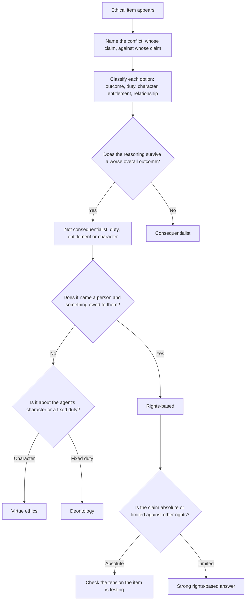

# Ethics and Moral Reasoning

The Humanities and Social Sciences section of GAMSAT is 62 multiple-choice questions in 100 minutes, and ACER describes it as testing "interpretation and understanding of ideas in social and cultural contexts". Ethical reasoning shows up in that section in a specific and repeatable form. You are given a scenario, frequently one about a public decision, a professional obligation, a distributive question or a conflict between a person's liberty and a community's welfare. You are asked which justification best supports a position, and the options are normally the same four or five ways of justifying a decision.

The skill being tested is not whether you agree with the answer. It is whether you can recognise which moral framework a given justification comes from, and therefore whether it can answer the question it is being asked. A rights-based reason and a consequence-based reason can both be morally serious, and an item will frequently present both and ask which one the argument actually rests on. Getting that wrong loses the item even if your personal view is the one being advocated.

ACER publishes no per-topic weightage for this section, so the framework set below is StudyRoadmap's own study organisation.

### 🟢 Lite — Quick Review (1h–1d)

**The five frameworks, and the one question each one asks.**

| Framework | Core idea | The question it asks | Typical sentence |
|---|---|---|---|
| Consequentialism (utilitarianism) | The morality of an action depends on its outcomes; the right action maximises overall well-being | "What are the consequences?" | "The rule that produces the best overall outcome is the rule we should adopt." |
| Deontology (duty ethics) | Some actions are right or wrong in themselves, regardless of consequences; morality consists in acting from duty | "What does my duty require?" | "Whatever maximises welfare, I cannot lie, because lying violates a duty that holds whatever follows." |
| Virtue ethics | Morality is a matter of character; we should act as a person of good character would | "What would a person of good character do here?" | "A good colleague would have raised the concern at the time rather than after the harm was done." |
| Rights-based (including Rawls) | People have entitlements that others owe them; a decision is wrong if it violates a right, regardless of aggregate benefit | "Whose right is at stake, and has it been respected?" | "The decision is wrong because it deprives the applicant of an entitlement they have already been granted." |
| Care ethics | Obligations arise from relationships, dependency and vulnerability, not from abstract rules | "What does this relationship require of me?" | "Caring for a dependent relative creates responsibilities that a rule about efficiency does not capture." |

Egoism sits alongside these as a fifth position, and it appears occasionally as an option: the claim that an action is right if it serves the agent's own interest. It is a position, not a mistake, so do not treat it as a distractor automatically.

**The distinction you will be asked to make most frequently: rights versus consequences.** These two produce different sentences about the same case.

- A consequence-based reason says: *the decision is acceptable because it produces the best balance of benefit and harm for everyone affected.*
- A rights-based reason says: *the decision is unacceptable because it overrides an entitlement that belongs to a particular person, and that override is not justified.*

The test: if you can rewrite the reason as "the total outcome is better", it is consequentialist. If the reason still holds even when the outcome is worse for everyone, because a right was violated, it is rights-based.

**The distinction between deontology and rights-based, which candidates confuse constantly.** Deontology is duty-centred: obligations bind you regardless of who benefits. Rights-based reasoning is entitlement-centred: a person holds a claim, and that generates a correlating duty on someone else. Deontologists characteristically hold that duties cannot simply be traded off against each other; rights-based theorists characteristically allow one right to be limited by another, provided the limitation itself respects a core right. In practice: "I have a duty not to betray my patient's confidence, whatever the case for breaching it" is deontological. "My patient has a right to confidentiality, which the hospital cannot override for convenience" is rights-based.

**Three further distinctions worth keeping straight.**

- **Moral absolutism** — some actions are always right or always wrong, regardless of consequences or context. **Moral relativism** — moral judgements are true only relative to a culture or framework, and no framework is privileged. **Moral objectivism** — some moral judgements are true regardless of who judges.
- **Moral requirements and moral permissions.** "Must not" versus "can". A rights-based argument frequently concerns a permission being removed: not a duty being breached, but an entitlement being denied.
- **Justification versus motive.** An argument can be morally wrong and still be the better-reasoned argument in the item, and a morally fine conclusion reached by a bad argument loses the marks if the item asks for the reasoning.

**The five-step protocol for any ethical item.**

1. **Name the conflict.** Whose interest, duty or right is under pressure? Write it as "X wants A, Y wants B".
2. **Identify what kind of claim each option makes.** Outcome, duty, character, entitlement, or relationship.
3. **Check the option against the scenario.** Does the reasoning it offers actually fit the facts in the stem, or does it import a concern the stem never raised?
4. **Look for the strongest objection the item implies.** Often one option is the objection to another, and the answer is the one that survives it.
5. **Watch the scope.** "This is never acceptable" and "this is acceptable here" are different claims, and the stem normally decides which one is being asked about.

**Memorise for the Lite tier.**

- Consequentialism asks about outcomes, deontology about duties, virtue ethics about character, rights ethics about entitlements, care ethics about relationships.
- If the reasoning survives a worse overall outcome, it is not consequentialist.
- If the reasoning names a person and something owed to that person, it is rights-based.
- Deontology: duty regardless of consequence. Rights: entitlement that others owe, which can sometimes be limited by another right.
- Egoism is a position, not a trap.
- Absolutism, relativism and objectivism are three different claims; read which one the stem asserts.
- Name the conflict before you evaluate any option.
- An option that raises a concern the stem never raised is normally the wrong option.
- A requirement being overridden and a permission being withdrawn are different moves.

### 🟡 Standard — Full Coverage (1–2d)

#### Worked example: one scenario, four frameworks

**The scenario.** A hospital faces a shortage of dialysis machines. A triage committee must decide who receives treatment. One proposal prioritises patients with the highest chance of survival over a defined period, so that the maximum number of lives are saved. Another proposal prioritises patients in order of waiting time, on the grounds that everyone has an equal claim and no committee should decide whose life counts for more. A third suggests the committee should ask what the patient themselves would want, focusing on whether they want to spend their limited remaining time on dialysis or on other things.

**What each framework says.**

- **Consequentialism** supports the survival proposal, because it maximises the number of people alive afterwards. The objection it must answer: maximising lives treats patients as units, and a patient denied dialysis to save two others has had something taken from them that no aggregate gain offsets.
- **Rights-based reasoning** supports the waiting-time proposal, because equal access is a claim each patient holds, and a committee that ranks people by expected benefit has decided that some claims count for more. The objection: a right that cannot be honoured at all is worth little to the people who hold it, so some triage is unavoidable and the question becomes which principle governs it.
- **Virtue ethics** asks what a clinician of good character would do, and the interesting answer is that a good clinician would not simply maximise a number. Good character includes honesty, compassion and practical wisdom, and would probably reject a rule that treats a named patient as an interchangeable unit while also resisting a rule that promises full access and then breaks it without explanation.
- **Care ethics** supports the third proposal, because the moral content of the decision lies in the relationship between the clinician and this particular patient, in their vulnerability and their dependencies, rather than in the abstract rule.

**What this teaches for the item.** Once you have the four answers, the item becomes easy, because the options are almost always these four positions in disguise. Your job is not to pick the one you like. It is to pick the one that matches the reasoning the stem is actually using.

#### Worked example: telling a rights-based reason from a consequence-based one

**The scenario.** A city introduces a traffic restriction on one street to cut traffic through a residential area. The stated purpose is to reduce noise and pollution for residents. A resident who wants to use the street to reach an appointment argues the restriction should not apply to them.

**Read each reason and label it.**

1. "The restriction is justified because it produces a better outcome for the majority of residents, reducing noise and air pollution." → **Consequence-based.** The justification lives entirely in the aggregate.
2. "Residents have a right to a reasonable quality of life in their own homes, and the council's power to restrict access does not extend to overriding that entitlement without an appeal process." → **Rights-based.** The reasoning names an entitlement and the corresponding duty, and it survives even if the traffic reduction were small.
3. "A councillor who restricts a street in her own area without consulting the people affected is not acting as a person of good character would." → **Virtue ethics.** The actor's disposition is the subject.
4. "A neighbour who stayed silent for years about the noise and now expects the council to act in her interest has a relationship to that council that carries obligations in both directions." → **Care ethics.**

The pair to compare closely is 1 and 2. Both accept that the restriction can be a good decision. The difference is that reason 1 can be defeated by showing the restriction does not actually improve the outcome, while reason 2 cannot be defeated that way at all. That is the marker of a rights-based claim.

#### A worked item set

Read the passage and answer the four items.

> **Passage**
>
> A hospital has introduced a policy requiring that, where a patient and a clinician disagree about whether treatment should be stopped, the disagreement is resolved by a second clinician who has not been involved in the patient's care. The hospital's justification is that patients are frequently reluctant to raise concerns about stopping treatment, and that an independent reviewer provides a check against the pressure of an overriding clinician.
>
> Critics make two objections. The first is procedural: the reviewer's decision is not itself reviewable, and a system with an unappealable last step has simply moved the problem. The second is substantive: the policy assumes that disagreement is a matter of information, and that a second opinion will settle it. Yet many of the hardest cases turn on values rather than facts, and where the disagreement is about what a good life looks like for a particular patient, more information does not resolve it.
>
> The hospital's response is that a reviewer who understands the difficulty of these cases is still better than a single clinician deciding alone, and that the alternative in which patients must negotiate directly with the team treating them is one that most patients find harder to navigate.
>
> It remains the case that the policy applies the same procedure to every case, including those in which a patient with capacity and a clear preference has already expressed a settled view that the treating team disagrees with. The policy does not distinguish between a case in which the patient is uncertain and one in which the patient is certain.

**Item 1.** The passage's primary purpose is to:

- (A) Show that a policy intended to protect patients removes decisions from them.
- (B) Examine a policy and identify objections to it that its proponents have not fully answered.
- (C) Argue that disagreements between patients and clinicians should be settled by independent reviewers.
- (D) Compare the treatment of patients who are uncertain with that of patients who are certain.

**Answer: B.** The passage sets out the policy, raises two objections, gives the hospital's response, and then closes with a problem the response does not address. The structure is "here is a policy, here is the defence, here is what remains unresolved".

Option C is the hospital's position, not the passage's. Option A is a stronger claim than the passage makes; the passage says the policy is not sensitive to a settled patient preference, not that it removes decisions broadly. Option D asks about a comparison the passage touches on only in its final sentence.

**Item 2.** Which of the following does the passage present as the difference between the two objections?

- (A) The first concerns the process of reaching a decision; the second concerns whether the dispute is the kind that can be settled by decision at all.
- (B) The first is stronger than the second and the passage treats it as such.
- (C) The first concerns patients with capacity; the second concerns clinicians.
- (D) The first was raised by the hospital; the second was raised by critics.

**Answer: A.** The passage labels the first objection procedural and the second substantive, and the content matches: procedural means how the decision is reached, substantive means what kind of dispute it is.

Option D reverses the source of each. Option B is unsupported; the passage gives no ranking. Option C misassigns the objections.

**Item 3.** The hospital's response to the second objection implicitly assumes that:

- (A) Most patients prefer not to negotiate directly with their treating team.
- (B) The second objection is factually incorrect.
- (C) Disagreement about treatment is normally caused by a lack of information.
- (D) A second opinion will resolve most cases involving values.

**Answer: A.** The response contrasts "a reviewer who understands the difficulty of these cases" with the alternative "in which patients must negotiate directly with the team treating them", and says that alternative is one most patients find harder to navigate. So the response leans on a claim about patient preference.

Option C is what the passage says the critics' second objection attacks, so treating it as an assumption the hospital holds contradicts the passage. Option D would answer the objection rather than assume it.

**Item 4.** Which of the following would most strengthen the passage's final point?

- (A) Evidence that a substantial share of disagreements are resolved by the independent reviewer without any further review.
- (B) Evidence that some patients who have expressed a settled preference have had it overridden by the review process.
- (C) A finding that most clinicians find the review process slow.
- (D) An argument that clinical decisions about stopping treatment should never be made by a committee.

**Answer: B.** The final point is that the policy applies one procedure to cases where a patient with capacity has a settled view, and does not distinguish that from a case of uncertainty. Evidence that settled preferences have in fact been overridden by the process makes that distinction practically important.

Option C supports the procedural objection rather than the final point. Option A weakens the passage's criticism. Option D is a freestanding objection the passage does not raise.

**What the set teaches.** The passage is about procedural fairness and the limits of procedural solutions, and it is written in the style ACER uses for this section: a policy, its justification, objections, a partial response, and an unresolved point. Reading for those joints is the skill from [Reading Comprehension and Inference](/notes/gamsat/humanities-social-sciences/hss-001/), and this set shows the same joints carrying ethical content.

#### Applying a framework without losing your own view

The instruction to argue a position applies here too. If a stem asks which justification best supports a decision, identify the framework, apply it to the specifics of the stem, and then check the objection the item implies. You are not asked which framework you personally hold, and a stem that is about consequences does not need you to defend rights.

The one place where a personal view can cost you marks is where the option and your view coincide. An item that offers "the patient's right to informed consent is absolute" alongside a qualified version is testing whether you notice that an absolute entitlement cannot accommodate every case. Read the strength of the claim, not the sentiment.

### 🔴 Deep — Mastery (3–5d)

#### Building a personal framework map

Ethical items get easier once you have a stable map, because you stop re-deriving it under time pressure. Use three questions to place any justification on the map.

**What is being maximised?** If the answer is a quantity of well-being, suffering avoided, lives saved or benefits gained across everyone affected, the reasoning is consequentialist. Note that consequentialism does not have to be about happiness; it can be about minimising harm, and a "least harm" argument is still consequentialist.

**What is being respected?** If the answer is an entitlement that belongs to someone and that others owe them, the reasoning is rights-based. Ask who holds it and who owes it, because a rights-based argument that names no one is normally not a rights-based argument at all.

**What is being asked of the agent?** If the answer is about the kind of person the actor is, the reasoning is virtue ethics. If it is about obligations that hold whatever the outcome, it is deontological. If it is about what the relationship requires, it is care ethics.

Notice that deontology and rights-based reasoning frequently overlap in practice: both resist the idea that a good outcome licenses anything. The distinguishing question is whether the argument is about what you must do, or about what you owe a particular party.

#### The objection each framework attracts, and the best answer

| Framework | Its standard objection | The best response |
|---|---|---|
| Consequentialism | It can require great harm to a few for a small gain to many; it has no way to say that some harms are simply not to be done | Consequentialism can be stated at the level of rules rather than individual acts, which changes what it permits |
| Deontology | It treats duties as fixed even when following them causes obvious harm | Some duties are imperfect and allow latitude, and duties can conflict, requiring judgement rather than mechanical application |
| Virtue ethics | It offers no clear answer when two virtues pull in opposite directions, and it depends on a community's judgement of what counts as good | A virtue ethics answer can still be given, but it is given by a wise person in context, and an item asking for the answer should expect a contextual judgement |
| Rights-based | Rights can conflict, and people can hold rights that make a just arrangement impossible | Rights are designed to be limited against each other, and some rights are treated as non-derogable, which is a designed-in answer to the conflict |
| Care ethics | It can appear to justify favouritism, and it is less clear about how to treat strangers | Care ethics has been extended to address impartiality, and a family's interest is not automatically decisive |

The third column is the one that earns marks. An option that names an objection and then answers it, is the strongest structure in this topic, and an item will frequently offer one option that raises an objection and one that resolves it.

#### Common mistakes

**Labelling every argument that mentions fairness as rights-based.** Fairness in outcomes is a distributive concern, which can be handled by a utilitarian argument about the aggregate or by a Rawlsian argument about the position of the least advantaged. Ask whether the claim names an entitlement owed to a person.

**Treating "best overall outcome" as the only consequentialist claim.** Avoiding a catastrophe for everyone is also consequentialist. If an option says "this produces the least harm for everyone affected", label it consequentialist.

**Missing that a Kantian duty and a right produce different sentences.** "I cannot lie because lying is wrong in itself" is deontological. "I cannot disclose this because the patient has a right to confidentiality" is rights-based, even though both refuse the disclosure.

**Assuming an option that agrees with the passage's conclusion is right.** The passage can endorse a policy and then undercut it. Read the verbs.

**Letting the scenario's moral weight override the question.** An item about a patient whose treatment is stopped can be disturbing. The question is still which reasoning the option supplies.

#### Exam traps

**The item where the passage reports a debate and one option says "the author would agree that".** The author need not have taken a side. This is the same trap as in [Reading Comprehension and Inference](/notes/gamsat/humanities-social-sciences/hss-001/), and it recurs constantly in ethical passages, because ethical topics attract balanced treatments.

**The item offering "the outcome matters but so do the intentions" as the correct answer.** It is frequently right, and it is right because the framework that captures both is a hybrid or a rights-based account with consequences as a limiting principle. But check the stem: if the scenario is purely about outcomes, "intentions" is an imported concern.

**The item where the strongest objection is the answer.** Several items are built so that the correct option is the objection, because the passage presents the position and then the critique. Identify whether the passage's own position is being stated or being attacked.

**The item with an absolute statement.** "Confidentiality must never be breached" and "patient safety always justifies disclosure" are both claims of a particular framework being pushed to an extreme. The item normally wants you to see the tension, and the correct answer is the one that names it.

#### 🧠 Memory Anchors

- **Outcome, duty, character, entitlement, relationship.** Five boxes, and every ethical option lands in one.
- **Survives a worse outcome, or it is not consequentialist.**
- **Names a person and something owed: rights.**
- **Obligation holds whatever follows: deontology. Entitlement can be limited: rights.**
- **Strongest answers name an objection and then answer it.**
- **Flashcard Q&A:**
  - *Which framework asks "what must I do"?* → Deontology.
  - *Which framework would say a fair procedure matters more than a good outcome?* → Rights-based, or Rawls.
  - *Which framework has no rule about who must be better off?* → Consequentialism.
  - *Is egoism a mistake?* → No, it is a position.
  - *What does a virtue ethics answer look like?* → What a wise person of good character would do in this situation.
  - *How do you tell a rights-based option from a deontological one?* → Rights are owed to a party; duties bind regardless of party.

#### Internal links

- [GAMSAT exam hub](/exams/gamsat/) — the three sections and how ACER builds the paper.
- [Reading Comprehension and Inference](/notes/gamsat/humanities-social-sciences/hss-001/) — how to find the joints in a passage that argues about a case.
- [Argument and Reasoning](/notes/gamsat/humanities-social-sciences/hss-002/) — premises, assumptions and the validity checks these items rely on.

The section structure and the quoted description of what ACER assesses come from ACER's GAMSAT materials (https://www.acer.edu.au/gamsat and https://gamsat.acer.org/), as recorded in this site's GAMSAT exam data. ACER publishes no per-topic weightage for the Humanities and Social Sciences section, so the weight on this page is StudyRoadmap's own prioritisation.

---

## Continue your study

- **[View this topic in your GAMSAT (Graduate Medical School Admissions Test) roadmap](/roadmap/?exam=gamsat&duration=1mo)** — see where this topic sits in your personalised plan
- **[Build a quick revision plan](/roadmap/?exam=gamsat&duration=1d)** — 1-day sprint covering the highest-weight topics
- **[GAMSAT (Graduate Medical School Admissions Test) exam overview](/exams/gamsat/)** — pattern, eligibility, and syllabus
- **[All Humanities and Social Sciences notes](/notes/gamsat/humanities-social-sciences/)** — browse sibling topics in this subject
