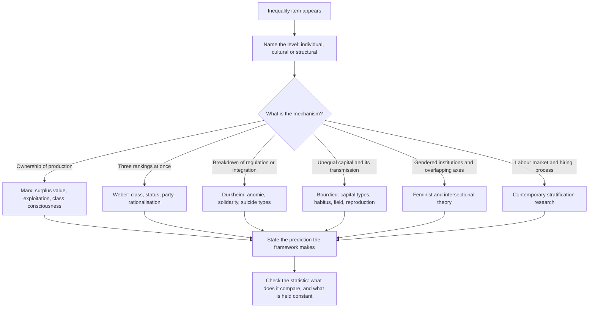

# Social Theory and Inequality

The Humanities and Social Sciences section of GAMSAT is 62 multiple-choice questions in 100 minutes, testing "interpretation and understanding of ideas in social and cultural contexts". A large share of the items in that section describe a social situation and ask which framework best explains it. The situations change; the frameworks do not. That is why this topic is worth the hours: six or seven explanations of inequality, each with its own vocabulary and its own preferred kind of evidence, cover a surprising number of items.

The other thing this topic trains is careful reading of social data. Inequality items frequently present a statistic and then ask what it does and does not show. The same number can be read as evidence of discrimination, evidence of occupational sorting, or evidence of nothing much at all, depending on what is held constant. Learning to name which is which is worth more marks than memorising a definition of stratification.

ACER publishes no per-topic weightage for this section, so the framework set below is StudyRoadmap's own study organisation.

### 🟢 Lite — Quick Review (1h–1d)

**Core vocabulary you must not confuse.**

- **Stratification** — a structured ranking of groups in a society, arranged in layers. Social stratification specifically refers to ranking by class and status.
- **Inequality** — unequal distribution of resources, outcomes or power. It can exist without stratification, as in a single unequal salary.
- **Class** — position in relation to production and the market. In Weber's sense it is one of three dimensions, not the whole picture.
- **Status** — social honour and standing, conferred by the group's own evaluation. Prestige and lifestyle.
- **Party** — the power to influence outcomes, in a formal organisation or a political movement.
- **Income versus wealth** — income is a flow of money over a period; wealth is the stock of assets held. Two households with identical incomes can differ enormously in security.
- **Social mobility** — movement between strata. Vertical (up or down), horizontal (across, at the same level), intergenerational (between generations) versus intragenerational (within one lifetime). Mobility caused by the economy changing is **structural**; mobility within an unchanged structure is **exchange**.

**Poverty, two definitions.** Absolute poverty is failing to meet a fixed subsistence standard, and it can in principle be eliminated by growth. Relative poverty is being poor compared with the society you live in, so it persists as long as the distribution is unequal. Amartya Sen's capability approach reframes poverty as a deprivation of what a person is actually able to do and be, not merely a low income, which is why the same income can produce very different levels of deprivation depending on disability, cost of living and access to services.

**Social exclusion** is the multidimensional version: exclusion from paid work, from services, from social networks, and from civic participation. A person can be employed and socially excluded, so income alone does not capture it.

**The six frameworks, in one table.**

| Framework | Explains inequality by... | Key concepts | Vocabulary cue |
|---|---|---|---|
| Marx | The ownership and control of the means of production | Base and superstructure, bourgeoisie and proletariat, surplus value, exploitation, class consciousness, alienation | Labour, capital, ownership, exploitation |
| Weber | Three competing dimensions of stratification plus rationalisation | Class, status and party; bureaucracy; the iron cage of rationalisation | Status groups, bureaucracy, calculation |
| Durkheim | The moral regulation of society and its breakdown | Mechanical and organic solidarity, division of labour, anomie, suicide types | Regulation, integration, anomie, solidarity |
| Bourdieu | The unequal distribution and transmission of different kinds of capital | Economic, cultural, social and symbolic capital; habitus; field; reproduction; symbolic violence | Capital, habitus, field, distinction, reproduction |
| Feminist and intersectional theory | Patriarchal and overlapping structures of advantage and disadvantage | Patriarchy, the personal is political, unpaid care work, intersectionality, institutional discrimination | Care, patriarchy, intersecting, structural |
| Contemporary stratification research | The operation of institutions, the labour market and the state | Occupational segregation, the gender pay gap, glass ceiling, credentialism, statistical discrimination | Segregation, credentials, gap, institution |

**Each framework, in one paragraph.**

**Marx** sees the economic base of society producing a superstructure of law, politics, religion and culture that legitimates the arrangement. Two classes exist because some own the means of production and others must sell their labour. The owner pays less than the value the worker produces, and the difference is surplus value; the worker's exploitation is that the arrangement works to the owner's advantage. When workers recognise their shared position, class consciousness arises and the structure can change. A worker who does not see this is under false consciousness, and alienation is the condition of not controlling one's own labour.

**Weber** refuses to reduce stratification to economics. People are ranked simultaneously by class (market position), status (social honour) and party (political power), and the three can point in different directions, which is why the answer to "who is above whom" is often "it depends which dimension you mean". Rationalisation is the slow replacement of tradition and custom with calculation, rules and bureaucracy. It produces efficiency and predictability, and also traps people in systems of rule they can no longer see the purpose of.

**Durkheim** studies what holds society together. In small, homogeneous societies, solidarity is mechanical: people share the same work and the same beliefs, and conscience is strong. In modern societies with a complex division of labour, solidarity is organic: people depend on one another through specialisation, and the shared task keeps them attached. Norms regulate desires, and where regulation breaks down, people become anomic, wanting things without limits and without norms to judge them by. His suicide types are the classic application: low integration produces egoistic suicide, high integration altruistic suicide, low regulation anomic suicide, high regulation fatalistic suicide.

**Bourdieu** treats social life as a series of fields, each with its own rules, and explains advantage through capital rather than money alone. Economic capital is money and property. Cultural capital is knowledge, credentials and familiarity with the codes of a group, and it exists in embodied form (demeanour, language, taste), objectified form (books, instruments) and institutionalised form (qualifications). Social capital is the resources available through networks. Symbolic capital is the prestige a form of capital confers once it is recognised as legitimate. Habitus is the durable set of dispositions that a person develops from their social position and carries with them, which is why people reproduce their own position without anyone engineering it. Symbolic violence is the process by which the dominant group's categories come to be experienced as natural and inevitable by everyone, including the dominated.

**Feminist and intersectional theory** argues that gender is not a separate variable added to class but a structure that runs through every institution. Liberal feminism seeks equal opportunity through law and education. Radical feminism locates the source in patriarchy and in the unpaid domestic and care labour that underpins paid work. Socialist feminism insists that class and gender cannot be separated, because the household is a workplace whose output enables the paid economy. Intersectionality, associated with Kimberlé Crenshaw, shows that people located at the overlap of race, gender and class experience combined effects that no single axis explains, so a policy designed for women or for ethnic minorities can miss the women who are also poor and also minority.

**Contemporary stratification research** works with the labour market: occupational segregation by gender and by ethnicity, the pay gap within and between occupations, credential inflation, the effect of hiring processes on who is judged competent, and statistical discrimination, where employers use group averages as a proxy in the absence of full information about individuals.

**The three levels of explanation, and why the level matters.** Individual explanations point to differences in skill, effort or preference. Cultural explanations point to socialisation, norms and taste. Structural explanations point to institutions and the division of labour, and they explain why the pattern persists across generations even when individuals change. Items frequently ask which level of explanation a framework operates at, and almost always the intended answer is the structural one, because the observed pattern is a system-level pattern.

**Memorise for the Lite tier.**

- Class, status and party are three different rankings. Weber says so; many items test it.
- Income is a flow; wealth is a stock.
- Structural mobility comes from the economy changing. Exchange mobility is people moving within a fixed structure.
- Absolute poverty can be eliminated by growth. Relative poverty cannot.
- Marx: base and superstructure, surplus value, alienation, class consciousness, false consciousness.
- Weber: class, status, party, rationalisation, bureaucracy.
- Durkheim: mechanical and organic solidarity, anomie, and the four types of suicide.
- Bourdieu: economic, cultural, social and symbolic capital; habitus; field; reproduction; symbolic violence.
- Feminism: liberal, radical and socialist; care work; the personal is political.
- Intersectionality: overlapping structures produce their own effects, so one-axis policy misses people.
- Structural versus individual explanation is the most common distinction an inequality item draws.
- A statistical gap is not a causal claim until the alternatives are excluded.

### 🟡 Standard — Full Coverage (1–2d)

#### Worked example: reading a pay gap

**The data.** In a large employer, the mean annual earnings of women are 12 per cent lower than those of men. The question asks what the figure shows.

**Work through the alternatives in order.**

**Alternative one: direct discrimination.** Could the employer be paying women less for the same work? Possible, and it is the alternative most people jump to. But the aggregate figure cannot establish it, because it compares the mean earnings of two groups whose jobs are not the same. To get at direct discrimination you need comparisons within job, within grade, controlling for hours and tenure, and even then you are estimating rather than observing.

**Alternative two: occupational sorting.** Women may be concentrated in lower-paid job families — administration rather than technical, care rather than engineering. If the distribution of grades differs between the groups, the aggregate gap can be produced entirely by composition, with no difference in pay for identical work. This is the classic decomposition, and the item's "best explains" answer often turns on which of the two the stem supports.

**Alternative three: hours and tenure.** If women as a group work fewer paid hours, or have shorter average tenure because of career breaks for caring responsibilities, the gap follows without any difference in hourly rate. Note that this alternative is itself socially produced, so it should not be treated as a neutral explanation.

**What the raw gap and the adjusted gap each measure.** The raw gap compares what the groups actually receive. The adjusted gap holds constant a list of characteristics — occupation, grade, hours, experience, qualification — and compares what remains. The debate is about which adjustments are legitimate. Holding constant occupation treats occupational sorting as an individual choice and hides the mechanism that produced it. Not holding it constant treats the sorting as given and concentrates attention on the small within-role gap. Neither answer is simply correct, and an item that asks which gap is more meaningful wants you to say which question each one answers.

**The move that wins marks.** Do not say "the gap proves discrimination" and do not say "the gap proves nothing". Say: the gap is a description of outcomes; it cannot by itself distinguish direct discrimination from differences in occupational distribution, hours or tenure; and identifying which requires within-role comparisons with those variables held constant.

#### Worked example: matching a scenario to a framework

Take each scenario and name the framework that explains it best, with the reasoning.

**Scenario A.** A company introduces an aptitude test for entry to a technical role. Studies find that the test predicts on-the-job performance better than any other single measure, and the same test has been shown to predict performance for a different job in a different decade. Which framework explains why the test is used rather than interview alone? → **Contemporary stratification research**, specifically statistical discrimination and the value of standardised information. It is not Marx, Weber or Bourdieu, because no question of class structure or capital is raised; the explanation is informational.

**Scenario B.** A school places children into streams at the age of eleven, and the children from wealthier homes end up disproportionately in the academic stream, even after controlling for prior attainment. The school's own explanation is that the children from wealthier homes "choose" the academic stream. Which framework? → **Bourdieu**, because the "choice" is explained by habitus and by the cultural capital that makes the academic stream familiar to those children, and the outcome is **reproduction** of class position rather than mobility.

**Scenario C.** During a period of rapid economic growth, suicide rates rise sharply. Which framework explains this? → **Durkheim**, anomic suicide: regulation collapses faster than hopes are revised upward, so desires outrun the norms that used to bound them.

**Scenario D.** A person inherits a house, uses it to provide security for a small business, and uses family connections to secure the first major client. Which framework? → **Bourdieu**, with all four capital types visible: economic capital (the house), social capital (the connections), and the conversion of both into symbolic capital (being taken seriously as a client) and into cultural capital (knowing how to run the business).

**Scenario E.** A society in which a hereditary aristocracy holds legal privilege and wealth while a large working class provides labour, and where religious practice legitimates the arrangement. Which framework? → **Marx**, with the superstructure functioning to legitimise the economic base.

#### Worked example: the four levels of explanation in one stem

**The stem.** Women make up a large share of those working part-time. Which explanation best accounts for this?

- (A) Women prefer part-time work because it suits them better than full-time work.
- (B) Women are less committed to their careers and so choose part-time work.
- (C) Employers assign part-time work to women because caring responsibilities make them more available, and this makes part-time work a route into lower-paid work.
- (D) The pattern is a statistical artefact of how hours are recorded.

Option C is the structural answer: it names an institutional mechanism and treats the "preference" as produced by an arrangement rather than as an independent fact. Options A and B are individual-level explanations, and B also smuggles in a value judgement about commitment. Option D is a methodological explanation and does not address the social mechanism at all.

The reason this shape appears so often is that items are testing level of explanation. When the observed pattern is a pattern across a population, the structural explanation is nearly always the intended one.

#### A worked item set

> **Passage**
>
> Examinations have become the ordinary route into professional employment, and employers report that qualifications are now the main signal they use to sort applicants. The stated purpose is that examinations provide a common standard that is comparable across applicants and cheap to administer. Critics have pointed out that examinations are not neutral measures of ability. Candidates who have been taught the material in the way the examination expects, and who have had access to teachers, equipment and revision resources that prepare them for that format, tend to do better, whatever their underlying aptitude.
>
> The defence offered is that examinations are not the only signal available, and that employers who use them alongside other evidence will avoid the problems the critics describe. It remains the case, though, that in a competitive labour market where many more people now hold the relevant qualification than there are jobs, the exam's residual power as a sorting device increases, since something must distinguish applicants who all look alike on paper. In that situation, the exam does not fail to discriminate; it discriminates in ways its authors did not intend.
>
> Whether that is a problem depends on what the examination is for. If its purpose is to certify that a candidate has attained a standard, then its imperfections matter less, since certification can tolerate false positives and false negatives. If its purpose is to rank candidates for a limited number of places, then its imperfections are transferred directly to the people ranked, and the errors are borne by those who happen to be the least well prepared.

**Item 1.** The passage's main claim is that:

- (A) Examinations should be replaced with school-based assessment.
- (B) Examinations discriminate, and whether that is a problem depends on the purpose they are used for.
- (C) Employers who use examinations alongside other evidence avoid the problems the critics describe.
- (D) The number of qualified applicants has grown faster than the number of places.

**Answer: B.** The passage raises the criticism, offers a defence, then reframes the problem in the final paragraph: discrimination itself may be acceptable for certification and unacceptable for ranking.

Option C is the defence, which the passage then undercuts. Option D is a fact the passage supports rather than a claim it is making. Option A is never proposed.

**Item 2.** According to the passage, the fact that examinations disadvantage candidates who were taught in the expected format is presented as:

- (A) A reason to abandon examinations entirely.
- (B) A difficulty in the defence that examinations are cheap and comparable.
- (C) A difference between certification and ranking.
- (D) A consequence of the growth in the number of applicants.

**Answer: B.** The criticism that examinations are not neutral measures is exactly a difficulty with the claim that they are a fair, comparable, cheap signal. Option D is a consequence the passage links to the exam's sorting power, not to the bias. Option C is the passage's final reframing, which is a different move.

**Item 3.** Which of the following would most weaken the passage's final paragraph?

- (A) Evidence that employers already use multiple signals when choosing among similarly qualified applicants.
- (B) Evidence that examinations are used in many professions where certification, rather than ranking, is the primary purpose.
- (C) Evidence that some employers can identify candidate ability without using examinations at all.
- (D) Evidence that candidates who did not have access to the preferred teaching format nevertheless performed well in the workplace.

**Answer: D.** The final paragraph claims that when exams rank applicants for limited places, their errors are borne by the least well prepared. Evidence that the least well prepared candidates perform well at work would undercut the claim that the ranking transfers meaningful errors to those people.

Option A weakens the defence in the middle paragraph rather than the final paragraph. Option B supports the passage's distinction. Option C is a freestanding point.

**Item 4.** The phrase "does not fail to discriminate; it discriminates in ways its authors did not intend" is best understood as:

- (A) A claim that examinations should not be used at all.
- (B) A concession that examinations produce a ranking, combined with a criticism of that ranking.
- (C) An argument that unintended discrimination is morally neutral.
- (D) A suggestion that the examination format should be changed.

**Answer: B.** The sentence concedes the exam's function while criticising its fairness, which is the pivot the whole final paragraph turns on. Option C is close to the opposite of the passage's position. Options A and D are never proposed.

**What the set teaches.** This passage is the humanities section's house style: an institution and its stated rationale, a critique, a partial defence, a reframing, and a conditional conclusion. Items are built on the joints. And the passage's argument structure maps exactly onto the framework question — whether the exam's imperfection is fatal depends on what it is for, which is a functional rather than an absolute judgement, the kind of move Rawlsian and functionalist reasoning makes and pure rights-based reasoning does not.

### 🔴 Deep — Mastery (3–5d)

#### Using the frameworks as diagnostics rather than as labels

The most common failure is naming a framework and stopping. The item wants you to explain the mechanism, so the answer you write in your head should always be a sentence of the form: *this framework explains the pattern by pointing at X, and it would predict Y.*

For example: "Bourdieu explains the pattern by pointing at cultural capital passed down in families and reinforced by schools, and it predicts that the pattern will persist even when individual effort and attainment are equal." The prediction is the part that shows you have understood the framework rather than recalled a label.

Two things follow from treating frameworks as diagnostics. First, an item that gives you a result and asks which framework explains it is usually giving you a result that only one framework would predict. Second, an item that gives you a framework and asks what it would predict is testing the same thing in reverse.

#### What each framework cannot explain

Knowing the limits is what makes the diagnosis accurate.

- **Marx** is weak on why exploitation is accepted, on the wide variation in pay within the working class, and on anything where class position does not determine the outcome. If an item's scenario features a middle-class professional whose material position has no relation to their exploitation, the intended framework is not Marx.
- **Weber** explains the coexistence of different rankings but is weaker on the reproduction of inequality across generations, which is Bourdieu's territory.
- **Durkheim** is about regulation and integration. It says little about distribution. An item about the size of the gap between rich and poor is not a Durkheim item.
- **Bourdieu** explains how advantage reproduces itself with cultural means, but it is less equipped to explain sudden economic change, such as a recession or a technological shift, which is better handled by structural or labour-market explanations.
- **Feminist theory** explains gender patterning powerfully, and intersectional theory handles overlapping disadvantage, but both need a companion framework to explain class and economic structures fully.
- **Contemporary research** describes patterns and mechanisms in institutions well, but the items about it usually want you to stay at the level of the institution rather than reach for a grand theory.

#### Common mistakes

**Applying Marx to an item about status.** Weber's point is precisely that honour and lifestyle are not reducible to economic position. If the scenario turns on prestige rather than money, Weber is the answer.

**Treating an adjusted statistic as neutral.** Every adjustment encodes a judgement about which differences are legitimate. The item is often asking you to notice that, and "adjusting for occupation assumes occupational sorting is an individual choice" is the observation that earns marks.

**Reading "the gap" as a single quantity.** Ask which gap: within occupation, between occupations, full-time only, or the whole population. An item that says "the pay gap" without specifying is usually testing whether you will ask.

**Assuming a statistic from a convenience sample generalises.** A survey of people recruited through a university forum is not the population, and a large sample from a narrow frame is still unrepresentative. Sample size and representativeness are different properties, and items on social data test the distinction.

**Letting "structural" become a synonym for "good".** Structural explanations describe mechanisms. They carry no evaluative verdict, and an option that uses a structural explanation to smuggle in a conclusion is wrong.

**Forgetting that reproduction and mobility are opposites.** A framework that explains how class position is reproduced across generations is not a framework that explains how people move between classes. The item tells you which one you are looking at by whether mobility or persistence is the phenomenon.

#### Exam traps

**The item that offers "structural" as an answer to a question about an individual's behaviour.** If the question asks why a particular person did what they did, and the option explains it by their class position, check whether the question asked for a group-level explanation.

**The item that presents a quote from a theorist and asks what it implies.** Marx's "the workers have no country" implies that national identity does not override class interest. Weber's "bureaucracy is the dominant kind of human association" implies that organisations have their own logic independent of the people in them. Read what the quote commits the writer to.

**The item that asks which framework would be most likely to emphasise institutional reform.** Liberal feminism and Rawlsian approaches point toward changing rules and opportunity structures. Marx points toward changing ownership. Bourdieu points toward changing the reproduction mechanism in schools. Durkheim points toward restoring regulation.

**The item where an option combines two frameworks accurately and another combines them inaccurately.** "Occupational segregation reflects employer assumptions and the constraints of caring responsibilities" is an accurate combination of contemporary stratification research and feminist analysis. "Class analysis explains everything because class determines every outcome" is an inaccurate combination, because the first clause overstates and the second ignores other structures.

#### 🧠 Memory Anchors

- **Class, status, party.** Three rankings, three different answers to "who is above whom".
- **Income is a flow; wealth is a stock.**
- **Structural mobility is the economy moving; exchange mobility is people moving.**
- **Absolute poverty can be ended by growth; relative poverty cannot.**
- **Durkheim's four suicides are decided by two axes: integration and regulation.**
- **Bourdieu's four capitals, and cultural capital in three forms.**
- **Reproduction and mobility are opposite phenomena.**
- **Flashcard Q&A:**
  - *Which framework treats occupational sorting as a problem?* → Bourdieu, through habitus and cultural capital.
  - *Which framework explains status alongside class?* → Weber.
  - *What does symbolic violence mean?* → The dominant group's categories are taken to be natural by everyone, including the dominated.
  - *What is the difference between relative and absolute poverty?* → One is against a fixed standard, the other against the society's own median.
  - *What does intersectionality add?* → That overlapping structures produce effects no single axis explains.
  - *Does an adjusted pay gap settle the discrimination question?* → No. Every adjustment encodes a judgement about which differences are legitimate.

#### Internal links

- [GAMSAT exam hub](/exams/gamsat/) — the three sections and how ACER builds the paper.
- [Reading Comprehension and Inference](/notes/gamsat/humanities-social-sciences/hss-001/) — locating the claim, the defence and the pivot in a social-science passage.
- [Argument and Reasoning](/notes/gamsat/humanities-social-sciences/hss-002/) — the premise-and-assumption work these items build on.
- [Ethics and Moral Reasoning](/notes/gamsat/humanities-social-sciences/hss-003/) — the distributive justice questions this topic keeps running into.

The section structure and the quoted description of what ACER assesses come from ACER's GAMSAT materials (https://www.acer.edu.au/gamsat and https://gamsat.acer.org/), as recorded in this site's GAMSAT exam data. ACER publishes no per-topic weightage for the Humanities and Social Sciences section, so the weight on this page is StudyRoadmap's own prioritisation.

---

## Continue your study

- **[View this topic in your GAMSAT (Graduate Medical School Admissions Test) roadmap](/roadmap/?exam=gamsat&duration=1mo)** — see where this topic sits in your personalised plan
- **[Build a quick revision plan](/roadmap/?exam=gamsat&duration=1d)** — 1-day sprint covering the highest-weight topics
- **[GAMSAT (Graduate Medical School Admissions Test) exam overview](/exams/gamsat/)** — pattern, eligibility, and syllabus
- **[All Humanities and Social Sciences notes](/notes/gamsat/humanities-social-sciences/)** — browse sibling topics in this subject
