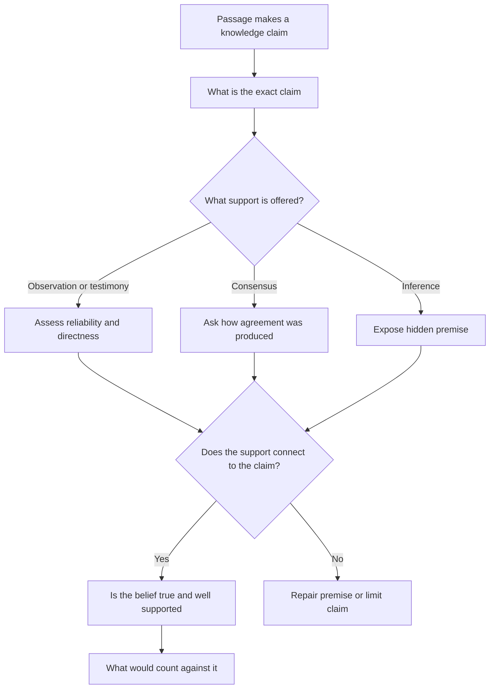

# Philosophy and Epistemology

Epistemology asks what knowledge is, what we can know, and how we justify a claim that we know something. The Humanities and Social Sciences section is full of passages that rely on these distinctions without naming them. One writer treats personal conviction as proof. Another treats a scientific result as certain. A third rejects a conclusion because the observer was biased. The passage may look like a disagreement about facts; it is often a disagreement about what would count as adequate support.

The practical approach is to identify the claim, name the kind of support offered, and ask what would change the writer's mind. Philosophical jargon is useful only when it makes that three-step process sharper.

### 🟢 Lite — Quick Review (1h–1d)

**The central vocabulary.**

| Term | Meaning | Test question |
|---|---|---|
| Belief | Acceptance of a proposition as true | Does the person accept it? |
| Knowledge | A justified true belief, subject to the Gettier objection | Is it true, believed and supported? |
| Justification | The reason or evidence that supports a belief | What makes this belief rational? |
| Evidence | Information that raises or lowers confidence in a proposition | How directly does it support the claim? |
| Truth | Correspondence, coherence or usefulness, depending on the theory | What makes a statement true? |
| Reality | The world as it exists independently of a mind | Is reality only mental, material, or both? |
| Argument | A set of premises offered in support of a conclusion | Is the reasoning valid, and are the premises true? |
| Fallacy | An argument error that can make an unsound case look persuasive | Where does the reasoning break? |

**The traditional analysis of knowledge.** Knowledge is justified true belief. A person must believe the proposition, the proposition must be true, and the person must have adequate justification. Gettier cases challenge the analysis by describing situations in which all three conditions hold but the belief rests on luck. A justified true belief that could easily have been false is not knowledge in the intended sense.

**Foundationalism, coherentism and pragmatism.**

- **Foundationalism** holds that some beliefs are justified independently of other beliefs, while the rest derive support from them. A perception or a basic logical principle can provide the base.
- **Coherentism** holds that a belief is justified when it fits with a coherent set of other justified beliefs. No member of the set needs an external foundation.
- **Pragmatism** treats justification in terms of what works for inquiry and practical problem-solving. A belief earns its place when it guides successful action and survives testing.

**Accounts of truth.**

- **Correspondence:** a statement is true when it corresponds to the facts.
- **Coherence:** a statement is true when it fits with other accepted statements.
- **Pragmatic or pragmaticist truth:** a belief becomes true through the process of inquiry and its successful use. William James treated truth as what works, while Richard Rorty recast truth as what a community settles on after discussion.

**Reality and mind.**

- **Realism** says that a mind-independent world exists. The nature of that world is a further question.
- **Idealism** says that reality is fundamentally mental or that experience is its starting point.
- **Dualism** distinguishes mental and physical substances; **physicalism** says every phenomenon is physical; **property dualism** says mental properties are distinct but arise from physical processes.
- **Skepticism** questions whether knowledge of the external world is possible. Radical skepticism suspends judgement; less radical forms argue that we cannot know certain kinds of claim.

**The distinction between knowledge and opinion.** A statement can be true without being known, for example when the evidence has not reached us. It can also be believed with justification but turn out false, so justification is not certainty. Knowledge requires a connection among truth, belief and adequate reasons.

**Necessary and sufficient conditions.** A condition is **necessary** when the outcome cannot occur without it. It is **sufficient** when that condition guarantees the outcome. A condition can be necessary without being sufficient: oxygen is necessary for combustion but not sufficient for it. This distinction catches many exam items that ask what a proposal would establish.

**Inference and validity.** An argument is **valid** when its conclusion must be true if its premises are true. Validity says nothing about whether the premises are actually true. A sound argument is valid and has true premises. An **inductive argument** offers support rather than a guarantee.

**Memorise for the Lite tier.**

- Knowledge: justified true belief, with Gettier as the classic challenge.
- Foundationalism starts with independent support; coherentism starts with mutual fit; pragmatism starts with successful inquiry.
- Correspondence, coherence and pragmatic accounts answer different questions about truth.
- Validity concerns the form of an argument; truth concerns its premises.
- A necessary condition is required; a sufficient condition guarantees.
- A true belief can still fail to be knowledge if justification is absent.

### 🟡 Standard — Full Coverage (1–2d)

#### Worked example: knowing which bus is arriving

**The situation.** A person looks at a timetable and believes the next bus will arrive at the stop. Another person has lived in the area for years, has heard the route described and believes the same thing without checking the timetable. A third says the belief cannot count as knowledge because no timetable could reveal every disruption to the service.

**The analysis.** The first person's belief is justified by a reliable public source, so it meets the traditional conditions if the prediction is true. The second person's confidence rests on testimony and familiarity; that can also justify a belief when the source is reliable, so the difference is not belief versus no belief. It is the quality and basis of support.

The third statement turns on the problem of **skepticism**. If knowledge requires a guarantee against every possible error, very little knowledge survives. If it requires well-supported belief that is true, the timetable case can qualify even though the bus route is vulnerable to traffic or mechanical failure. The passage's disagreement is therefore about the standard of justification, not about the bus.

**The useful question.** Ask: what would the writer accept as a reason for confidence? This exposes the epistemological assumption behind an everyday judgement.

#### Worked example: an argument with a hidden premise

**The argument.**

1. No policy that has harmed one community has produced a fair society.
2. The housing programme has harmed one community.
3. Therefore, the housing programme has not produced a fair society.

The reasoning is valid: the premises, if true, support the conclusion. The weakness lies in premise one. It treats every harmful policy as disqualifying, even when harm and fairness concern different values. A policy can reduce deprivation for one group while imposing a cost on another, and the argument has to show that such a trade-off defeats fairness rather than merely makes fairness harder to achieve.

**How to repair it.** Replace premise one with a qualified claim: *when a programme imposes serious and avoidable harm on a community while leaving its benefits distributed on a different principle, it fails to produce a fair outcome.* Now the argument has an explicit standard rather than a slogan. This is the move an item rewards: isolate the premise and test whether it does the work the conclusion requires.

#### Worked example: observation, interpretation and reality

A researcher records that participants choose the longer route more often when a sign points toward a destination outside the study area. The researcher writes: "The navigational instinct directs people away from their intended destination."

The observation is the route choice. The interpretation is that an instinct caused it. Neither the observation nor the interpretation establishes that an instinct is a real mental faculty rather than a description of learned cues. A **behavioural** explanation says the environment produced the route choice. A **mentalistic** explanation says the person formed an intention. A **physicalist** explanation says the intention is realised in brain activity. The passage can support the first description without settling the ontology of the intention.

This example is central to realism and idealism. Idealism treats the experienced world as primary and asks how physical objects acquire their meaning within experience. Physicalism treats mental states as descriptions of physical processes. Dualism leaves open whether mental properties are fundamental. An item usually asks which account the writer assumes, so identify the commitment rather than evaluating whether it sounds philosophical.

#### Three recurring types of passage

**An observer-bias passage.** The writer says people are not entitled to trust a conclusion because the observer had an interest in the result. The hidden question is whether motive cancels evidence. A biased observer can still observe accurately, but bias matters for sampling, interpretation and the weight assigned to ambiguous evidence. The strongest answer separates those roles.

**A consensus passage.** The writer argues that a belief becomes true when a community agrees to use it. This is a pragmatic or consensus account. The likely objection is that agreement can be manufactured by power and can exclude valid claims, so consensus does not by itself guarantee truth.

**An uncertainty passage.** The writer says that repeated observation without a decisive test cannot settle a question. This is a discussion of inductive scepticism. The important distinction is between uncertainty that remains after evidence has been gathered and uncertainty built into the method. Repeated observations strengthen a belief, even when they do not provide logical certainty.

#### Applying the framework to social evidence

Philosophy and social science meet when a passage asks whether an inference is justified. Suppose a survey finds that a group with better educational outcomes also reports greater trust in institutions. Three explanations compete: educational access changes both outcomes; trust helps people benefit from education; or a third factor affects both.

The survey establishes association, not causation. Philosophical judgment enters when the writer asks what counts as good evidence for the causal claim and whether observational patterns can ever justify it. Controlled comparison supports causal inference, while a mechanism and careful attention to alternatives strengthen an observational argument. The writer's claim about certainty, explanation or practical certainty indicates the epistemological position.

### 🔴 Deep — Mastery (3–5d)

#### Questions that expose the position behind a passage

Learn to ask six questions. They work on an abstract argument and on a familiar social-science passage.

1. **What exactly is claimed?** Separate the conclusion from the premises and examples.
2. **What sort of support is offered?** Testimony, perception, consensus, inference, experiment or internal consistency?
3. **Is the support direct or indirect?** A witness to an event is stronger evidence for that event than an inference from distant resemblance.
4. **What assumptions connect the evidence to the claim?** A diagnosis can be wrong even when the symptom is real.
5. **What would count against the claim?** A position that explains every possible result has insulated itself from testing.
6. **What standard of truth or certainty is being used?** Correspondence, coherence and pragmatic success assign different roles to evidence.

#### Distinguishing knowledge, belief and opinion

Belief is a state of acceptance. Knowledge adds truth and justification. Opinion, in ordinary use, includes a belief held with less confidence. The important item trap is treating an opinion as the opposite of knowledge. A well-supported conclusion remains knowledge even when a person admits fallibility, and a confident assertion remains opinion when the evidence is missing.

Justification has at least two dimensions. **Internalist** accounts ask whether the person can access reasons for the belief. **Externalist** accounts ask whether the belief was produced by a reliable process, even if the person cannot explain that reliability. A person who reads a reliable weather report has a justified belief about tomorrow's weather under both views. A person who reads a corrupted forecast without knowing it fails the internalist test but passes an externalist process test.

#### Truth, meaning and verification

Verificationism links meaning to methods for confirming or refuting a statement. It handles scientific claims well but strains with statements whose truth has no practical test. A coherence account fits a legal or mathematical system, where a claim's truth depends on its place in a structured set. A correspondence account best fits ordinary factual claims about physical and social events. Pragmatism asks what difference the belief makes in successful action.

These accounts are not mutually exclusive in ordinary reasoning. A scientist can hold that a statement is true when it corresponds to reality, that a theory is justified when it is empirically adequate and predictive, and that truth develops through inquiry. Exam items often test whether the writer confuses these levels.

#### Common mistakes

**Treating skepticism as denial of everything.** Skepticism questions the warrant for a claim; it does not require the writer to assert that no claim is true.

**Confusing validity with truth.** A valid argument can rest on a false premise, and a true conclusion can be reached by invalid reasoning.

**Calling any explanation an argument.** An explanation says how a fact fits together; an argument supports a conclusion from premises. A causal story is not automatically proof that the cause produced the result.

**Using “objective” to mean free of all judgment.** Observation involves choices about what to count, instruments and categories. Objectivity concerns disciplined control and public checking, not the absence of interpretation.

**Reading a social construction claim as denial of reality.** A claim that categories are socially made can be true while real physical and social constraints remain.

**Treating disagreement as proof that all positions are equally rational.** Positions can be equally sincere and unequally supported.

#### Exam traps

A passage argues that because a claim has survived many attempts to disprove it, it must be true. The writer uses a pragmatic test of truth, and the vulnerable step is the transfer from usefulness to truth.

An option says that the conclusion follows only if the witness is unbiased. The better analysis separates the witness's motives from the accuracy of the observation and asks whether the observation was independently checked.

A passage treats agreement among experts as decisive but provides no account of how experts are identified or how disagreement is handled. The likely criticism is not that consensus has no evidential value, but that consensus needs a procedure and cannot be treated as self-validating.

#### 🧠 Memory Anchors

- **Knowledge: justified true belief, challenged by Gettier cases.**
- **Foundation, coherence, inquiry: three routes to justification.**
- **Validity is form; soundness adds true premises.**
- **Necessary versus sufficient: required versus guarantees.**
- **Flashcard Q&A:**
  - *What does a coherence theory of truth connect?* → Other accepted beliefs.
  - *What does internalism ask?* → Whether the person can access reasons.
  - *What does externalism ask?* → Whether the belief arose through a reliable process.
  - *Can a true claim fail to be knowledge?* → Yes, when belief or justification is absent.
  - *Does a valid argument have true premises?* → No.

#### Internal links

- [GAMSAT exam hub](/exams/gamsat/) — the section that tests interpretation of social and cultural ideas.
- [Reading Comprehension and Inference](/notes/gamsat/humanities-social-sciences/hss-001/) — separating a passage's claim from what it merely implies.
- [Argument and Reasoning](/notes/gamsat/humanities-social-sciences/hss-002/) — the premise, conclusion and assumption work behind these items.
- [Ethics and Moral Reasoning](/notes/gamsat/humanities-social-sciences/hss-003/) — the neighbouring problem of how we ought to act.

The topic name, subject organisation and weight come from the GAMSAT Humanities and Social Sciences data in this repository. ACER publishes no per-topic weightage for the section, so the weight is StudyRoadmap's own prioritisation.

---

## Continue your study

- **[View this topic in your GAMSAT (Graduate Medical School Admissions Test) roadmap](/roadmap/?exam=gamsat&duration=1mo)** — see where this topic sits in your personalised plan
- **[Build a quick revision plan](/roadmap/?exam=gamsat&duration=1d)** — 1-day sprint covering the highest-weight topics
- **[GAMSAT (Graduate Medical School Admissions Test) exam overview](/exams/gamsat/)** — pattern, eligibility, and syllabus
- **[All Humanities and Social Sciences notes](/notes/gamsat/humanities-social-sciences/)** — browse sibling topics in this subject
