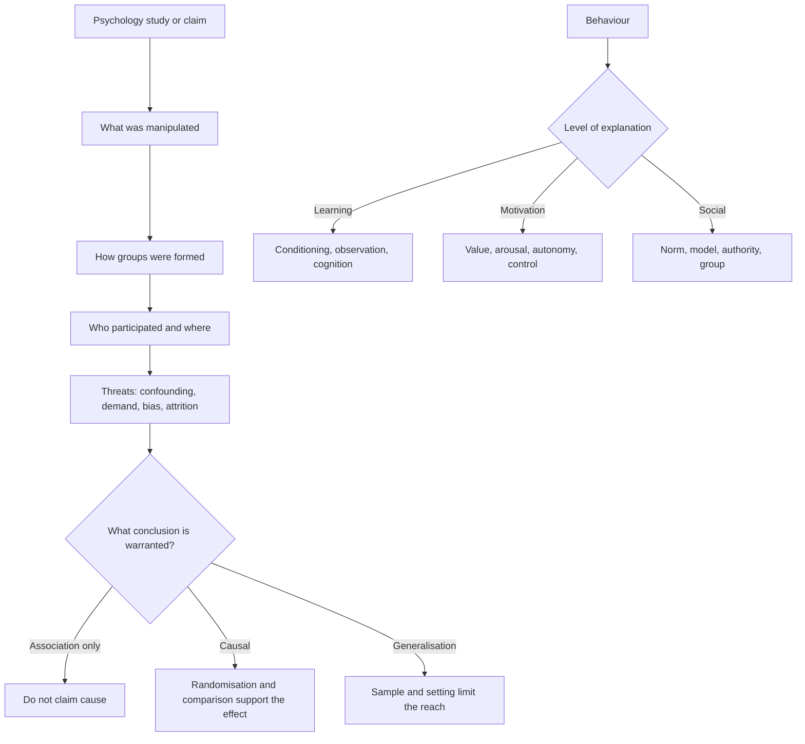

# Psychology and Human Behaviour

Psychology items in the Humanities and Social Sciences section rarely ask for a list of findings. They give a study, a developmental observation, a memory error or a social interaction and ask you to explain it. The explanation has to fit the design. A finding from a small laboratory group cannot automatically be extended to daily life; a correlation cannot identify cause; and a familiar behaviour can have several mechanisms.

The topic is therefore easiest when organised as a set of links: research design establishes what a result can support; development organises changes across the lifespan; cognition and learning explain information processing; motivation and emotion explain why behaviour starts and persists; social influence explains how other people change it.

### 🟢 Lite — Quick Review (1h–1d)

**The research-design map.**

| Method | Strength | Main threat | Example |
|---|---|---|---|
| Randomised controlled trial | Strongest test of a causal effect | Small samples, artificial setting, attrition | Random allocation to a teaching method and a control condition |
| Cohort study | Exposure precedes outcome; can measure several outcomes | Loss to follow-up and confounding | Workers exposed to a chemical followed over time |
| Case-control study | Efficient for uncommon outcomes | Recall and selection bias | Comparing people with a condition with matched controls |
| Cross-sectional study | Quick description of a population at one time | Cannot establish temporal order | Surveying stress and exercise in adults |
| Laboratory experiment | Controls setting and variables | Demand characteristics and low realism | Reaction time under different visual cues |
| Field study | High ecological validity | Less control over variables | Observing behaviour in a school or workplace |
| Case study | Detailed information about one unusual case | Weak basis for generalisation | Full clinical history of one neurological patient |

**Core methodological ideas.**

- **Correlation** means two variables vary together. It does not establish which caused which.
- **Confounder** is a variable related to both the exposure and the outcome, creating a non-causal association.
- **Randomisation** balances known and unknown confounders across groups. Random assignment supports causal inference; random sampling supports population estimates.
- **Placebo effect** is improvement caused by expectation or the treatment ritual; **nocebo effect** is harm produced by expectation.
- **Demand characteristics** occur when participants infer the study's aim and change their behaviour.
- **Observer bias** occurs when the researcher's expectations influence recording or interpretation.
- **Placebo control** and **double blinding** reduce several of these threats at once.
- **Ecological validity** describes how well a study reflects behaviour outside the laboratory.

**Cognitive development.** Piaget described children as constructing knowledge through interaction, with qualitatively different ways of thinking at different stages. Sensorimotor children develop action-based knowledge; preoperational children use symbols but have limited logical and conservation reasoning; concrete operational children reason logically about tangible objects; formal operational adolescents and adults handle abstract and hypothetical problems. Vygotsky emphasised social interaction, language and scaffolding in learning. Erikson described psychosocial conflict across the lifespan, such as identity versus role confusion in adolescence.

**Cognition and memory.**

- **Working memory** holds and manipulates information briefly.
- **Long-term memory** is divided into explicit memory, available for conscious recall, and implicit memory, which guides skills and habits without conscious recall.
- Explicit memory includes **episodic memory** for events and **semantic memory** for facts and concepts.
- **Encoding** turns sensory input into a durable representation; **storage** preserves it; **retrieval** brings it back into use.
- **Recognition** is easier than **recall** because recognition presents the item again, whereas recall generates it.
- **Schema** is an organised knowledge framework that helps interpretation and can distort it.
- **Working-memory capacity** predicts performance on reasoning, comprehension and learning tasks.

**Learning.**

| Type | Mechanism | Worked example |
|---|---|---|
| Classical conditioning | A neutral stimulus acquires the capacity to trigger a response after pairing | A bell paired with food comes to trigger salivation |
| Operant conditioning | Behaviour changes according to its consequences | A study period is followed by a reward and becomes more frequent |
| Cognitive learning | Expectation, observation and mental models guide behaviour | A learner revises a method after comparing it with an expert's solution |
| Observational learning | Behaviour is acquired by watching a model | A child copies a caregiver's coping behaviour |
| Social learning | Observation interacts with motivation, attention and retention | Modelling changes what a learner attempts as well as what they retain |

**Motivation and emotion.**

- **Drive reduction** links behaviour to the restoration of physiological balance.
- **Arousal theory** links performance and preference to an optimal level of arousal.
- **Maslow's hierarchy** treats physiological needs, safety, belonging, esteem and self-actualisation as a motivational sequence; the framework is useful as a prompt, not a universal law.
- **Intrinsic motivation** comes from the activity itself; **extrinsic motivation** comes from a separable reward.
- **Self-determination theory** links motivation to autonomy, competence and relatedness.
- **Cognitive dissonance** is discomfort caused by conflicting beliefs or behaviours, which people reduce by changing belief, behaviour or the interpretation.
- **Attribution** explains behaviour through internal or external causes and stable or unstable causes. Attribution affects emotion and persistence.

**Emotion theories.** The James-Lange theory says physiological arousal produces the emotional experience. Cannon-Bard says arousal and emotional experience occur together. Schachter-Singer adds a cognitive label to arousal. Lazarus places appraisal before both. Each theory fits different evidence.

**Social influence.**

- **Conformity** is agreement with a group.
- **Compliance** is agreement with a direct request.
- **Obedience** is compliance with an authority.
- **Social facilitation** is better performance in the presence of others; **social inhibition** is worse performance.
- **Groupthink** suppresses dissent when group harmony becomes more important than good decisions.
- **Bystander effect** reduces helping as the number of other bystanders grows because responsibility becomes diffuse.
- **Social loafing** reduces individual effort in a group.
- **Fundamental attribution error** overweights disposition and underweights situation when explaining others' behaviour.

**Memorise for the Lite tier.**

- Random assignment supports causal claims; random sampling supports generalisation.
- Correlation is not cause, and confounding is the usual reason.
- Expectation produces placebo and nocebo effects; awareness of the aim produces demand characteristics.
- Recognition is easier than recall.
- Classical conditioning links stimuli; operant conditioning links behaviour to consequences.
- Motivation can be intrinsic or extrinsic.
- Conformity, compliance and obedience answer different questions.
- The fundamental attribution error is a claim about explainers, not actors.

### 🟡 Standard — Full Coverage (1–2d)

#### Worked example: does the app improve vocabulary?

**The design.** A developer wants to test whether a vocabulary app improves word recall. She recruits volunteers who already use language apps, assigns them at random to the new app or their usual routine, and tests recall before and after the study period. Participants know that vocabulary is the target and guess which app is intended to help. The results show improvement in both groups.

**Question one: what does the comparison support?** Random assignment and an active comparison support a causal conclusion about the intervention. The pre-test measures baseline ability, although change scores can still be distorted by regression to the mean and differences in initial ability.

**Question two: what weakens the result?** Demand characteristics are substantial because participants can infer the purpose. Some change their behaviour to please the researcher, and a new app is more exciting than an old routine. Blinding participants to the specific hypothesis and using an active control with similar engagement would reduce this.

**Question three: how far does it generalise?** Volunteers who already use language apps resemble the population poorly. The study also runs in a structured testing environment rather than during ordinary reading. Its result supports the intervention under those conditions; extension to broad daily vocabulary use needs a different design.

**Question four: why did both groups improve?** Practice on the test, repeated testing of the same items, and the passage of time are plausible explanations. A comparison with no-contact participants would help separate these. Without it, the study shows change in both groups, not a clear treatment advantage.

#### Worked example: the child who solves the conservation task

A child is asked whether the same amount of water remains after a tall, thin glass is poured into a short, wide glass. The child says there is less water because the glass is wider. Another child says the amount is the same.

The first answer fits preoperational thought: conservation is not yet stable, and appearance dominates quantity. The second fits concrete operational thought. An item asking about the child's age is testing Piaget's stages, and a follow-up about whether the child understands that the water can be poured back is testing whether the task has been completed correctly.

**The trap.** The stages describe an average pattern, not a rigid calendar. A child can perform a task early or struggle with it later for reasons unrelated to stage. The strongest answer uses the reasoning process, not age alone, as evidence.

#### Worked example: why a witness remembered an innocent suspect

A witness viewed a staged crime and selected a lineup. The lineup contained the real suspect plus a similar-looking man. Later, another witness selected the innocent man after seeing news coverage naming the suspect.

Several processes interact. **Misinformation** from the news coverage altered the witness's memory trace. **Source-monitoring error** led the witness to confuse information seen on television with information seen at the event. **Unconscious transference** can make a familiar face seem familiar because it was encountered elsewhere. **Confidence** rose with time and with repeated selection, yet confidence was not an accurate measure of accuracy. The practical lesson is that a confident, detailed account can still be wrong, and post-event information changes the evidence.

#### Worked example: interpreting social influence in a real setting

A hospital introduces a checklist and the rate of missed medication steps falls. The project leader claims that colleagues copied one another because the unit's senior doctor used the checklist.

The proposed mechanism is **observational learning** or **social norm change**, not simple conformity. A model demonstrates the behaviour, and people attend, retain and reproduce it. To test the claim, the investigator needs to separate modelling from other changes: staff training, system prompts, staffing and leadership attention. Randomising units to checklist access, measuring adoption over time and interviewing staff about what caused adoption would provide better evidence.

#### The design question behind most items

When an item gives a study, run this sequence:

1. **What was manipulated?** Independent variable.
2. **What was measured?** Dependent variable.
3. **How were groups formed?** Random assignment, matching, self-selection or convenience sampling.
4. **Who participated?** Volunteers, students, patients or the general population.
5. **Where did it happen?** Laboratory, clinic, school, workplace or home.
6. **What else changed?** Confounders, coaching, novelty, time and attrition.
7. **What does the result support?** Description, association, comparison or causal conclusion.

The last step is the one candidates skip. A result can be real and still support a narrower conclusion than the writer claims.

### 🔴 Deep — Mastery (3–5d)

#### Memory and learning, connected

Encoding is not a photographic capture. Attention selects and organises information, and schemas guide what is encoded. Retrieval is reconstructive: each act of recall changes the memory trace and can incorporate new information. This is why a witness who discusses the event with others can become more confident and less accurate, and why repeated retrieval strengthens a memory while each reconsolidation leaves room for change.

Learning also depends on feedback and timing. Operant learning depends on the consequence following the behaviour. Immediate reinforcement teaches the contingency more efficiently than delayed reinforcement. Shaping uses successive approximations to build a behaviour that does not occur naturally. Punishment can suppress a response without teaching a replacement, which explains why a child who is punished for an error but given no alternative may repeat the error when the supervisor leaves the room.

Motivation operates through expected value and control. People persist when an outcome is valued, the path feels possible and the outcome feels connected to their action. Overjustification can weaken intrinsic motivation when an external reward makes an enjoyable activity feel controlled. The relevant exam distinction is not whether a reward is good or bad, but what the reward changes about the perceived reason for acting.

#### Common mistakes

**Confusing randomisation with random sampling.** Random assignment asks whether this effect is causal for the participants. Random sampling asks whether the participants represent a population.

**Treating a significant result as a large or important effect.** Statistical significance and practical importance are different questions, and a large sample can detect a tiny difference.

**Assuming the control group receives nothing.** An active control also manipulates expectations, time and attention. Without knowing what the control received, the mechanism cannot be identified.

**Calling every laboratory weakness artificial.** Low realism and strong control answer different questions. A study can be artificial in setting but strong on causal identification.

**Reading a group average as every member's response.** Mean performance hides individual differences, and a developmental stage applies as a broad pattern rather than a diagnostic label.

**Attributing a behaviour without checking the situation.** The fundamental attribution error is made by observers, and social-cognitive accounts warn that actors often explain their own behaviour through situational constraints.

**Confusing emotion with its expression.** Anger can be present without outward aggression, and a smiling face can accompany an unpleasant internal state.

#### Exam traps

A passage reports that people report more wellbeing after a personality test. Demand characteristics are a plausible alternative to the test itself, because participants infer what the researcher wants and respond accordingly.

A researcher finds that older adults perform worse on a recall task but not a recognition task. The correct explanation is that recognition provides retrieval cues whereas recall requires generation.

A child uses a caregiver's coping strategy after seeing it modelled but shows no improvement in the underlying problem. Observational learning explains acquisition of the strategy, while motivation and the environment determine whether it is used or successful.

A worker performs better when watched by supportive colleagues but worse under hostile supervision. Social facilitation and social inhibition apply in different conditions; the presence of others alone does not determine the direction of the effect.

A team reaches quick agreement despite one member identifying a serious modelling error. Groupthink describes the pressure toward consensus and the suppression of dissent that makes the error survive.

#### 🧠 Memory Anchors

- **Assignment for cause; sampling for generalisation.**
- **Encode, store, retrieve; recognition beats recall.**
- **Consequence drives operant learning; pairing drives classical learning.**
- **Intrinsic and extrinsic motivation are not moral opposites.**
- **Conformity, compliance, obedience: group, request, authority.**
- **Flashcard Q&A:**
  - *What is demand bias?* → Participants change behaviour to fit the perceived aim.
  - *What is source-monitoring error?* → Confusing where a memory came from.
  - *What does arousal theory predict?* → Performance is best near an optimal arousal level.
  - *What is social loafing?* → Reduced effort when individual output is pooled.
  - *What is the fundamental attribution error?* → Overweighting disposition when explaining others.

#### Internal links

- [GAMSAT exam hub](/exams/gamsat/) — the section that tests interpretation of social and cultural ideas.
- [Argument and Reasoning](/notes/gamsat/humanities-social-sciences/hss-002/) — separating a causal claim from the evidence offered for it.
- [Sociology and Social Institutions](/notes/gamsat/humanities-social-sciences/hss-007/) — the group processes that surround individual behaviour.
- [Data Literacy in Social Context](/notes/gamsat/humanities-social-sciences/hss-011/) — reading the research figures used in psychology items.

The topic name, subject organisation and weight come from the GAMSAT Humanities and Social Sciences data in this repository. ACER publishes no per-topic weightage for the section, so the weight is StudyRoadmap's own prioritisation.

---

## Continue your study

- **[View this topic in your GAMSAT (Graduate Medical School Admissions Test) roadmap](/roadmap/?exam=gamsat&duration=1mo)** — see where this topic sits in your personalised plan
- **[Build a quick revision plan](/roadmap/?exam=gamsat&duration=1d)** — 1-day sprint covering the highest-weight topics
- **[GAMSAT (Graduate Medical School Admissions Test) exam overview](/exams/gamsat/)** — pattern, eligibility, and syllabus
- **[All Humanities and Social Sciences notes](/notes/gamsat/humanities-social-sciences/)** — browse sibling topics in this subject
