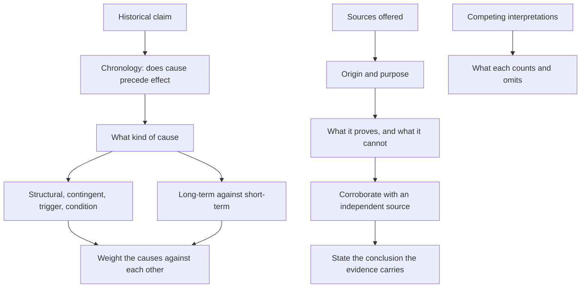

# History and Historical Reasoning

History passages in the Humanities and Social Sciences section are arguments in disguise. A writer sets out why an event happened, and the item asks you to judge the explanation: is the cause identified correctly, is the evidence the right kind, is the chronology respected, and does the conclusion go further than the sources allow? The habit being tested is the historian's habit of weighing causes and stating confidence rather than asserting a single neat story.

### 🟢 Lite — Quick Review (1h–1d)

**The vocabulary that carries real meaning.**

| Term | What it means | What it rules out |
|---|---|---|
| Primary source | Material produced at the time by someone with direct involvement | relying on the creator's motives as evidence of fact |
| Secondary source | An account produced after the event, reconstructing it | treating a later interpretation as a record of the time |
| Long-term cause | A structural condition operating over decades | the belief that history turns on a single moment |
| Contingent cause | A decision, accident or crisis that triggered change | monocausal explanations |
| Revisionism | A reinterpretation that challenges the accepted account | dismissing an interpretation for being new |
| Anachronism | Reading a later idea back into an earlier period | judging past actors by standards they could not know |
| Presentism | Judging the past entirely by present-day values | assuming our concerns were the past's concerns |
| Teleology | History had a predetermined destination | treating hindsight as making one reading inevitable |

**Causation, done properly.** Sort causes into kinds before ranking them. Structural against contingent: conditions operating across decades against decisions that trigger change in weeks. Long-term against short-term: the same event can have a decades-old structural cause and a trigger in a single week. Proximate against ultimate: the immediate spark against the deep conditions that made the spark consequential. Individual against collective: one leader's decision against the pressures that made it the available option.

Then test the claim against three failure modes. **Post hoc** reasoning treats sequence as proof. **Correlation** treats two things happening together as proof that one produced the other, when a third factor or the flow of events in one direction produced both. **Monocausality** ignores that outcomes have a number of causes of unequal weight, which is why a good explanation names a primary cause and a reinforcing secondary factor.

**Evaluating a source.** Four questions, in order.

1. **Origin**: who made it, for what audience, in what position? A minister's private memo and a public pamphlet on the same policy carry different weight on the minister's intentions.
2. **Purpose**: what was the source created to do? A petition was written to be persuasive, and its exaggerations are evidence of the grievance rather than a neutral record.
3. **Content**: what does it actually say, and what does it leave out?
4. **Context**: what did the author know, and what could they not know? A document written the day after an event records the rumour of the day.

A source can be strong evidence for one thing and useless for another. A propaganda poster proves that the regime wanted a particular image projected; it proves nothing on whether the image was true.

**Corroboration.** One source rarely settles a question. Compare independent sources with different interests: a government report, a private letter and a newspaper account. Where they agree on the underlying facts, confidence rises. Where they disagree, the disagreement is itself evidence, and the reasons for it (access, audience, timing, position) explain which to trust for which claim.

**The whig problem.** Nineteenth-century historians wrote history as a march towards progress with the present as its goal, and read earlier actors as imperfect versions of themselves. Modern historians call this presentism, and the criticism is not that the earlier history is wrong but that it organises the past by the concerns of the writer's own day.

### 🟡 Standard — Full Coverage (1–2d)

#### Worked example: the single-cause explanation

**The passage.** "The revolution of 1917 was caused by the decision to impose bread rationing in Petrograd that January. The crowds that had tolerated the war for three years could not tolerate hunger, and once they moved the old order collapsed within eight months."

**The analysis.** The passage identifies a short-term contingent cause and treats it as sufficient. Three things are missing. The structural conditions: military failure, inflation and food supply, the weakness of the monarchy after 1905, and the demands of industrial workers. The sequence: rationing was the trigger, but a trigger only matters where the ground has already been prepared. The outcome: eight months is described as a single collapse, when the February and October revolutions involved different groups with different aims, and the settlement that followed was shaped by the war and the Treaty of Versailles as much as by hunger.

The stronger explanation holds the trigger in place and adds the conditions that made it consequential, and it treats the timing as evidence rather than as the whole story: a policy that produced no mass protest elsewhere, or in the same city in the previous year, is a clue that something else had changed. The option saying the passage understates the structural causes is the strongest, and the option saying the passage is wrong to mention rationing is wrong, because the passage is not wrong about the trigger, only about calling it the cause.

#### Worked example: what a source can prove

**The passage.** "A lithograph produced in 1832 shows workers kneeling outside a factory gate while an overseer reads a notice. The lithograph was sold widely as a print. The historian concludes that the notice read aloud on that morning announced the introduction of a ten-hour working day."

**The analysis.** The source is strong evidence for part of the story and weak for the rest. It reliably establishes that the lithograph was produced and circulated, and that the image of the kneeling workers formed part of the political argument of the 1830s. It does not establish the content of the notice, because the artist had every reason to alter the scene to serve the print's purpose, and it does not establish that the depicted event happened on the day it was published rather than being drawn from an earlier gathering.

The date on the print establishes a terminus ante quem, the earliest possible date of the event, and not the date of the event itself. The method is to find a source closer to the event and independent of the lithograph's commercial interests: factory wage books, a company minute book, a newspaper report or a private letter, then compare.

#### Worked example: two historians, same event, different conclusions

**The passage.** "One historian argues that the 1918 influenza pandemic had negligible demographic impact and that its consequences were overshadowed by the war. A second argues that the pandemic's mortality contributed to the collapse of a number of governments and shaped the postwar settlement."

**The analysis.** Both historians are arguing over scale and consequence, and neither is wrong on the data they use. The disagreement turns on what counts as an effect. The first measures deaths against the death toll of the war and finds the pandemic small in comparison. The second follows the consequences: workforce loss in 1918 and 1919, political unrest, and pressure on governments that already faced demands from the war.

To adjudicate, do not pick the historian whose conclusion matches your own view. Look at what each has left out. The first has not accounted for indirect effects on political stability. The second runs the risk of over-reading: the statesmanship of the period also responded to war debts, to the Russian Revolution and to the fear of socialism, and the pandemic has to be weighed against those causes rather than credited with their whole effect. The transferable skill is to ask what each counts, what each omits, and what evidence would separate them.

### 🔴 Deep — Mastery (3–5d)

**Schools of interpretation.**

- **Whig and presentist history** read the past as a prelude to the present: the Reformation as a step towards religious liberty, the Magna Carta as an ancestor of parliamentary democracy. The method connects events; the defect is that the line is drawn backwards from a conclusion.
- **The Annales school and the longue durée** shift attention away from the event towards slow structures of geography, climate, economy and demography, on the argument that events are the surface of deeper currents. It explains continuity and constraint, and it risks explaining away human agency.
- **Marxist and class analysis** read history through control of the means of production, with class conflict as the engine of change. It explains economic and institutional structures with one logic, and it treats politics and culture as derivative.
- **Revisionism** reopens settled accounts, from the motives behind imperial expansion to the record of a national foundation myth. It is a method of work, not a verdict, and it is judged on its evidence like any other.
- **Post-colonial and subaltern history** writes from outside the metropolitan frame, centring the colonised and the local agents, and asks what the archive silences. It treats nation, civilisation and ethnicity as historically constructed.
- **Oral history and public memory** hold knowledge no written archive holds, but testimony is retrospectively shaped by later events and by the interview itself; the related study of monuments and commemorations treats the past as a contested site negotiated in the present.

**What the craft demands.** Contextualisation places a source in its moment, which cuts both ways: it explains the source and shows how far its assumptions sit from a present-day reading. Provenance is the chain of custody of a document, so a text preserved because it suited the regime that seized it tells you of that regime. Negative evidence becomes informative once you know who created the archive and what would have been recorded if the fact had existed.

**Common mistakes.** Accepting a well-told single cause; treating a source as transparent; reading intent as fact; assuming later historians are simply wrong; ignoring chronology; treating absence of evidence as evidence of absence; and confusing historical explanation with moral verdict.

**Exam traps.** A passage that attributes a revolution to one event is wrong about sufficiency, not about the trigger. A document showing what a government wanted to happen is evidence of intent, not of outcome. The word "inevitable" flags teleology, since inevitability projects a known outcome backwards. A reform attributed to "the influence of Enlightenment ideas" names a diffusion without a mechanism, and leaves open who converted ideas into policy and against what resistance.

#### 🧠 Memory Anchors

- **Primary source: evidence of its own production; secondary source: reconstruction.**
- **Condition makes possible, trigger sets off, cause explains.**
- **Structural versus contingent; proximate versus ultimate.**
- **Post hoc is sequence, not proof. Correlation is not causation.**
- **Anachronism judges the past by present standards; presentism organises the past by present concerns.**
- **Flashcard Q&A:**
  - *What is a terminus ante quem?* → The earliest possible date an event could have occurred.
  - *What does a lithograph prove?* → That the image circulated; not the date or detail of the scene.
  - *What is teleology?* → Reading history as a predetermined march to a known end.
  - *Why does a petition exaggerate?* → Its purpose was persuasion, so the exaggeration is evidence of grievance.

#### Internal links

- [GAMSAT exam hub](/exams/gamsat/) — the section that tests interpretation of social and cultural ideas.
- [Reading Comprehension and Inference](/notes/gamsat/humanities-social-sciences/hss-001/) — separating what a passage states from what it implies.
- [Philosophy and Epistemology](/notes/gamsat/humanities-social-sciences/hss-005/) — the standard of evidence that a historical argument rests on.

The topic name, subject organisation and weight come from the GAMSAT Humanities and Social Sciences data in this repository. ACER publishes no per-topic weightage for the section, so the weight is StudyRoadmap's own prioritisation.

---

## Continue your study

- **[View this topic in your GAMSAT (Graduate Medical School Admissions Test) roadmap](/roadmap/?exam=gamsat&duration=1mo)** — see where this topic sits in your personalised plan
- **[Build a quick revision plan](/roadmap/?exam=gamsat&duration=1d)** — 1-day sprint covering the highest-weight topics
- **[GAMSAT (Graduate Medical School Admissions Test) exam overview](/exams/gamsat/)** — pattern, eligibility, and syllabus
- **[All Humanities and Social Sciences notes](/notes/gamsat/humanities-social-sciences/)** — browse sibling topics in this subject
