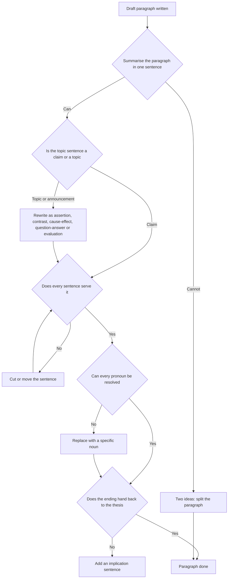

# Paragraph and Coherence

GAMSAT's Written Communication section is two essay responses, and ACER states they are delivered as two 30-minute writing tasks within a single remote-proctored component, that each task offers four statements on a common theme, and that it assesses the ability to "generate and develop ideas in writing". Thirty minutes per task is the constraint that shapes everything here. A candidate who can think clearly and write one paragraph well can produce a strong response. A candidate who writes clearly but lets paragraphs drift will not get the chance to show it.

Paragraphs are where that drift happens, and they are also where most of the marks sit. An essay with a good thesis and no coherent paragraphs is an essay that has stated a position and then talked around it. Coherence is not decoration. It is the thing that makes a reader believe the sentences belong to the same argument.

This topic is the one that pays most off across both writing tasks, because a coherent paragraph is a reusable unit. Learn to build one, learn to check one, and you can build an essay out of them.

### 🟢 Lite — Quick Review (1h–1d)

**What a paragraph is.** One controlling idea, developed far enough that the reader can see why it matters, and closed in a way that hands the reader back to the essay's argument. Four jobs, usually in this order: **claim**, **reason**, **support**, **implication**.

The order is not a rule. It changes with what the paragraph is doing. But the four jobs are always there, and when one is missing you can usually see the damage.

**The topic sentence is a claim, not a topic.** A topic sentence names the subject: "Social media has changed public discussion." A claim sentence states what you want said about it: "Social media has changed public discussion by rewarding the fastest response rather than the most accurate one." The difference matters because the second can be disagreed with, and a paragraph built on a claim can be argued against, extended or limited. A paragraph built on a topic can only be described.

**The five shapes a topic sentence takes.**

| Shape | Looks like | Example |
|---|---|---|
| Assertion of a claim | A statement you could dispute | "Competition produces higher standards only where the rules of entry are open." |
| Contrast | The other side, then which side wins | "Although competition rewards effort, it does not guarantee fairness." |
| Cause and effect | The consequence, named | "Removing competition removes the incentive to improve, so standards fall." |
| Question and answer | A question, then the answer | "Why do standards fall? Because the incentive disappears." |
| Evaluation | A judgement with a reason attached | "Competition is a poor guide to quality, because it measures a different thing from quality." |

**Announcing versus signposting.** This is the single most common weakness in GAMSAT essays.

- **Announcing** names the topic of the paragraph without saying anything about it: "There are three reasons why competition raises standards." The reader now knows the shape of the paragraph and must still be told its content.
- **Signposting** tells the reader what the paragraph will argue: "The clearest reason competition raises standards is that it removes the possibility of complacency." The reader can now follow the argument while it happens.

Every topic sentence should be one of the five shapes above. If it fits the pattern "There are several reasons why...", it is announcing, and it should be rewritten.

**Transitions that carry a relationship.** The test for a transition is not whether it sounds like a link. It is whether it names the logical relationship between the two ideas.

| Relationship | Transitions that work |
|---|---|
| Consequence | therefore, so, which means, and this in turn |
| Reason | because, since, given that, the reason is |
| Contrast | however, by contrast, whereas, yet, on the other hand |
| Addition | moreover, in addition, what compounds this |
| Example | for instance, a case that shows this, take the case of |
| Concession | it is true that, while this is fair, granted |
| Comparison | similarly, in the same way, the parallel case |
| Result of a condition | if so, in that case, otherwise |

Note what is missing: "also", "furthermore", "in addition to this", "Another point to consider is". These connect sentences without naming a relationship, and the reader has to infer it. Use them when the relationship is obvious from the content; do not use them as the link itself.

**Cohesion: making sure the reader can follow the referents.** Coherence is argument-level; cohesion is sentence-level. Two things break cohesion constantly.

- **A pronoun with no clear antecedent.** "This policy has attracted criticism. It was introduced in response to falling numbers." The second "It" cannot be resolved, because the passage has offered two candidate antecedents.
- **A demonstrative with no demonstrandum.** "The argument relies on two assumptions. The first is that motivation is intrinsic. This is questionable." "This" has to point at the assumption, and it does, but only if the sentence before it names exactly one thing. If the previous sentence named two, the reference is ambiguous.

The fix is rarely a longer sentence. It is a more specific noun. "The policy was introduced in response to falling numbers" is clearer than "It was introduced in response to falling numbers".

**Paragraph length.** There is no rule, but there is a reliable test: if you cannot write one sentence that states what the paragraph is arguing, it is two paragraphs pretending to be one. If a paragraph runs past roughly eight sentences, look for the point at which it changes direction, and split there.

**The four-question paragraph check.** Use it on every paragraph you write, and on the ones you did not write yourself.

1. **What does this paragraph argue?** Say it in one sentence. If you cannot, you have a topic, not a paragraph.
2. **Does every sentence serve that argument?** Cut anything that only introduces the subject or restates the claim.
3. **Can the reader follow the links?** Check every "this", "it", "such", "the former", "the latter" for a resolvable referent.
4. **Does it hand back to the thesis?** The last sentence should either set up the next paragraph or close a part of the argument. A paragraph that simply stops has not been closed.

**Memorise for the Lite tier.**

- One controlling idea per paragraph. If you cannot summarise it in one sentence, split it.
- Topic sentence is a claim, not a topic.
- Five topic sentence shapes: assertion, contrast, cause and effect, question and answer, evaluation.
- Announcing is "There are three reasons why...". Signposting is "The clearest reason is...".
- A transition must name the relationship, not merely precede the next sentence.
- Pronouns need unambiguous antecedents. Prefer a specific noun when in doubt.
- A paragraph needs four jobs: claim, reason, support, implication.
- An implication links the paragraph back to the essay's argument. Without it, the paragraph floats.
- Check the paragraph on four questions: what does it argue, does everything serve it, can the links be followed, does it hand back.

### 🟡 Standard — Full Coverage (1–2d)

#### Worked example: one paragraph, broken and repaired

**The original.** It is often said that competition is a good thing. There are a number of arguments for this. Competition makes people work harder because if there is a prize at the end then people will try to get it. It also means that the best people win, because the ones who are better will be the ones who do well. In schools, this is how it works, because the students who work hard get the good grades and the ones who do not do not get them. This is also what happens in the workplace, where the best workers get promoted. However, there are also arguments against competition. Some people say that it is unfair because not everyone starts at the same point.

**Diagnosis, sentence by sentence.**

| Sentence | Problem |
|---|---|
| "It is often said that competition is a good thing." | Announces. Says the topic and nothing else. Also "it is often said" attributes the claim to unnamed others, which is a hedge that hides who is speaking. |
| "There are a number of arguments for this." | Announces again. Now the reader has been told there will be reasons and has learned none. |
| "Competition makes people work harder because if there is a prize at the end then people will try to get it." | The claim is present but the reason is circular: people try because there is something to get. It restates the mechanism rather than explaining it. |
| "It also means that the best people win..." | New claim, no link to the previous one, and the phrase "the best" is doing hidden work that is never examined. |
| "In schools, this is how it works..." | The example is fine, but it is introduced with "this", which now points at three candidate claims. |
| "This is also what happens in the workplace..." | Second example with the same referent problem, and "also" is a transition that names no relationship. |
| "However, there are also arguments against competition." | Announces the counter-argument and never makes it. The paragraph has spent most of its length on a side it then abandons. |
| "Some people say that it is unfair..." | The strongest material in the paragraph, and it arrives last, unlinked, and attributed to "some people". |

**The repair.** One idea, one paragraph, a real reason, a specific example, and a link back.

> Competition improves standards only where entry to the contest is open, because the incentive to improve comes from the chance of winning, and that chance is worth nothing if the result has already been decided. A school examination works this way: the grade is awarded on the work done, so a student who prepares has something real to gain from preparing, and a student who does not cannot claim the grade on the strength of the school's reputation. Where the contest is closed, the incentive weakens. A selection that has already been made on the basis of the very quality being tested produces a winner, but it does not produce the effort that the competition was supposed to reward. This is why open contests and closed ones produce different behaviour from the people inside them, and why simply adding a prize to a contest that was never in doubt changes nothing.

**What changed and why.**

- The opening is now a claim with a condition attached, so the paragraph has something to argue.
- The reason is no longer circular: the incentive comes from the possibility of winning, and the paragraph then says exactly when that possibility is real.
- "The best people win" is gone, because "best" is exactly the word that needed defending.
- The example is specific and it is load-bearing. It does the work of showing how the mechanism operates.
- The final two sentences turn the point towards the essay's larger claim, so the paragraph hands back.
- The counter-argument has been given its own space in the essay, rather than a half sentence at the end of a paragraph about something else.

#### Worked example: an essay-level coherence failure

**The essay.** Four paragraphs. Paragraph 1 argues that competition raises standards. Paragraph 2 argues that competition widens gaps between advantaged and disadvantaged participants. Paragraph 3 argues that competition rewards risk-taking rather than careful work. Paragraph 4 concludes.

**What is wrong.** Nothing in paragraphs 1, 2 and 3 connects them. They are three claims about competition, and a reader cannot tell whether they are three steps in one argument, three competing positions, or three unrelated observations. The paragraphs are internally fine and the essay is incoherent.

This is a common and diagnosable failure, and it is a planning failure rather than a sentence-level one. The fix is to decide what the three claims share, and then to write that into the transitions and the conclusion.

**Step one: find the shared question.** Here the three claims answer "what does competition actually reward?" Paragraph 1 says it rewards effort and raises standards. Paragraph 2 says it rewards participants who already hold advantages, and widens gaps. Paragraph 3 says it rewards visible risk rather than careful work.

**Step two: order them so they accumulate.** The strongest and most familiar claim goes first because a 30-minute essay needs a secure opening. The gap paragraph comes second, because it is the qualification of the first. The risk paragraph comes third, because it is the sharpest version of the qualification.

**Step three: write the transitions to carry that work.** The paragraph ends by naming what the next paragraph will address: "What the incentive rewards, however, depends on who is able to respond to it." And the last paragraph now has something to conclude: it can say that competition is not a single force with one effect but a mechanism whose effects depend on the conditions around it, which is a conclusion that only the three-claim structure makes available.

**The diagnostic to run on any draft.** Read the first sentence of every body paragraph, in order, and nothing else. If those sentences look like a list, the essay is incoherent even if every sentence inside the paragraphs is well written. Then read the last sentence of each paragraph and check that it either sets up the next one or closes a section of the argument.

#### The four paragraph templates, filled in

**Argumentative paragraph.** Claim, reason, support, implication.

> *Claim:* Removing public funding for the arts makes participation less equitable, not more. *Reason:* because subsidies lower the cost of entry, and entry cost is what determines who turns up at all. *Support:* the same programme run without subsidy charges a fee that covers its costs, and the cheapest sessions fill first with people whose families can pay. *Implication:* so a policy justified on efficiency grounds can reduce participation while appearing to preserve it, and the measure of success has to be who participates rather than how cheaply the sessions run.

**Analytic paragraph.** Claim, definition, explanation, application.

> *Claim:* The idea of merit is doing less work in current policy than it appears to. *Definition:* merit, as used in these debates, means that outcomes track ability and effort alone. *Explanation:* but ability is itself shaped by access to preparation, and effort responds to the probability of success, which depends on resources people already hold. *Application:* so a selection process that removes one obstacle while leaving the rest intact will reproduce the distribution it set out to change, and it will do so while describing itself as meritocratic.

**Comparative paragraph.** Claim, comparison along a dimension, contrast, implication.

> *Claim:* The two systems of selection look similar and function differently. *Dimension:* both ask the applicant to demonstrate ability. *Contrast:* one tests performance under controlled conditions, the other tests accumulated credentials produced under conditions the applicant could not choose. *Implication:* the difference does not show up in the results, which look equally merit-based, but it shows up in who feels entitled to appeal a bad outcome, and that is where the two systems produce their different effects.

**Objection paragraph.** Claim, objection, reply, implication.

> *Claim:* The objection that a competition rewards only those who can afford to practise is partly right, and its force depends on what kind of competition is meant. *Objection:* if preparation requires money, then an open contest is not open. *Reply:* where the skill is cheap to acquire, as it is for a written examination, the objection loses most of its force, because the preparation needed to sit well is available to most candidates. *Implication:* so the fairness of a competition is not a general property but a feature of its design, which is an argument for examining contests individually rather than defending competition in the abstract.

#### Transitions that carry a relationship, in use

Watch what each of these is doing.

- "Because" moves from claim to reason. It is the most common word in a good essay and the one most often left out.
- "Which means" moves from a result to a consequence, and it keeps the argument moving rather than restarting.
- "However" marks a genuine turn, so it needs something to turn against. If the sentence before it does not set up something to turn against, use "and" or "also" instead.
- "A case that shows this" introduces evidence and tells the reader its role, which saves them from wondering why the example is there.
- "It is true that" concedes, and it must be followed by "but" or "yet", otherwise it is not a concession at all.
- "This in turn" links two consequences, and it tells the reader the argument is tightening rather than listing.

#### The paragraph check in practice

Two minutes on a finished essay, using the four questions from the Lite tier.

1. Say each paragraph's argument in one sentence. Any paragraph you cannot summarise is the one to fix first.
2. Check referents. Every "this", "it", "such", "the latter", "the former" — resolve it against the previous sentence. Rewrite any that fail.
3. Check the topic sentences. Any that announce rather than signpost get rewritten, and they are usually the sentences that most need it, because they are the ones the reader uses to navigate.
4. Check the endings. Any paragraph that just stops gets a final sentence that links it forward or back.

### 🔴 Deep — Mastery (3–5d)

#### The anatomy of an incoherent paragraph

When paragraphs fail, they fail in a small number of recognisable ways, and each has a different repair.

| Failure | What it looks like | The repair |
|---|---|---|
| Topic drift | The paragraph begins on one claim and ends on another, with a connective joining them | Cut at the point of drift, and start a new paragraph |
| Announcing opening | "There are three reasons why..." | Replace with the strongest reason, stated as a claim |
| Stacked examples | Three examples with no reasoning, so the examples substitute for an argument | Add the reason after the first example and shorten the rest |
| Objection abandonment | A counter-argument is raised in the last sentence and never answered | Give it a paragraph of its own, with a reply |
| Referential ambiguity | Two or more candidate antecedents for a pronoun | Replace the pronoun with the specific noun |
| Floating paragraph | A well-built paragraph with no connection to the thesis | Add an implication sentence that hands back |
| Summary ending | The paragraph closes by restating its opening | Delete it, or make the ending do new work |

The repair for the third row is the one candidates get wrong most often. When a paragraph contains only examples, the instinct is to add more examples. The instinct should be to add the reasoning that makes the examples matter, and then cut two of them.

#### Paragraph length, revisited properly

Length is not a target; it is a consequence. A paragraph earns its length by the amount of work the claim needs. A claim that is close to obvious needs two sentences. A claim that runs against the reader's expectation needs the reason, an example, and a qualification, and that is five or six sentences.

Two practical consequences. First, never pad to length, because padding is visible and is the failure the marker is looking for when they ask whether the argument develops past the first paragraph. Second, do not compress to length, because a paragraph that is too short usually means the reason was skipped, and the reason is where the marks live.

A useful diagnostic: a paragraph whose sentences could be reordered without changing the meaning is a paragraph that has no argumentative sequence. It may be perfectly grammatical and still not be doing anything.

#### Coherence between paragraphs

Paragraph-level coherence is the same problem one level up, and it has the same three parts: a shared question, an order that accumulates, and transitions that carry the relationship.

**The shared question.** Before writing, write one sentence naming what all your paragraphs answer. If your essay has three paragraphs and you cannot name the shared question, you have three paragraphs, not an essay. Sometimes the shared question is a contrast: three paragraphs each describing a different position on a question, with the fourth saying which one survives and why.

**Order that accumulates.** Three reliable orders. Strongest first, for a timed essay where finishing is the risk. Least to most contested, which carries the reader along. And objection-then-reply, which puts the essay's tension at the centre instead of beside it. What does not work is putting the paragraphs in the order you thought of them.

**Transitions that carry the relationship.** The single most useful addition to a GAMSAT essay is one sentence per paragraph that says what the next paragraph will do, written as part of the current paragraph rather than as a separate linking line. "The consequence is that the contest measures preparation as much as performance." Then the next paragraph opens on preparation. This single move fixes most incoherence in weak essays.

#### Common mistakes

**Treating a long paragraph as a sign of depth.** Length is not development. A paragraph that runs long without a reason is padding, and padding is exactly what the marker is looking for.

**Using transitions to fix a structural problem.** A transition between two unrelated paragraphs produces a sentence that refers to both and connects neither. The paragraphs need restructuring, not a connective.

**Announcing the paragraph count.** "There are three arguments against competition" tells the reader your plan, then makes them wait through it. Signpost the argument, not the outline.

**Writing the topic sentence last.** It is much easier to write a paragraph once you know what it is arguing, and it is much easier to write the argument once you have a sentence for it. Drafting the topic sentence first costs a minute and prevents a whole paragraph from drifting.

**Repeating the thesis in every paragraph.** The thesis is stated once, in the introduction. Each paragraph should connect to it without restating it, and the connection should come at the end of the paragraph as an implication.

**Confusing coherence with variety.** A paragraph in which every sentence starts the same way is monotonous, but that is a style problem. A paragraph in which the sentences do not build on each other is a coherence problem, and it is the one that costs marks.

#### Exam traps

**The passage-like stem in a writing task.** ACER's writing tasks offer four statements on a theme. A candidate who answers one statement at a time, in the order given, produces four paragraphs that never connect. The item is not checking whether you can write about each statement, it is checking whether you can develop an argument across them. Pick two or three, use them well, and let them be part of one argument.

**The prompt that resists a familiar answer.** When you take a position that the prompt does not obviously invite, the paragraph that introduces it has to do extra work: it has to say why the position is defensible before it develops it. That paragraph needs a reason of its own, not just a claim.

**The near-miss.** The essay is coherent but the paragraphs all make the same point at increasing length. Six paragraphs, one idea. That is the restatement failure described in [Argument Structure and Thesis](/notes/gamsat/written-communication/wc-001/), and it is invisible if you only check referents. Check the paragraph summaries: if they can be paraphrased with one word changed, they are the same paragraph.

#### 🧠 Memory Anchors

- **Claim, reason, support, implication.** Four jobs, in that order usually.
- **Announcing tells the reader the shape; signposting tells them the content.**
- **A transition must name the relationship.**
- **An unresolvable pronoun is a sentence the reader will reread.**
- **Read the paragraph summaries alone. If they are the same paragraph, you have padding.**
- **Flashcard Q&A:**
  - *What is the difference between a topic sentence and a claim?* → A topic names the subject; a claim states what you want said about it and can be disputed.
  - *What does a paragraph need at its end?* → An implication that links it back to the thesis or sets up the next paragraph.
  - *Why is "There are three reasons" a problem?* → It announces without signposting, so the reader gets no content from it.
  - *How do you fix referential ambiguity?* → Replace the pronoun with the specific noun, or disambiguate the preceding sentence.
  - *What is the fastest coherence diagnostic?* → Read the first sentence of each body paragraph on its own.
  - *When is a long paragraph a problem?* → When it runs long without doing reasoning, rather than when it is simply long.

#### Internal links

- [GAMSAT exam hub](/exams/gamsat/) — ACER's section structure, including the two 30-minute tasks.
- [Argument Structure and Thesis](/notes/gamsat/written-communication/wc-001/) — the essay-level plan these paragraphs serve.
- [Analysis of Ideas in Prose](/notes/gamsat/written-communication/wc-003/) — generating the claims that a paragraph then develops.

Section structure and the description of the writing component on this page come from ACER (https://www.acer.edu.au/gamsat and https://gamsat.acer.org/), as recorded in this site's GAMSAT exam data. ACER publishes no per-task mark breakdown for the writing section; the weights used here are StudyRoadmap's own.

---

## Continue your study

- **[View this topic in your GAMSAT (Graduate Medical School Admissions Test) roadmap](/roadmap/?exam=gamsat&duration=1mo)** — see where this topic sits in your personalised plan
- **[Build a quick revision plan](/roadmap/?exam=gamsat&duration=1d)** — 1-day sprint covering the highest-weight topics
- **[GAMSAT (Graduate Medical School Admissions Test) exam overview](/exams/gamsat/)** — pattern, eligibility, and syllabus
- **[All Written Communication notes](/notes/gamsat/written-communication/)** — browse sibling topics in this subject
