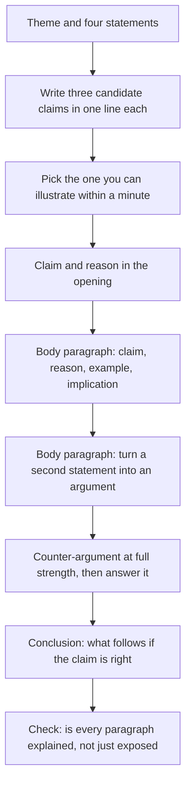

# Analysis of Ideas in Prose

The GAMSAT Written Communication section is two essay responses. ACER states that these are delivered as two 30-minute tasks within a single remote-proctored component, that each task offers four statements on a common theme, that the first task deals with socio-cultural issues and the second with more personal and social issues, and that the section assesses the ability to "generate and develop ideas in writing".

That last phrase is the whole topic. The marks are not for writing an essay about a topic. They are for taking a set of statements about a theme, working out which of them hold and on what grounds, and developing your own position into prose that holds together.

The failure mode is the essay that describes. A candidate restates the four statements in order, adds an example about "modern society", and concludes that the issue is complex. Nothing in that essay is wrong, and nothing in it is argued. The task is to move from statements to an argued position, and that movement is a learnable procedure.

### 🟢 Lite — Quick Review (1h–1d)

**The claim ladder.** Every paragraph you write should be able to complete this chain:

> **Claim** → **Reason** → **Evidence or example** → **Implication**

- **Claim**: a sentence with a verb that you could disagree with. "Social media has changed public discussion." Not "Social media and public discussion".
- **Reason**: why the claim is true. This is the "because" of the claim.
- **Evidence**: a concrete case, a comparison, a consequence you can picture. Not a statistic you cannot check.
- **Implication**: what follows for the theme, or what the opponent would have to accept.

**The two tests that diagnose a weak claim.**

- **The "because" test.** If you cannot finish the sentence "This matters because ___" in one breath, you do not have a claim yet. You have a topic.
- **The "so what" test.** If you cannot finish "So this means ___" with something that matters for the theme, you have stopped one step short of an argument.

**Exposition versus explanation.** Exposition arranges information: definitions, descriptions, chronology, categories. Explanation gives reasons and consequences. A paragraph that only exposes is worth much less than a paragraph that explains, and the fix is always the same: add the reason, or add the consequence.

| Exposition (weak) | Explanation (strong) |
|---|---|
| "There are many types of online community." | "Online communities work best where physical distance makes shared interest scarce, which is why they substitute for local ties rather than replace them." |
| "Privacy is hard to protect online." | "Once information is copied it can be held indefinitely, so consent given at one moment cannot bind a later holder." |

**Working with the four statements.** The statements are raw material for the theme, not a list of answers to tick. A strong essay takes a position on the theme and uses two or three of the statements as evidence or as opposition. An essay that agrees with all four has not analysed anything.

**The counter-argument rule.** One opposing point, stated in its strongest form, then answered. Not mentioned, not implied, answered.

**Memorise for the Lite tier.**

- A claim can be disagreed with. If nobody could disagree, it is a description.
- Every paragraph gets a reason. Exposition without reasons does not score.
- Examples must be concrete enough to picture. "In modern society" is not an example.
- Argue against the strongest version of the opposing view, not a weak one.
- An implication is what changes if your claim is right.
- Take a position. A conclusion that says the issue is complex says nothing.
- Use two or three of the four statements well rather than all four badly.
- The first task is socio-cultural and the second is personal and social. Write in the register the task asks for.

### 🟡 Standard — Full Coverage (1–2d)

#### Worked example: from four statements to an essay plan

Suppose the theme is technology and community, and the four statements are these.

1. Social media has lowered the quality of public discussion.
2. Online communities give people support that their local communities cannot.
3. The pace of technological change is faster than institutions can respond to.
4. Privacy cannot be protected in a society where everything is connected.

**Step 1, generate candidates before you choose.** Write three possible positions in one line each, without judging them yet.

- *A.* Technology has made communities larger and weaker at the same time: it puts more people in contact and gives each of them less weight.
- *B.* The real cost is not the quality of discussion but the loss of local capacity: once needs can be met online, the institutions that met them lose their reason to exist.
- *C.* None of the four statements is about the right variable; the thing worth analysing is how people decide what to believe when no institution is trusted to decide for them.

**Step 2, pick on testability.** Candidate A is the easiest to argue and the easiest to illustrate. Candidate C is the most interesting and the hardest to control in 20 minutes. Candidate B is strong but needs a case, and a case you cannot picture is a case you will not write well.

A useful test: which candidate can you give a concrete example for within one minute of writing? That candidate wins, because an argument without a concrete example becomes assertion, which is exactly what this task is testing.

**Step 3, build the shape.** Take candidate A.

- **Opening**: the claim, and the reason it is not obvious. "Larger and weaker at once" is the tension to state up front.
- **Body paragraph 1**: statement 2, turned into an argument. Online communities substitute for local ties where distance and interest make local ties scarce. They work, and that is the problem: a substitute that works reduces the pressure on what it substitutes for.
- **Body paragraph 2**: statement 1, turned into an argument. Public discussion online is not simply lower quality; it is lower quality in a specific way, because the rewards for visible contributions favour the indefensible over the careful.
- **Body paragraph 3**: the counter-argument, at full strength. Large online communities function as local communities for people who would otherwise have none, and "weak" implies a standard of strength that only applies to the old local form. Then the answer: the weakness is not smallness, it is the absence of consequence. A group that can be ignored can be ignored.
- **Conclusion**: the implication, and what follows for how we should judge it.

**Step 4, check the register.** Task 1 deals with socio-cultural issues, so the paragraphs above are about structures and general tendencies. If the same theme appeared in task 2, which deals with more personal and social issues, the essay would have to be about the individual's experience of the theme: what it is like to belong to an online community, what the loss of local institutions does to the people who relied on them. Same theme, different scale, different evidence.

#### Turning an abstract theme into cases

Most GAMSAT prompts are abstractions: community, technology, freedom, obligation, identity, progress. The essay improves the moment the abstraction is given an actor.

A working sequence is four moves and it takes about two minutes.

1. **Name the abstractions in the prompt.** Technology. Community. Connection.
2. **Make each concrete.** Technology is the software and the network, not "modernity". Community is a group of people who recognise each other, not "society".
3. **Find a case you can picture.** A town whose local noticeboard has been replaced by a group chat. A workplace where decisions are made in a channel where nobody can be held responsible for them. A hospital trust that cannot get staff to fill posts because the online community for that profession has its own norms, advice and internal politics.
4. **Ask what the case shows.** Not "this shows technology is bad", but "this shows that substitution is easy and consequence is not".

#### Developing the best argument, not the first one

The procedure that separates a developed argument from an undeveloped one is simple and brutal: write the argument once, then attack it.

Take the claim that online communities are justified by the support they provide, and attack it: what if the people who bear the cost are not the people who benefit? What if the community looks supportive from inside but not from outside? What if the benefit only appears after a delay long enough for everyone involved to have adapted to the harm?

Each of those is a sentence that belongs in the essay, and each one is a place where a reader can tell whether you control the idea or the idea controls you. An essay that has absorbed three objections is visibly different from an essay that has not met any.

#### The four-statement response

Three positions are available with the statements, and they are not equal in quality.

| Position | What it looks like | Why it is weak or strong |
|---|---|---|
| Accept all four | Restates each statement and calls the theme complex | No analysis has occurred; nothing is at stake |
| Reject all four | Claims the statements are wrong | Overreach; you will be asked to defend four rejections in 20 minutes |
| Take a position on the theme, use two or three | Argues through some statements and against others | This is what the task asks for |

The third position also handles the statements you do not use: a sentence that locates one statement inside your argument ("The fourth statement describes a problem that has no solution under the conditions the first two describe") uses it without needing to endorse it.

### 🔴 Deep — Mastery (3–5d)

#### Exposition, explanation, and the paragraph that fails

The most common weak paragraph in this section defines a term and then describes the term's features. It reads well, it contains correct information, and it earns very little, because the reader could have written it without having formed a view.

The diagnosis is simple: underline the verbs in the paragraph. If they are all *is, are, includes, refers to, consists of*, the paragraph exposes. If there are *because, therefore, which means, so that, and this happens because*, the paragraph explains.

The repair is not to add more information. It is to add one causal link and one consequence. Exposition plus a reason becomes explanation. Exposition plus a reason and an implication becomes an argued paragraph.

#### Handling a prompt that resists a familiar answer

Some themes have a standard answer that everyone has written: technology isolates us, education equalises, money buys happiness, cities should be more walkable. When a prompt lands on one of these, the standard answer is not banned, but it is worth little, because every other candidate wrote it too.

Three moves out of the standard answer.

**Change the level of analysis.** If the expected answer is about society, argue about the individual, or the reverse. "Social media isolates" becomes "social media changes what kind of isolation people can choose", which is a different claim with a different argument.

**Change what is being measured.** "Cities should be more walkable" assumes walkability is the goal. Ask what walkability is for, and argue that the real question is what a street is for.

**Take the standard answer seriously enough to find its boundary.** "Technology can connect people across distance" is true, and the interesting question is what it cannot do. Argue the boundary rather than the centre.

#### Recovering when the essay goes off-plan

It happens in a timed section: you commit to a claim in the first paragraph, and by the third you have run out of reasons for it. There are three moves, in order of preference.

**Narrow the claim.** The most common cause of running out of reasons is a claim that is too broad. "Social media has changed public discussion" can be rewritten as "social media has changed which contributions public discussion rewards", which is smaller and easier to support.

**Change the support, keep the claim.** If you cannot find reasons, find a case. One concrete case can carry a paragraph that three generalisations failed to carry.

**Accept the turn and make it part of the essay.** If the argument has genuinely moved, say so: "The first two paragraphs assumed the problem was the speed of change. On reflection, it is better understood as..." That is an honest move and it reads as thinking rather than as a patch. It is still worse than not going off-plan, so use it last.

#### Common mistakes

- **Describing the theme.** Four paragraphs of what the issue involves, with no position. This is the dominant failure.
- **Using the four statements as headings.** One paragraph per statement, in order. The essay then has no argument, only a summary with an introduction.
- **Offering examples you cannot picture.** "Social media has been shown to cause isolation" is not an example; a description of a particular group of people who moved their community online is.
- **Hedging into meaninglessness.** "While there are arguments on both sides, it is clear that the situation is complex" says nothing that the reader could disagree with.
- **Writing a conclusion that adds a new argument.** The conclusion settles the claim you made. A new argument in the last paragraph reads as running out of time.
- **Ignoring the task's register.** Task 2 asks for personal and social issues. A sociological essay with no individual stakes underperforms there even if its argument is sound.
- **Spending the plan on one idea.** Five minutes of planning on a single claim leaves 20 minutes to fill it. Generate three, choose one, and move.

> ⚡ **Examiner Trap.** An essay that agrees with every statement in the prompt. It reads as agreement, and agreement is not analysis. The statements exist to give you the range of the debate; the marks are for what you do with the range.

#### 🧠 Memory Anchors

- **"Claim, reason, example, implication."** The ladder for every paragraph.
- **"Because and so what."** If either is missing, the paragraph is not doing its job.
- **"Three claims, then choose."** Never commit to the first one.
- **"Argue through, not around."** Use the statements as evidence and opposition.
- **"Steelman the objection."** The strongest version, then the answer.
- **Flashcard Q&A:**
  - *My paragraph defines a term. What is missing?* → A reason and a consequence.
  - *I have three statements and two of them are wrong.* → Argue the theme anyway; one statement used well beats three used badly.
  - *I ran out of reasons. What do I do first?* → Narrow the claim.
  - *What is the difference between exposition and explanation?* → Arrangement of information versus giving reasons.
  - *Which task asks for individual experience?* → The second, which deals with personal and social issues.

#### Internal links

- [GAMSAT exam hub](/exams/gamsat/) — the three sections and how ACER builds the paper.
- [Argument Structure and Thesis](/notes/gamsat/written-communication/wc-001/) — where the thesis and the plan are built.
- [Argument and Reasoning](/notes/gamsat/humanities-social-sciences/hss-002/) — the frameworks you can apply when a theme turns moral.

The facts about this section — two essay responses, two 30-minute tasks within a single remote-proctored component, four statements per task on a common theme, the socio-cultural and personal-social split between the two tasks, and ACER's description of what the section assesses — come from ACER's GAMSAT materials (https://www.acer.edu.au/gamsat and https://gamsat.acer.org/), as recorded in this site's GAMSAT exam data. ACER publishes no per-task mark breakdown, so the timing plan on this page is StudyRoadmap's own study aid.

---

## Continue your study

- **[View this topic in your GAMSAT (Graduate Medical School Admissions Test) roadmap](/roadmap/?exam=gamsat&duration=1mo)** — see where this topic sits in your personalised plan
- **[Build a quick revision plan](/roadmap/?exam=gamsat&duration=1d)** — 1-day sprint covering the highest-weight topics
- **[GAMSAT (Graduate Medical School Admissions Test) exam overview](/exams/gamsat/)** — pattern, eligibility, and syllabus
- **[All Written Communication notes](/notes/gamsat/written-communication/)** — browse sibling topics in this subject
