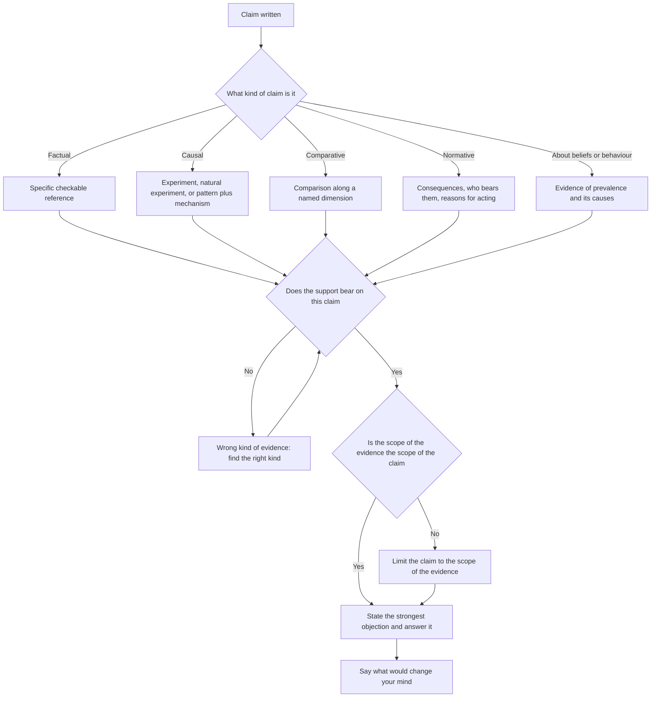

# Evidence, Examples and Critical Voice

GAMSAT's Written Communication section is two essay responses, delivered as two 30-minute tasks inside a single remote-proctored component, in which each task offers four statements on a common theme and ACER says the section assesses the ability to "generate and develop ideas in writing". Two things follow from that. First, the four statements are raw material, not four questions to answer one at a time. Second, what is marked is development, and development means reasons and support, not more sentences.

This topic is where essays are won or lost. A candidate with a clear position and thin support writes an essay that asserts; a candidate with a clear position, a reason, and one well-chosen example writes an essay that argues. The second is not much harder to write and it is worth far more, because the marker's question is whether the ideas have been developed, and support is where development lives.

The other half of the topic is critical voice, which is the difference between an essay that asserts and an essay that weighs. A critical voice does not mean criticising for its own sake. It means the writer is doing something with the evidence: comparing it, limiting it, explaining why it supports the claim, and saying what would change the argument.

### 🟢 Lite — Quick Review (1h–1d)

**A claim that cannot be supported is a sentence, not an argument.** "Technology has changed education" needs evidence and does not need much. "Technology has improved learning outcomes" needs a specific kind of evidence, because the two claims are different claims. Before you look for support, decide what kind of support the claim actually needs.

| The claim | The kind of evidence it needs |
|---|---|
| Something is true now | A specific observation or a specific case |
| Something causes something else | A comparison, ideally an experiment, or at least a mechanism plus a pattern |
| Something is better than the alternative | A comparison along a named dimension |
| Something should be done | The consequences of acting and of not acting, plus who bears them |
| Something is widely believed | Evidence that the belief is actually held and what it rests on |

**The evidence menu.** Eight kinds, and they are not interchangeable.

- **Specific factual data** — a number, a date, a measured quantity, with a source you could name.
- **A concrete case** — one instance, described with enough detail that the reader can picture it.
- **A historical example** — an event, with its context and its outcome.
- **A mechanism** — an explanation of how the cause would produce the effect. This is the most underrated kind of support, because it explains why the evidence fits the claim.
- **An analogy** — a parallel case where the outcome is known. Weak on its own, useful when combined with a difference you acknowledge.
- **Expert testimony** — the opinion of someone with relevant expertise, named.
- **Comparative data** — the same measure for two or more groups or times.
- **Experimental or natural-experiment evidence** — a controlled comparison, or a situation where the conditions varied naturally.

**Qualities of good evidence.** Relevance, which means it bears on this claim and not on a neighbouring one. Strength, which means how much it would move a sceptic. Scope, which means whether it covers the cases you are claiming about or only some of them. Currency, which matters most for claims about the present. Verifiability, which means the reader could check it. Independence, which means it does not come from the same source as the other support you are using.

**The example test.** Four questions, and if you answer no to the first one the example is not doing any work.

1. **Can you picture it?** "In modern society" cannot be pictured. "A regional hospital that began recording triage times on paper so that shift handovers stopped losing information" can.
2. **Is it load-bearing?** Does the argument fail without it, or does the argument work regardless and the example is decoration? Decoration costs time you do not have.
3. **Is it proportionate?** One case supports a claim about one case. To support a general claim you need either a general kind of evidence or an explicit acknowledgment that the case illustrates rather than proves.
4. **Is it the right kind?** A single case is weak evidence for a causal claim and strong evidence for a claim about what happens in that kind of situation.

**Critical voice: what a weighing sentence looks like.** Each of these does something different, and doing two or three of them in a paragraph is what critical voice means.

- **Concede and limit.** "The policy reduces waiting times, though it does so by directing the people who can wait longest to a separate queue."
- **Distinguish scope.** "The evidence covers large metropolitan hospitals, and says little about regional services with far fewer staff."
- **Explain the mechanism.** "The benefit is plausible because the change removes the need for two systems to be reconciled, which is where most of the previous errors came from."
- **Reframe the opposition at its strongest.** "The objection is not that the scheme is expensive, since that is a question of degree, but that it removes discretion from the people best placed to exercise it."
- **Say what would change your mind.** "The argument would fail if the reassignment were shown to be reversible, because the irreversible part is the trust that cannot be rebuilt."

**The fallacies worth recognising on sight.** Most of them are one sentence long, which makes them easy to both commit and spot.

| Fallacy | What it looks like | The repair |
|---|---|---|
| Unnamed authority | "Experts agree that..." | Name the expertise and the claim, or drop it |
| Appeal to popularity | "Most people believe..." | Give a reason; agreement is not evidence |
| Appeal to feeling | An anecdote that produces emotion and stops there | Ask what the case shows, not how it feels |
| Straw man | A stronger version of the opposing view than anyone holds | State the strongest version the opponents would accept |
| False balance | Two options presented as equally supported when the evidence is not equal | Weigh, do not list |
| Circularity | "This is good because it is beneficial" | Break the circle with a reason that stands outside the claim |
| Unfalsifiability | Any outcome is compatible with the claim | Ask what observation would count against it |
| Cherry-picking | One favourable study, others ignored | Consider the range of findings |
| Base-rate neglect | A striking case treated as if it were common | Ask how often this happens relative to the alternative |
| Post hoc | "It happened after, so it caused it" | Look for a mechanism and a comparison |
| False dilemma | Two options when more exist | Check whether the alternatives were removed for a reason |
| Appeal to ignorance | "No one has shown it is false, so it is true" | Absence of evidence is not evidence of absence |

**Hedging without hiding.** Two opposite failures. An essay hedged everywhere reads as having no position, which is the same as having no argument. An essay hedged nowhere reads as claiming more than it has shown. The fix is not to hedge less or more in general. It is to attach the limit to the claim it belongs to: state the claim confidently, and state the condition or scope precisely. "Where the mechanism depends on a reliable supply, which the system under review lacks, the policy delivers little" is precise, not hedged.

**Memorise for the Lite tier.**

- Decide what kind of evidence a claim needs before hunting for support.
- Eight kinds of evidence, and a mechanism is the one candidates forget.
- The example test: can you picture it, is it load-bearing, is it proportionate, is it the right kind.
- Critical voice means doing something with the evidence: conceding, limiting, explaining, reframing, or saying what would change your mind.
- List two options without weighing them and you have written a false balance.
- "Experts agree" without naming the expertise is an empty claim.
- One case illustrates; it does not prove a general claim.
- Hedge the claim, not the essay. Attach the limit to the claim it qualifies.
- Absence of evidence is not evidence of absence.
- State the argument, then state the strongest objection, then answer it.

### 🟡 Standard — Full Coverage (1–2d)

#### Worked example: an assertion rebuilt into an argument

**The original paragraph.**

> Technology has changed the way students learn. Many people believe that online learning is more flexible and more effective than traditional teaching. It is also clear that technology is important in modern education. There are many examples of this. In conclusion, technology has made learning better.

**Diagnosis.**

The claim is vague ("changed the way students learn" could mean anything, and "made learning better" is asserted, not argued). "Many people believe" is an appeal to popularity doing the work of a reason. "It is also clear" is an assertion with no support at all. "There are many examples of this" announces examples without giving one, which is the same announcing-and-signposting failure as in [Paragraph and Coherence](/notes/gamsat/written-communication/wc-002/). "In conclusion" inside a body paragraph is a formula that adds nothing. And the paragraph never says in what sense learning got better, which is the hardest question in the topic.

**The repair, step by step.**

**Step one: sharpen the claim.** Not "technology has changed learning" but "Recorded material changed what students can practise outside a timetabled session, and it changed it in a specific way: it removed the constraint of when a teacher was available, but added a constraint of when a student could concentrate."

**Step two: decide what kind of evidence the claim needs.** This is a causal claim about an intervention, so it needs a comparison, a mechanism, or both. A mechanism is the faster and stronger option in a 30-minute essay, because you can reason it out rather than recall it.

**Step three: supply the mechanism.** "A recorded lecture can be paused, which changes what practice is available: a student who has not understood a step can stop at the step rather than at the end of the session. That is why the same recording used for revision and used for first exposure produce different results, and it is why a recording does not replace teaching so much as change which part of teaching is scarce."

**Step four: give one concrete, load-bearing example.** "A first-year chemistry course that posts each week's worked problem set as a short recording, with the tutor's office hours reserved for students who arrive having attempted the problem, changes what the office hours are for. They stop being a re-lecture and become troubleshooting."

**Step five: add the limit and the implication.** "The benefit depends on the material being divisible into steps that can be paused, which is true of problem sets and much less true of discussion, where the value lies in the exchange rather than the content. So the recording changes the shape of the scarcity, and it does not remove it."

**What the rewrite does.** It keeps the original's position, which was defensible, and makes it arguable. It supplies a mechanism rather than an opinion, one specific example that carries weight, a condition that shows the writer knows where the claim stops, and an implication that hands back to the essay. It is roughly the same length as the original.

#### Worked example: weighing two positions properly

**The situation.** The prompt is about whether public funding should support the arts.

**Positions that fail.** "Some people argue that the arts are vital to society, while others believe they are a luxury that public funds cannot afford. Both sides have valid points, and the debate continues." This is a false balance, and it is the most common way an essay loses marks on a prompt that offers four statements. Nothing is weighed, so nothing is developed.

**The weighing sentence that works.** Pick the two positions you actually want to compare, name the dimension on which you are comparing them, and say which is stronger and why.

> "The two positions disagree about what public money is for, and on that question the funding argument is stronger, because it identifies a function the market does not perform at all, while the spending argument identifies a function the market performs reasonably well. A funded gallery is not competing with a commercial gallery; it is doing the work of providing access to work that would otherwise never be made, and that is work whose value does not show up in a ticket price. But the argument is weaker than it first appears when the case is about operating costs rather than creation: routine operating costs are exactly the kind of thing private galleries provide efficiently, and funding them at a distance removes the price signal that tells a gallery what people want to see."

**The four moves in that paragraph.** It names the dimension of comparison. It says which side is stronger and on what basis. It explains a mechanism rather than asserting a preference. And it limits the conclusion to the case where the argument is weaker, which is the move that distinguishes a weighed argument from a stated preference.

**The template.** "X and Y disagree about Z. On Z, X is stronger because [reason]. But the argument weakens when [condition], because [reason]. So X holds for [scope], while Y holds for [scope]."

#### Worked example: reading statistics without being fooled

**The arithmetic of screening.** Suppose a condition affects one person in a hundred, and a screening test catches ninety-nine of every hundred cases while producing a false positive in one in twenty of the people who do not have it.

Take ten thousand people. A hundred have the condition, and the test finds ninety-nine of them. Of the remaining nine thousand nine hundred, one in twenty tests positive, which is four hundred and ninety-five people. So of the five hundred and ninety-four positive results, ninety-nine are real.

Most of the positive results are false. A person who tests positive and is told the test is ninety-nine percent accurate would be badly misled, because the accuracy figures describe the test's performance on each group separately, not the chance that a positive result is correct. The reason is the base rate: when the condition is rare, false positives outnumber true positives no matter how good the test is. This is why the same test performs very differently in a different population.

**Relative versus absolute risk.** Suppose a treatment is reported to halve the risk of an outcome, and the outcome affects two people in a hundred without treatment. The relative reduction is fifty per cent, which is impressive. The absolute reduction is one percentage point: from two in a hundred to one in a hundred. Treating a hundred people prevents one bad outcome. If a second treatment halves the risk of a different outcome that affects one in a thousand, the relative reduction is the same fifty per cent and the absolute reduction is one in two thousand, which is a much weaker case for treating anyone. Relative figures are useful for comparing mechanisms; absolute figures are what tell you whether acting is worth it.

**Post hoc and cherry-picking.** "Attendance at the programme rose after the reform, so the reform worked" has no comparison, and time order alone does not establish cause. And an essay that cites the one study with a positive result while ignoring the several with none is making a claim about the evidence that the evidence does not support.

**The three questions to ask of any number in an essay.** Where did it come from? What is it comparing against? What is the denominator? A percentage without a denominator can hide almost anything.

#### A worked item set

> **Passage**
>
> Programs that encourage households to replace inefficient appliances are usually justified by the money saved on energy bills. That justification has been challenged on two grounds. The first is arithmetic: the measure of benefit depends on how the savings are counted, and a program that counts a reduction in the household's own electricity consumption alongside the reduction in the utility's total output can report a benefit larger than the physical saving available, because the same kilowatt-hour is counted twice.
>
> The second ground is distributive. A subsidy paid to buyers of efficient appliances is worth more to a household that was already going to buy an appliance than to one that would have continued using the old one, because the saving is a reduction in the price rather than an avoided cost. A program financed by a general levy therefore transfers money from people who have no immediate purchase to those who do, and the size of the transfer depends on how many households were planning to buy in any case.
>
> Neither objection, it is true, addresses the case for the program when the appliances in question are replaced at the end of their working life rather than before, since in that case there is no additional purchase to subsidise and the energy saving is additional. The objections are also, in practice, easier to settle than they appear, because the administrative data on which the programs rely do not distinguish a purchase that would have happened anyway from one that would not.
>
> What the objections do establish is that the headline figure attached to these programs is a figure about a particular counting method, and that the counting method has been chosen for reasons that make the number easy to report.

**Item 1.** The passage's primary concern is:

- (A) The physical efficiency of the appliances in question.
- (B) The reliability of the administrative data used to evaluate the programs.
- (C) How the benefits of the programs are calculated and reported.
- (D) Whether the programs are financed fairly.

**Answer: C.** The whole passage concerns measurement: how savings are counted, how the subsidy's value differs across households, and how the headline figure depends on the counting method.

Option D is one of the two objections, not the passage's overall concern. Option B appears only in the third paragraph as a point that the objections are easier to settle in practice, which is a concession rather than the passage's concern. Option A never arises.

**Item 2.** According to the passage, the subsidy is worth more to a household that was already going to buy an appliance because:

- (A) Such households pay a lower electricity bill after the subsidy.
- (B) For such households the saving takes the form of a reduced price rather than an avoided cost.
- (C) Such households are more likely to use the appliance more efficiently.
- (D) The subsidy is calculated as a proportion of the appliance's price.

**Answer: B.** The second objection states exactly this: where the purchase was going to happen anyway, the subsidy reduces the price paid, whereas for a household that would have kept the old appliance the saving is an avoided cost that would have occurred regardless.

Option A is a general statement that does not explain the difference between the two kinds of household. Option D invents an administrative detail. Option C is imported.

**Item 3.** Which of the following would, if true, weaken the second objection?

- (A) Some households replace appliances early rather than at the end of their working life.
- (B) The administrative data do distinguish purchases that would have happened anyway from those that would not.
- (C) Utility companies have opposed the counting method used for these programs.
- (D) Energy prices have risen faster than household incomes.

**Answer: A.** The second objection is a distributional one: the subsidy transfers more to households with an immediate purchase. If some households replace appliances early, the transfer is smaller than the objection assumes, because those households face an additional purchase that would otherwise not have happened, so their saving is additional.

Option B strengthens the passage's third paragraph rather than weakening the objection, and in any case the passage already states that the data do not distinguish the two kinds of purchase. Option C is opposition without relevance. Option D is imported.

**Item 4.** The passage's final sentence suggests that:

- (A) The programs should be discontinued.
- (B) Headline figures for the programs should be reported with the counting method alongside them.
- (C) The programs have been misreported by their administrators.
- (D) The counting method was chosen because it produces a larger number.

**Answer: B.** The sentence establishes that the headline figure is a figure about a particular counting method. The natural implication is that the method has to be reported with the figure for the figure to be interpretable.

Option D overreaches: the passage says the method was chosen because it makes the number easy to report, not because it makes the number larger. Option C is a stronger claim of wrongdoing than the passage supports. Option A is never proposed.

**What the set teaches.** This passage does exactly what the writing tasks ask you to do: it takes a claim that sounds settled, examines how it is supported, and finds that the support depends on contested decisions. Notice also that the passage includes a concession, a counter-concession, and a conditional conclusion, which is the structure you should be able to reproduce in your own essays.

### 🔴 Deep — Mastery (3–5d)

#### The hierarchy of support, and how to match evidence to a claim

Not all evidence is equal, and the strongest support for a claim is the one that speaks to the claim's actual structure.

**For a factual claim** ("this policy exists, this happened then"): a specific, checkable reference. Anything less is an assertion.

**For a causal claim** ("this produces that"): in descending strength, a controlled experiment, then a natural experiment where conditions varied for reasons unrelated to the claim, then a consistent observational pattern plus a plausible mechanism. A mechanism on its own supports plausibility, not actuality, and a correlation on its own supports association, not cause. Say which one you are offering.

**For a comparative claim** ("this is better than that"): a comparison along a named dimension. If you do not name the dimension, you are asserting an unargued ranking.

**For a normative claim** ("this should happen"): the consequences of acting and of not acting, who bears them, and whether the reasons for acting would apply to the reader. A normative claim supported only by a statistic is a claim with the wrong kind of support.

**For a claim about what people believe or do**: evidence that the belief or behaviour is actually common, and what produces it. Be careful here, because this is where appeals to popularity live.

#### Handling the counter-argument

Every essay that states a position robustly should meet its strongest objection. The reason is not politeness. It is that the marker is looking for development, and a position that has survived its best counter-argument is demonstrably more developed than one that has not met it.

**The three-step move.** State the objection at full strength, in the form its holder would accept. Answer it, either by showing it does not apply to this case or by conceding it and limiting your claim accordingly. Then say what is left of your claim.

The failure in the middle step is a false dismissal: "that objection is irrelevant" or "that is simply not true". Almost always the objection has some force, and the marking rewards the candidate who says where it stops applying. Conceding a limit is not weakness. An essay that says "this holds where X, and fails where Y" is stronger than one that claims X everywhere.

**When to put the objection in its own paragraph.** If the objection is serious, give it a paragraph with a reply in the same paragraph, or a paragraph followed by a reply. A half-sentence objection at the end of a favourable paragraph gives the reader nothing to evaluate and gives the marker no development to credit.

**When to fold it in.** When the objection is minor or when the prompt itself is a tension. Then the essay's structure can be objection-then-reply throughout, which turns the prompt's difficulty into the essay's spine.

#### Common mistakes

**Padding with examples instead of reasoning.** Three examples and no reason is a list, and the reason is where the marks are. One example plus a reason beats three examples.

**Citing a statistic without a source.** "Studies show" is a weak attribution. "A national survey of X conducted in Y" is a usable one. If you cannot name the source in a way that would survive being asked, use the example instead.

**Using an example you cannot picture.** "In many modern workplaces" cannot be pictured, and the reader notices. The fix is one added detail: a place, a time, a mechanism, a consequence.

**Treating an example as proof of a general claim.** One case is evidence about one case. If the claim is general, say "this illustrates" rather than "this proves", and pair the case with reasoning about why the mechanism generalises.

**Over-claiming from the evidence you have.** "This shows that the program works" after one case is the over-claim. "This shows what the program does in the case of X, and the mechanism suggests the same would happen wherever Y holds" is precise.

**Confusing a balanced presentation with a balanced conclusion.** You can describe two positions fairly and still conclude that one is stronger, and in a persuasive essay you usually should.

**Attacking a straw man in your own essay.** If you say "some argue that competition is only for the elite" and then refute it, you have refuted nobody, and an experienced marker will notice that your opponent was never that weak.

**Letting critical voice become criticism.** Weighing is not dismissal. An essay in which every source is found wanting has not weighed anything; it has decided in advance and gone looking.

#### Exam traps

**The four statements on the theme.** The trap is treating them as four sub-questions. The task is to develop an argument that uses two or three of them. An essay that discusses statement one, then two, then three, then four has produced four small essays and no argument.

**A statement that is simply true.** Do not spend the essay on it. Use it as a premise or a launching point and spend the time on the statement that is contestable, because that is where an argument is available.

**A statement that is plainly false.** Do not build the essay on refuting it either. Refuting a false statement is easy and develops nothing. Find the tension among the other statements.

**The prompt that asks you to evaluate rather than argue.** Then the structure is: state the criteria you will use, apply them to each position, and conclude which is stronger and on which criterion. Naming the criteria first is the move that distinguishes a strong answer from a survey.

**The moment you have five minutes left.** Write the sentence that links the paragraph to the thesis and the sentence that hands back to the next one. An unfinished connection is the most expensive kind of unfinished, because it is invisible to the marker unless they go looking for it.

#### 🧠 Memory Anchors

- **Match the evidence to the kind of claim.** Factual, causal, comparative, normative, behavioural.
- **The example test:** can you picture it, is it load-bearing, is it proportionate, is it the right kind.
- **Weighing template:** they disagree about Z; X is stronger because; but it weakens when; so X holds here and Y holds there.
- **Name the strongest objection and answer it. Conceding a limit is not weakness.**
- **Relative risk flatters; absolute risk tells you whether to act.**
- **Flashcard Q&A:**
  - *What is the most underrated kind of support?* → A mechanism, because it explains why the evidence fits the claim.
  - *Why does a screening test disappoint when the condition is rare?* → Base rate. False positives outnumber true positives.
  - *What does "experts agree" need?* → Named expertise and the specific claim they are said to support.
  - *What is the difference between illustration and proof?* → A case shows what happens in that case; it does not establish a general claim.
  - *How do you fix an assertion?* → Give it a reason, then one load-bearing example, then a limit.
  - *What is the cheapest way to look critical?* → Name the strongest objection to your own position and answer it.

#### Internal links

- [GAMSAT exam hub](/exams/gamsat/) — ACER's section structure, including the two 30-minute tasks.
- [Argument Structure and Thesis](/notes/gamsat/written-communication/wc-001/) — the position these paragraphs then support.
- [Analysis of Ideas in Prose](/notes/gamsat/written-communication/wc-003/) — generating claims that can be evidenced.
- [Social Theory and Inequality](/notes/gamsat/humanities-social-sciences/hss-004/) — the same statistics discipline applied to social data in multiple choice.

Section structure and the description of the writing component on this page come from ACER (https://www.acer.edu.au/gamsat and https://gamsat.acer.org/), as recorded in this site's GAMSAT exam data. ACER publishes no per-task mark breakdown for the writing section; the weights used here are StudyRoadmap's own.

---

## Continue your study

- **[View this topic in your GAMSAT (Graduate Medical School Admissions Test) roadmap](/roadmap/?exam=gamsat&duration=1mo)** — see where this topic sits in your personalised plan
- **[Build a quick revision plan](/roadmap/?exam=gamsat&duration=1d)** — 1-day sprint covering the highest-weight topics
- **[GAMSAT (Graduate Medical School Admissions Test) exam overview](/exams/gamsat/)** — pattern, eligibility, and syllabus
- **[All Written Communication notes](/notes/gamsat/written-communication/)** — browse sibling topics in this subject
