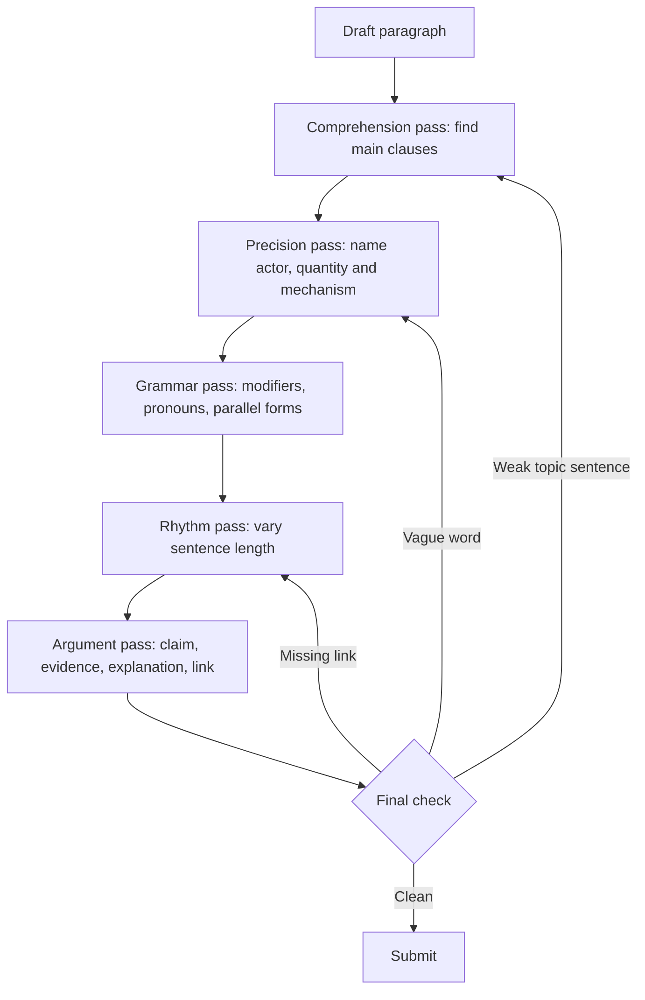

# Language Control and Tone

An essay can contain good ideas and still score poorly because the language hides them. Vague nouns replace the actor, long sentences lose their main clause, transitions point toward a claim that the paragraph never develops, and inflated diction makes a simple point sound empty. Language control is the ability to keep the reader's attention on the argument rather than on the writing.

Tone is the relationship the essay establishes with its reader. In the GAMSAT writing tasks, the reader is assessing an academic argument. The voice should be confident, precise and responsive to the prompt. It should not sound like a textbook summary, a speech full of slogans, or a private journal entry. The practical goal is controlled prose: exact words, clear connections, and no sentence that asks the reader to work harder than the idea requires.

### 🟢 Lite — Quick Review (1h–1d)

**The eight edits that produce the largest gain.**

1. **Name the actor.** Replace an abstract process with the person or group doing it when that makes responsibility clear.
2. **Put one idea in each sentence.** If a sentence contains "and", "but" or "which" joining two substantial claims, split it.
3. **Place modifiers beside what they modify.** A phrase describing a person cannot drift into modifying a noun in the next clause.
4. **Make pronoun references explicit.** Name the person, group or idea when "this", "it" or "they" has more than one possible referent.
5. **Use parallel grammatical forms.** A list of actions should not jump between noun phrases, verbs and infinitive phrases.
6. **Prefer the specific verb.** "Changed" is less informative than "reduced", "replaced", "delayed" or "excluded".
7. **Cut nominalisation.** Return verbs and actors to sentences where the grammar has hidden them.
8. **Match register to the task.** Keep the language academic, but retain ordinary precision.

**Precise versus vague word pairs.**

| Vague | Precise | What the precise word identifies |
|---|---|---|
| significant | reduced income inequality by twelve per cent | Direction and size of change |
| good outcomes | fewer readmissions and shorter stays | The outcomes being claimed |
| impact | increased clinic attendance | The mechanism and direction |
| people | eligible patients | The group affected |
| problems | delayed laboratory results | The operational failure |
| showed | demonstrated through repeated trials | The kind of evidence |
| very important | determines whether the intervention reaches patients | The causal role |

**Voice.** Use active voice for actions and for assigning responsibility: "The school changed its admissions policy" is clearer than "The admissions policy was changed." Passive voice has legitimate uses: the actor is unknown, irrelevant or deliberately protected. "The error was recorded in the incident system" focuses attention on the record, which is appropriate in that context.

**Sentence control.**

- **Subject–verb agreement:** "The list of approved suppliers is attached" takes singular *is* because the head noun is *list*.
- **Articles:** use *the* for a specific known item, *a* for one example, and no article for a general plural.
- **Plural agreement:** "Each of the students has submitted" and "The students have submitted" differ because *each* takes a singular verb.
- **Dangling modifiers:** "Reviewing the transcript, the tutor noticed the error" makes the tutor appear to review it. "After reviewing the transcript, the tutor noticed the error" fixes the structure.
- **Squinting modifiers:** "She borrowed the book from the library that was open late" leaves the referent of "that" unclear.
- **Comma splices:** two independent clauses joined by a comma need a coordinating conjunction, a semicolon or a full stop.
- **Run-ons:** when several ideas compete for one sentence, make the logical relation explicit.

**Paragraph control.** A paragraph should contain one controlling idea, evidence for it, an explanation of how the evidence works, and a link to the essay's overall argument. A topic sentence is not a label; it should make a claim. "There are several benefits" announces a topic without stating one.

**Tone and hedging.** Confidence comes from precise limits, not empty confidence. "This policy reduces waiting times in urban clinics, though the evidence does not cover rural services" gives the reader a usable claim. A sentence weakened at every clause has no position left to evaluate.

**Memorise for the Lite tier.**

- Name the actor and use a precise verb.
- One main claim per sentence; one controlling idea per paragraph.
- Keep modifiers next to their nouns and make pronouns refer to one clear thing.
- Parallel structure makes a list easy to understand.
- Active voice by default; passive voice when the actor is not the point.
- Hedge the scope of a claim, not the fact that you hold it.
- Transitions should express a logical relation, not merely mark a sequence.

### 🟡 Standard — Full Coverage (1–2d)

#### Worked revision: from abstract to accountable

**Original.**

> The impact of the policy on educational outcomes has been significant, and there are various factors which may have played a role in determining the extent of the improvement, which was made possible by a number of different stakeholders who were involved in its implementation.

**Diagnosis.** The sentence has one controlling idea, but the reader has to find it. "Impact" does not identify the mechanism. "Significant" states no measure. "Various factors" and "a number of different stakeholders" add no information. The relative clause at the end leaves it unclear what "which" refers to. "Was made possible" hides the action. The result is wordy and vague.

**Revision.**

> The policy raised examination participation because outreach teams contacted eligible students directly and schools reserved transport for weekly attendance classes.

**What changed.** The actor is named. The mechanism is stated. The outcome has a direction. The specific phrase "outreach teams contacted eligible students directly" replaces a general claim about implementation. The sentence is shorter and easier to test against evidence.

**Revision that preserves uncertainty.**

> The policy raised examination participation in participating schools, although the evaluation cannot show whether outreach caused the change or whether schools that volunteered for the programme were already more engaged with families.

This version does not manufacture certainty. It names the supported outcome and the unresolved causal question.

#### Worked revision: pronoun and modifier repair

**Original.**

> Teachers who believed that students needed encouragement were given training. After the workshop, it was clear that the students felt more confident because of it.

**Problems.** "It" has two plausible referents: the training or the encouragement. "Because of it" repeats the vague reference. "The students" is ambiguous if the programme involved several classes.

**Revision.**

> Teachers who believed that students needed encouragement received training. After the workshop, teachers reported that their students expressed greater confidence during class discussions.

**Why this works.** The subject of the second sentence is clear. "Their" points to the teachers' students. "Reported" keeps the evidence source visible without claiming that confidence increased more than the reports establish. "During class discussions" makes the observation concrete.

#### Worked revision: parallel structure

**Original.**

> The programme improved attendance, reduced dropout and the provision of counselling, and strengthened links with families.

**Revision.**

> The programme improved attendance, reduced dropout, expanded counselling and strengthened links with families.

**Why this works.** All four items are verbs in the same grammatical form. The revision also identifies what changed in counselling: access expanded. A parallel list is not decoration; it makes the content easy to scan and check.

#### Worked revision: controlling the register

**Academic but empty.**

> In today's rapidly evolving world, the importance of accessible healthcare can hardly be overstated. It is incumbent upon all stakeholders to collaboratively endeavour towards multifaceted solutions.

**Plain and precise.**

> Rural patients face travel, cost and scheduling barriers that limit access to preventive care. Regional clinics, mobile screening units and extended opening hours address different parts of that problem.

The second version keeps an academic register but removes inflated claims, empty modifiers and the vague collective agent. "Incumbent upon" and "endeavour towards" do not add meaning. Specific barriers and responses do.

#### A sentence-level editing routine

Use three passes, not one.

**Pass one: comprehension.** Read only the main clauses. If the paragraph's argument disappears, a main clause is buried. Rewrite it.

**Pass two: precision.** Circle every vague noun and general quantifier. Ask what kind, how many, who, which direction and by what mechanism.

**Pass three: rhythm.** Vary sentence length deliberately. Break up a run of long sentences. Combine two short sentences when they make one point. Check that each paragraph has a natural landing point rather than ending on a list.

Read the paragraph aloud at the final pass. A missing comma or an unclear pronoun becomes audible even when the page hides it.

### 🔴 Deep — Mastery (3–5d)

#### How to create a controlled academic voice

An academic voice in this task has three qualities.

**It is argument-bearing.** Every sentence contributes a claim, a reason, evidence, a qualification or a link. Sentences that only announce the topic contribute nothing.

**It is calibrated.** Strong verbs and precise nouns express confidence. Limits attach to the claim: the population, period, mechanism or type of evidence. This is different from inserting vague adverbs throughout.

**It is responsive.** The vocabulary follows the prompt's subject and the argument's terms. A passage about public trust and expert decision-making does not need terms imported from unrelated debates simply to sound scholarly.

The voice does not need to sound detached from humanity. Concrete examples, direct consequences and ordinary actions can appear inside academic prose. The question is whether the diction serves the argument.

#### Cohesion versus mechanical linking

Five kinds of connection can link ideas:

- **Addition:** also, in addition, moreover.
- **Contrast:** however, although, by contrast.
- **Cause or result:** therefore, consequently, as a result.
- **Example:** for instance, specifically.
- **Restriction or qualification:** although, while, except where.

Use a connector only when the relation is real. "However" that joins two agreeing sentences creates a false contrast. "Moreover" adds little when the next sentence continues the same point. The strongest link is often grammatical: the second sentence uses the noun phrase or idea established by the first. In a paragraph about waiting times, "The change moves the longest waits to a separate queue" follows naturally from a sentence about two queues.

#### Editing for argument, not only grammar

A grammatically correct paragraph can still fail because the topic sentence is weak, the evidence does not support the claim, or the conclusion arrives without explanation. Use this final checklist:

1. What is the controlling claim?
2. Which sentence states it?
3. What evidence supports it?
4. Why does that evidence bear on the claim?
5. What limit or objection deserves attention?
6. How does the paragraph advance the essay's thesis?

If the paragraph contains no explanation of why the evidence matters, add one. If it lists evidence without ranking it, connect it to the claim. If it ends without linking back, finish the intellectual work rather than adding a filler sentence.

#### Common mistakes

**Inflating ordinary words.** "Demonstrates" is not automatically better than "shows"; it can overstate what was demonstrated.

**Using a thesaurus mechanically.** Replacing "use" with "utilise" lengthens the sentence and changes nothing.

**Making every sentence elaborate.** Precision does not require complexity. A short sentence can be exact.

**Hiding responsibility in passives.** Passive voice is useful when the agent is unknown or irrelevant. It conceals responsibility when the actor is central to the argument.

**Over-signposting.** Every paragraph beginning with "Furthermore" makes the reader work to find the relationship. Logical structure should carry the links; connectors confirm them.

**Treating a qualification as a weakness.** A precise boundary strengthens a claim because the reader knows where it applies.

**Confusing personal voice with opinion.** A first-person argument is not automatically less academic, but the prompt's task determines whether personal experience serves the analysis.

#### Exam traps

A prompt asks whether a policy is justified. An answer that describes the policy accurately but never states a verdict has answered a different task. The thesis must appear early and control the body.

An answer uses "clearly", "obviously" and "undoubtedly" to replace support. These words intensify a claim without supplying a reason.

An answer discusses four supplied statements in separate sections. The prompt asks for an essay, not four summaries. Language control includes using the statements as material for one developed position.

An answer ends with "In conclusion, there are many factors to consider." The conclusion must state what the argument has established. A generic close discards the reasoning built in the body.

#### 🧠 Memory Anchors

- **Actor, action, object.**
- **One claim per sentence; one controlling idea per paragraph.**
- **Modifiers stay close; pronouns have one referent.**
- **Parallel structure makes content visible.**
- **Active by default; passive for deliberate focus.**
- **Flashcard Q&A:**
  - *What is a dangling modifier?* → A phrase grammatically attached to the wrong subject.
  - *When is passive voice useful?* → When the actor is unknown, irrelevant or not the point.
  - *How do you calibrate a claim?* → Attach the relevant population, period or limit.
  - *What should a topic sentence do?* → State the paragraph's claim, not label its subject.
  - *What makes a transition useful?* → It expresses the real logical relation.

#### Internal links

- [GAMSAT exam hub](/exams/gamsat/) — the writing component described by ACER.
- [Argument Structure and Thesis](/notes/gamsat/written-communication/wc-001/) — the position that language control must keep visible.
- [Paragraph and Coherence](/notes/gamsat/written-communication/wc-002/) — the unit within which sentences work.
- [Timed Essay Technique](/notes/gamsat/written-communication/wc-006/) — the editing routine placed inside the writing window.

The topic name, subject organisation and weight come from the GAMSAT Written Communication data in this repository. ACER publishes no per-task mark breakdown for the writing section, so the weight is StudyRoadmap's own prioritisation.

---

## Continue your study

- **[View this topic in your GAMSAT (Graduate Medical School Admissions Test) roadmap](/roadmap/?exam=gamsat&duration=1mo)** — see where this topic sits in your personalised plan
- **[Build a quick revision plan](/roadmap/?exam=gamsat&duration=1d)** — 1-day sprint covering the highest-weight topics
- **[GAMSAT (Graduate Medical School Admissions Test) exam overview](/exams/gamsat/)** — pattern, eligibility, and syllabus
- **[All Written Communication notes](/notes/gamsat/written-communication/)** — browse sibling topics in this subject
