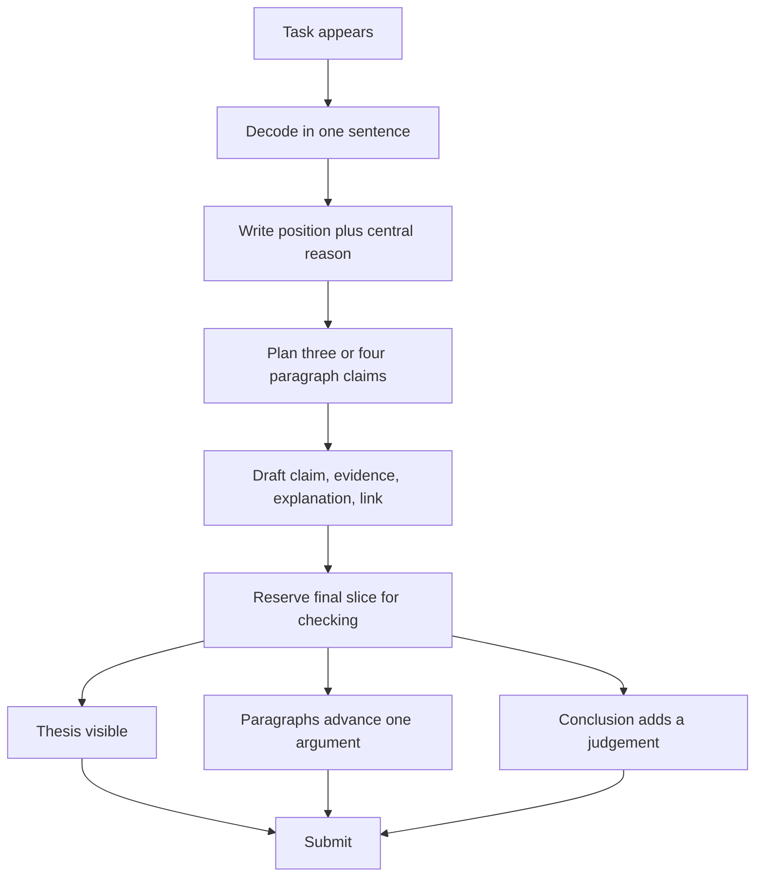

# Timed Essay Technique

Timing an essay is not the same as writing quickly. It is deciding what a good answer must contain, producing that answer in the available window, and leaving enough time to see structural errors. Students who lose marks under the clock usually have a knowledge problem, an argument problem or a planning problem. The technique works when it identifies which one caused the loss.

The GAMSAT writing component gives each candidate two separate essay tasks. Each task presents statements on a theme, and the candidate must generate and develop ideas in response. The second task begins after the first, so attention and decision speed carry across the session. One essay that burns the whole planning stage leaves the next task with a tired brain and no working rhythm.

### 🟢 Lite — Quick Review (1h–1d)

**The working sequence.**

| Phase | Purpose | Output |
|---|---|---|
| Decode | Decide what the prompt asks | A task in one sentence |
| Position | Choose a defensible thesis | One sentence with a reason |
| Plan | Select and order the body | Three or four paragraph claims |
| Draft | Develop each claim | One developed idea per paragraph |
| Check | Repair structure and language | A thesis, linked paragraphs and a conclusion |

**The first five minutes.** Read the task twice. Underline the key terms, circle the demands and reject the interpretation that makes the prompt easier than it is. Then write one sentence: *"The question asks whether [X], and my answer is [position], because [central reason]."* If that sentence contains an unsupported claim, keep working on the position before outlining.

**Plan the body before writing the introduction.** Write a claim for each paragraph in the margin or in a note field. A strong plan contains a reason, the mechanism or example that will support it, and the main point of tension. The plan is not a summary of the prompt. It is the essay in compressed form.

**The paragraph test.** A finished paragraph should contain:

1. A controlling claim.
2. Evidence: a reason, mechanism, example or comparison.
3. Explanation of why the evidence supports the claim.
4. A link back to the thesis or forward to the next claim.

If the paragraph has a topic sentence and a pile of examples but no explanation, the examples are not yet developed.

**Time control.** Use proportions rather than fixed minutes, because the task window and the writing speed vary. Spend roughly one fifth of the window on reading and planning, four fifths on drafting, and reserve the final slice for checking. The reserve is not optional: the most expensive errors are structural and visible on a reread.

**What to do when you have no idea.** Start with the task's terms, not a memorized essay. Write two possible positions. For each, ask: what reason would support it, what example would make it concrete, and what would count against it? Choose the position with the stronger reason and better example. Five minutes of deliberate choice beats fifteen minutes of blank-page panic.

**What to do when the argument collapses mid-draft.** Do not restart the whole essay. Write the claim you can defend in the next paragraph, connect it to the thesis, and treat the abandoned branch as one side of a qualification if it is relevant. A coherent essay with a narrowed claim scores better than an ambitious plan abandoned halfway.

**The final check, in priority order.**

1. Does the introduction state a position?
2. Does every body paragraph advance that position?
3. Does each paragraph explain its evidence?
4. Is there a counter-argument or a meaningful limit?
5. Does the conclusion add a judgement rather than repeat the introduction?
6. Are subject–verb agreement, articles, pronouns and spelling correct?

**Memorise for the Lite tier.**

- Decode the task before generating ideas.
- Write the thesis in one sentence with a reason.
- Plan paragraph claims before drafting the introduction.
- Use evidence and explain why it matters.
- Reserve a fixed slice for structural checking.
- When stuck, generate two positions and choose on reasoning.
- When the draft breaks, salvage a coherent narrower argument.
- Check structure before grammar.

### 🟡 Standard — Full Coverage (1–2d)

#### Worked example: interpreting a prompt before answering it

**Task.** Four statements concern public trust in institutions. One says that trust rises when decisions are transparent. Another says that trust depends on institutions acting consistently. Another says public education improves understanding of why decisions are made. The fourth says trust matters less than practical service quality.

**The wrong opening.** Treat each statement as a question and write four paragraphs. The task asks for an essay response, not commentary on four items. This structure produces summary without development.

**The productive reading.** Identify a tension: transparency and consistency describe different institutional processes, while education and service quality describe different ways of supporting public confidence. The candidate needs an argument about how trust is built.

**A workable position.** "Transparency improves trust when it explains how a decision was made, but consistent implementation matters more because an explanation that is contradicted by the institution's next action teaches distrust."

**Why it works.** It takes two statements rather than mechanically covering all four. It states a comparative claim. It supplies a mechanism in the final clause. It leaves a defined scope: transparency helps when it explains a decision.

**The body plan.**

1. Transparency creates legitimacy by showing the grounds of a decision, but only when the public can understand those grounds.
2. Consistency strengthens trust because people infer institutional seriousness from the relationship between stated rules and later action.
3. Service quality and education support trust in different ways; the first demonstrates capacity and the second builds informed engagement.
4. A qualified conclusion: trust is strongest when explanation, consistency and performance point in the same direction.

The plan gives each paragraph a job. It does not prescribe sentences, which frees drafting time for explanation and examples.

#### Worked example: recovering a bad opening

A candidate writes: "Throughout history, societies have debated the importance of trust, and this has always been a controversial topic that has attracted attention from many different people."

**Diagnosis.** The sentence contains no position. It gives a vague subject, an uninformative historical point and a passive use of "has attracted". The candidate now faces a blank page because the opening cannot control the body.

**Recovery without restarting.**

1. Circle the real task terms: trust, institutions, public understanding.
2. Write a fresh position: "Institutional trust depends more on consistent conduct than on explanation because trust is a prediction about future action."
3. Write one reason for the position: people judge an institution by whether its later conduct matches its stated principles.
4. Write one example shape: a regulator that publishes clear reasons but later reverses without explanation demonstrates the point.
5. Keep the original opening as a single introductory sentence if desired, but put the thesis immediately after it.

This recovery takes a few focused minutes and preserves the work already done.

#### Worked example: the paragraph that needs explanation

**Draft.**

> Online appointments have many advantages. They save time, reduce travel, give patients more control, and improve efficiency for clinics.

**Diagnosis.** The paragraph lists benefits but does not argue. It also compresses several different mechanisms into a list. "Save time" and "give patients more control" are separate claims. "Improve efficiency" is also vague about efficiency for whom.

**Development.**

> Online appointments reduce the travel and waiting time required to attend routine care, which helps patients with irregular work or caring duties in particular. The benefit is greatest when the appointment is suitable for a remote consultation; it is smaller when the patient needs a physical examination or has limited digital access. That limit matters because presenting online booking as a universal solution directs patients with the fewest alternatives toward a route that suits the institution more than the person.

**The development moves through:** defined claim, mechanism, scope condition, consequence for a group. The paragraph now argues rather than lists.

#### Running two tasks in one session

The second task is not a separate world. Before starting, decide what kind of thinking each task needs. A task that asks for a position with trade-offs rewards argument mapping. A task that asks for evaluation of several views rewards criteria. The essay plan changes, but the core habits remain: decode, position, plan, develop, check.

After the first task, take a short reset. Stand, drink water, and look away from the screen. Do not spend the reset analysing how well the first essay went; that uses attention without changing the work. Before the second task, restate your procedure: decode the task, write a one-sentence position, plan paragraph claims, draft, check.

**Energy allocation.** The first task is a rehearsal for the second. If the first essay ends with five spare minutes, use them to check rather than to add ornamental sentences. The final structural check trains the eye that will review the second essay. If the first essay runs out of time, the second task begins without that rehearsal, so protect the transition rather than squeezing extra words into the first.

### 🔴 Deep — Mastery (3–5d)

#### Diagnose why a timed essay failed

After each practice attempt, classify the loss. The categories point to different repairs.

| Failure pattern | Diagnosis | Repair |
|---|---|---|
| The essay answers a different question | Task decoding | Rewrite the prompt as a question before planning |
| The introduction describes but does not claim | Thesis control | State position and reason in one sentence |
| Body paragraphs cover the prompt rather than argue | Argument structure | Plan claims before paragraphs |
| Evidence is present without explanation | Development | Add one sentence explaining the connection |
| The conclusion repeats the introduction | Synthesis | State what the argument establishes and its limit |
| A grammar error changes meaning | Language control | Leave a structural and language checking reserve |
| The final essay is weaker than the first | Fatigue and transition | Practise the reset and preserve attention between tasks |

Do not respond to a structural failure by adding more words. Structure changes through reordering, replacing a summary paragraph with a developed claim, or cutting material that does not advance the thesis.

#### The resistant prompt

Some prompts resist because the supplied statements appear equally attractive and disconnected. The solution is not to force a synthesis between every statement. Find the dimension on which the statements differ.

For example, one statement values transparency, another values speed, another values participation, and another values consistency. Ask what each value protects. Transparency protects legitimacy from secret decision-making. Speed protects access from procedural delay. Participation protects legitimacy from exclusion. Consistency protects trust from contradiction. The essay can then argue about which conflict matters under which conditions.

A second technique is to identify a practical test for each position. Ask what evidence would strengthen it and what evidence would weaken it. A position that survives both questions is ready for an outline. A position that collapses after one question is still an opinion, not yet an argument.

#### Quality under time pressure

The strongest timed essays are not the longest. They contain fewer paragraphs with better development. A well-developed paragraph with claim, evidence, explanation and limit carries more analytical value than three paragraphs of claims.

Use marginal notes during drafting. A symbol beside a paragraph can mark a missing example, a weak link or a sentence to cut. This creates speed later because the editor sees the issue at once. It also prevents the common habit of polishing an opening while the body has no plan.

**Sentence-level speed.** Write the claim first, then the support, then the explanation. This order reduces circling and crossed-out clauses. Do not spend time seeking the perfect first adjective. A precise noun and a plain verb can be revised; a structurally weak paragraph cannot be rescued by diction.

#### Common mistakes

**Writing the introduction first for a long time.** A beautiful introduction cannot compensate for a body that answers another question.

**Planning every sentence.** Detailed sentence planning consumes the drafting window. Plan claims and evidence, then draft the prose.

**Adding examples without explanation.** An example becomes evidence only when the paragraph says why it bears on the claim.

**Using the supplied statements as headings.** This creates four summaries. Select, combine or oppose them under an argument.

**Hiding uncertainty with vague claims.** A precise limit is stronger than a claim that tries to cover every case and says little about any.

**Treating the conclusion as optional.** The conclusion resolves the argument by stating the answer, the reason and the boundary of the claim.

**Checking punctuation before structure.** Repair the sequence that controls the essay before polishing individual sentences.

#### Exam traps

A prompt says "Discuss" and a candidate treats it as a list. The better response defines the criteria for a good discussion and applies them.

A prompt says "Is X always beneficial?" and a candidate argues only about benefits. The task demands attention to counterexamples or scope.

One supplied statement is weak. Building the essay on refuting it wastes the window on an easy target. The stronger task is to ask how it relates to the more contestable statements.

A conclusion arrives after the final example. Keep a conclusion in reserve and use a strong closing claim rather than a generic summary.

#### 🧠 Memory Anchors

- **Decode, position, plan, draft, check.**
- **Plan claims before the introduction.**
- **Evidence plus explanation.**
- **Save the structural check.**
- **Two positions, then choose by reason.**
- **Flashcard Q&A:**
  - *What should the opening sentence contain?* → A position and its central reason.
  - *What makes a paragraph developed?* → Claim, evidence, explanation and link.
  - *What do you do when stuck?* → Generate two positions and select the stronger.
  - *What do you do when the draft breaks?* → Salvage a narrower coherent claim.
  - *What should you check first?* → Whether the essay answers the task and maintains one argument.

#### Internal links

- [GAMSAT exam hub](/exams/gamsat/) — ACER's description of the writing component.
- [Argument Structure and Thesis](/notes/gamsat/written-communication/wc-001/) — the position and plan built in the opening phase.
- [Paragraph and Coherence](/notes/gamsat/written-communication/wc-002/) — the drafting unit used in each body paragraph.
- [Language Control and Tone](/notes/gamsat/written-communication/wc-005/) — the final language and tone check.

The topic name, subject organisation and weight come from the GAMSAT Written Communication data in this repository. ACER publishes no per-task mark breakdown for the writing section, so the weight is StudyRoadmap's own prioritisation.

---

## Continue your study

- **[View this topic in your GAMSAT (Graduate Medical School Admissions Test) roadmap](/roadmap/?exam=gamsat&duration=1mo)** — see where this topic sits in your personalised plan
- **[Build a quick revision plan](/roadmap/?exam=gamsat&duration=1d)** — 1-day sprint covering the highest-weight topics
- **[GAMSAT (Graduate Medical School Admissions Test) exam overview](/exams/gamsat/)** — pattern, eligibility, and syllabus
- **[All Written Communication notes](/notes/gamsat/written-communication/)** — browse sibling topics in this subject
