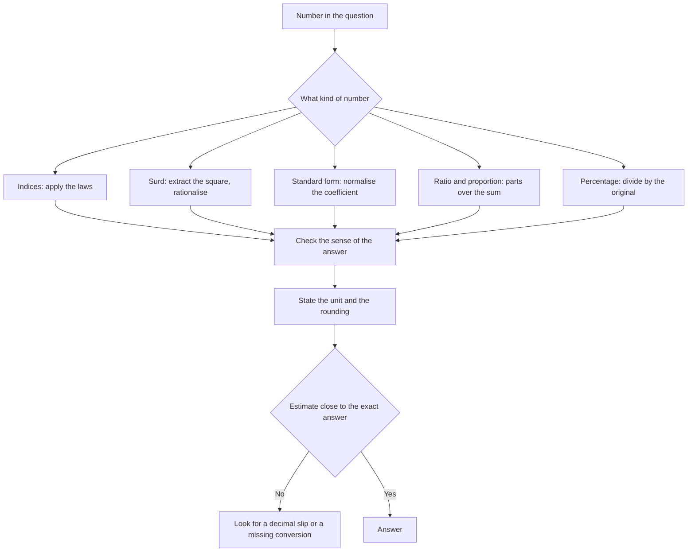

# Arithmetic and Number

Arithmetic and Number is the part of the O/L Mathematics syllabus that the two-paper split asks you to do accurately and fast: indices, surds, standard form, ratio and proportion, percentage change and error. Every other branch of the subject calls back into it, and the marks lost here are marks lost everywhere.

Two habits carry the bulk of the weight. First, leave nothing to the final line: every answer states its unit, and every approximation states the rounding you used. Second, check the sense of the number before you move on, because an order-of-magnitude error is invisible in an exam hall.

### 🟢 Lite — Quick Review (1h–1d)

**Number types and properties.** Natural numbers count, integers include negatives, rational numbers are fractions including those with terminating or repeating decimals, and irrational numbers cannot be expressed as a fraction, with √2, √3 and π the examples to know. A rational number has a terminating decimal when its denominator in lowest terms has no prime factor other than 2 and 5. Divisibility tests worth remembering: 3 divides a number when the digit sum is divisible by 3; 9 divides it when the digit sum is divisible by 9; 11 divides it when the alternating digit sum is a multiple of 11; 4 divides it when the last two digits form a multiple of 4; 8 divides it when the last three digits do.

**Highest common factor and lowest common multiple.** Prime factorise each number, then take the common factors for the HCF and the remaining powers for the LCM. Worked: 84 = 2² × 3 × 7 and 126 = 2 × 3² × 7, so the HCF is 2 × 3 × 7 = 42 and the LCM is 2² × 3² × 7 = 252. HCF × LCM = product of the two numbers, which gives a fast check.

**Indices.**

| Law | Example |
|---|---|
| aᵐ × aⁿ = a^(m+n) | 2⁵ × 2³ = 2⁸ |
| aᵐ ÷ aⁿ = a^(m−n) | 3⁶ ÷ 3² = 3⁴ |
| (aᵐ)ⁿ = a^(mn) | (2³)⁴ = 2¹² |
| (ab)ⁿ = aⁿbⁿ | (5x)² = 25x² |
| a⁰ = 1 | 7⁰ = 1 |
| a⁻ⁿ = 1/aⁿ | 4⁻² = 1/16 |
| a^(1/n) = ⁿ√a | 64^(1/3) = 4 |
| a^(m/n) = ⁿ√(aᵐ) | 8^(2/3) = 4 |

Negative indices are the ones candidates mishandle: 2⁻³ = 1/8, and 4⁻¹ + 2⁻¹ = 0.25 + 0.5 = 0.75.

**Surds.** A surd is an irrational root left in exact form.

- Simplify by taking out the largest perfect square: √50 = 5√2, √72 = 6√2, √108 = 6√3, √12 = 2√3.
- Add and subtract only like surds: 3√2 + 5√2 = 8√2, and 3√2 + 2√3 cannot be combined.
- Multiply by multiplying the numbers under the roots and simplifying: √8 × √18 = √144 = 12.
- Rationalise the denominator: 6/√2 = 6√2/2 = 3√2, and 1/(√5 − 1) = (√5 + 1)/((√5 − 1)(√5 + 1)) = (√5 + 1)/4.
- If the answer should be a decimal, give it to the number of decimal places asked for, not more.

**Standard form.** A number in standard form is a × 10ⁿ with 1 ≤ a < 10.

- To convert, move the decimal point until only one digit sits to the left of it, then adjust the power of ten.
- Multiply: multiply the coefficients and add the powers of ten. 3.2 × 10³ × 4.5 × 10⁴ = 14.4 × 10⁷ = 1.44 × 10⁸.
- Divide: divide the coefficients and subtract the powers of ten. 6 × 10⁵ ÷ 4 × 10² = 1.5 × 10³.
- Add: convert to the same power of ten first. 2 × 10³ + 5 × 10² = 2 × 10³ + 0.5 × 10³ = 2.5 × 10³.
- Compare: the larger power of ten gives the larger number, so 4 × 10⁵ exceeds 4 × 10⁴.

**Ratio and proportion.**

- Divide a total in a ratio by multiplying by each part over the sum of the parts.
- Ratio of ratios multiplies: if A:B = 2:3 and B:C = 4:5, then A:C = 8:15, because 2:3 and 12:15 and 8:15 share the same middle value.
- A ratio that changes becomes an equation: set the parts to k and a multiple of k and solve.
- Proportion questions use the conversion-factor method, cancelling units as you go.

**Percentage.**

- Percentage change divides by the original value: from 250 to 300 is a rise of 20%, from 300 to 250 is a fall of 16⅔%.
- Successive changes multiply: +20% then −20% leaves 96% of the original.
- Reverse percentage: a price cut by 20% to 96 had an original of 96 ÷ 0.8 = 120.
- Percentage profit or loss divides the profit by the cost price, never by the selling price.
- Percentage of a percentage multiplies: 30% of 40% is 12%.
- Discounts and taxes work from the original price: a 20% discount on 250 gives 200, and adding 20% VAT to 200 gives 240.

**Error and approximation.**

- Absolute error = measured value − true value.
- Relative error = absolute error ÷ true value.
- Percentage error = relative error × 100.
- If a number is rounded to a stated place, the true value lies between the midpoint below and the midpoint above. 3.456 to three decimal places lies between 3.4555 and 3.4565, so the maximum absolute error is 0.0005.
- For an estimate with a stated maximum error, find the lower and upper bounds that round to the estimate.

**Speed, distance and time.** Average speed = total distance ÷ total time. Unit conversion: multiply km/h by 5/18 to get m/s, and multiply m/s by 18/5 to get km/h. Relative speed for two objects moving towards each other is the sum of their speeds, and for objects moving in the same direction it is the difference.

**Memorise for the Lite tier.**

- A rational denominator has only 2 and 5 as prime factors for a terminating decimal.
- HCF × LCM = the product of the two numbers.
- a⁰ = 1 and a⁻ⁿ = 1/aⁿ.
- Simplify surds by taking out the largest perfect square.
- In standard form, multiply coefficients and add powers; divide and subtract.
- Percentage change divides by the original; successive changes multiply.
- Profit as a percentage of cost price, never of selling price.
- km/h × 5/18 gives m/s.

### 🟡 Standard — Full Coverage (1–2d)

#### Worked example: surds and rationalising

**The stem.** Simplify 3√8 − √72 + √50 and express 6/√12 in simplest surd form.

**The reasoning.** First expression: √8 = 2√2, √72 = 6√2 and √50 = 5√2, so 3√8 − √72 + √50 = 3(2√2) − 6√2 + 5√2 = 6√2 − 6√2 + 5√2 = 5√2.

Second expression: √12 = 2√3, so 6/√12 = 6/(2√3) = 3/√3. Multiply numerator and denominator by √3 to rationalise: 3√3/3 = √3.

**The check.** 3√8 ≈ 8.485, √72 ≈ 8.485 and √50 ≈ 7.071, so the expression is ≈ 7.071, which is 5√2. Correct.

**The trap.** Leaving a surd in the denominator. Exact answers are expected in simplest surd form, and 3/√3 is not considered simplified.

#### Worked example: standard form with a rounded answer

**The stem.** Calculate (3.2 × 10³) × (4.5 × 10⁴) and give the answer to three significant figures.

**The reasoning.** Multiply the coefficients: 3.2 × 4.5 = 14.4. Add the powers: 10³ × 10⁴ = 10⁷. So the result is 14.4 × 10⁷, which is not in standard form because the coefficient is above 10. Rewrite it: 1.44 × 10⁸.

**The check.** Estimate: 3 × 10³ × 5 × 10⁴ = 15 × 10⁷ = 1.5 × 10⁸, which sits close to 1.44 × 10⁸.

**A second form of the same question.** With division, (6 × 10⁵) ÷ (4 × 10²) = 1.5 × 10³, where the coefficients are divided and the powers subtracted. Candidates who add the powers here get 10 × 10⁷, which is wrong by a factor of a hundred.

#### Worked example: percentage error of a rounded answer

**The stem.** A measurement of 6.4 cm is given to one decimal place. Find the maximum percentage error.

**The reasoning.** The true value lies between 6.35 and 6.45. The maximum absolute error is half of one unit in the last place, which is 0.05. The maximum percentage error is 0.05 ÷ 6.4 × 100 = 0.78125%, which is 0.78% to two decimal places.

**The trap.** Dividing by 6.4 is right, but candidates who use the upper bound 6.45 in the denominator get 0.7246%, and candidates who use the rounded value as if it were exact get 0. This is why the question says maximum.

**The variant.** A calculator displays a value of 3.8 with an accuracy of ±0.05. Find the upper bound for the true value: 3.85, and the lower bound: 3.75. State both.

#### Worked example: a ratio that changes

**The stem.** The ratio of copper to zinc in an alloy is 5:3. If 20 kg of zinc is added, the ratio becomes 7:5. Find the original mass of the alloy.

**The reasoning.** Let the original copper and zinc be 5k and 3k. After adding 20 kg of zinc, the ratio is 5k : (3k + 20) = 7 : 5. Cross-multiplying gives 5 × 5k = 7(3k + 20), so 25k = 21k + 140, so 4k = 140 and k = 35. Copper = 175 kg and zinc = 105 kg, so the original mass is 280 kg.

**The check.** After adding 20 kg of zinc, the alloy is 175 kg copper and 125 kg zinc, and 175 : 125 = 7 : 5. Correct.

#### Worked example: two legs of a journey

**The stem.** A cyclist rides from A to B at 20 km/h and returns from B to A at 30 km/h. What is the average speed for the round trip?

**The reasoning.** The trap answer is 25 km/h, which is the average of the two speeds and is wrong, because the cyclist spends more time on the slower leg. Take the distance as 60 km each way. Outbound time = 60/20 = 3 hours; return time = 60/30 = 2 hours. Total distance 120 km in 5 hours, so the average speed = 120 ÷ 5 = 24 km/h.

**The check.** The average speed must lie between the two speeds and closer to the slower one, because more time is spent there. 24 km/h satisfies both conditions, and 25 km/h fails the first reasoning.

### 🔴 Deep — Mastery (3–5d)

#### Indices and surds in algebra

**Negative and fractional indices applied.** 3⁻² = 1/9. 32^(2/5) = (32^(1/5))² = 2² = 4. 9^(3/2) = (9^(1/2))³ = 27. A negative base with a fractional index has no real value, and a zero base with a negative index is undefined.

**Expanding with fractional powers.** (2x^(1/3))³ = 8x. (x^(1/2) + y^(1/2))² = x + y + 2(xy)^(1/2), and the middle term is the one candidates drop.

**Surds in expressions.** (√5 + √2)² = 5 + 2 + 2√10 = 7 + 2√10. The rule is that squaring a sum of two surds gives the squares plus twice the product of the roots, not 2√5 + 2√2.

**Equations with surds.** Solve √(x + 3) = 4 by squaring to get x = 13, then substitute back: √16 = 4, so the solution is valid. Squaring can introduce a false solution, so always check the original equation. An equation such as √(x + 3) = −2 has no solution at all, because a principal square root is never negative.

**Rationalising with a conjugate.** 1/(√3 + √2) = (√3 − √2)/((√3 + √2)(√3 − √2)) = (√3 − √2)/(3 − 2) = √3 − √2. The denominator becomes 1 because the two surds are like.

#### Standard form and approximation

**Ordering numbers in standard form.** Compare the powers of ten first. Between 4 × 10⁻³ and 8 × 10⁻⁴, the first is larger because 10⁻³ exceeds 10⁻⁴.

**Estimating with standard form.** 2.5 × 10⁵ + 6 × 10⁴ = 2.5 × 10⁵ + 0.6 × 10⁵ = 3.1 × 10⁵. Candidates who align the powers wrongly treat the second term as negligible.

**Significant figures in standard form.** A number written as 3.14 × 10² has three significant figures regardless of the power of ten, so 3.14 × 10² and 3.14 have the same precision even though one is 100 times bigger.

**Error and approximation in a chain.** When a number is rounded at each step, the error accumulates. A three-stage calculation that rounds to three significant figures at each stage can end with a relative error larger than a single rounding, and the direction of the rounding matters. A useful technique is to keep one extra digit through the calculation and round only at the end.

**Bounds on surd answers.** When an answer involves a surd that cannot be simplified, give the answer as an inequality. If √2 lies between 1.4142 and 1.4143, then 3 + 2√2 lies between 5.8284 and 5.8286.

**Irrationality.** The proof that √2 is irrational runs by contradiction: assume √2 = p/q in lowest terms, then p² = 2q², so p is even, so p = 2k, so 4k² = 2q², so q² = 2k², so q is even, which contradicts the fraction being in lowest terms. The same structure works for √n when n is not a perfect square.

#### Percentage in depth

**Compound interest against simple interest.** A sum of 10,000 at 8% per year gives 1,600 in simple interest in two years. Compound interest gives 10,000 × 1.08² = 11,664, so the interest is 1,664. The gap widens with time and rate, which is why compounding drives the growth in a savings scheme and the decay in a depreciation schedule.

**Depreciation.** A machine worth 500,000 falls by 20% of its current value each year. After one year it is worth 400,000, and after two years it is worth 320,000. Taking 20% off the original price each year would give 300,000, which is wrong under the reducing-balance method.

**Percentage of a percentage in context.** A shop raises a price by 20% and then offers 10% off the raised price. The final price is 1.2 × 0.9 = 1.08 of the original, so the customer pays 8% more than before, not 10% more. Candidates who subtract the percentages get 10% and miss the compounding.

**Percentage profit with a change in price.** A trader buys at 400 and sells at 500, a profit of 25% on cost. If the cost price rises by 10% to 440 and the selling price stays at 500, the profit is 60 on 440, which is 13.64%.

#### Ratio, proportion and scale

**Three-part ratios.** If A:B:C = 2:3:5, then B's share of A is 3/2 and C's share of A is 5/2. Candidates who try to compare two of three parts directly without scaling make the classic error.

**Ratio of ratios.** Chain them through a common middle term: 2:3 and 3:4 give 2:4, but 2:3 and 4:5 give 8:15, because the middle terms differ.

**Scale drawings.** A scale of 1:25,000 means 1 cm on the map is 25,000 cm, which is 250 m, on the ground. Convert the scale to a unit conversion factor and use it as one.

**Bearing-based proportions.** Convert bearings to angles measured clockwise from north, then use the sine and cosine rules to find the missing lengths before any proportion work. Distance and bearing problems are geometry problems that end in a ratio calculation.

**Unit cancellation as a check.** Write the calculation with units on every factor and cancel. A speed in km/h multiplied by a time in seconds without conversion is the commonest error in applied questions.

#### Common mistakes

**Confusing HCF with LCM.** HCF is the largest factor that divides both; LCM is the smallest number each divides.

**Writing a negative index as a negative number.** 2⁻³ = 1/8.

**Combining unlike surds.** 3√2 + 2√3 stays as it is.

**Leaving the coefficient above 10 in standard form.** 14.4 × 10⁷ becomes 1.44 × 10⁸.

**Adding standard form without aligning the powers of ten.**

**Dividing by the selling price when finding a profit percentage.**

**Averaging two speeds.** Use total distance over total time.

**Dropping a unit or a rounding statement.** A dropped unit is a dropped mark.

**Rounding intermediate figures.** Keep one extra digit until the end.

#### Exam traps

A question gives 2.4 × 10⁶ ÷ 6 × 10² and asks for the answer in standard form. The coefficients divide to 0.4 and the powers subtract to give 10⁴, so the answer is 0.4 × 10⁴ = 4 × 10³.

A question asks for the HCF of 84 and 126 and then for the LCM. Use the product relationship: 84 × 126 = 10,584 and 42 × 252 = 10,584, which checks both answers.

A question gives a speed of 72 km/h and asks for the distance covered in 2 minutes 30 seconds. Convert the time to 1/24 of an hour and the answer is 3 km.

A question asks for the maximum percentage error in a value of 8.5 given to two significant figures. The true value lies between 8.45 and 8.55, so the maximum absolute error is 0.05 and the maximum percentage error is 0.05 ÷ 8.45 × 100, which uses the smaller bound because that gives the larger percentage.

A question asks which of two measurements in standard form is larger. Compare the powers of ten before the coefficients.

A question gives a ratio of 7:5 and asks for the fraction of the total that is one part. Each part is 7/12 and 5/12 of the total.

#### 🧠 Memory Anchors

- **HCF × LCM = product of the numbers.**
- **a⁰ = 1; a⁻ⁿ = 1/aⁿ.**
- **Extract the largest perfect square from a surd.**
- **Standard form: multiply coefficients, add powers; divide, subtract.**
- **Percentage change divides by the original; successive changes multiply.**
- **Profit percentage uses cost price.**
- **km/h × 5/18 gives m/s.**
- **Flashcard Q&A:**
  - *What is the HCF of 84 and 126?* → 42.
  - *What is 4⁻¹ + 2⁻¹?* → 0.75.
  - *How do you simplify √72?* → 6√2.
  - *What does 14.4 × 10⁷ become?* → 1.44 × 10⁸.
  - *A cyclist rides at 20 and returns at 30; what is the average?* → Distance ÷ total time, not the mean.
  - *Which bound gives the maximum percentage error?* → The smaller one.

#### Internal links

- [GCE O/L exam hub](/exams/gce-ol/) — the Ordinary Level structure and how the subject is examined.
- [Algebra](/notes/gce-ol/mathematics/ma-002/) — the algebra that carries these indices and surds.
- [Geometry and Mensuration](/notes/gce-ol/mathematics/ma-003/) — trigonometry and scale work that uses ratios and standard form.
- [Statistics and Probability](/notes/gce-ol/mathematics/) — the interpretation questions that sit alongside these calculations.

The subject organisation and weight come from the GCE O/L Mathematics data in this repository. The Department of Examinations publishes marking schemes subject by subject and no consolidated O/L Mathematics weightage, so the weight here is StudyRoadmap's own prioritisation.

---

## Continue your study

- **[View this topic in your GCE O/L (General Certificate of Education Ordinary Level, Sri Lanka) roadmap](/roadmap/?exam=gce-ol&duration=1mo)** — see where this topic sits in your personalised plan
- **[Build a quick revision plan](/roadmap/?exam=gce-ol&duration=1d)** — 1-day sprint covering the highest-weight topics
- **[GCE O/L (General Certificate of Education Ordinary Level, Sri Lanka) exam overview](/exams/gce-ol/)** — pattern, eligibility, and syllabus
- **[All Mathematics notes](/notes/gce-ol/mathematics/)** — browse sibling topics in this subject
