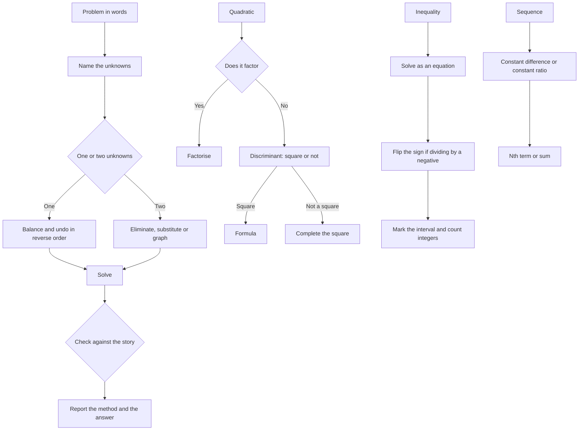

# Algebra

Algebra is where the O/L Mathematics paper stops being calculation and starts being method. The two-paper split puts the algebra skills in both sessions: simultaneous equations and quadratic work in Paper I, and sequences, algebraic proof and formulae rearrangement in Paper II. A candidate who knows which method a question wants gains time on every item.

The recurring theme is that a problem is a story told in symbols, and the marks are for the translation and the method, not for the final number alone. Write the relation before you touch it, name the method you are using, and check the answer against the story.

### 🟢 Lite — Quick Review (1h–1d)

**Expressions and the index laws.**

| Law | Example |
|---|---|
| aᵐ × aⁿ = a^(m+n) | x³ × x⁴ = x⁷ |
| aᵐ ÷ aⁿ = a^(m−n) | x⁸ ÷ x³ = x⁵ |
| (aᵐ)ⁿ = a^(mn) | (x²)⁵ = x¹⁰ |
| (ab)ⁿ = aⁿbⁿ | (2x³)³ = 8x⁹ |
| a⁰ = 1 | x⁰ = 1, for x not zero |
| a⁻ⁿ = 1/aⁿ | x⁻³ = 1/x³ |

Expanding: a(b + c) = ab + ac, and (a + b)² = a² + 2ab + b². The middle term is the one candidates drop. A minus in front of a bracket changes every sign inside it.

**Solving linear equations.** Undo in reverse order: subtract, divide, subtract, divide. If the unknown appears on both sides, move the terms together first. To clear fractions, multiply through by the lowest common denominator.

**Simultaneous equations.**

- *Elimination*: multiply the equations so the coefficients of one variable match, then add or subtract to remove that variable, then substitute back.
- *Substitution*: solve one equation for one variable and put that into the other.
- *Graphically*: plot both as straight lines; the solution is the point where they cross.

Worked: 2x + 3y = 100 and 3x + 2y = 95. Multiply the first by 3 and the second by 2 to get 6x + 9y = 300 and 6x + 4y = 190. Subtract: 5y = 110, so y = 22, and x = (100 − 66)/2 = 17.

**Quadratic equations.** Three methods, and knowing which to reach for is the skill.

- *Factorising*: 2x² − 7x + 3 = 0 becomes (2x − 1)(x − 3) = 0, so x = ½ or x = 3. Look for two numbers that multiply to give ac and add to give b.
- *Completing the square*: x² + 6x + 5 = 0 becomes (x + 3)² = 4, so x = −1 or x = −5.
- *Quadratic formula*: for ax² + bx + c = 0, x = [−b ± √(b² − 4ac)] / 2a. For 3x² − 5x − 2 = 0 the discriminant is 25 + 24 = 49, so x = (5 ± 7)/6, giving x = 2 or x = −⅓.

**The discriminant decides the number of roots.** b² − 4ac above zero gives two distinct real roots; equal to zero gives one repeated root; below zero gives no real roots. The same question decides whether a parabola cuts the x-axis twice, touches it, or stays clear of it.

**Inequalities.**

- Solve an inequality exactly as an equation, and if you multiply or divide by a negative number, reverse the sign. In 3(x − 2) ≥ 5x − 12 the work gives −2x ≥ −6, so x ≤ 3.
- On a number line use a closed dot for ≤ and ≥ and an open dot for < or >.
- A quadratic inequality uses a sign diagram. For x² − x − 6 ≤ 0, factorise to (x − 3)(x + 2) ≤ 0; the parabola opens upwards, so the expression is negative between the roots and the solution is −2 ≤ x ≤ 3.
- "At least" is ≥, "more than" is >, "no more than" is ≤.

**Sequences.** The two families you need.

- *Arithmetic sequence*: a constant difference d. The nth term is a + (n − 1)d, and the sum of n terms is n/2 [2a + (n − 1)d].
- *Geometric sequence*: a constant ratio r. The nth term is a·r^(n−1), and the sum of n terms is a(r^n − 1)/(r − 1).
- Special sequences to recognise: squares 1, 4, 9, 16; triangular numbers 1, 3, 6, 10; cubes 1, 8, 27, 64; and the Fibonacci sequence 1, 1, 2, 3, 5, 8, 13, where each term is the sum of the previous two.

**Rearranging formulae.** Keep the structure and move the subject to one side.

- V = πr²h gives h = V/(πr²).
- S = 2πr(r + h) gives h = S/(2πr) − r.
- y = (3x + 4)/5 gives x = (5y − 4)/3.

**Algebraic proof.** Start from what you are given and work towards what you must show. For example, given a + b = 7 and ab = 12, show that a² + b² = 25. Then a² + b² = (a + b)² − 2ab = 49 − 24 = 25. Substitution of the given values does the work.

**Straight-line graphs.** A straight line has the form y = mx + c, where m is the gradient and c is the y-intercept. The gradient between two points is (y₂ − y₁)/(x₂ − x₁). Parallel lines have equal gradients; perpendicular lines have gradients whose product is −1. The x-intercept is found by setting y = 0.

**Memorise for the Lite tier.**

- (a + b)² = a² + 2ab + b², and the middle term is the one you drop.
- Quadratic formula: [−b ± √(b² − 4ac)] / 2a.
- Discriminant: two roots, one root, no real roots.
- Dividing by a negative reverses the inequality.
- Arithmetic nth term a + (n−1)d; geometric nth term a·r^(n−1).
- Sum of an arithmetic series: n/2 [2a + (n−1)d].
- y = mx + c; parallel lines share a gradient; perpendicular gradients multiply to −1.

### 🟡 Standard — Full Coverage (1–2d)

#### Worked example: simultaneous equations from a story

**The stem.** Two trays of fruit and three trays of vegetables cost 100 units. Three trays of fruit and two trays of vegetables cost 95 units. Find the cost of one tray of each.

**The reasoning.** Name the unknowns before writing anything: let x be the cost of a tray of fruit and y the cost of a tray of vegetables. Each fact becomes one equation: 2x + 3y = 100 and 3x + 2y = 95.

Eliminate x by multiplying the first equation by 3 and the second by 2, giving 6x + 9y = 300 and 6x + 4y = 190. Subtracting gives 5y = 110, so y = 22. Substituting into the first equation: 2x + 66 = 100, so x = 17.

**The check.** 2(17) + 3(22) = 34 + 66 = 100, and 3(17) + 2(22) = 51 + 44 = 95. Both original conditions hold.

**The trap.** Solving for x before reading the whole story and using the price of the wrong item.

#### Worked example: choosing a quadratic method

**The stem.** Solve x² − 8x + 12 = 0 and then find the roots of 5x² − 3x − 2 = 0.

**The reasoning.** The first factorises: the two numbers that multiply to 12 and add to −8 are −2 and −6, so (x − 2)(x − 6) = 0 and x = 2 or x = 6.

The second has no integer factorisation, since the pairs of factors of 10 that add to −3 are 2 and −5, and that gives 5x² − 25x + 2x − 10, which is the wrong middle term. So use the formula: the discriminant is 9 + 40 = 49, so x = (3 ± 7)/10, giving x = 1 or x = −0.4.

**The reasoning that earns the marks.** Look at the discriminant before you start hunting for factors. A perfect-square discriminant means the roots are rational and factorising will work; a discriminant that is not a square tells you to stop trying.

#### Worked example: completing the square to find a maximum

**The stem.** A rectangular photograph has a perimeter of 40 cm. Find the largest possible area.

**The reasoning.** Let the width be x, so the length is 20 − x and the area is A = x(20 − x) = 20x − x². Complete the square: A = −(x² − 20x) = −((x − 10)² − 100) = 100 − (x − 10)². Since the squared term cannot be negative, the largest area is 100 cm², achieved when x = 10, a square.

**Why this method matters.** The completing-the-square form answers a maximum or minimum question directly, because a square is never negative. The same technique finds the vertex of a parabola, and the same reasoning is why a quadratic inequality solution sits between the roots.

#### Worked example: an inequality with an integer answer

**The stem.** Find the greatest integer value of x that satisfies 2x + 1 < 9.

**The reasoning.** Subtract 1: 2x < 8. Divide by 2: x < 4. The greatest integer below 4 is 3, because 4 itself is excluded by the strict inequality.

**The trap.** Answering 4. The inequality sign is strict, so the boundary value is not a solution. On a number line the boundary would be an open dot.

#### Worked example: sequences in a practical problem

**The stem.** A savings scheme pays interest of 500 shillings in the first month, 600 in the second, 700 in the third, and so on. How much is paid in the twelfth month, and what is the total paid over the twelve months?

**The reasoning.** The payments form an arithmetic sequence with a = 500 and d = 100. The twelfth term is a + (n − 1)d = 500 + 11(100) = 1,600.

The sum of the twelve terms is n/2 [2a + (n − 1)d] = 12/2 [1000 + 1100] = 6 × 2100 = 12,600.

**The check.** The first and last payments are 500 and 1,600, and their sum is 2,100; pairing 12 terms gives 6 pairs of 2,100, which is 12,600. Correct, and the pairing check is worth using in the exam because it confirms the formula without more arithmetic.

#### Worked example: rearranging a formula and checking it

**The stem.** Make r the subject of V = (4/3)πr³.

**The reasoning.** Multiply both sides by 3: 3V = 4πr³. Divide by 4π: 3V/(4π) = r³. Take the cube root: r = ∛(3V/(4π)).

**The check.** Substitute back: (4/3)π(∛(3V/4π))³ = (4/3)π · 3V/(4π) = V. Correct. Substitution is the only reliable check on a rearrangement, and it costs fifteen seconds.

#### Worked example: an algebraic proof

**The stem.** Given that x + y = 8 and x − y = 2, show that x² + y² = 34.

**The reasoning.** From the given, x = 5 and y = 3, so x² + y² = 25 + 9 = 34. That proof works, but it depends on finding the values, and it stops working when the given values are awkward. The better form uses the given directly: (x + y)² = x² + 2xy + y², so x² + y² = (x + y)² − 2xy = 64 − 2(15) = 34, with xy found by multiplying the two given equations: (x + y)(x − y) = x² − y² = 16, which gives x² = 25 and y² = 9 and hence x² + y² = 34.

**The method.** In an examination, a proof that reaches the answer by algebra from the given values is accepted. Use the cleanest route and show the intermediate step that the examiner will look for.

### 🔴 Deep — Mastery (3–5d)

#### Quadratic functions as graphs

A quadratic y = ax² + bx + c has an axis of symmetry at x = −b/2a, a vertex there, and x-intercepts where the value is zero. The discriminant decides the intercepts, the sign of a decides the direction, and the vertex form y = a(x − h)² + k reads the vertex straight off as (h, k). Converting between forms is worth practising: y = x² + 6x + 5 becomes y = (x + 3)² − 4, so the vertex sits at (−3, −4) and the minimum value is −4.

**Sketching from a table.** Plot the x-intercepts, the vertex and the y-intercept, and reflect the shape. The x-intercepts come from the discriminant, so the sketch and the calculation support each other. An item that gives a graph and asks for the equation wants the roots from the intercepts and then the scale factor from a third point.

**Solving by graph and by algebra.** Where an item asks for roots to a stated accuracy, read them from a graph and say they are approximations. Where it wants exact values, use the algebra, and the graph gives a check on which root is which.

#### Sequences and series in depth

**Arithmetic series.** The sum formula n/2 [2a + (n−1)d] is the average of the first and last term multiplied by the number of terms. Another route is to pair terms from opposite ends, and for an even number of terms each pair sums to the same value. A series question gives a term number and asks for a term, so identify which formula that needs before substituting.

**Geometric series.** The sum a(r^n − 1)/(r − 1) comes from multiplying the sum by r and subtracting. Practical applications: compound interest, populations, depreciation of a machine, and the growth of a sum of money left untouched. Each asks for the nth term or the sum after n periods, and the distinction between them is the first thing to check.

**Difference tables.** A constant first difference means an arithmetic sequence; a constant second difference means a quadratic sequence, whose nth term can be written as an² + bn + c. Working down the table and then reading off the formula is faster than fitting a pattern by eye, and it is the method the marking schemes reward.

**Sequences from a diagram or a pattern.** Count the additions rather than the terms. The number of line segments joining n points on a circle is n(n − 1)/2, and the number of handshakes among n people is the same, which is the standard pairing with the triangular numbers.

**Second differences and the quadratic formula in disguise.** If the second differences are constant at 2c, the sequence has the form an² + bn + c, and a difference table lets you read off all three coefficients directly.

#### Algebraic proof techniques

**Work backwards from the goal.** Instead of starting at the given, rewrite the target until it looks like the given, then reverse the steps. This is the standard technique for identities of the form (a + b)³ = a³ + 3a²b + 3ab² + b³.

**Multiply by the conjugate.** To prove an expression with surds is irrational or to remove a surd denominator, multiply by the conjugate and use the difference of two squares: (√5 + √2)(√5 − √2) = 5 − 2 = 3.

**Do not divide by a zero.** A step that divides by (x − 3) assumes x ≠ 3, and a proof that loses the case x = 3 is incomplete. Multiply through instead.

**Substitute the given values.** For a proof involving two numbers with a given sum and product, computing the needed symmetric quantities from the givens is shorter than finding the numbers themselves: (x + y)² − 2xy gives x² + y² directly.

#### Inequalities in depth

**Sign diagrams.** Mark the critical values on a number line, test the sign of the expression in each interval, and read off the solution. This works for any product or quotient of linear factors, and it is the only reliable way to solve a quadratic inequality.

**Range of integer solutions.** Combine the inequality with the fact that x is an integer, and count. A question that asks for the number of integer values of x satisfying an inequality wants the count, so state the inequality, the interval, and the count in that order.

**Quadratic inequalities with a reversed parabola.** For a downward-opening parabola the expression is positive between the roots and negative outside, so the sign reverses relative to the upward case. Sketching first removes the chance of getting this backwards.

**Inequalities in two variables.** A pair such as x + y ≤ 5 and x − y ≥ 1 describes a region on a graph, and the vertices of that region come from intersecting the boundary lines. The marks are for identifying the region and shading the correct side of each line.

#### Functions and graphs

**Domain and range.** State the domain before the range, and remember that a square root requires its radicand to be non-negative and a denominator to be non-zero. For y = √(x − 3) the domain is x ≥ 3.

**Interpreting y = mx + c.** The gradient is the rate of change of y for each unit change in x, which is the physical meaning of the slope in the applied questions. The y-intercept is the value of y when x = 0.

**Lines in other forms.** The equation ax + by = c is a line with x-intercept c/a and y-intercept c/b, and its gradient is −a/b. Drawing it from the two intercepts is quicker than converting to y = mx + c.

**Transformations.** A graph moved up by k adds k to y; one moved right by h replaces x with x − h; one reflected in the x-axis replaces y with −y; one stretched vertically by a factor of k multiplies y by k. Each of these has a matching change to the equation, and knowing which change to make is the item.

#### Common mistakes

**Dropping the middle term when expanding a square.**

**Using the wrong sum formula for a geometric sequence.**

**Reversing an inequality only sometimes.** Every division by a negative reverses it.

**Answering a strict inequality with the boundary value.**

**Losing a solution by dividing by a zero in a quadratic.** Divide by x and then test x = 0 separately.

**Assuming the larger root is the wanted one.** Read the context: a length, a count and a time cannot be negative.

**Mixing up a quadratic sequence with an arithmetic one.** Check whether the differences or the second differences are constant.

**Forgetting to state the units.**

#### Exam traps

A question asks for the sum of the first twenty terms of an arithmetic sequence given the first three terms. Read off a and d, then use n/2 [2a + (n−1)d].

A question gives a recurrence such as u_(n+1) = 2u_n + 3 and asks for the fifth term. Build the sequence term by term, one line each, and show the working.

A question asks which integers satisfy an inequality. Solve the inequality, then count the integers in the interval and state the count.

A question gives a graph of y = x² − 5x + 6 and asks for the range of x where the graph is below the x-axis. Read the roots from the graph, or factorise to get 2 and 3, then state 2 < x < 3.

A question asks for the equation of the line joining (2, 3) and (6, 11). The gradient is (11 − 3)/(6 − 2) = 2, so the line is y = 2x − 1, and substituting either point confirms it.

A question asks to show that x² + y² = 34 given x + y = 8 and x − y = 2. Use (x + y)² − 2xy, or compute x² − y² from the product of the givens and add the two squares.

#### 🧠 Memory Anchors

- **(a + b)² = a² + 2ab + b², and the middle term is the one you drop.**
- **Quadratic formula: [−b ± √(b² − 4ac)] / 2a.**
- **Discriminant: two roots, one root, no real roots.**
- **Dividing by a negative reverses the inequality.**
- **Arithmetic: a + (n−1)d and n/2 [2a + (n−1)d]. Geometric: a·r^(n−1) and a(r^n − 1)/(r − 1).**
- **y = mx + c; parallel gradients equal; perpendicular gradients multiply to −1.**
- **Flashcard Q&A:**
  - *What is the nth term of an arithmetic sequence?* → a + (n−1)d.
  - *When do you use completing the square?* → When a question asks for a maximum, a minimum or a vertex.
  - *What does a constant second difference signal?* → A quadratic sequence.
  - *How do you clear fractions in an equation?* → Multiply through by the lowest common denominator.
  - *What does a closed dot on a number line mean?* → The boundary value is included.

#### Internal links

- [GCE O/L exam hub](/exams/gce-ol/) — the Ordinary Level structure and how the subject is examined.
- [Arithmetic and Number](/notes/gce-ol/mathematics/ma-001/) — the indices, surds and arithmetic that this algebra runs on.
- [Geometry and Mensuration](/notes/gce-ol/mathematics/ma-003/) — trigonometry and constructions that use these algebraic methods.
- [Coordinate Geometry and Graphs](/notes/gce-ol/mathematics/) — the graph work that reads these equations back.

The subject organisation and weight come from the GCE O/L Mathematics data in this repository. The Department of Examinations publishes marking schemes subject by subject and no consolidated O/L Mathematics weightage, so the weight here is StudyRoadmap's own prioritisation.

---

## Continue your study

- **[View this topic in your GCE O/L (General Certificate of Education Ordinary Level, Sri Lanka) roadmap](/roadmap/?exam=gce-ol&duration=1mo)** — see where this topic sits in your personalised plan
- **[Build a quick revision plan](/roadmap/?exam=gce-ol&duration=1d)** — 1-day sprint covering the highest-weight topics
- **[GCE O/L (General Certificate of Education Ordinary Level, Sri Lanka) exam overview](/exams/gce-ol/)** — pattern, eligibility, and syllabus
- **[All Mathematics notes](/notes/gce-ol/mathematics/)** — browse sibling topics in this subject
