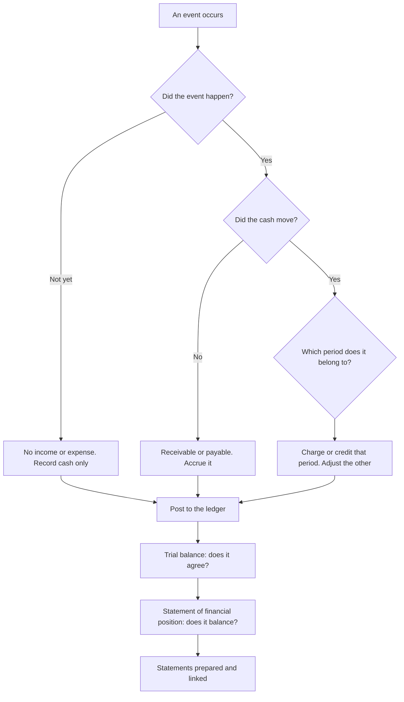

# CA11: Financial Accounting

CA11 is one of the six Foundation Level papers of the KASNEB CPA qualification. KASNEB states that examinations are held three times each year, in April, August and December, and that CPA papers run for three hours, with morning sessions beginning at 9:00 a.m. and afternoon sessions at 2:00 p.m. KASNEB publishes no per-paper weightage.

Accounting is the paper where method beats effort. Almost every mark in CA11 comes from a procedure performed correctly, and the procedure is the same on every question: identify the event, find the accounts it touches, decide which side of each account it goes on, post it, and carry it through to the statements. A candidate who cannot do that reliably loses marks in every part of the paper, because almost nothing else in CA11 can be answered without it.

This note covers the whole spine of the paper: the double-entry framework, how transactions are recorded, how the statements are prepared and linked, and how adjustments and errors are handled.

### 🟢 Lite — Quick Review (1h–1d)

**The one equation everything sits on.**

> Assets = Liabilities + Equity

Every transaction changes this equation by the same amount on both sides. That is what double entry means. If you can write the equation after a transaction and the two sides still balance, your entry is probably right.

**The recording chain.** Learn it as a sequence, because each step feeds the next.

> Source document → journal entry → ledger account → trial balance → financial statements

Nothing goes straight into the financial statements. A figure in the statement of profit or loss or the statement of financial position was posted to a ledger account first, and the ledger account was fed by a journal entry with a source document behind it.

**Which side an entry goes on.**

| Account type | Debit | Credit |
|---|---|---|
| Assets | Increase | Decrease |
| Liabilities | Decrease | Increase |
| Equity | Decrease | Increase |
| Revenue | Decrease | Increase |
| Expenses | Increase | Decrease |

Read it as one rule instead of five: assets and expenses grow on the debit side; liabilities, equity and revenue grow on the credit side.

**The four statements and what each one does.**

| Statement | Shows | Period | Opens from |
|---|---|---|---|
| Statement of profit or loss | Income and expenses, arriving at profit for the period | A period | Comparatives for the prior period |
| Statement of financial position | Assets, liabilities and equity at a date | A point in time | The prior year's closing balances |
| Statement of cash flows | Where cash came from and went | A period | Opening cash from the statement of financial position |
| Statement of changes in equity | Movement in reserves and retained earnings | A period | Opening equity plus profit |

**The four adjustments, and where each lands.**

| Adjustment | Creates | Touches |
|---|---|---|
| Accrued income | A receivable | Income up, assets up |
| Prepayment (income received in advance) | A liability | Cash up, income down |
| Accrual (expense unpaid) | A liability | Expense up, liabilities up |
| Prepaid expense (paid in advance) | An asset | Cash down, expense down |
| Depreciation | An accumulated depreciation account | Expense up, asset carrying amount down |
| Irrecoverable debt | A bad debt expense | Receivables down, expense up |

**Memorise for the Lite tier.**

- Assets = Liabilities + Equity, and every entry balances.
- Assets and expenses increase on the debit; liabilities, equity and revenue increase on the credit.
- A trial balance that agrees proves arithmetic, not correctness.
- Profit is an income statement figure that moves equity; it is not a cash figure.
- A receipt of cash is not income, and a payment of cash is not necessarily an expense.
- Accruals and prepayments are the same two ideas applied to different accounts: one recognises the event, the other recognises the payment.
- An error found before the statements are issued is corrected by an adjusting entry; an error found after issue is a restatement of the comparative figures.
- Cash generated from operations and profit are different numbers, and the difference is working capital and non-cash items.

### 🟡 Standard — Full Coverage (1–2d)

#### Worked example 1: from transactions to a trial balance

Kilimo Traders opened for business on 1 January with KSh 200,000 cash in the bank. During January it bought KSh 300,000 of goods on credit, sold KSh 480,000 of those goods for cash, paid KSh 250,000 to the supplier, paid KSh 60,000 in wages, and paid KSh 20,000 rent for a month.

The entries are:

| Transaction | Debit | Credit | Amount |
|---|---|---|---|
| Capital introduced | Bank | Capital | 200,000 |
| Goods bought on credit | Purchases (expense) | Trade payables | 300,000 |
| Goods sold for cash | Bank | Sales | 480,000 |
| Paid the supplier | Trade payables | Bank | 250,000 |
| Wages paid | Wages expense | Bank | 60,000 |
| Rent paid | Rent expense | Bank | 20,000 |

Now work the ledger balances. Bank: 200,000 debit, less 250,000, 60,000 and 20,000 credits, plus 480,000 debit = 350,000 debit. Trade payables: 300,000 credit less 250,000 debit = 50,000 credit. Purchases: 300,000 debit. Sales: 480,000 credit. Wages: 60,000 debit. Rent: 20,000 debit. Capital: 200,000 credit.

Profit for the month is 480,000 less 300,000 less 60,000 less 20,000 = 100,000. Check the equation: assets 350,000, liabilities 50,000, equity 200,000 capital plus 100,000 profit = 300,000. Liabilities plus equity = 350,000. It balances.

The point of the check is that it is a check on the entries, not on the answers. Working the equation at the end catches a misposting that a trial balance will happily agree with, because a trial balance only proves that debits equal credits.

#### Worked example 2: adjustments

At 31 December the records show:

- Trade receivables of KSh 400,000, of which KSh 25,000 is not expected to be collected.
- Rent of KSh 36,000 paid in December covers January to June next year.
- An invoice of KSh 50,000 for services received in December has not yet been recorded.
- Equipment costing KSh 120,000 was bought three months ago and has no depreciation recorded.
- A customer paid KSh 80,000 in advance for services to be delivered next year.

The adjustments, and the effect of each:

| Adjustment | Entry | Effect on profit | Effect on the statement of financial position |
|---|---|---|---|
| Bad debt | Debit bad debt expense 25,000; credit receivables 25,000 | Profit down 25,000 | Receivables down 25,000 |
| Rent prepaid | Debit prepaid rent 18,000; credit rent expense 18,000 | Profit up 18,000 | Prepaid asset up 18,000 |
| Accrual | Debit services expense 50,000; credit trade payable 50,000 | Profit down 50,000 | Liability up 50,000 |
| Depreciation | Debit depreciation expense 30,000; credit accumulated depreciation 30,000 | Profit down 30,000 | Carrying amount of equipment down 30,000 |
| Income received in advance | Debit deferred income 80,000; credit service income 80,000 | Profit down 80,000 | Liability up 80,000 |

Two of these deserve a second look.

**The rent.** Six months of rent were paid, so only one month, KSh 6,000, belongs to this period. The adjustment moves KSh 18,000 out of the expense and into an asset. The cash did not change, which is why the adjustment does not appear in the cash flow statement at all.

**The advance receipt.** Cash of KSh 80,000 came in, so cash is higher than the accounts show, but the service has not been delivered, so it is not yet income. The entry credits income and debits deferred income, and it reduces profit while leaving the cash untouched. This is the case candidates most often reverse, because the money has been received and the instinct is to record the income.

After the adjustments, profit changes by: down 25,000, up 18,000, down 50,000, down 30,000, down 80,000, a net fall of 167,000.

#### Worked example 3: the statement of cash flows

Start from profit and reconcile to cash.

Profit after adjustments, on these figures, is 33,000: 200,000 before adjustments, less the net 167,000 reduction. To reach the movement in cash, add back the non-cash charge of depreciation of 30,000, then adjust for working capital movements and for investing and financing flows.

The adjustments that the exam expects you to track are the ones already made in the adjustments note. A prepayment of 18,000 means rent expense was higher than the cash paid, so the movement is subtracted; an accrued expense of 50,000 means the expense was higher than the cash paid, so it is added back; a bad debt of 25,000 is a charge with no cash behind it, so it is added back in the same way as depreciation; deferred income of 80,000 means cash received exceeded income recognised, so it is subtracted.

The structure of the answer matters as much as the arithmetic. Most marks in this part come from correctly classifying each flow as operating, investing or financing, and from stating the reconciling adjustment clearly.

#### The four statements and how they link

The linkage is what turns four separate statements into one report.

- The statement of profit or loss produces **profit**.
- Profit is added to opening retained earnings in the statement of changes in equity, producing **closing equity**.
- Closing equity plus liabilities produces **total assets** in the statement of financial position.
- The statement of financial position gives **closing cash**, which becomes opening cash in the statement of cash flows.

If a question gives you three statements and asks for a missing figure, work the chain in that order rather than trying to recall a formula. The chain also tells you where an error shows up: a stock figure that does not agree with the cost of sales, or an opening equity that does not agree with the prior year's closing equity.

#### Errors: adjustment or restatement

The distinction turns on timing.

**Before the statements are issued.** If the books are still open, the correction is an adjusting entry posted to the affected account, and the statements are then prepared normally. This is the cheaper and more usual treatment.

**After the statements have been issued.** The comparative figures for the prior period are restated, and the effect on the current period's opening balances is carried forward. An error found after issue is a disclosure matter as well as a correction matter.

**Compensating error.** Two errors of equal amount cancel in the trial balance. The trial balance still agrees, the equation still balances, and the statements are still wrong. A candidate who relies on the trial balance as a correctness check will miss every compensating error, which is why the equation check in the first worked example is worth doing.

### 🔴 Deep — Mastery (3–5d)

#### How to decide an adjustment quickly

Every adjustment question reduces to three questions, asked in order.

1. **Has the event happened?** If the service has not been delivered, no income is recognised, whatever the cash has done.
2. **Has the cash moved?** If it has not, there is a receivable or a payable. If it has, there is no receivable or payable for that item.
3. **Which period does the event belong to?** That period takes the income or the expense, and the other period keeps the remainder.

A fourth question resolves the rest: **which statement changes?** An adjustment that changes profit changes the statement of profit or loss and therefore the statement of changes in equity and the statement of financial position. An adjustment that changes only a balance sheet figure, such as a reclassification, changes only the statement of financial position. An adjustment that changes neither profit nor the balance sheet, such as a transfer between reserves, is disclosed and explained but moves no total.

#### Worked scenario

**Question.** A retailer prepares its statements on 31 December. At that date the trial balance includes trade receivables of KSh 2,400,000, an accrual for wages of KSh 180,000 in the wages expense account, and a bank overdraft of KSh 300,000. Trade payables stand at KSh 900,000, and inventory at cost is KSh 1,500,000. The directors have asked for a statement of financial position and are considering writing off KSh 120,000 of the receivables.

**Step 1, accrual.** The wages are already in the expense account, so no adjustment is needed to the expense. The corresponding liability is missing and must be added: credit trade payables or a wages payable of KSh 180,000, or present it as a separate accrual line.

**Step 2, the overdraft.** A bank overdraft is a liability, not an asset, and it goes in liabilities. It is not netted against cash and it does not go in equity, however much the directors would prefer the second.

**Step 3, the write-off.** Write off KSh 120,000 of the receivables means a bad debt expense of KSh 120,000 and a reduction of receivables to KSh 2,280,000. It reduces profit and reduces assets by the same amount, so the balance sheet still balances. What it does not do is change cash, and it does not affect the payables.

**Step 4, the inventory.** Inventory is an asset at the lower of cost and net realisable value, and that is where an examinable question usually sits: if net realisable value is below cost, the difference is a write-down, charged to profit.

**Step 5, the trap.** The tempting error is to treat the directors' preference as relevant. Whether to write off a debt is a judgement, but once taken, the accounting consequence is fixed, and the question is asking for the consequence. A second trap is to write off the full KSh 120,000 as though it were cash, which is what an item describing "the company writes off bad debts and pays KSh 120,000" would be testing.

#### Common mistakes

- **Treating a trial balance that agrees as proof of correctness.** It proves only that the arithmetic of the postings balances. Compensating errors pass it every time.
- **Recognising cash instead of the event.** Recording a receipt as income because the money arrived, and recording a payment as an expense because the money left. Cash is not the trigger; the event is.
- **Omitting the accrued liability behind an accrued expense.** The expense in the trial balance is not the whole entry.
- **Charging depreciation to the wrong year.** Depreciation is charged on the asset's carrying amount over its useful life to the date of the statements, so it is a time apportionment, not a percentage of the current year's sales.
- **Putting the overdraft into current assets.** It is a liability, and the current-versus-non-current split follows the repayment terms, not the size.
- **Changing the prior year after issue instead of restating it.** A restatement of comparatives and a note explaining the change are required; a silent adjustment is not acceptable.
- **Netting assets and liabilities.** Show gross amounts and let the totals speak. A large net figure hides the liquidity position the reader needs.

> ⚡ **Examiner Trap.** A question where the trial balance balances, the equation balances, and the statement of profit or loss is still wrong. The error is either a compensating error or a classification error, and in both cases only reading the narrative — rather than checking the arithmetic — finds it. The narrative is where the marks are.

#### 🧠 Memory Anchors

- **"Event, not cash."** The event decides the accounting; the cash decides the cash flow statement.
- **"Debit grows for assets and expenses."** Credit grows for liabilities, equity and revenue.
- **"Accrue before you adjust."** Nothing goes into a statement until the adjustment is posted.
- **"Prepaid is an asset, accrued is a liability."** Both are timing differences; the direction follows the account affected.
- **"Agreement is not correctness."** Check the equation, and read the narrative.
- **Flashcard Q&A:**
  - *Cash received in advance. Income or liability?* → Liability until the service is delivered.
  - *Expense paid in advance. Expense or asset?* → Asset, released to expense over the period it covers.
  - *The trial balance agrees. Is the statement of profit or loss right?* → Not necessarily. Compensating errors agree.
  - *An error found after issue. Adjusting entry or restatement?* → Restatement of the comparative figures, with disclosure.
  - *What does depreciation do to cash?* → Nothing. It is a non-cash charge added back in the cash flow reconciliation.

#### Internal links

- [KASNEB CPA exam hub](/exams/kasneb-cpa/) — the three levels, the paper list and the three-hour session format.
- [CA15: Quantitative Analysis](/notes/kasneb-cpa/foundation-level/ca15/) — the other Foundation paper where method carries the marks.
- [CA23: Financial Reporting and Analysis](/notes/kasneb-cpa/intermediate-level/ca23/) — the statements and their linkage, in detail.

The paper list, level structure, three sittings a year and three-hour session format on this page come from the Kenya Accountants and Secretaries National Examinations Board's own pages (https://www.kasneb.or.ke/cpa and https://www.kasneb.or.ke/faqs), as recorded in this site's KASNEB CPA exam data. KASNEB publishes no per-paper weightage; the weight here is StudyRoadmap's own prioritisation. Every figure in the worked examples on this page is illustrative and is not a figure from any KASNEB paper.

---

## Continue your study

- **[View this topic in your KASNEB CPA (Certified Public Accountants, Kenya) roadmap](/roadmap/?exam=kasneb-cpa&duration=1mo)** — see where this topic sits in your personalised plan
- **[Build a quick revision plan](/roadmap/?exam=kasneb-cpa&duration=1d)** — 1-day sprint covering the highest-weight topics
- **[KASNEB CPA (Certified Public Accountants, Kenya) exam overview](/exams/kasneb-cpa/)** — pattern, eligibility, and syllabus
- **[All Foundation Level notes](/notes/kasneb-cpa/foundation-level/)** — browse sibling topics in this subject
