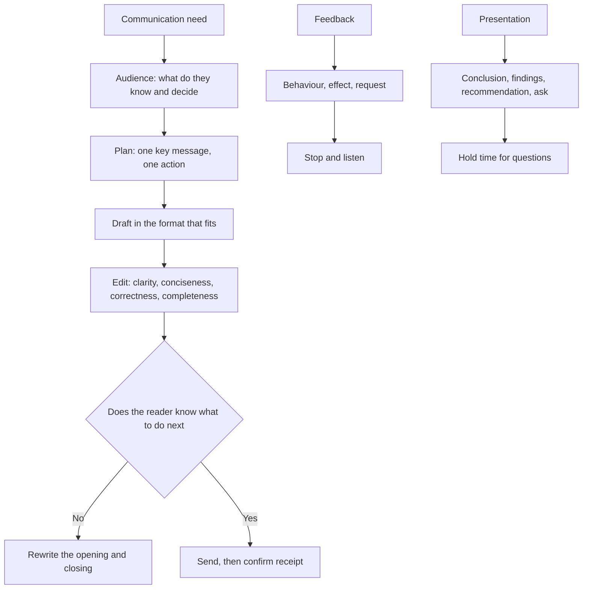

# CA12: Communication Skills

CA12 is one of the six Foundation Level papers of the KASNEB CPA qualification, sitting alongside CA11 Financial Accounting, CA13 Introduction to Law and Governance, CA14 Economics, CA15 Quantitative Analysis and CA16 Information Communication Technology. KASNEB publishes no per-paper weightage.

What makes this paper different from English at school is the audience. Every answer is a piece of communication with a purpose: to move a decision forward, to protect the firm, to explain a finding to someone who will act on it. The examiner reads for what a partner or a client reads for, which is whether the message works. The practical consequence is that CA12 rewards structure and precision over elegance: a well-organised report with plain sentences beats a beautifully worded paragraph that buries the recommendation.

### 🟢 Lite — Quick Review (1h–1d)

**The four tests of business writing.**

- **Clarity**: one idea per sentence, and the reader can tell what you mean without re-reading.
- **Conciseness**: no word that can be deleted without loss.
- **Correctness**: facts, figures, grammar and spelling.
- **Completeness**: the reader has everything needed to act.

**The writing process.** Plan, draft, edit. Skipping the planning stage is the commonest cause of a document that has to be rewritten, because the problem was never the sentences, it was the decision the document was meant to support. Plan by answering four questions: who is the audience, what do they already know, what do they need to do, and what is the one thing they must take away.

**Business letter layout.** The parts, in order: the letterhead and date, the recipient's address, the salutation, the subject line, the opening paragraph, the body, the closing paragraph, the complimentary close, the signature block, and the enclosure and copy notations. Three layouts exist: **block**, where every line starts at the margin; **modified block**, where the body starts at the margin but the signature, the date and the enclosure are indented; and **semiblock**, where the inside address and paragraphs are indented. The modified block is the standard layout for business letters.

**Word choice.** Prefer the plain word: "use" not "utilise", "help" not "facilitate", "so" not "therefore" in a sentence a manager will read aloud. Avoid nominalisations, which turn an action into an abstract noun: "we will conduct a review of the ledger" is weaker than "we will review the ledger". Use the active voice: "the committee approved the budget", not "the budget was approved by the committee". Passive voice is right when the actor is unknown or irrelevant, or when the bad news needs a passive form: "the error was not corrected in time".

**Sentence control.** Aim for an average sentence length of 15 to 20 words, and vary it. A 45-word sentence with three semicolons is a sentence the reader will lose. Watch for fragments, run-on sentences, comma splices, and subject-verb disagreement across long subjects such as "the list of items that the manager submitted".

**Punctuation that carries marks.** The comma splice, two independent clauses joined by a comma, is wrong: use a semicolon, a full stop, or a conjunction. A colon introduces an explanation or a list. An apostrophe marks possession and contractions, so "its" for the possessive and "it's" for "it is"; "their" for possession and "they're" for "they are". Use a serial comma when the items contain commas themselves.

**Email etiquette.** A subject line that states the purpose, a greeting, short paragraphs, a clear request or action, a sign-off with your name and role, and attachments named in the body. Answers within the working expectations of the firm. No text-speak in a communication to a client or a regulator. Write the reply you would be happy to forward, because one day you will forward it.

**Memorise for the Lite tier.**

- Clarity, conciseness, correctness, completeness.
- Plan, draft, edit. Planning decides the document.
- Block, modified block, semiblock are the three letter layouts.
- Active voice, plain words, short varied sentences.
- A comma splice is two independent clauses joined by a comma.
- Email needs a subject line, a purpose, and an action.
- Never use "its" for "it's" or "their" for "they're".

### 🟡 Standard — Full Coverage (1–2d)

#### Worked example: the request for information

**The situation.** A junior auditor needs the signed inventory sheets for two warehouses before the audit deadline. The stock controller is busy with a stocktake.

**The reasoning.** The communication has one purpose: to obtain two specific documents by a stated time. Everything else is noise. The reader knows the audit context and does not need it explained; the reader needs to know exactly which documents and by when; and the request must not read as an accusation, because the controller did not cause the delay.

**The draft.**

*Subject: Signed inventory sheets for Nairobi and Mombasa depots — needed by Friday 14 March*

Dear Mr Otieno,

The audit file for Omega Ltd requires the signed inventory sheets for the Nairobi and Mombasa depots as at 28 February. Could you send them to me by 3 p.m. on Friday 14 March so that we can complete the file before the partner's review on Monday 17 March.

If the Mombasa sheets are with the external auditor, please let me know and I will request them directly.

Kind regards,
Grace Wanjiru
Audit Assistant

**Why it works.** The subject line states the documents and the deadline. The opening sentence gives the documents and the date they relate to, the middle sentence gives the reason for the deadline and a deadline of its own, and the third paragraph handles the likely obstacle before it becomes an exchange. There is no apology, no flattery and no filler. A weaker version opens with "I hope this email finds you well", buries the request in the fourth paragraph and gives no deadline, so the reader cannot prioritise it.

#### Worked example: structuring a memorandum

**The situation.** Your supervisor asks for a short memo on why the year-end stock count was delayed, addressed to the audit manager, who will read it before a client meeting.

**The reasoning.** A memo is the right instrument for an internal communication, and it follows the same logic as a letter: heading, to, from, date, subject, then the content. The reader is time-poor and wants the answer first, so the memo leads with the conclusion, supports it with the two facts that matter, and closes with what happens next.

**The draft.**

*MEMORANDUM*

*To: Audit Manager*
*From: K. Mwangi, Audit Senior*
*Date: 10 March*
*Subject: Delay in the year-end stock count at the Mombasa depot*

**Summary.** The Mombasa year-end stock count finished on 6 March rather than 28 February because the stocktake was delayed by the closure of the Mombasa depot for two days following a burst pipe. The count was completed with no difference in total stock value beyond the usual count margin, and the delay has no effect on the audit opinion.

**Details.** The depot closed on 24 and 25 February. Counting resumed on 26 February and the additional two days were required to complete the third aisle, which had been inaccessible. All count sheets are signed and filed, and the results were reconciled to the 28 February ledger.

**Next step.** No further action is needed from the client. If the timing must be disclosed in the management letter, the wording should follow the draft in the file.

**Why it works.** The conclusion is in the first sentence, the facts are in the second, and the reader's next question, which is whether the client needs to know, is answered in the last paragraph.

#### Worked example: the ten-minute presentation

**The situation.** You must present the results of an internal audit to the finance committee, which has allocated you ten minutes and will ask questions.

**The reasoning.** Structure the ten minutes: one minute for why the audit was done, three for the findings, three for what you recommend, one for what you need from the committee, and two held back for questions, because questions expand to fill any time you leave for them.

Build the slides to support, not to replace. One idea per slide, the evidence on the slide, and the recommendation on a separate slide. A chart should carry one message stated in its title, such as "Reconciliations are late in two of five branches", and the title should be readable as the conclusion even without the rest of the slide.

Rehearse the opening and the closing sentences, because those are the two places nerves show. Have the three figures the panel will ask for on one small card.

### 🔴 Deep — Mastery (3–5d)

**Communication models.** The Shannon and Weaver model introduced noise into communication analysis: the sender encodes a message, a channel carries it, the receiver decodes it, and noise threatens each step. Applied to a memo, the encoder is you, the channel is the document, the decoder is the reader, and noise is the reader's assumptions, your jargon, a missing attachment or a format that buries the point. The model turns "the reader did not understand" from a complaint into a diagnosis: which step broke? Transactional analysis adds that people communicate from one of three ego states, and that the adult-to-adult transaction, which treats both parties as capable of reason and responsibility, is the one that works in a professional setting. The Johari window maps what is known to self and known to others: you move information from the open pane into the blind pane by disclosing, from the hidden pane into the open pane by asking, and from the hidden pane into the blind pane by discovery, normally through feedback. A manager with a large blind pane cannot lead, because they cannot see how their team reads them.

**Interpersonal styles and conflict.** The style that works in a professional accounting setting is high on assertiveness and consideration, with responsiveness adapted to the situation. The Thomas and Kilmann conflict modes are competing, collaborating, avoiding, accommodating and compromising. Each suits a context: competing fits a genuine emergency where speed matters; collaborating fits an issue where the working relationship and the outcome both matter, which is the standard case in an audit firm; avoiding suits a trivial issue or a cooling-off period; accommodating fits an issue where you are wrong or the other party's stake is higher; and compromising fits an issue where both parties have real claims and time is short. In negotiation, separate the interests from the positions, ask what each party needs rather than what it has demanded, make the first offer higher than you would settle for if the other party is likely to counter, and write down any agreement with dates and owners before leaving the room.

**Communicating upward and outward.** Upward, the rule is to lead with the decision needed: the recommendation, then the evidence, then the risk of not acting, with a clear line between what is known, what is estimated and what lies outside your knowledge. Outward, different audiences need different things from the same fact. A client wants the finding, the consequence and the fix; a regulator wants compliance with a reporting standard, evidence and consistency across periods; a shareholder wants the effect on value. Reusing one document for all three fails, because the audience that needs the least detail is the one that gets the least of it. Writing for a regulator raises the bar further: consistency between periods matters more than persuasive presentation, definitions and boundaries must not shift, every figure must be traceable to the underlying records, and hedging reads as concealment.

**Documents and charts.** Report structure: title page, contents, terms of reference, executive summary, methodology, findings, conclusions, recommendations, appendices. The executive summary is written last and read first, so it must stand alone. Each finding has a statement, the evidence behind it, and the effect on the entity, and each recommendation names an owner and a date, because a recommendation without an owner is an opinion. Referencing follows Harvard or APA consistently, including for figures and tables, which are numbered and captioned. Minutes record decisions, not transcripts: headings, attendance, apologies, approval of the previous minutes, then each item with the discussion summarised in the past tense, the decision stated clearly, and the action with an owner and a deadline. For charts, choose the tool for the question: a bar chart for comparing categories, a line chart for change over time, a pie chart only when parts of a clear total, and a scatter plot for relationships. Label the axes with units, state the source, and start a bar chart's axis at zero, since a truncated axis exaggerates differences.

**Ethics, confidentiality and AI.** Confidentiality binds on client information, staff information and working papers, and it applies to the email channel as much as to the file: a misdirected attachment is a reportable incident. Where an ethical or legal breach is discovered, the professional obligation is to follow the firm's reporting procedure and, where the law requires, to report to the relevant authority. Using a drafting tool to structure a document is a process question, and a growing number of professional bodies require disclosure and personal accountability for the final text. The safe position is that the professional signs the document, every figure and every citation is verified independently, and confidential client information is never placed into a tool without authority.

**Common mistakes.** Burying the recommendation; padding with paragraphs that repeat a previous point; passive voice used by habit; vague quantifiers such as "significant improvement" without a figure and a baseline; writing at the reader's level rather than yours; using "we" for a personal opinion in an audit file, where "we" means the firm; and assuming a document has been read, when silence is not agreement and the request needs following up.

**Exam traps.** An item asking you to critique an email expects the answer that it contains no deadline, no specific request and an unnecessary apology. An item asking you to rewrite a sentence wants it shortened, with the active voice restored and a nominalisation removed. A question ranking communication purposes expects the meeting agenda to serve the chair, the memorandum to serve a decision-maker who cannot attend, and the report to serve a reader who needs evidence. A question asking what to do when a colleague misunderstands your report expects you to ask for the misunderstanding in the colleague's own words and rewrite that part of the report.

#### 🧠 Memory Anchors

- **Clarity, conciseness, correctness, completeness.**
- **Plan, draft, edit. Planning decides the document.**
- **Modified block: body flush, signature indented.**
- **Active voice, plain words, sentences of 15 to 20 words.**
- **A comma splice is wrong.**
- **Lead with the conclusion in a memo and a report.**
- **Flashcard Q&A:**
  - *When is passive voice correct?* → When the actor is unknown or irrelevant, or the news is bad.
  - *What makes a recommendation useful?* → An owner, a date and a measurable effect.
  - *Which conflict mode fits a long-term working relationship?* → Collaborating.
  - *What are minutes for?* → Recording decisions and actions, not transcripts.

#### Internal links

- [KASNEB CPA exam hub](/exams/kasneb-cpa/) — the three levels and the six Foundation Level papers.
- [CA11: Financial Accounting](/notes/kasneb-cpa/foundation-level/ca11/) — the technical content you will spend much of your career communicating.
- [CA13: Introduction to Law and Governance](/notes/kasneb-cpa/foundation-level/ca13/) — the legal and governance obligations that shape what you can say.

The qualification facts stated here, that the CPA qualification has three levels and that the Foundation Level comprises the six CA1x papers, come from KASNEB's own CPA page (https://www.kasneb.or.ke/cpa, retrieved 9 October 2026). KASNEB publishes no per-paper weightage, so the weight on this page is StudyRoadmap's own prioritisation.

---

## Continue your study

- **[View this topic in your KASNEB CPA (Certified Public Accountants, Kenya) roadmap](/roadmap/?exam=kasneb-cpa&duration=1mo)** — see where this topic sits in your personalised plan
- **[Build a quick revision plan](/roadmap/?exam=kasneb-cpa&duration=1d)** — 1-day sprint covering the highest-weight topics
- **[KASNEB CPA (Certified Public Accountants, Kenya) exam overview](/exams/kasneb-cpa/)** — pattern, eligibility, and syllabus
- **[All Foundation Level notes](/notes/kasneb-cpa/foundation-level/)** — browse sibling topics in this subject
