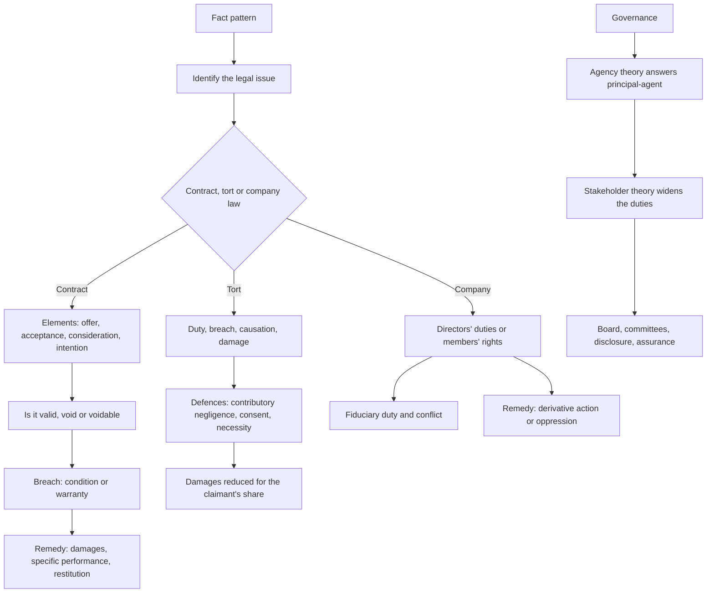

# CA13: Introduction to Law and Governance

CA13 gives a foundation accountant the legal vocabulary of the world they will work in. It sits in the Foundation Level of the KASNEB CPA qualification alongside CA11 Financial Accounting and CA12 Communication Skills, and it assumes no prior legal study. The subject has two halves that interlock: the law, which tells you what is legal and what follows from a breach, and governance, which tells you who is accountable for the organisation's decisions and how that accountability is enforced.

The exam draws heavily on applied scenarios. A stem describes a fact pattern and asks you to identify the issue, apply the rule, and state the consequence. The skill being tested is issue-spotting: finding the legal question inside the story.

### 🟢 Lite — Quick Review (1h–1d)

**Sources of Kenyan law and their order of authority.**

| Source | Notes |
|---|---|
| The Constitution of Kenya, 2010 | Supreme; any law inconsistent with it is invalid; it also governs the interpretation of all other law, requiring interpretation that promotes the values and principles of the Constitution |
| Acts of Parliament | Statutes made by Parliament; the highest source of written law |
| Subsidiary legislation | Regulations, rules, notices and orders made under a parent Act by a body with delegated power; valid only within the parent Act's limits |
| Case law | Decisions of the courts; the reasoning of a higher court binds lower courts |
| Common law and equity | English common law as received and developed in Kenya, and the equitable principles the courts apply; equity follows the law where they conflict |
| Customary and religious law | Recognised where it does not conflict with the Constitution or written law; relevant in land, succession and family matters |
| International law | Treaties and conventions, applied in Kenyan courts so far as their terms permit and the rules of international law allow; treaties need domestication to bind private rights |
| General rules of law | Maxims, doctrines and principles of justice applied by the courts, including the rule against delegating legislative power |

**Case law vocabulary.** **Ratio decidendi** is the reasoning that decides the case and binds lower courts. **Obiter dicta** is the incidental remark that persuades but does not bind. **Stare decisis** means a court follows its own or a higher court's previous decision, though the Supreme Court can depart from a decision of the Court of Appeal on a point of law. Courts: the Supreme Court, the Court of Appeal, the High Court, and the subordinate courts with the jurisdiction given to them by statute.

**Interpreting statutes.** The modern approach in Kenya starts from the constitutional position and asks what the words mean in context.

- **Literal**: the ordinary meaning of the words.
- **Golden**: the ordinary meaning, unless that produces an absurdity the legislature cannot have intended.
- **Mischief**: identify the defect the Act was meant to remedy, then interpret to suppress it.
- **Purposive**: read the provision in light of its object, within the language used.
- **Ejusdem generis**: where a list of specific items is followed by general words, the general words are confined to items of the same kind.
- **Expressio unius**: the express mention of one thing implies the exclusion of others.
- **Noscitur a sociis**: a word's meaning is understood from the words beside it.

**Contract.** A contract is a legally binding agreement. The essential elements: offer, acceptance, consideration, intention to create legal relations, capacity, legality, certainty, and any required formality.

- An **offer** is an expression of willingness to be bound. An **invitation to treat** is not, and a statement of price in an advertisement is one. An offer can be revoked before acceptance.
- **Acceptance** must be communicated. Silence is not acceptance unless the parties agreed it. A **counter-offer** kills the original offer. Acceptance by conduct is possible where the terms make it reasonable.
- **Consideration** must be sufficient, though need not be adequate. Past consideration is no consideration.
- **Capacity**: minors and persons of unsound mind, with the exceptions the law allows.
- **Contractual terms** are conditions if their breach goes to the root of the contract, and warranties if they do not. Breach of a condition entitles the innocent party to terminate; breach of a warranty gives only damages.
- **Remedies for breach**: damages, which put the innocent party in the position they would have been in had the contract been performed, with the rule in Hadley v Baxendale limiting recovery to loss arising naturally from the breach or within the contemplation of both parties; specific performance, which the courts will not grant for contracts of personal service or for land where damages are adequate; and restitution, which prevents unjust enrichment.
- **Frustration** discharges a contract when an unforeseen event makes performance impossible or radically different, and it is not the fault of either party. **Force majeure** clauses allocate that risk expressly by listing the events that excuse performance.
- **Mistake** as to terms, **misrepresentation**, **duress**, **undue influence**, and illegality are grounds of avoidance or voidness.
- A contract that is illegal, contrary to public policy or in fraud of creditors is void. A contract voidable for mistake or misrepresentation can be rescinded.

**Tort.** A tort is a civil wrong, other than breach of contract, that causes loss. Negligence needs four elements: duty of care, breach of that duty, causation, and damage recognised by the law. The test for breach is the standard of the reasonable person adjusted for circumstances including the defendant's circumstances, the claimant's circumstances, the probability of harm, the burden of precautions and the social utility of the defendant's activity.

- **Remoteness**: damage must not be too remote. In Wagon Mound No 1 the test is whether the kind of damage was reasonably foreseeable, not whether it was the precise damage.
- **Contributory negligence** reduces the claimant's damages. **Volenti non fit injuria** is the complete defence where the claimant accepted the risk.
- **Vicarious liability** makes an employer answer for the torts of an employee committed in the course of employment, with close connection and unauthorised mode of work still covered.
- **Occupiers' liability** imposes a duty on someone in control of premises, higher where the visitor is an invitee.
- **Defamation**: libel is written or broadcast and slander is spoken; the claimant must prove the statement, its publication and its defamatory character, and the defendant has defences such as truth, absolute privilege, qualified privilege and honest opinion.
- Other torts: trespass to land, trespass to goods, conversion, nuisance, assault, battery, false imprisonment, and the rule in Rylands v Fletcher for escape of a dangerous thing from land.

**Company law.** The Companies Act No. 17 of 2015 governs incorporated companies in Kenya.

- **Incorporation** gives the company a separate legal personality, with the effect that the company owns the property, incurs the liabilities and is sued in its own name. Pre-incorporation contracts remain the promoter's liability, with exceptions.
- **Types**: private companies limited by shares, public companies limited by shares, and companies limited by guarantee without share capital.
- **Promoters** owe fiduciary duties: to disclose any profit or benefit and to account for it, and the company can recover secret profit.
- **Members** have the rights to be entered on the register of members, to attend and vote at meetings, to receive dividends when declared, to receive a surplus on winding up, and to appoint and remove the auditor. A member of a company limited by guarantee has a guaranteed amount rather than a share.
- **Meetings**: an annual general meeting is required for private companies, and public companies must also hold a general meeting if the articles require it. Resolutions are ordinary, needing a simple majority, or special, needing a three-quarters majority for matters such as altering the articles, changing the share capital, or voluntary winding up. Written resolutions are permitted in place of meetings, and a special resolution can be passed by unanimous written consent.
- **Directors** owe fiduciary duties to the company: to act in its best interests, avoid conflicts, and not profit personally from the office. They also owe the duty to act with care, skill and diligence, and to exercise independent judgment. A director must not use information gained in office for private benefit, and the company can require that benefit to be accounted for. Directors are disqualified if convicted of an offence involving dishonesty, if bankrupt, or if they act fraudulently or improperly towards the company.
- **Shareholder remedies**: the derivative action, in which a member brings proceedings in the company's name where the company itself will not act, and the oppression remedy, which protects members unfairly prejudiced or unfairly disregarded by conduct that is oppressive, prejudicial or unfairly prejudicial. Both sit in the Companies Act.
- **Auditors**: the Companies Act regulates their appointment, rotation and independence, and the audit reports on the financial statements.

**Governance.** The set of structures, processes and behaviours through which an organisation is directed and controlled.

- **Agency theory** explains governance as the answer to the principal-agent problem: owners (principals) delegate to managers (agents), and the divergence of interests requires monitoring mechanisms such as a board, external audit and remuneration design.
- **Stakeholder theory** holds that the organisation owes duties to employees, creditors, customers, communities and the state, not only to shareholders.
- **Stewardship theory** argues that managers are not inherently rivals of owners and can be motivated by intrinsic and long-term concerns.
- **The board** is the governing body: it sets strategy, oversees performance, monitors risk and holds management to account. The **executive** runs the business. Separating the roles of chairman and chief executive is a governance practice that stops one person chairing the board while also running it.
- **Committees** take detailed work: audit, nomination and remuneration, and risk. The audit committee oversees financial reporting, internal control, external audit and internal audit.
- **The annual general meeting** is the forum at which members hold the directors and the auditor to account, and it is a constitutional right of the members rather than a courtesy.

**Memorise for the Lite tier.**

- The Constitution is supreme and governs the interpretation of all other law.
- Ratio decidendi binds; obiter dicta persuades.
- Ejusdem generis, expressio unius, noscitur a sociis.
- Contract needs offer, acceptance, consideration, intention, capacity, legality, certainty.
- Damages put the claimant where performance would have; specific performance is refused for personal service contracts.
- Negligence: duty, breach, causation, damage.
- The derivative action and the oppression remedy are the shareholders' remedies.
- Directors owe fiduciary duties and the duty of care, skill and diligence.
- Agency theory solves the principal-agent problem; stakeholder theory widens the duties.

### 🟡 Standard — Full Coverage (1–2d)

#### Worked example: is the contract binding?

**The stem.** A supplier's quotation states "we can supply 500 units at 240,000 shillings, subject to our standard terms being accepted within seven days". The buyer replies "we accept" on day nine. The supplier then refuses to deliver, arguing no contract arose.

**The analysis.** The quotation is an offer or an invitation to treat. The words "subject to our standard terms being accepted within seven days" indicate that the supplier was not willing to be bound without an acceptance inside the stated period, so the document is an offer. The buyer's reply on day nine is outside the period, so it cannot be an acceptance in time. Two further points: a late acceptance does not create a contract, it is a counter-offer unless the seller accepts it; and even if the reply had arrived in time, a reply that referred to different terms would have been a counter-offer rather than an acceptance.

**The conclusion.** No contract was formed, because there was no acceptance communicated within the period the offer specified. If the buyer had sent an acceptance on day six, a contract would have arisen on that date, and the supplier's refusal would be a repudiation.

**The issue-spotting lesson.** The facts that decide the case are the words of the offer, the identity of the parties, and the timing. Candidates who argue over whether the quotation was an offer without reading the words miss the point.

#### Worked example: breach, and the remedy that follows

**The stem.** A supplier delivers goods that meet the description but are two weeks late. The contract contains a clause stating "time is of the essence". The buyer rejects the goods and cancels the order.

**The analysis.** Two rules interact. Where time is of the essence, delivery within the stipulated time is a condition of the contract, and the buyer's right to reject is lost if the seller delivers late and the buyer accepts the goods or the delay is waived. Where time is not of the essence, lateness gives the innocent party a right to damages but not to reject.

The second question is the remedy. The buyer can claim damages measured by the loss the delay caused, subject to the rule that the loss must arise naturally from the breach or be within the contemplation of the parties at the time of contracting. If the buyer had no real interest in early delivery, the loss is likely to be too remote.

**The conclusion.** With time of the essence, the buyer can reject and treat the contract as repudiated, and can also claim damages for the loss caused. Without it, the buyer keeps the goods and claims damages only.

#### Worked example: elements of negligence

**The stem.** A shop floor is left wet after a leak. A customer walks through it, sees the wet floor, and slips. The customer had been told earlier that the floor was wet and had walked round it once already.

**The analysis.** Duty: the shop owes customers a duty to take reasonable care to keep the premises reasonably safe. Breach: the shop knew of the leak, and a cleaner, warning sign or the closure of the area would have been reasonable precautions. Causation: the slip on the wet floor and the injury follow the failure to take precautions, so the factual and legal causation tests are met on the facts given. Damage: an injury is required, and injury is proved by the claimant.

The contributory negligence point is decisive on the quantum. The customer had been told the floor was wet and had already avoided it once, so a court would find that the customer failed to take reasonable care for their own safety and would reduce the damages to reflect that share of responsibility. The reduction is proportionate, unlike contributory negligence in other jurisdictions, which is a Kenyan point worth knowing.

**The issue-spotting lesson.** The facts are deliberately supplied for each element, and the contributory negligence fact is the one that decides the outcome.

#### Worked example: a director's decision

**The stem.** A director of a family-owned company approves a contract with a firm in which her brother is a partner. The board is not told. The contract price is above the market rate.

**The analysis.** This engages the fiduciary duty to avoid conflicts of interest and the duty to act in the best interests of the company. The director has a direct personal interest in the transaction, and the conflict is undisclosed, which is a breach of the duty to disclose. The company has remedies: it can require the director to account for any profit made, and the transaction is voidable in the company's favour where the conflict was not disclosed and the company suffered loss.

The best-interests duty is engaged too, because a price above the market rate is evidence that the company did not receive the equivalent value. The personal benefit is direct and not remote.

**The conclusion.** The director has breached her duties. The company can require the account of profits and can seek to set the transaction aside. On the facts, the shareholder members would also have a remedy through the derivative action where the company itself is unwilling to act.

#### Worked example: a member with no remedy

**The stem.** A member of a private company complains that the directors have paid themselves excessive salaries and refuses to attend meetings. The directors refuse to call an extraordinary general meeting. The member asks what she can do.

**The analysis.** The starting point is that the members as a body control the company through the general meeting, and the board manages it. A member acting alone cannot instruct the directors, and a single member cannot bring a derivative action without the leave of the court, which requires a good faith belief that the company has been harmed and that the interests of the members as a whole would be harmed by the action failing.

The practical routes are: apply to the court for leave to bring the derivative action on the company's behalf; use the oppression remedy if the conduct is unfairly prejudicial to her, and a company run for the benefit of the controlling family with a member treated as an outsider is a strong candidate for that route; and apply to the court for an order requiring the directors to call the meeting if the requirements for doing so are met.

**The conclusion.** A member has no automatic right to instruct the directors. The realistic options are the derivative action with leave, the oppression remedy, or a court order for the meeting to be called.

### 🔴 Deep — Mastery (3–5d)

#### Contract law in depth

**Formation.** The order of the elements in an examination answer: offer, acceptance, consideration, intention, capacity, legality, certainty, formalities. Each element is a separate heading, and an answer that lists the elements without applying each one to the facts scores poorly.

**Consideration.** Sufficiency means the courts will not assess whether the bargain was equal, only whether it had value. A promise to do something the promisor was already obliged to do is no consideration. A promise made in the past is no consideration unless it is sought and given in circumstances of a contemplated future performance, the exception for promises made in recognition of a benefit already received.

**Intention to create legal relations.** The test is objective, judged from the words and the context. Social and family arrangements are presumed not to be intended as legal contracts, while business arrangements are presumed to be. The presumption is rebuttable by showing that the parties used legal terms or intended to be bound.

**Certainty.** Terms must be sufficiently certain for the court to enforce. An agreement to negotiate in good faith is unenforceable, and a price that is to be agreed is void for uncertainty unless a mechanism exists to determine it.

**Vitiating factors.** Misrepresentation requires a statement of fact, a representation that is false or misleading, an intention to induce, actual inducement, and reliance. Undue influence rests on domination and trust rather than on unfairness, and the categories are the unconscionable influencer, the vulnerable party, and the fiduciary relationship. Duress requires illegitimate pressure that vitiates consent. Illegality renders a contract void, and the consequence depends on whether the plaintiff knew of the illegality.

**Frustration and force majeure.** Frustration is a common law doctrine that discharges a contract when an unforeseen event makes performance impossible or so radically different that the parties would not have contracted had they known. It does not apply where the event is the fault of the party seeking to rely on it, where the contract provides for the risk, or where performance is merely more difficult or more expensive. Force majeure clauses are construed strictly against the party relying on them, and the drafting lists the events and sets the notice and mitigation requirements.

**Remedies.** Damages for breach of contract are compensatory and not punitive. The Hadley v Baxendale rule and its refinement in cases such as Victoria Laundry v Newman Industries, where the defendant knew of the claimant's special circumstances, control what is recoverable. Specific performance is equitable and granted at the discretion of the court, and it is refused where the contract is for personal service, where damages are adequate, or where the court cannot supervise performance. Restitution and unjust enrichment undo an unjust benefit. Rescission unwinds the contract where the grounds for avoidance exist. The election between remedies matters: affirming the contract keeps it alive and preserves the right to damages later, and a party cannot both affirm and rescind.

#### Company law in depth

**Separate personality and its limits.** Incorporation creates a separate legal person with its own property and liabilities, which protects shareholders from the company's debts beyond their contribution. The court will pierce the corporate veil where the company is a mere facade, where there is fraud or evasion of the law, where the company is undercapitalised, or where continued existence would lead to injustice.

**Capital and the balance sheet test.** The older principle from Salomon v A Salomon and Co Ltd, that a company is a separate entity beyond the reach of its members, sits alongside a modern regulatory concern that a company should have sufficient capital for its operations. The distinction between **share capital**, which is a legal fund belonging to the company and available to creditors, and **reserves**, which are profits retained, matters when a company buys back shares or pays a dividend out of capital.

**Directors' duties and their judicial gloss.** The fiduciary duties are drawn from fiduciary law and include the prohibition on personal profit, the duty to avoid conflicts, the duty not to misappropriate company property, the duty to disclose, and the obligation to act in the company's best interests. The statutory duty of care, skill and diligence was introduced by the Companies Act and later given statutory force in the UK by section 172 of the Companies Act 2006, which lists the factors a director can consider, including the long-term consequences, the interests of employees, suppliers and customers, community and environmental factors, and the fairness of the treatment of members. Kenyan law took the pre-2006 formulation.

**Proper purpose and the "own affairs" defence.** A director's personal interest does not automatically disqualify a decision. The director can show that the transaction was in the company's interests and that the benefit was received in a capacity other than that of director, which is the own affairs defence. The company then has a claim against the director if the transaction was dishonest or unfair, and the directors have the benefit of the doubt under the business judgement rule if they acted honestly and rationally.

**Derivative action and oppression.** The derivative action is a statutory remedy allowing a member to bring proceedings in the name of the company, and it is the route for a misapplication of company funds or a director's disloyalty where the company itself will not act. The oppression remedy protects members against conduct that is oppressive, prejudicial or unfairly prejudicial to them, and the court has wide powers, including orders regulating the company's affairs, requiring the purchase of a member's shares at a fair value, or requiring the directors to be replaced. A family company that has diverted opportunities to a related company is a strong oppression case.

**Directors' remuneration and conflicts.** The disclosure and authorisation requirements mean a director cannot take a benefit from a transaction with the company without disclosure and, where required, shareholder approval. The corporate governance codes for listed companies go further and require a remuneration committee to set the policy, disclose the policy and the amounts, and include malus and clawback provisions so that remuneration is forfeited or recovered where performance turns out to have been misstated.

#### Governance in depth

**The agency problem and its mechanisms.** The principal-agent problem is the divergence of interest between owners and managers, worsened by information asymmetry and by the fact that managers can hide effort. The mechanisms that address it each attack a different part: an independent board and audit committee address monitoring, remuneration aligned with long-term performance addresses incentives, external audit addresses verification of the accounts, disclosure rules address information asymmetry, concentrated ownership with active blockholders addresses monitoring from outside, and internal audit addresses the operating level.

**Why agency theory is not the whole answer.** It treats shareholders as the only claimants and assumes shareholders can organise to monitor managers, which is hard for dispersed minority holders. Stakeholder theory, and the "enlightened shareholder value" argument that the long-term value of the company depends on the relationships with employees, customers, suppliers and communities, answers back that a company that ignores its stakeholders damages the shareholder value it claims to protect.

**Board effectiveness.** The ingredients that research and case law point to: an appropriate balance of skills against the strategy, enough independent non-executive directors to be a genuine counterweight, a separation of the chairman and chief executive roles, a board that receives information early enough to influence decisions rather than approve them, induction and training, an effective induction of the chair, and a formal evaluation of the board and of individual directors. Diversity of thought improves decisions, and diversity of background improves the range of issues the board can see, though both need to be designed for rather than assumed.

**Board dynamics.** Common failure modes in case studies: the board receives a paper pack too late to influence anything, the chair dominates discussion, the board is told only good news, dissenting voices are discouraged, and the audit committee is treated as a formality. A board that never challenges management is not providing assurance, and the evidence of a real audit committee is that it asks awkward questions and reports to the board without filtering.

**Governance codes and compliance.** The Capital Markets Authority issues a code of corporate governance for listed companies in Kenya, and the United Kingdom and OECD principles supply the wider comparative framework. The pattern is comply or explain: the substance is what matters, and the explanations are scrutinised. A governance report that lists compliance boxes without explaining the underlying practices fails the substance test.

**Integrated reporting and the ESG agenda.** The integrated report connects strategy, governance, performance and the organisation's effect on the economy, the environment and people, and it requires the boundary, the definitions and the data to be stated so that the numbers can be compared across periods. The assurance question then arises: who verifies the non-financial information, and to what level of assurance. An auditor who signs a report on the financial statements only has not assured the sustainability claims sitting beside them.

**Ethics in the governance context.** The ethical frameworks in play are utilitarian, deontological, virtue-based and the stakeholder approach. For a board decision the useful test is a sequence: identify the stakeholders, identify the harms and the benefits, identify the rules and legal duties, then ask whether the decision would be defensible if explained publicly and if the parties had to justify it to those affected.

#### Common mistakes

**Treating the Companies Act as the only source of company law.** The common law fills the gaps, and the Constitution governs.

**Confusing obiter with ratio.** Only the reasoning that decides the case binds.

**Assuming consideration must be adequate.** It must be sufficient.

**Forgetting the fourth element of negligence.** Damage is required.

**Claiming a member can instruct the directors.** Members control the company through the general meeting.

**Ignoring the leave requirement in the derivative action.** It is a condition of the remedy.

**Treating a conflict of interest as automatically voiding the transaction.** It is voidable, and the director can show the transaction was fair and in the company's interests.

**Over-reading a governance code.** Comply or explain is a framework for substance, not a scoring exercise.

#### Exam traps

A stem describes a director who signed a contract benefiting a company he owns. The item raises self-dealing, and the answer covers the duty to avoid conflicts, the duty to disclose, the account of profits, and the derivative action.

A stem describes a shareholder who is being excluded from information while dividends are paid to the majority. The item points at the oppression remedy and the right to be registered and to receive information.

A stem describes a contract for the supply of goods with a clause making time of the essence and a delivery two weeks late. The item raises the right to reject, and the answer depends on whether the lateness has been waived or accepted.

A stem describes a shop floor injury with a flooded floor, a warning sign absent, and the claimant wearing inappropriate footwear. The item tests contributory negligence and the reduction in damages.

A stem describes a statute listing specific types of licence and then adding "or any other licence". The item asks for the interpretation rule, and the answer is ejusdem generis.

A stem describes a scheme to move company contracts to a company owned by the directors. The item asks which rule is engaged, and the answer covers both the account of profits and the derivative action or oppression.

#### 🧠 Memory Anchors

- **The Constitution is supreme and governs interpretation.**
- **Ratio binds, obiter persuades.**
- **Ejusdem generis, expressio unius, noscitur a sociis.**
- **Contract: offer, acceptance, consideration, intention, capacity, legality, certainty.**
- **Damages compensate, specific performance compels, restitution undoes.**
- **Negligence: duty, breach, causation, damage.**
- **Derivative action for the company, oppression for the member.**
- **Directors owe fiduciary duties plus care, skill and diligence.**
- **Flashcard Q&A:**
  - *What does the case ratio do?* → Bind lower courts; obiter merely persuades.
  - *Is silence acceptance?* → Not unless the parties agreed it.
  - *What does Hadley v Baxendale establish?* → The limit on recoverable loss in contract damages.
  - *When is the veil pierced?* → Facade, fraud, undercapitalisation or injustice.
  - *Who holds the company to account?* → The members through the general meeting.
  - *What does comply or explain mean?* → Follow the code or state why you did not.

#### Internal links

- [KASNEB CPA exam hub](/exams/kasneb-cpa/) — the three levels and the six Foundation Level papers.
- [CA11: Financial Accounting](/notes/kasneb-cpa/foundation-level/ca11/) — the reporting obligations that sit behind the company law here.
- [CA12: Communication Skills](/notes/kasneb-cpa/foundation-level/ca12/) — the professional judgement and ethics that governance depends on.
- [CA15: Quantitative Analysis](/notes/kasneb-cpa/foundation-level/ca15/) — the analysis that turns financial information into governance evidence.

The qualification facts stated here, that the CPA qualification has three levels and that the Foundation Level comprises the six CA1x papers, come from KASNEB's own CPA page (https://www.kasneb.or.ke/cpa, retrieved 9 October 2026). The legal framework described is Kenyan law as at the date of this note, with the Constitution of Kenya 2010 and the Companies Act No. 17 of 2015 as the principal statutes. KASNEB publishes no per-paper weightage, so the weight on this page is StudyRoadmap's own prioritisation.

---

## Continue your study

- **[View this topic in your KASNEB CPA (Certified Public Accountants, Kenya) roadmap](/roadmap/?exam=kasneb-cpa&duration=1mo)** — see where this topic sits in your personalised plan
- **[Build a quick revision plan](/roadmap/?exam=kasneb-cpa&duration=1d)** — 1-day sprint covering the highest-weight topics
- **[KASNEB CPA (Certified Public Accountants, Kenya) exam overview](/exams/kasneb-cpa/)** — pattern, eligibility, and syllabus
- **[All Foundation Level notes](/notes/kasneb-cpa/foundation-level/)** — browse sibling topics in this subject
