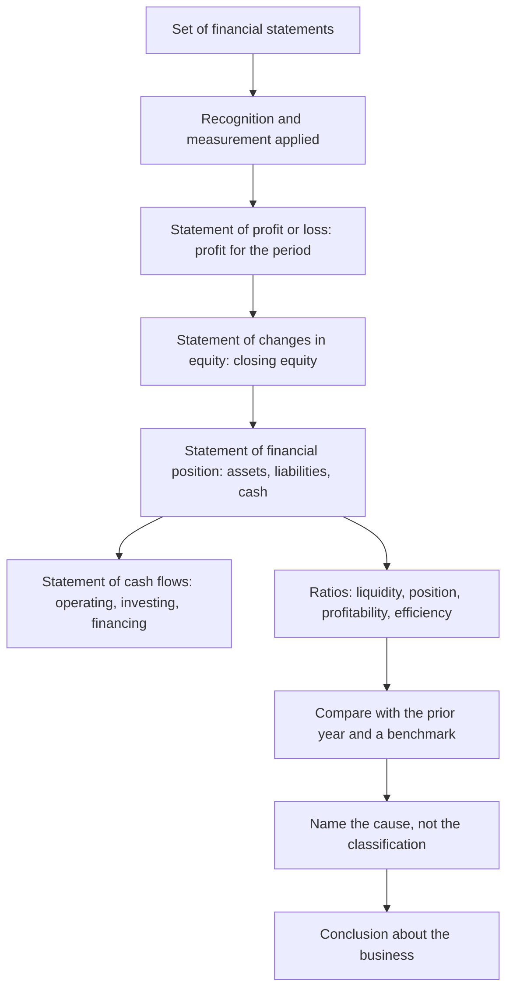

# CA23: Financial Reporting and Analysis

CA23 is one of the six Intermediate Level papers of the KASNEB CPA qualification. KASNEB states that examinations are held three times each year, in April, August and December, and that CPA papers run for three hours, with morning sessions beginning at 9:00 a.m. and afternoon sessions at 2:00 p.m. KASNEB publishes no per-paper weightage.

This paper is about the statements as a system rather than as a set of documents. It asks what the reporting framework requires, how the primary statements fit together and feed each other, how the statement of cash flows is built, and what the numbers in the statements let you conclude about a business. The three parts are linked: the framework decides what is recognised and how it is measured, the statements present the result, and the ratios are the only honest way to read the result back.

Candidates often treat this paper as an arithmetic paper. It is not. Almost every mark here is either a choice about treatment or an inference from two or more figures, and the arithmetic is a small part of the work.

### 🟢 Lite — Quick Review (1h–1d)

**The framework in four questions.** Almost every framework question in the paper is one of these.

1. **Definition** — what does this term mean, and what falls inside it?
2. **Recognition** — has the event happened, and does it meet the criteria for an item and an event? Recording is not the same as recognising.
3. **Measurement** — what amount is carried, and on what basis?
4. **Presentation and disclosure** — how is it shown, and what must be explained?

**The three primary statements and the chain between them.**

> Statement of profit or loss → profit → statement of changes in equity → closing equity → statement of financial position → closing cash → statement of cash flows

The statement of profit or loss covers a period. The statement of financial position covers a date. The cash flow statement explains the movement in the cash figure that sits inside the statement of financial position.

**The cash flow statement: three activities.**

| Activity | What belongs in it |
|---|---|
| Operating | Cash from trading, from paying staff and suppliers, and tax paid |
| Investing | Buying and selling long-term assets |
| Financing | Raising and repaying borrowings, issuing shares, paying dividends |

**The ratio families and the question each one answers.**

| Family | Question it answers | Examples |
|---|---|---|
| Liquidity | Can the entity meet its short-term obligations? | Current ratio, quick ratio, cash ratio |
| Financial position | How is the entity financed, and can it service its debt? | Gearing, debt to equity, interest cover |
| Profitability | What does the entity earn for the owners? | Net profit margin, return on assets, return on equity |
| Efficiency | How well are assets being used? | Asset turnover, inventory days, receivables days |

**Memorise for the Lite tier.**

- Recognition is not recording. Cash moving is not an event that has occurred.
- Measurement asks what amount is carried and on what basis.
- Disclosure explains; it does not change the numbers.
- Profit is a period figure. Equity and cash are balances at a date.
- The cash flow statement starts from the cash figure in the statement of financial position and explains its movement.
- Operating, investing, financing. Tax paid is an operating flow.
- A ratio is a question, not an answer. It needs a comparator and a cause before it means anything.
- A ratio without a trend, a benchmark or a cause is arithmetic.
- Return on equity decomposes into margin times asset turnover times leverage. If it rises, one of the three moved.

### 🟡 Standard — Full Coverage (1–2d)

#### Worked example 1: the statements, from a trial balance

A trading company prepares its statements for the year ended 31 December. The figures below are illustrative.

**Statement of profit or loss.**

| | Current year | Prior year |
|---|---|---|
| Revenue | 120,000 | 100,000 |
| Cost of sales | (70,000) | (62,000) |
| Gross profit | 50,000 | 38,000 |
| Operating expenses | (30,000) | (24,000) |
| Operating profit | 20,000 | 14,000 |
| Interest | (5,000) | (6,000) |
| Profit before tax | 15,000 | 8,000 |
| Tax | (4,500) | (2,400) |
| Profit for the year | 10,500 | 5,600 |

**Statement of financial position.**

| | Current year | Prior year |
|---|---|---|
| Non-current assets | 60,000 | 56,000 |
| Inventory | 25,000 | 20,000 |
| Trade receivables | 18,000 | 15,000 |
| Cash | 12,000 | 4,500 |
| Current assets | 55,000 | 39,500 |
| Total assets | 115,000 | 95,500 |
| Trade payables | 15,000 | 12,000 |
| Short-term borrowings | 10,000 | 8,000 |
| Current liabilities | 25,000 | 20,000 |
| Net current assets | 30,000 | 19,500 |
| Long-term loan | 30,000 | 20,000 |
| Total liabilities | 55,000 | 40,000 |
| Share capital | 40,000 | 40,000 |
| Retained earnings | 20,000 | 15,500 |
| Total equity | 60,000 | 55,500 |
| Total liabilities and equity | 115,000 | 95,500 |

Two checks confirm the set hangs together. Total assets equal total liabilities plus equity in both years: 115,000 against 55,000 plus 60,000 now, and 95,500 against 40,000 plus 55,500 in the prior year. And the equity moves as it should: closing equity of the prior year, 55,500, plus profit of 10,500, less a dividend of 6,000, gives the current year's 60,000. That second check is the work of the statement of changes in equity, and without it the movement in equity is invisible. A question in this paper is quite likely to hand you three statements and ask for the missing one, and the statement of changes in equity is how you find it.

#### Worked example 2: the statement of cash flows, indirect method

Using the same figures, with depreciation of 8,000 for the year:

| | Current year |
|---|---|
| Profit before tax | 15,000 |
| Add back depreciation (non-cash) | 8,000 |
| Increase in inventory (25,000 less 20,000) | (5,000) |
| Increase in trade receivables (18,000 less 15,000) | (3,000) |
| Increase in trade payables (15,000 less 12,000) | 3,000 |
| Cash generated from operations | 18,000 |
| Tax paid | (4,500) |
| Net cash from operating activities | 13,500 |
| Purchase of non-current assets | (12,000) |
| Net cash used in investing activities | (12,000) |
| New long-term loan drawn | 10,000 |
| Increase in short-term borrowings | 2,000 |
| Dividend paid | (6,000) |
| Net cash from financing activities | 6,000 |
| Net increase in cash | 7,500 |
| Cash at the beginning of the year | 4,500 |
| Cash at the end of the year | 12,000 |

The closing figure of 12,000 agrees with the cash line in the statement of financial position, which is the point of the reconciliation: the two statements cannot disagree.

The sign logic is worth memorising because it is the most common error. An increase in inventory consumes cash, so it is subtracted. An increase in receivables consumes cash, because revenue has not yet been collected, so it is subtracted. An increase in payables provides cash, because the expense has not yet been paid, so it is added. Non-cash charges such as depreciation are added back because they reduced profit without reducing cash.

One more line is worth reading carefully, because it shows why the investing figure is not the same as the movement in the balance sheet line. Non-current assets rose from 56,000 to 60,000, a change of 4,000, but the cash flow statement shows 12,000 spent on assets. The difference is depreciation of 8,000, which reduced the carrying amount without any cash leaving the business.

The direct method is the other presentation: it lists the actual cash receipts from customers and the actual cash paid to suppliers and staff, and reconciles the total to the same operating cash flow. The two methods reach the same operating figure, and the difference is presentation, not substance.

#### Worked example 3: ratios and what they actually tell you

Using the figures above, with prior-year ratios where they are needed.

| Ratio | Calculation | Result |
|---|---|---|
| Current ratio | 55,000 ÷ 25,000 | 2.2 |
| Quick ratio | (55,000 − 25,000) ÷ 25,000 | 1.2 |
| Gearing, liabilities to equity | 55,000 ÷ 60,000 | 0.92 |
| Interest cover | 20,000 ÷ 5,000 | 4.0 times |
| Net profit margin | 10,500 ÷ 120,000 | 8.75% |
| Return on assets | 10,500 ÷ 115,000 | 9.1% |
| Return on equity | 10,500 ÷ 60,000 | 17.5% |
| Asset turnover | 120,000 ÷ 115,000 | 1.04 times |
| Inventory days | 25,000 ÷ 70,000 × 365 | 130 days |
| Receivables days | 18,000 ÷ 120,000 × 365 | 55 days |
| Payables days | 15,000 ÷ 70,000 × 365 | 78 days |

Now read them, which is where the marks are.

**Liquidity.** The current ratio of 2.2 and quick ratio of 1.2 both improved on the prior year, and both sit comfortably above the level at which a business is usually described as stretched. The quick ratio is the more informative of the two here, because a large part of current assets is inventory, and inventory is only quickly realisable if it can be sold at close to cost.

**Financial position.** Gearing moved from 0.72 to 0.92, because liabilities grew by 15,000 while equity grew by 4,500. Interest cover moved the other way, from 2.3 times to 4.0 times, because operating profit rose by 6,000 while interest fell by 1,000. So the business is more indebted and better able to service that debt at the same time, and both facts have to be reported. The question the two ratios raise between them is whether the extra borrowing is funding growth that generates cash or funding a working capital squeeze, and that is answered by the cash flow statement rather than by the ratios.

**Profitability.** Margin improved from 5.6% to 8.75%, and return on equity rose from 10.1% to 17.5%. The decomposition explains it: margin up, asset turnover almost unchanged at 1.04 against 1.05, and leverage up because liabilities grew faster than equity. So the improvement in return on equity came from margin and leverage, not from better use of assets.

**Efficiency.** Inventory days of 130 are high and rose from the prior year's 118, while receivables days of 55 are modest. Payables days of 78 mean the company is taking about 78 days to pay its suppliers while holding stock for 130 days, which is a gap worth querying: the business is financing its inventory using its suppliers' credit. That is the kind of observation the paper rewards, because it comes from two ratios together rather than from one.

#### Reading ratios well

Four habits separate a strong answer from a weak one.

**Always state the comparator.** A ratio on its own says nothing. 130 inventory days is good, bad or ordinary depending on the sector, the prior year and the terms the business has negotiated with its suppliers.

**Look for the cause, not the classification.** Inventory days rose. That could be deliberate buying ahead of a price increase, a slowdown in sales, or a change in purchasing policy. The ratio identifies the question; it does not answer it.

**Never average when the question wants the balance sheet date.** Ratio definitions are conventional, and the examiner expects the definition you were taught. If a definition uses closing balances, use closing balances.

**Watch for the effect of inflation and for the effect of the balance sheet date.** A ratio computed on year-end balances can move purely because trading slowed in the last month of the year.

### 🔴 Deep — Mastery (3–5d)

#### The four analytical questions

When you are handed a set of statements and asked what they show, work through these in order.

1. **Can it pay its way?** Liquidity ratios, and the composition of current assets.
2. **Can it survive its obligations?** Gearing, interest cover, and the maturity profile of the liabilities against the assets.
3. **What does it earn for the owners?** Return on equity, decomposed into margin, asset turnover and leverage.
4. **Is the business getting more out of what it owns?** Turnover and working capital days, compared over time.

The order matters, because a business can be profitable and still fail the first question. Profit is an accounting measure; cash is a survival measure.

#### A scenario that tests all four

**Question.** A company's profit for the year has risen by a third, and its return on equity has risen with it. Cash at the year end is lower than it was, inventory has grown faster than revenue, and the bank has reduced its overdraft facility. Explain what has happened.

**Step 1, the profit.** Rising profit with falling cash is the first thing to explain. Candidates look for higher revenue, but revenue is not the issue: inventory has grown faster than revenue, which means more cash has gone into stock than came out of sales. Receivables may also have grown, and the payables days may have shortened, which takes cash out of the business.

**Step 2, the return on equity.** It rose because margin improved or because the business became more geared. If the bank has reduced its overdraft while long-term borrowing rose, part of the improvement is leverage, and leverage that comes with a shrinking overdraft facility and falling cash is a warning, not a strength.

**Step 3, the liquidity position.** A reduced overdraft facility with more inventory and less cash means the working capital cycle has stretched. The business is funding a longer cycle with less facility, which is precisely the situation in which a funding problem appears.

**Step 4, the conclusion.** The correct answer is not "the business is performing well". It is that the improvement in profit has been funded by working capital rather than generated as cash, and that the funding for it has been reduced. Every figure in the question contributes.

#### Common mistakes

- **Computing a ratio and stopping.** The computation is worth a fraction of the mark; the interpretation and the cause carry the rest.
- **Comparing a ratio with no benchmark and no trend.** "The current ratio is 2.2" is not a finding.
- **Using the wrong definition.** Gearing on total liabilities and gearing on interest-bearing debt give different answers. Use the definition the course uses and name it in the answer.
- **Averaging balances that the definition does not average.** It changes the answer and loses the mark.
- **Treating profit as cash.** The scenario above exists precisely to punish that.
- **Ignoring that the cash flow statement and the balance sheet must agree.** A closing cash figure that does not tie back is a defect, and the question may be testing exactly that.
- **Reading a rise in return on equity as good news without decomposing it.** Margin, turnover and leverage can move independently, and the source of the change decides whether it is good.
- **Forgetting the comparatives.** Every statement carries prior-year figures, and the question usually turns on the movement rather than the level.

> ⚡ **Examiner Trap.** A question that gives rising profit, a falling current ratio and a new long-term loan, and asks what the statements show. The tempting answer focuses on the profit. The correct answer is that the loan funded the working capital that the profit did not, so the business is more leveraged, less liquid and no better placed, and every ratio mentioned in the stem is part of that.

#### 🧠 Memory Anchors

- **"Profit is a period, cash is a date."**
- **"Increase in stock, receivables or payables: the cash direction is the opposite."**
- **"Tax paid is operating."**
- **"A ratio needs a comparator, a cause and a conclusion."**
- **"Margin × turnover × leverage equals return on equity."**
- **Flashcard Q&A:**
  - *Inventory rises. Cash effect?* → Cash out. Subtract it.
  - *Payables rise. Cash effect?* → Cash in. Add it.
  - *Depreciation in the indirect method?* → Added back. No cash left the business.
  - *Interest cover fell while gearing rose. Is that safe?* → Not necessarily. More debt, less headroom.
  - *Return on equity rose. Which three things could have caused it?* → Margin, asset turnover, leverage.

#### Internal links

- [KASNEB CPA exam hub](/exams/kasneb-cpa/) — the three levels, the paper list and the three-hour session format.
- [CA24: Auditing and Assurance](/notes/kasneb-cpa/intermediate-level/ca24/) — the assertions attached to the balances in these statements.
- [CA11: Financial Accounting](/notes/kasneb-cpa/foundation-level/ca11/) — the entries and adjustments behind every figure on these statements.

The paper list, level structure, three sittings a year and three-hour session format on this page come from the Kenya Accountants and Secretaries National Examinations Board's own pages (https://www.kasneb.or.ke/cpa and https://www.kasneb.or.ke/faqs), as recorded in this site's KASNEB CPA exam data. KASNEB publishes no per-paper weightage; the weight here is StudyRoadmap's own prioritisation. Every figure in the worked examples on this page is illustrative and is not a figure from any KASNEB paper.

---

## Continue your study

- **[View this topic in your KASNEB CPA (Certified Public Accountants, Kenya) roadmap](/roadmap/?exam=kasneb-cpa&duration=1mo)** — see where this topic sits in your personalised plan
- **[Build a quick revision plan](/roadmap/?exam=kasneb-cpa&duration=1d)** — 1-day sprint covering the highest-weight topics
- **[KASNEB CPA (Certified Public Accountants, Kenya) exam overview](/exams/kasneb-cpa/)** — pattern, eligibility, and syllabus
- **[All Intermediate Level notes](/notes/kasneb-cpa/intermediate-level/)** — browse sibling topics in this subject
