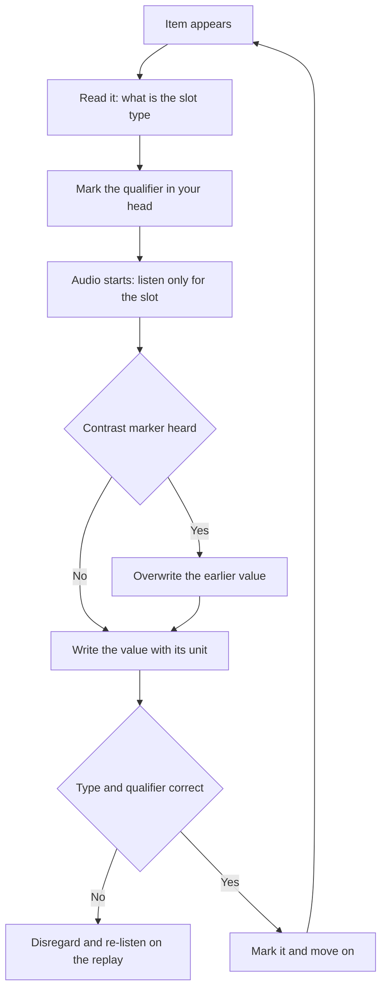

# Part 1: Identifying Specific Detail

Part 1 of the OET Listening sub-test asks for one specific piece of information and nothing else. The answer is stated once, spoken quickly, and then the tape moves on. What makes these items difficult is not the audio but the distractors: a second number, a second place, a second time, all of the same type as the real answer and all of them mentioned.

The OET Test Handbook 2026 states that "Listening and Reading are the same for all candidates, regardless of profession." That removes a false worry: you are not being tested on clinical vocabulary, and you will not be asked to interpret a diagnosis. You are being tested on whether you caught the right word at the right moment. The three parts of the listening paper are StudyRoadmap's own organisation of that audio, not a structure the handbook publishes, and the handbook gives no per-part question distribution.

### 🟢 Lite — Quick Review (1h–1d)

**What the items look like.** Two kinds dominate. **Matching items** give you a list of options, people or topics, and a set of short exchanges; you decide which option belongs with which exchange. **Short-answer items** give you a gap to complete, and the answer is a word or a phrase that the speaker actually says.

**The single sentence that governs everything.** In Part 1 the answer is stated once, clearly, and then the conversation continues without repeating it. The answer cannot be assembled from two places, so if you did not catch it the first time it is gone. Part 1 rewards a narrow, targeted attention rather than a broad one.

**Memory hook — SLOT.** Four moves, applied to every item in this part.

- **S — Slot.** Read the item before the audio starts. Know exactly what is missing: a number, a place, a name, a time.
- **L — Listen for the type.** You know what kind of thing you want, so you can ignore everything else.
- **O — One answer.** The answer arrives once. Write it down and move on.
- **T — Trap check.** Before moving on, check your note against the item: right type, right category, no borrowed value from a different slot.

**Numbers are the biggest trap.** The tape says one number for the number of patients and a different number for the number of days, and both are the right type. Capture them into separate slots and never let them blur.

- Listen for the contrast words: "actually", "rather", "let's say", "make it", "on second thoughts", "instead of", "correct me", "I meant".
- A correction late in the audio replaces the earlier value. Write the later one and cross out the earlier one.
- Record digits one at a time as you hear them, and write the number of units with them: 3 tablets, twice a day.
- Watch for the classic near-misses: fifteen against fifty, thirteen against thirty, fourteen against forty, forty against fourteen, six against sixteen, seven against seventeen.

**Places and names.** The distractors here are other places of the same kind. A hospital, a clinic and a pharmacy are three destinations; the item wants one of them, and the other two are mentioned as possibilities. With names, capture the surname, then check the spelling against the option list, since a one-letter error in a matching item is the same as a wrong answer.

**Times and dates.** Write them the way they are spoken and convert only if the item needs it: "half past four" becomes 4:30, "quarter to nine" becomes 8:45, and "ten past six in the morning" needs the morning marker kept, because "six in the evening" appears later in the same exchange.

**Paraphrase in the item, exact wording in the answer.** If the item says "the number of days the patient should wait", the answer "7" is right and "a week" is not. If the item says "which room", write the room name exactly as the options give it.

**Memorise for the Lite tier.**

- Part 1 answers are stated once and never repeated.
- Read the item first, then listen only for the slot.
- Numbers, places, times and names are the four slot types, and each has same-type distractors.
- A late correction replaces the earlier value.
- Match the answer format to the item format.
- Never carry a number from one slot into another.

### 🟡 Standard — Full Coverage (1–2d)

#### Worked example: two numbers of the same type

**The item.** *A nurse asks when the patient should return. The patient says: "It was going to be a week, actually no — they said ten days."* Which option completes: "The patient will return in ___ days." Options: 5, 7, 10, 14.

**The reasoning.** Two numbers of the same type appear, and the second replaces the first. "It was going to be a week" is abandoned by "actually no", so the live value is ten. Write 7, strike it out, then write 10. The item is testing whether you kept the final version of the slot, and the trap is exactly the one a candidate who writes the first number hits.

**The general lesson.** Whenever you hear a contrast marker, the value after it is the live one. Marking the superseded number rather than deleting it costs nothing and prevents the blur.

#### Worked example: a location distractor

**The item.** *A patient asks where to get a prescription. The pharmacist replies: "You can take it to the pharmacy on the ground floor, or the branch in Westbridge — the Westbridge one is open on Sundays."* Which option completes: "The prescription can be taken to the ___ branch on Sunday."

**The reasoning.** Three locations appear: the pharmacy on the ground floor, the branch in Westbridge, and implicitly the other branch. The item's qualifier is "on Sunday", which only the Westbridge branch satisfies, so the answer is Westbridge. It is located by cross-referencing the location with the additional detail, not by taking the last place mentioned.

**The general lesson.** When the item contains a qualifier that is not in the slot itself, the slot is fixed by the qualifier. Read the whole item before the audio, and mark the qualifier mentally.

#### Worked example: a matching item with near-identical options

**The item.** *Options: (a) Ms Almeida, (b) Mr Ndoro, (c) Dr Farouk. Exchange 1: "Could you take the blood pressure readings for the new patient?" Exchange 2: "I'll bring the files up from the ward." Exchange 3: "I'll update the medication chart before the round."*

**The reasoning.** The matching structure means each exchange must take a different person, and you need three distinct details, one per exchange. The priority is to catch the giveaway in each turn rather than to follow the whole conversation. A name spoken with a role attached ("Dr Farouk will do the ward round") is worth more than a name dropped without context, because the role gives you the anchor to recognise it later.

**The general lesson.** In matching items you are building a map with one entry per option. As soon as an option is used, mark it, because a name that appears twice will otherwise look like the right answer for the second exchange too.

### 🔴 Deep — Mastery (3–5d)

**How distractors are built.** Part 1 distractors are engineered, and the engineering is learnable. Six constructions cover nearly all of them.

| Construction | What it looks like | How to resist it |
|---|---|---|
| Same-type alternative | a second number, place, time or name of the same kind | keep one slot per value, never merge them |
| Superseded value | an early value later replaced by a correction | listen for contrast markers and overwrite |
| Partial value | the right answer with a digit changed: 10 becomes 13 | write digits as you hear them, then re-read the whole number aloud |
| Near-homophone | two names that sound alike | anchor each name to a role or topic, not to the sound |
| Category switch | a value of the right kind but the wrong category: a ward number instead of a room | check the item's qualifier against the value |
| Implicit answer | the value is stated across two utterances rather than in one | accept a value assembled from a split statement, but not a value you invented |

**The correction pattern.** Corrections in Part 1 are short and unmarked: "no, sorry", "actually", "I said Tuesday, not Wednesday", "make that two". A candidate who hears the first value and relaxes loses the item. The habit to build is to keep writing after you think you have the answer, because the tape is not finished with you.

**Distractors placed after the answer.** The commonest design puts the correct value first and the distractors afterwards, so the item is decided in the first few seconds. That means you must be writing from the very beginning of the exchange, and a candidate who starts listening properly after hearing the first utterance has already lost the item.

**Listening mechanics.** Unstressed vowels get swallowed and consonants merge, so "next week" arrives as something closer to "necsweek", and "seven" can arrive as "hevn" when the preceding word ends in a vowel sound. The fix is not to decipher the sound but to predict the category and let the category pick the candidate. Numbers carry more pronunciation variants than any other word class, so capture the digit sequence with the unit attached, because "twice" and "three times" are the same sound pattern at different magnitudes, and "for two weeks" and "for two years" differ only in the unit. Plurals and quantifiers change the answer: "three tablets" and "three tablets a day" answer different questions.

**Working the part as a whole.** Part 1 items are short and the pace is steady, so you cannot dwell. Read the item, mark the slot type, listen for it, write it, and move on while the tape continues. The items arrive in order with the audio, so you cannot skip ahead to a harder item, which makes catching the first value of each exchange essential. Each item has one correct answer and a mark for it, with no partial credit and no penalty for a wrong answer, so a guess costs nothing but gains nothing; every item you skip by not listening carefully is a mark already lost.

**Where Part 1 differs from the other parts.** Part 2 is a longer professional dialogue with exchanges tracked at once, and Part 3 is a long monologue or consultation requiring selection and paraphrase rather than transcription. The reason Part 1 feels easy and the others do not is that Part 1 needs no state and no summary. A candidate who has trained only on the harder parts sometimes loses Part 1 items by trying to over-listen, and the fix is the opposite of what you would expect: listen less, but decide faster.

**Common mistakes.** Writing the first value heard for a slot, which is the costliest error in this part. Carrying a number across slots, so label each one. Writing a technical synonym for the speaker's word. Losing the qualifier. Guessing on the item you skipped, when there is no penalty. Letting one exchange run into the next. Mishearing a number under pressure, which is why you repeat the whole number to yourself before writing it.

**Exam traps.** A part 1 exchange contains a number for the patient's age and a number for the number of tablets, and the item asks for the tablet count, so label each slot. An exchange names two streets and one hospital, and the item asks which building, so the hospital is the answer and the streets are distractors. A speaker says "it's Tuesday, sorry, Wednesday", so the answer is Wednesday. An option list contains "Dr Ferreira" and "Ms Ferreira", and the role disambiguates. An item asks for the number of minutes a procedure takes, and the tape gives a number in minutes for one step and a number in hours for another, so the units decide the answer.

#### 🧠 Memory Anchors

- **SLOT: Slot, Listen for the type, One answer, Trap check.**
- **The answer is stated once, so there is no second chance.**
- **A late correction replaces the earlier value.**
- **Write the speaker's word, not your synonym.**
- **Label every slot so numbers cannot blur.**
- **Flashcard Q&A:**
  - *Why does Part 1 reward narrow attention?* → Each item needs one detail stated once.
  - *What are the common distractor types?* → Same-type alternatives, superseded values, partial numbers, near-homophones, category switches.
  - *How do you handle a correction?* → Overwrite the earlier value and keep listening.
  - *What extra step do matching items need?* → Mark each option once used.
  - *Is there a penalty for a wrong answer?* → No, so a guess is free.

#### Internal links

- [OET exam hub](/exams/oet/) — the four skills the test covers and the profession-tailored writing and speaking.
- [Part 2: Following a Clinical Exchange](/notes/oet/listening/li-002/) — the longer dialogue where you track a run of exchanges at once.
- [Listening for Attitude, Modality and Register](/notes/oet/listening/li-004/) — the distinction between advice, instruction and suggestion that Part 1 hints at.

The handbook facts used here, that the test assesses Listening, Reading, Writing and Speaking, that Listening and Reading are the same for all candidates regardless of profession, and that no per-part distribution is published, come from the official OET Test Handbook 2026 (https://cdn-aus.aglty.io/oet/pdf-files/OET%20Test%20Handbook%202026.pdf). The three-part organisation and the topic weight are StudyRoadmap's own.

---

## Continue your study

- **[View this topic in your OET (Occupational English Test) roadmap](/roadmap/?exam=oet&duration=1mo)** — see where this topic sits in your personalised plan
- **[Build a quick revision plan](/roadmap/?exam=oet&duration=1d)** — 1-day sprint covering the highest-weight topics
- **[OET (Occupational English Test) exam overview](/exams/oet/)** — pattern, eligibility, and syllabus
- **[All Listening notes](/notes/oet/listening/)** — browse sibling topics in this subject
