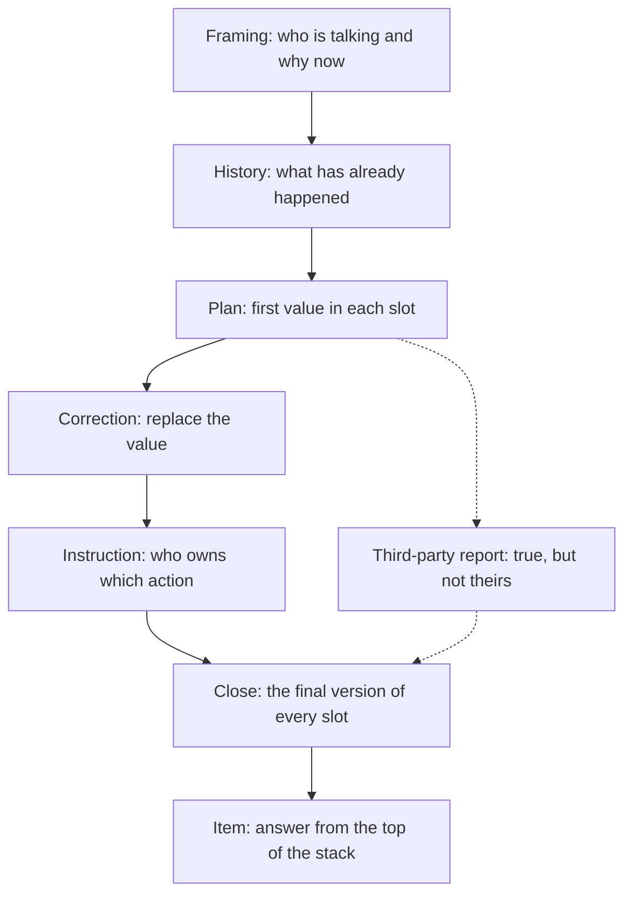

# Part 2: Following a Clinical Exchange

The OET Test Handbook 2026 gives the Listening sub-test approximately 40 minutes of audio across three parts and 42 questions, with one mark for each correct answer and the score out of 42 converted onto the 0 to 500 scale. It also states the sentence that shapes how you prepare for this topic: "Listening and Reading are the same for all candidates, regardless of profession." Nothing here depends on knowing clinical vocabulary, and nothing here is specific to the twelve healthcare professions the handbook lists — a dentist and a veterinary nurse sit the same listening paper.

The three parts are StudyRoadmap's own organisation of that audio, not a structure the handbook publishes. The handbook gives no per-part question distribution, so this note will not tell you how many of the 42 items fall in Part 2 or how many minutes of the audio it occupies. Treat both as unknown. What the subject data does support is the shape of Part 2: a longer professional dialogue, tested with note-completion and multiple-response items, requiring you to track several exchanges at once without losing the thread.

That last clause is the whole topic. Part 1 asks you to catch a stated detail, once, quickly, against a distractor of the same type. Part 2 asks you to hold a state. In a longer clinical exchange the value you need for a given slot — the preparation, the test, the service, the person who will do it, the time it happens — is often proposed, revised, qualified and re-stated before the item arrives. The candidate who writes down the first value heard ends the call with tidy notes and wrong answers. The candidate who keeps the final version of every slot ends it with right ones. Everything below is about telling those two candidates apart.

### 🟢 Lite — Quick Review (1h–1d)

**Memory hook — THREAD.** Six moves, used in this order on every exchange.

- **T — Turn type.** Classify the turn before you write: framing, history, plan, correction, instruction, close.
- **H — Headline state.** Keep one current value per slot, not a list of values per slot.
- **R — Replace rule.** A later statement about the same slot replaces the earlier one.
- **E — Evidence speaker.** Who said it, and was it a decision, an instruction, or a report about somebody else?
- **A — Answer slot.** The gap you are filling, decided before the audio reaches it.
- **D — Discard.** Everything else you heard.

**The one-line rule.** In a clinical exchange, answer from the last version of each slot, never the first.

**The six turns of the exchange.**

| Turn | What the speaker does | What it does to your notes |
|---|---|---|
| Framing | Sets who is talking, about what, and why the call is happening | Names the slots that will be filled later |
| History | Gives the background and what has already been done | Fills "already known" slots; not the current plan |
| Plan | States what is going to happen | Writes a first value into a slot |
| Correction | Withdraws or replaces part of the plan | Pushes a new value; the old one is dead |
| Instruction | Assigns an action to a named role | Fills "who does what" |
| Close | Summarises who is doing what and when | Usually the version that lands in the gap |

**The slots that get revised.** Preparation, form, route, timing, frequency, duration, the investigation, the referral destination, who reviews it, what the patient is told, and what happens if a result comes back different.

**Traps that cost marks.**
- Answering with the first value heard for a slot that is later revised.
- Keeping a value after it has been explicitly withdrawn.
- Selecting an option that is clinically true but was never said in the exchange.
- Selecting a true statement attributed to the wrong speaker.
- Treating a third-party report as a decision taken on the call.
- Transcribing the clause the audio used instead of the word the gap wants.
- Missing the grammatical cue that tells you what kind of word the gap needs.
- Reading the options during the audio instead of listening for the slot.

**Revision bullets.**
- One slot, one current value. Strike out the old one.
- Write the speaker next to the value, so a report never masquerades as a decision.
- Fix the answer slot before the exchange reaches it.
- A report is not a decision, and an instruction is not advice.
- If the gap wants a noun, a noun goes in it, however the audio phrased it.

**Where this tier takes you next.**
- [the other topics in this section](/notes/oet/listening/)
- [where this topic sits in a month-long plan](/roadmap/?exam=oet&duration=1mo)

### 🟡 Standard — Regular Study (2d–2mo)

#### The exchange as six moves

A clinical exchange is not a conversation, it is a structured negotiation with a beginning, a middle, a correction and a summary. Recognising the move you are in tells you whether to write, to overwrite, or to stop writing.

| Move | What you hear | What you write | The trap |
|---|---|---|---|
| Framing | Who is talking, why the call is happening | The slots that are coming | Treating the framing as skippable background |
| History | What has already happened | Almost nothing | Recording history as the current plan |
| Plan | A first proposal | The first value in the slot | This is the value that gets revised |
| Correction | A withdrawal or a replacement | The new value, old one struck out | Keeping both in the margin |
| Instruction | An action assigned to a role | Who owns which action | Writing the action without its owner |
| Close | A summary of who does what and when | The final values | Skipping it because it sounds repetitive |

The history trap deserves its own line, because it is the most common one. "The patient has already been started on the twice-daily preparation" tells you what happened, not what is planned. History fills the past tense of the slot; the plan fills its present tense. If a slot has only history in it, the slot is still empty when the item asks about it.

#### The replace rule in practice

An exchange that revises a value sounds like this — illustrative, not an actual test item:

> "I'd start her on the twice-daily preparation while we wait for the bloods."
> "Okay. If the bloods are clear we can step down to the once-daily one before the weekend."
> "So the plan is the once-daily one from Friday, but the twice-daily one until then?"
> "Until the bloods come back, yes. After that, once daily."

The twice-daily preparation was correct as of the first turn and wrong as of the last. Which answer is right depends entirely on the item: asked what she is on now, it is the twice-daily one; asked what she is on from Friday, it is the once-daily one. The audio carries both and the item decides. What you cannot do is decide on the first hearing.

Note the conditional in that exchange. "If the bloods are clear we can step down" is not the same as "we will step down", and an item asking what has been agreed about the weekend is answered by the agreed default, not by the branch that depends on a result still in the lab.

#### Multiple-response items: only what was said

A multiple-response item asks you to select options that the speakers actually committed to. Three knocks decide each option.

1. **Who said it?** The words must come from one of the two participants, not from somebody they report.
2. **In what form?** A decision, an instruction, an offer or a report are not interchangeable.
3. **Did it survive?** If it was said and then revised or withdrawn, the version that counts is the final one.

| Option you are tempted by | Why it is wrong | The question that kills it |
|---|---|---|
| True in the world, never said | Clinically sound but absent from the audio | Did anyone actually say this? |
| Said earlier, then revised | The earlier version is dead | What is the final version? |
| Said, but by the other participant | The wrong speaker made it | Which of us said it? |
| Said about a third party | A report, not a decision by the speakers | Who made the call here? |
| Floated as advice, never accepted | An offer that was dropped | Was it agreed? |
| The right fact in the wrong slot | It belongs to another item | Which gap does this fill? |

The pattern holds across the sub-test: plausible alternatives are included deliberately, and the correct option is regularly less obvious on the page than the distractors.

#### Note completion: match the gap, do not transcribe

A note-completion item gives you a skeleton and the audio gives you the flesh. The skeleton is not a transcript waiting to be filled word for word — it is a set of frames, and the frame tells you what kind of word belongs in it.

| The frame | It wants | Example |
|---|---|---|
| "Continue the ______ preparation" | A modifier or adjective | "twice-daily" |
| "Referral to ______ for review" | A place or a service | "the day unit" |
| "Next step: ______ the patient in clinic" | A verb | "review" |
| "The result will be ______ by the team" | A passive participle | "reported" |

Two habits follow. Read the whole skeleton before the audio starts, so you know which slots exist and roughly what shape they take; and write the frame's word rather than the speaker's clause. If the note says "Preparation to change to: ______" and the audio says "we'll step her down to the once-daily preparation once the bloods are back", the gap takes the word, not the sentence.

A second, subtler trap sits in the frame. A clinical synonym that the speaker did not use is a guess even when it is accurate, because the item is asking what was said in a particular shape. "Spoken to" and "briefed" are not interchangeable in "the patient is to be ______ about the change before Friday".

#### Attribution: decisions, reports and instructions

Three kinds of statement turn up in an exchange and they are not interchangeable. A decision is taken on the call now. An instruction assigns an action to a role. A report conveys what somebody else said.

"The lab rang and said the result is normal" is a report of a result. It does not tell you that the antibiotics stop. If the exchange then says "so we can stop them today", that second sentence is the decision, and the first is background to it. "I'll send the referral this afternoon" is the speaker's own commitment; "you should send the referral this afternoon" puts the action on the listener, and in a listening paper that difference is exactly what an item can test.

Modality is covered at length in the sibling topic Listening for Attitude, Modality and Register. In a Part 2 exchange modality decides whether a value in your notes is live or merely reported, which is why the two topics reinforce each other.

#### Worked example 1 — the preparation that changes mid-exchange

**Question shape.** An item asks what the patient will be taking once the blood results are back, with options covering: the twice-daily preparation; the once-daily preparation whatever the results show; the once-daily preparation, with the twice-daily one kept if the bloods are not clear; and no change until the results are discussed.

**Exchange.** "I'll continue the twice-daily preparation while we're waiting for the bloods." — "And once those come back, can we go down to the once-daily one?" — "Yes. From then we go down to the once-daily. Unless the bloods are not clear, in which case we keep her on the twice-daily and discuss it at the team meeting." — "So from then, once daily, unless the bloods are not clear." — "That's right."

**Step 1 — find the slot.** The item asks about the period after the results. The "until the results are back" state is therefore out of scope even though it is a large part of the audio.

**Step 2 — track the versions.** Twice-daily (turn one) → once-daily proposed (turn two) → once-daily with a retained exception (turn three) → confirmed in the summary and closed with "That's right" (turns four and five). The bare "once-daily" was an intermediate version, not the agreed one.

**Step 3 — check the exception.** "Unless" marks a branch the speakers kept inside the plan, not a doubt about it. An exception named in the plan is part of the plan.

**Step 4 — answer.** The once-daily preparation, with the twice-daily one kept if the bloods are not clear.

> ⚡ **Examiner Trap.** Stopping at turn three, where the plan sounded settled, gives the bare once-daily option and loses the exception. The other trap is reading "unless" as "only if": that converts an agreed default into a conditional that may never fire, and the item about "once the results are back" then has no answer at all. Read the closing summary — it is where the final version of every slot usually lands.

#### Worked example 2 — a gap that wants a noun, not a clause

**Question shape.** The notes read:

> Plan agreed:
> - Continue the ______ preparation until the blood results are back
> - Step down to the once-daily preparation afterwards, unless the results are not clear
> - Referral to ______ for review
> - Patient to be ______ about the change before Friday

**Exchange.** "So we'll keep her on the twice-daily one until we see the bloods. After that we step down to the once-daily, unless the bloods aren't clear. I'm sending the referral over to the day unit for them to review, and I'll speak to her this afternoon to go through the change before Friday."

**Step 1 — read the frames first.** "Continue the ______ preparation" wants a modifier. "Referral to ______ for review" wants a service. "Patient to be ______ about the change" wants a passive verb form.

**Step 2 — write the word, not the clause.** The audio says "keep her on the twice-daily one", so the gap takes "twice-daily", not "keep her on the twice-daily preparation".

**Step 3 — fill the service.** "Sending the referral over to the day unit" gives "the day unit" — a place or a service, which is what the frame requires.

**Step 4 — fill the verb.** "I'll speak to her" becomes "spoken to" in a "to be ______ about" frame. The clinically tempting alternative "briefed" fits the frame too, and that is the problem: it was not said, and the item is not asking what could have been said.

> ⚡ **Examiner Trap.** Writing the whole clause into the gap because that is how the audio said it. The second trap is substituting a synonym that a clinical reader would consider better English. The third is letting the second line of the notes, which already contains "once-daily", pre-fill the first gap.

#### Worked example 3 — two speakers, one plan, and a report from outside

**Question shape.** An item asks what will happen once the referral has been received, with options covering the day unit contacting the patient, the nurse telephoning the patient, the day unit taking the bloods, and the team meeting being rescheduled.

**Exchange.** "The nurse rang to say the bloods will be taken before the review, so we'll have them when the referral arrives. I'll send the referral over to the day unit this afternoon. As for the preparation, she stays on the twice-daily until the results are back, unless the bloods aren't clear, in which case we'll discuss it at the team meeting. And the day unit will contact the patient about the appointment."

**Step 1 — find the slot.** The item asks about what follows the referral, so the preparation sentence is context and the referral sentence is history.

**Step 2 — discard the report.** The bloods sentence is what the nurse said. It is the most concrete and most specific line in the exchange, which is exactly why it tempts you, and it is not a statement by either speaker about the next step.

**Step 3 — take the final version of the slot.** The closing turn names the day unit contacting the patient about the appointment. Nothing later revises it, so it is the live value.

**Step 4 — answer.** The day unit contacts the patient.

> ⚡ **Examiner Trap.** Answering with the bloods because it was said first and in detail. The second trap is the option that re-attributes the day unit's job to the nurse, which confuses who reported a fact with who holds the task. The third is assuming the referral sentence is the answer, since the item mentions the referral — the referral is the trigger, not the event being asked about.

#### Common mistakes

Writing the first value for a slot that is later revised, because the first version was said confidently and the second was said quietly.

Treating a report from a third party as an agreement by the speakers.

Keeping two versions of a slot in case one is wrong, which guarantees you read the wrong one at the item.

Copying the clause the speaker used into a gap that wants a word, and filling the wrong word class.

Ignoring the frame of the gap and writing what the audio said first.

Answering from clinical expectation rather than from the audio, which is where the "plausible alternative" distractors get their power.

Letting the close of the exchange pass unmarked, because it sounds like repetition and it is the turn that confirms the final version of every slot.

Assuming a multi-response option is right because it is true. The test is whether it was said here, by these speakers, in this form, and whether it survived to the end.

### 🔴 Extended — Deep Study (3mo+)

#### The state stack, and why a linear list fails you

Model the exchange as a stack with one entry per slot. Each entry holds the current value and the speaker who gave it.

- A turn that mentions a known slot **pushes** a new value, overwriting the old one.
- A turn that withdraws **pops** the entry and leaves the slot empty until a replacement arrives.
- A turn that opens a new slot **creates** it.
- An item is answered from the **top** of the stack.

A linear list, the obvious alternative, puts the first value at the top and the last value at the bottom — that is, exactly reversed. This is why candidates report having heard the right information and still chosen the wrong option: the value was in their notes and the ordering was not. The stack is not a metaphor for a technique you already use; it is the technique.

#### Correction, elaboration, and the third kind

Later turns relate to earlier ones in one of three ways, and the relation decides what you write.

| Relation | What happened | What you do |
|---|---|---|
| Correction | Same slot, incompatible new value | Replace; the old value is dead |
| Elaboration | A new slot with extra detail | Keep both; nothing was replaced |
| Withdrawal | The old value is retracted, not replaced | Leave the slot empty; write nothing yet |

The test that separates them is simple: could the new statement and the old one both be true at the same time? If yes, it is elaboration. If no, it is a correction. "Not the tablet — the liquid" and "and we should also check renal function" look identical on the page and behave oppositely in your notes.

Withdrawal is the one that catches people, because nothing replaces the value that was withdrawn. A speaker who says "sorry, I gave you the wrong unit, let me check" has not revised the slot; they have emptied it. If you keep the withdrawn value you will answer with a number that both speakers disowned.

#### The Part 2 distractor taxonomy

Six families of distractor do most of the work in this part, and each has its own kill.

| Family | How it is built | How you kill it |
|---|---|---|
| The superseded value | A real value from earlier in the exchange | Apply the replace rule; find the final version |
| The unsaid truth | Clinically correct, absent from the audio | Ask whether anyone said it here |
| The misattribution | A real statement given to the wrong speaker | Ask which participant made it |
| The third-party report | True, but sourced from outside the call | Ask who holds the decision |
| The dangling offer | Advice floated and never accepted | Ask whether it was agreed |
| The near-match | The right shape with a different value | Listen to the whole sentence, not the value |

The near-match is the one that only exists in Part 2. A Part 1 distractor is usually a different number of the same type. Here it is the same slot, the same shape, and a value that differs by one detail, and the detail is decided in the last third of the exchange. Treating the item as a detail-catching exercise rather than a state-tracking exercise is what makes near-matches work.

#### Edge cases

**Overlap.** Two speakers talking at once. Do not try to catch the overlapped words; wait for the completed turn, because the interrupted speaker almost always returns to it and completes it. An overlapped fragment is a distractor's raw material, not an answer.

**The reply that is a question.** A speaker who answers with a query has not agreed. "So we can go down to the once-daily one?" is a question; the agreement is in the next turn. This is the same machinery as the sibling topic's advice-versus-instruction distinction, applied to an exchange rather than a single statement.

**The third voice.** A colleague interjecting, a patient audible in the room, someone on a speakerphone in the background. Attribute the words to the nearest speaker and remember that an interjection is not an instruction. If the words come with a name attached — "the nurse rang" — they are a report.

**The repeated value.** The same value stated twice, once in passing and once in the plan. The one in the plan is the one the item wants, and the fact that it was repeated at all is a strong hint about which slot the item is probing.

**No going back.** The Listening sub-test runs to approximately 40 minutes of audio and 42 items across three parts, one mark per correct answer and no partial credit. There is no revisit for an item you could not place while the exchange was happening, so the decision has to be made there, and an item you can neither place nor plausibly infer is worth nothing. Decide during the exchange; do not carry it.

**Numbers and names.** The transcription discipline for digits and spellings has its own topic, Numbers, Names and Spellings Under Time Pressure. The Part 2 twist is that the number you need is usually the revised one, so the transcription skill and the state-tracking skill have to be applied at the same time to the same sentence.

#### Memory anchors

**THREAD**, each letter tied to a physical action rather than a slogan.

- **T — Turn type:** as you hear a turn, name it silently — framing, history, plan, correction, instruction, close. Naming takes no extra time and stops history being filed as plan.
- **H — Headline state:** one line per slot, one value per line, written in the present tense.
- **R — Replace:** strike the old value through as you overwrite. Do not erase it either — the struck value is your evidence that you heard a revision at all.
- **E — Evidence:** a name or a role next to every value. A value with no speaker is a value you cannot classify.
- **A — Answer slot:** decide the gap before the exchange reaches it, and let the audio confirm rather than introduce it.
- **D — Discard:** everything else. A tidy sheet of notes with one current value per slot beats a complete transcript every time.

**One slot, one value.** The motto for the whole part. A note that contains two versions of a slot is a note that contains no answer.

#### ⚡ Quick Exam Checklist

- Turn classified before it is written: framing, history, plan, correction, instruction, close
- History never filed as the current plan
- One slot, one current value, old values struck through rather than kept
- Withdrawal treated as emptying the slot, not as a revision
- Speaker recorded next to every value
- Reports, decisions, instructions and advice kept apart
- Multi-response options tested with three knocks: who said it, in what form, did it survive
- The final version of a slot taken from the closing summary
- Gaps filled with the frame's word class, not the speaker's clause
- Clinical synonyms rejected when they were not the words spoken
- Third-party statements excluded from what the speakers agreed
- Near-match distractors killed by listening to the whole sentence
- No revisit available: every item decided during the exchange
- 42 items, one mark each, approximately 40 minutes of audio across three parts, no partial credit
- Score reported on the 0 to 500 scale with its own letter grade, not as a total across the four sub-tests
- Listening and Reading identical for every candidate, so this skill is the same whatever your profession
- The handbook publishes no per-part question distribution, so this part's share of the 42 items is unknown rather than guessed

**Where this tier takes you next.**
- [the fastest of the parts to move](/notes/oet/listening/)
- [a one-day sprint over the highest-weight topics](/roadmap/?exam=oet&duration=1d)

## Internal links

- [OET exam hub](/exams/oet/) — the four sub-tests, the 0 to 500 scale, the grade bands and the regulators that accept the result.
- [Part 1: Identifying Specific Detail](/notes/oet/listening/) — the faster and more mechanical part, where the answer is stated once.
- [Part 3: Extended Monologue or Consultation](/notes/oet/listening/) — the single-speaker end of the sub-test, tested with note and summary completion.
- [Listening for Attitude, Modality and Register](/notes/oet/listening/li-004/) — where the advice, instruction and report distinctions are set out in full.
- [Numbers, Names and Spellings Under Time Pressure](/notes/oet/listening/) — the transcription discipline that runs alongside the state-tracking in this part.
- [Reading](/notes/oet/reading/) — the other sub-test that is identical for every profession.

Every fact about the Listening sub-test on this page — approximately 40 minutes, three parts, 42 questions, one mark per correct answer converted from a score out of 42 to the 500 scale, the 0 to 500 scale with its letter grades, and the statement that Listening and Reading are the same for all candidates regardless of profession — comes from the official OET Test Handbook 2026 (https://cdn-aus.aglty.io/oet/pdf-files/OET%20Test%20Handbook%202026.pdf), fetched and read directly on 23 October 2026. The handbook publishes no per-part question distribution and no per-part timing; the three-part split and the weights on this page are StudyRoadmap's own organisation and prioritisation.

---

## Continue your study

- **[View this topic in your OET (Occupational English Test) roadmap](/roadmap/?exam=oet&duration=1mo)** — see where this topic sits in your personalised plan
- **[Build a quick revision plan](/roadmap/?exam=oet&duration=1d)** — 1-day sprint covering the highest-weight topics
- **[OET (Occupational English Test) exam overview](/exams/oet/)** — pattern, eligibility, and syllabus
- **[All Listening notes](/notes/oet/listening/)** — browse sibling topics in this subject
