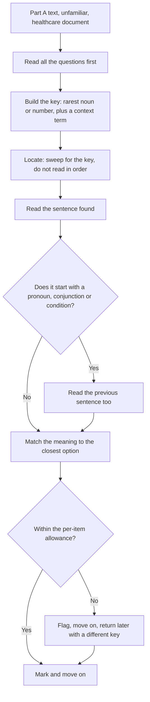

# Part A: Expeditious Reading for Detail

The official OET Test Handbook 2026 sets out the Reading sub-test as 60 minutes, three parts and 42 questions, and states that "Part A takes 15 minutes. Parts B and C take 45 minutes." Each correct answer earns one mark, and the score out of 42 is converted to the 0 to 500 scale on which every sub-test is reported. The handbook also states that Listening and Reading are the same for all candidates, regardless of profession — which means the material in front of a dentist and a vet in Part A is identical.

What makes Part A different from the other two parts is not the topic but the task. In Part B and Part C you read a text in order and work out what it means, what it argues and what the author thinks. In Part A you do not read the text in order at all. You are given a question, and then you go and find the answer in a text you have never seen. The skill is retrieval under a clock, and the handbook's word for it is expeditious reading.

That has a practical consequence which governs everything else on this page: **the answer is in the text, and the question tells you roughly where to look.** You are not being asked whether you understood an argument. You are being asked to locate a fact and report it accurately. Two candidates can read the same paragraph word for word and score differently, because one read it in order and the other read it hunting.

### 🟢 Lite — Quick Review (1h–1d)

**The hunt, in four moves.**

1. **Read the question first.** The stem tells you what kind of answer you want.
2. **Build a search key.** Take the rarest word in the stem — a specific noun, a number, a technical term, a place, a proper name. Not the commonest word.
3. **Locate.** Sweep the text for the key. Do not read the surrounding paragraphs.
4. **Verify.** Read the sentence you found, then the sentence before it if the sentence starts with a pronoun or a conjunction. Confirm the answer says what you think it says.

**The four question types and what each demands of you.**

| The question asks | What you are looking for | The trap |
|---|---|---|
| A specific detail | The exact fact, in the text's own words | Reading past it because it is boring |
| When or how often | A date, a frequency, a duration | Two similar time expressions in the same paragraph |
| Who or where | A person, a role, a place, a department | The most memorable name, which is not the right one |
| Why or what for | The stated reason or purpose | Your own plausible reason instead of the stated one |

**Paraphrase is expected.** The options are written in different words from the text, so searching for the option's exact wording will fail. Find the meaning, then match it to the closest option.

**Distractors are same-type.** The wrong option is the right shape with the wrong detail — a different number, a different ward, a different time. That means it cannot be eliminated by plausibility; it can only be eliminated by reading precisely.

**Your budget.** The handbook gives Part A 15 minutes. Before you start, divide 15 by the number of items on the page and set that as your per-item allowance. If the section has ten items, that is 90 seconds each. When the allowance is spent, move on.

**Traps that cost marks.**

- Reading the whole text before looking at the questions.
- Searching for the option's wording rather than the meaning.
- Stopping at the first sentence containing the search word.
- Skipping back a line when a sentence begins with "This", "It", "They" or "However".
- Spending four minutes on one stubborn item because it feels more important than the others.
- Choosing a distractor because it is the most medically plausible rather than the most textually supported.

**Memory anchors.**

- **Q-K-L-V** — question, key, locate, verify.
- **Hunt, do not read.** Part A is retrieval.
- **Rarest word wins.** The search key is the least common word in the stem, never the commonest.
- **Same-type distractors.** Plausibility cannot save you; only precision can.
- **Budget first.** 15 minutes divided by the number of items, decided before you start.

**Where this tier takes you next.**

- [Part B: matching headings and paragraph functions](/notes/oet/reading/)
- [Part C: inference, attitude and gist](/notes/oet/reading/re-003/)
- [the OET exam hub](/exams/oet/)

### 🟡 Standard — Full Coverage (1–2d)

#### What Part A texts look like

The Part A texts are short, factual and taken from healthcare documents. The register is administrative and institutional rather than narrative: a hospital policy on infection control, a patient information leaflet, an extract from a clinical guideline, a medicines information sheet, an occupational health notice, a research abstract, a hospital discharge or referral information sheet, a public health campaign leaflet. You are not being asked to follow an argument. You are being asked to read a document as a professional would read it: quickly, looking for the one thing you need.

Two features of this genre are worth knowing before you sit the paper. **Documents contain numbers, dates, times, quantities and named roles**, and they contain them densely, often in a list, often in a table-like sentence. That is exactly the material the Part A questions are built from, because a specific detail is easy to check and easy to make a same-type distractor for. **Documents also carry an institutional voice** — "patients should be advised", "staff must", "the service will" — and the questions often test whether the stated obligation belongs to a named group.

#### The anatomy of a Part A question

Most Part A items have three layers, and reading them in the right order saves time.

**Layer one: the topic.** The subject the question is about. "Regarding the visiting policy…", "In relation to infection control…", "For the referral process…"

**Layer two: the question type.** What kind of answer is wanted. "Who…", "How long…", "What should the patient be told…", "Which department…"

**Layer three: the options.** Usually four, always the same shape as the answer.

Read layers one and two, then build the key from layer two, then hunt for it. Reading the options first is the single most common time-waster, because the options are written in a vocabulary that does not match the text, and hunting for their exact words teaches you nothing about where in the text to look.

#### Building a good search key

A search key has to be both **rare** and **findable**. Rank the candidate words in the stem this way:

1. **Proper nouns and specific names** — the name of a drug, a ward, a service, a document. Rare and unique.
2. **Numbers, dates, times and quantities** — the fastest anchors in any document. If the stem says "how long", look for a duration.
3. **Technical terms of two words or more** — "clinic", "postnatal", "discharge", "medication".
4. **Unusual verbs and adjectives** — "escalate", "deferred", "routine", "urgent".
5. **Common nouns** — "staff", "patient", "service". Almost useless alone; use them only to confirm a candidate sentence.

Then add a **context term**. A single rare word can appear twice in a document in different contexts, so the key often needs a pair: a rare word plus a qualifier. "Referral" plus "community", "shield" plus "vaccination".

#### Worked example: a hunt in a patient leaflet

**The text.** A hospital patient information leaflet on preparing for an outpatient appointment. It contains, among other things: "Bring a list of all medicines you take, including those bought over the counter and any supplements. If you cannot remember the names, photograph the boxes and bring the photographs. Arrive ten minutes early so that you can complete the registration form. If you need an interpreter, telephone the booking office at least five working days before your appointment date."

**Question.** *How much notice does a patient need to give if they need an interpreter?*

**Step one — topic.** Appointment preparation.
**Step two — question type.** A duration or a period of notice.
**Step three — key.** "interpreter" is rare in the leaflet; "five working days" is the kind of detail the question wants. Key pair: *interpreter* + *days*.

**Locate.** The interpreter sentence is near the end of the leaflet. Read it: "telephone the booking office at least five working days before your appointment date."

**Verify.** The preceding clause is "If you need an interpreter," so the condition is attached to the whole instruction. The answer is five working days.

**The distractor.** The leaflet also contains "arrive ten minutes early" and "at least five working days". Both are durations, both involve numbers, both are in the same paragraph. A candidate who hunts for "days" but not for "interpreter" lands on the right sentence and still picks wrong, or lands on "ten minutes". This is what same-type distractors look like in practice: the number is right there and it is about the wrong thing.

#### The paraphrase problem

The options are never in the text's words. Expect these four moves:

- **Synonym substitution.** "Telephone the booking office" in the text becomes "contact the appointments team" in the options. The concept is the same; the words are not.
- **Nominalisation.** "Five working days" becomes "a period of notice" or "the lead time required".
- **Passive-to-active.** "Patients must bring" becomes "the patient is required to bring".
- **Generalisation.** "Over the counter medicines and supplements" becomes "all medication, including non-prescribed items".

So: find the meaning, then choose the option that carries that meaning. When two options look close, check them against the sentence you found rather than against your memory of it. The sentence is the authority.

#### Handling the four question types

**When or how often.** Documents are full of paired durations and you must keep them straight: "arrive ten minutes early" against "five working days before the appointment"; "within 24 hours" against "at the next visit". When you find a duration, read the sentence before it to check that the duration belongs to the right action.

**Who or where.** Roles are the common answer here — the booking office, the ward, the clinical nurse, the phlebotomist, the pharmacist. Two roles in the same sentence are the classic trap. And institutional voice ("the service will contact you") does not tell you which member of staff will do it.

**Why or what for.** Documents state their reasons explicitly and in a flat declarative way. Find the stated reason, not your own explanation. If the text says the form must be completed before arrival "because the clinic list is closed on the morning of the session", the reason is the closure of the list, and an option about arriving early is not the reason.

**What should happen next.** This is a sequence question. Documents with steps have a natural order and the options are usually three or four consecutive steps with one substituted. Find the step in question, then read forward one or two sentences to see what the document says happens next.

#### Timing: the budget that decides your Part A score

The handbook gives Part A 15 minutes and gives Parts B and C the remaining 45. Work the budget out before you begin.

**Divide 15 by the number of items.** Write the per-item allowance at the top of the page. If there are ten items, that is 90 seconds; if there are twelve, that is 75 seconds.

**Two passes are better than one.** First pass: answer every item you can locate quickly. Flag the ones where you cannot find the anchor within about half your allowance. Second pass, with the remaining time: return to the flags in order, and for each one, try a different key — a number instead of a noun, a different noun, a different document section.

**The hard stop is real.** When an item exceeds its allowance, mark it and move. A Part A item is a fact-finding exercise, so a stubborn item usually means your key is wrong, not that the answer is subtle. Changing the key is more productive than reading more of the paragraph.

**Never leave an item blank.** There is no penalty for a wrong answer in a computer-marked sub-test, so every unanswered item is a mark you have already lost. If you are out of time, choose the option that the text most nearly supports, on the balance of the sentence you did find.

#### What to do when the answer is not obviously in the text

Some Part A items ask what the text implies rather than what it states, and some ask about a detail that appears in a part of the document you have not reached. In both cases the same discipline applies: **go back to the sentence you found and read it properly**, including the sentence before it, because documents put the qualifier first and the main clause second. The phrase "provided that", "unless", "subject to" and "in cases where" carries the exception, and it usually sits at the start of the sentence or the start of the clause.

### 🔴 Deep — Mastery (3–5d)

#### The cascade: why a Part A overrun is expensive

The handbook's allocation is the whole reason Part A gets rehearsed separately. Reading is 60 minutes: Part A has 15, and Parts B and C share the other 45. So Part A is a quarter of the clock and, because Parts B and C are both longer and harder, they are the parts that cannot absorb a shortfall.

The arithmetic of a small overrun is brutal. If you lose six minutes in Part A because three items ran long, you arrive at Part B with six minutes fewer. Part B is a matching-headings task, and matching tasks slow down sharply when you have lost the thread of the text, so the six minutes lost in Part A does not cost you six minutes of Part B — it costs six minutes of Part B plus whatever the lost thread costs you. The candidates who score badly on Reading are usually not the ones who read badly; they are the ones who arrived at Part B already behind.

**The practical protocol.** Set the per-item allowance before you begin. Honour the allowance even when you are certain you are close to the answer, because the allowance is not per item, it is for the section. Keep a visible clock or use the on-screen timer. When the flag pass begins, work the flags in order of confidence, not of attractiveness: a flagged item whose key you can re-derive in ten seconds is worth more than one you merely feel you nearly solved.

#### Scanning, skimming, intensive reading: which part uses which

The three parts of Reading test three different operations, and using the wrong one is the most expensive single mistake a candidate can make.

| Operation | What it does | Which part | What it looks like when done well |
|---|---|---|---|
| Scanning | Locates a specific detail without reading the surrounding text | Part A | Eye jumps to the anchor, reads one sentence, moves on |
| Intensive reading | Reads closely for meaning, structure and attitude | Part C | Full sentences, with attention to hedges and modality |
| Skimming | Reads for overall structure and paragraph function | Part B | First and last sentence of each paragraph, plus the headings and any topic sentences |

Doing Part A intensively is slow and, oddly, less accurate, because reading a document in order is what allows a persuasive-sounding phrase to override the precise wording. Doing Part C by scanning is worse, because Part C questions are built to punish exactly that shortcut.

#### The trap you are being set

Same-type distractors are deliberate, and they are designed against a specific behaviour: reading for plausibility. In a well-designed Part A item, every option is something that could plausibly appear in the document. The wrong options are not nonsense; they are true statements about the document, or true statements about the world, that answer a slightly different question. The only way to eliminate them is to check each option against the sentence you actually located.

This produces a counterintuitive result worth understanding before you sit the paper: **the more carefully you read, the more likely you are to be caught.** A skimming reader who recognises a familiar phrase may lock onto it confidently. A careful reader who has located the right sentence will notice that the question asks about a different subject within that sentence. The resolution is not to read less carefully; it is to separate the two acts. Locate first, with the key. Verify second, with the full sentence and its qualifier. A candidate who merges the two steps verifies nothing.

#### Rehearsal protocol for Part A

**Do the question-first pass.** In every practice set, read all the questions for Part A before you look at the text. This is the single habit that transfers most directly into the exam.

**Time yourself in fifteen-minute blocks.** Not nine, not twelve. Fifteen, with a hard stop, so that the overrun reflex gets trained out of you rather than reinforced.

**Log your misses by cause, not by topic.** For each wrong answer, record one of: wrong key (you searched for the wrong word), anchor too early (you stopped at the first hit), qualifier missed (the sentence before or after carried the condition), paraphrase trap (the meaning was right and the option was a near-miss), or timeout. The distribution of causes tells you what to practise, and it is usually not what you expect. Most candidates have far more "anchor too early" and "qualifier missed" than "did not understand".

**Practise the flag pass.** Deliberately skip three items in the first pass and come back to them. The point is to rehearse the second search with a different key, and to prove to yourself that the answer is findable on the second attempt.

**Read healthcare documents outside the exam.** Leaflets, discharge information, hospital pages, guideline summaries. Five minutes each, question-first, with a timer. This builds the genre familiarity that makes the anchor obvious: when you know that leaflets state obligations in a particular way, you stop reading them in order and start reading them for the obligation.

#### Common mistakes

- Reading the text before the questions, which costs you the first minute and gives you no key.
- Using the commonest word in the stem as the search key.
- Stopping at the first occurrence of the key when the document uses the word twice in different contexts.
- Reading the found sentence without the one before it, and losing a condition or a negation.
- Choosing the most medically sensible option when the text says something less sensible. The document is the authority, and it is occasionally duller than the medicine.
- Letting a Part A item consume its whole allowance.
- Arriving at Part B with the text unread, so the matching task starts from scratch instead of from the structure you have already seen.
- Confusing Part A with Part C and trying to infer an attitude the question never asked for.

> ⚠️ **Examiner Trap.** Part A distractors are same-type on purpose: a duration swapped for a different duration, a ward swapped for a different ward, a role swapped for a different role. Nothing about them looks wrong on its face. The only defence is to hold the located sentence in your head and test each option against it word by word, which is why the verify step cannot be skipped when the answer feels obvious.

#### Memory anchors

- **Q-K-L-V** — question, key, locate, verify. The verify step is the one candidates skip.
- **Rarest word wins.** The key is the most unusual noun or number in the stem, never the commonest word.
- **Qualifier first.** Documents put conditions before main clauses: read the sentence before.
- **Same-type distractors.** Plausibility cannot eliminate them; only the located sentence can.
- **Budget before you start.** 15 minutes divided by the number of items, written down.
- **Locate, then read.** Part A is a hunt. Parts B and C are readings. Do not mix them.

#### ⚡ Quick Exam Checklist

- Questions read before the text, every time
- Key built from the rarest word in the stem, plus a context term
- Text scanned, never read in order, in Part A
- Anchor verified with the preceding sentence when the sentence opens with a pronoun, conjunction or condition
- Options matched on meaning, not on wording
- Every option tested against the located sentence rather than against plausibility
- Per-item allowance calculated from the 15 minutes before the section starts
- Flagged items revisited in the second pass with a different key
- No item left blank
- Part A finished within its 15 minutes, so Parts B and C receive their 45
- Numbers, dates, times and named roles treated as the highest-value anchors
- Paraphrase, nominalisation and passive constructions handled without alarm
- Institutional voice read as obligation: who is required to do what
- Sequence questions answered by reading forward from the located step
- Genre familiar with: leaflets, policies, guideline extracts, abstracts, discharge sheets
- Part A, B and C operations kept distinct — hunt, structure, meaning

**Where this tier takes you next.**

- [Part C: inference, attitude and gist](/notes/oet/reading/re-003/)
- [all Reading notes](/notes/oet/reading/)
- [the OET exam hub](/exams/oet/)

## Internal links

- [OET exam hub](/exams/oet/) — the four sub-tests, the 0 to 500 scale, the grade bands and the regulators that accept the result.
- [Part C: Inference, Attitude and Gist](/notes/oet/reading/re-003/) — the other end of the Reading sub-test, where you read for meaning rather than for a located fact.
- [Time Management Across the 60 Minutes](/notes/oet/reading/) — the part that decides whether the Part A budget survives.
- [Listening](/notes/oet/listening/) — the other sub-test that is identical for every profession, and the same locate-and-verify discipline in a different medium.

The Reading sub-test facts on this page — 60 minutes, three parts, 42 questions, "Part A takes 15 minutes. Parts B and C take 45 minutes", one mark per correct answer with the score converted to the 500 scale, and Reading being the same for all candidates regardless of profession — come from the official OET Test Handbook 2026 (https://cdn-aus.aglty.io/oet/pdf-files/OET%20Test%20Handbook%202026.pdf), which this worker fetched and read directly on 24 October 2026. The weight on this page is StudyRoadmap's own prioritisation.

---

## Continue your study

- **[View this topic in your OET (Occupational English Test) roadmap](/roadmap/?exam=oet&duration=1mo)** — see where this topic sits in your personalised plan
- **[Build a quick revision plan](/roadmap/?exam=oet&duration=1d)** — 1-day sprint covering the highest-weight topics
- **[OET (Occupational English Test) exam overview](/exams/oet/)** — pattern, eligibility, and syllabus
- **[All Reading notes](/notes/oet/reading/)** — browse sibling topics in this subject
