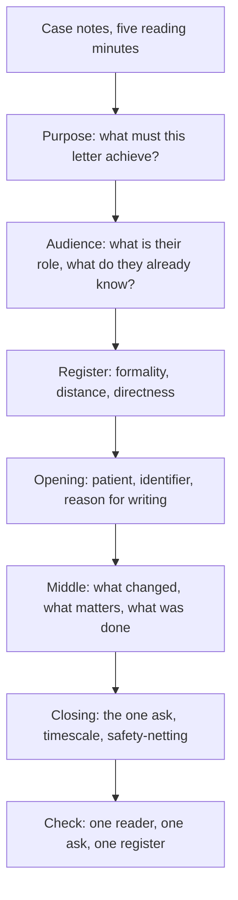

# Purpose, Audience and Register

The OET Test Handbook 2026 gives the Writing sub-test one task of 45 minutes, made up of five minutes of reading time and forty minutes of writing time. The task is a letter written in response to a set of case notes, and the handbook defines its reader precisely: you write to another health professional caring for the patient, and the notes outline that patient's condition. That definition is doing a great deal of work, because it settles the audience before you have read a single case note. The reader is not the patient, not the family, and not the examiner.

Writing and Speaking are the two profession-specific sub-tests. The handbook states that Listening and Reading are the same for every candidate regardless of profession, while Writing is tailored to the candidate's profession, and the twelve professions it lists — Dentistry, Dietetics, Medicine, Nursing, Occupational Therapy, Optometry, Pharmacy, Physiotherapy, Podiatry, Radiography, Speech Pathology and Veterinary Science — each bring their own case notes. The consequence for this topic is direct. In every other sub-test you are a candidate sitting an exam; here you are a clinician writing to a colleague, and the mark depends on whether the letter sounds like it came from someone who knows what that reader does.

The handbook states that the writing sub-test is assessed using six criteria whose scores combine and converted to the 500 scale on which every sub-test is reported, with grade bands at A 450 to 500, B 350 to 440, C+ 300 to 340, C 200 to 290, D 100 to 190 and E 0 to 90. Purpose, audience and register are not headings in that criteria list, but they are the mechanism by which most of those criteria are won or lost. A letter can be accurate, well organised and grammatically clean and still fail on appropriateness, because it was written for a reader who was never in the room.

### 🟢 Lite — Quick Review (1h–1d)

**Three questions, asked in this order, before the first sentence.**

- Purpose — what must this letter achieve?
- Audience — who is reading it, and what do they already know?
- Register — how formal, how distant, how direct should it be?

Purpose constrains audience and audience sets register. Solved in a different order, they produce a beautifully written letter to the wrong person.

**One document, one reader, one ask.** The handbook says the letter goes to another health professional caring for the patient. So there is a single addressee who is inside the care pathway, and a single closing action that the reader is expected to take. If your draft contains two unrelated asks, it has no purpose: keep the one the reader can act on.

**The three purposes the task is built from.**

| Purpose | The reader is | The letter leads with | The letter ends with |
|---|---|---|---|
| Referral | A clinician who will assess the patient | Why the patient is being sent | A specific request, and what you want back |
| Discharge summary | A clinician who will take over continuing care | The episode and how it ended | What to watch, and what to do if it recurs |
| Care instruction | A professional who will carry out or advise on a step | The instruction and its indication | Confirmation of what was arranged or done |

**Three axes of register.**

- Formality — how much of the reader's context you may assume.
- Distance — "you", "we", or the passive voice.
- Directness — how plainly the request is stated.
- Register is set by the reader's role, not by the seriousness of the case.

**Traps that cost marks.**

- Writing to the patient because the notes are addressed to the patient.
- Reusing one letter template across audiences and changing only the name.
- Opening with background the reader already holds.
- Burying the request inside a hedge.
- Hiding the request in the final paragraph.
- Drifting into chat register in the closing line.
- Over-formality towards a peer clinician: "I would be most grateful if you could possibly consider..."

**Revision bullets.**

- Purpose, audience, register — answered in that order before drafting.
- One ask per letter.
- Lead with the reason for writing, not with the history.
- Every request gets a subject, a verb and, where it matters, a timescale.
- Summarise the notes; never transcribe them.
- Keep the closing line in the same register as the opening line.

**Where this tier takes you next.**

- [the Writing task and its five reading minutes](/notes/oet/writing/wr-001/)
- [Reading, the sub-test that is identical for every profession](/notes/oet/reading/)
- [Listening, likewise](/notes/oet/listening/)
- [the OET exam hub and its four sub-tests](/exams/oet/)

### 🟡 Standard — Regular Study (2d–2mo)

The official OET Test Handbook 2026 sets out the Writing sub-test as one task of 45 minutes in total, given as "5 minutes reading time and 40 minutes writing time", and states that the candidate writes a letter to another health professional caring for the patient in response to a set of case notes outlining the patient's condition. The sub-test is tailored to the candidate's profession and is assessed using six criteria whose scores are combined and converted to the 500 scale.

That single sentence contains three decisions you have to make before you write anything: what the letter is for, who it is for, and therefore how it should sound. This topic is those three decisions, because they are where most of the writing marks are decided.

#### Purpose: a letter is a request with a shape

Every clinical letter exists to move the patient forward, and that movement has a direction: something happened, something is needed, or something is being handed over. Name which one you are writing before you choose a sentence.

Three directions, and they look different on the page. A **referral** exists to move the patient into someone else's care, so it ends with what you want that clinician to do and what you want back from them. A **discharge summary** exists to hand over continuing care, so it ends with what the next clinician should watch for. A **care instruction** exists to get a specific step carried out or advised on, so it ends with confirmation that it has been arranged or done.

Purpose also decides what you leave out. A referral does not need the patient's childhood history; a discharge summary does not need a fresh referral rationale; a care instruction does not need a narrative of the whole admission. Material that does not serve the purpose is not neutral — it dilutes the request that does.

#### Audience: read the reader out of the notes

The reader is a health professional caring for the patient, but the notes will not say "write to the pharmacist". They will contain cues. Read them in the five reading minutes and fill in three things: what this reader's role is, what they already know, and what they have to do next.

| Cue in the case notes | What it tells you | Register consequence |
|---|---|---|
| A named role, such as a ward pharmacist or a community nurse | That role's scope and what they can action themselves | You can ask for the specific step, not for a plan |
| A result already returned, or a procedure already done | The reader has context you do not need to re-explain | Move the history out of the opening lines |
| An instruction addressed to a colleague, not to you | That action is not yours to request | Do not request it; account for it and say who owns it |
| A question in the notes | The reader may expect to be asked | Asking is the point, and asking is not hedging |
| A missing value or an unanswered question | A deliberate gap | Ask for it explicitly rather than inventing it |

The discipline is to state the reader's role in a single sentence before drafting, in your own head. "A pharmacist who is being asked to advise on administration" gives you a different letter from "the GP who will take over this patient's care", and it is worth more than any amount of vocabulary work.

#### Register: formality, distance, directness

Register is the sum of three decisions, and they can pull against each other, which is why "professional tone" is not a usable instruction.

**Formality** is about assumed context. Writing to a colleague in the same hospital, you can say "the patient has been started on the new regimen" and assume they know which regimen and when. Writing to a professional outside your service who has never met the patient, you have to name the drug, the dose change and the indication, because none of it can be assumed.

**Distance** is the pronoun. "We have started the new regimen" and "the patient has been started on the new regimen" are different acts of authorship. The first commits the writer and the service to the action; the second states a fact and leaves the actor implicit. In a letter to a colleague you are handing care over, the second is often the more professional choice because it keeps attention on the patient rather than on you.

**Directness** is about the request. "Please arrange a review in the respiratory clinic and send the referral back to me" tells the reader two things to do. "It might be worth considering a review in the respiratory clinic" gives the reader a decision to make while they are trying to close a request on a busy day. Vague modal phrasing reads as deference and is scored as imprecision, because the six criteria include clear, unambiguous language.

> ⚡ **Examiner Trap.** Assuming that a serious case calls for a formal register. It does not. The reader is a health professional caring for the patient, and clinical letters between professionals are direct and economical; "Dear Sir/Madam", "I would be most grateful if you could possibly consider" and "Please do not hesitate to contact me at your earliest convenience" are the register of a stranger, and used towards a colleague they read as padding.

#### Worked example 1 — a referral

**Situation.** The notes describe a patient with a persistent cough, a failed course of treatment in primary care, and a request that the patient be seen in a respiratory clinic.

**Step 1 — purpose.** To move this patient into the respiratory clinic's care. The letter must end with a request that can be closed: a referral back with the outcome, or a direct appointment.

**Step 2 — audience.** The reader is the clinician who will assess the patient, and they have not met the patient and do not have the notes. Assume nothing, and lead with the reason for referral rather than with the referral mechanics.

**Step 3 — register.** Formality: moderate, because this is a new reader who needs the clinical picture. Distance: the patient's condition is the subject, so passive or "the patient" constructions keep the focus clinical. Directness: high, because the ask must be unambiguous.

**A letter that scores well opens like this.** "I am referring [patient details] to the respiratory clinic because of a persistent cough unresponsive to treatment in primary care. Please see and advise." That is a referral, it names the patient and the reason, and it states the ask in one sentence.

**A letter that loses marks opens like this.** "I am writing to you in my capacity as a clinician to bring to your attention the case of a patient who has been experiencing a persistent cough, and I would be grateful for your advice on the above matter, which I trust will be acceptable." It leads with the writer instead of the patient, spends a sentence on politeness, and states no actual request.

> ⚡ **Examiner Trap.** Leading with background instead of the reason for writing. The reader can find the patient's history in the notes; what the reader cannot find, anywhere else, is why this letter exists and what you want them to do about it.

#### Worked example 2 — a discharge summary

**Situation.** The notes describe an admission, the treatment given, and a discharge with the patient to be reviewed in the community.

**Step 1 — purpose.** To hand over continuing care. The reader is not being asked to assess; they are being asked to take over, which means the letter must leave them able to recognise deterioration without phoning you.

**Step 2 — audience.** The community clinician who will see the patient next. They need to know what happened, what has changed since admission, what is still outstanding, and what should trigger a review.

**Step 3 — register.** Formality: moderate to high, because a handover letter must survive being read days later by someone who did not see the patient. Distance: the past episode is described factually, in the passive voice, because the point is what happened rather than who did it. Directness: high, and it lands in the closing lines as the warning threshold.

**What a discharge summary must contain.** The episode and its outcome. What is still outstanding. What the patient has been told. What to watch for and what to do if it happens. The last two are the part most often left out, and they are the part that makes the handover safe.

**Why this letter sounds different from a referral.** A referral is forward-looking and asks for an action; a discharge summary is backward-looking and hands over responsibility. Leading a discharge summary with "I am referring this patient to you" is a category error that a reader will notice immediately, and it is a common way for a strong candidate to lose the audience-appropriateness marks.

> ⚡ **Examiner Trap.** Writing the discharge summary as a referral letter with the same opening and the same closing. Same facts, wrong document, wrong register, and the criteria that catch it are the ones that judge whether the content suits the audience.

#### Worked example 3 — a care instruction

**Situation.** The notes describe a patient being discharged with a medicine that must be supplied and administered in a specific way, and the reader is a community pharmacist being asked for advice.

**Step 1 — purpose.** To get a specific thing done or advised on. Nothing else. There is exactly one ask, and it is the whole letter.

**Step 2 — audience.** A professional who can action this within their own scope, and who is not responsible for the wider episode. So the letter does not need the admission history, and including it buries the instruction.

**Step 3 — register.** Formality: high relative to the other two documents, because this reader may never have seen the patient and needs the instruction to be self-contained. Distance: neutral. Directness: maximal.

**Why the instruction comes first.** A care instruction read after a paragraph of history is a care instruction that gets missed when the reader is scanning for the actionable line. Lead with the medicine, the instruction and the indication, then give the supporting detail.

**What the closing line does.** It converts the letter from a request into a record: confirmation of what has been arranged or advised, and what the patient has been told. Without it, the reader cannot tell whether the loop has closed.

> ⚡ **Examiner Trap.** Writing the instruction twice, once as background and once as the request. Repeating it does not strengthen it; it makes the reader hunt for which version is current. State it once, clearly, and close with the arrangement.

#### Common mistakes

Writing to the patient because the case notes address the patient in the second person.

Reusing a letter you have already drafted for a different audience, changing only the salutation and the sign-off.

Opening with the writer's credentials, the service's background or a statement of gratitude for the reader's help.

Burying the single request under two paragraphs of clinical history.

Using "I wondered if you might possibly be able to consider..." when "please arrange" is what you mean.

Stating an action the reader has already completed, which shows the five reading minutes were not used.

Letting the register drift: a formal opening followed by a chatty, chatty closing line that reads like a message to a friend.

Hedging an observation. "The patient seems to have perhaps had some reaction" concedes that what you saw cannot be relied on. Hedge the interpretation if you must, not the finding.

Asking the reader to do something they have no scope to do, because you did not check what their role can action.

**Where this tier takes you next.**

- [the Writing task and its five reading minutes](/notes/oet/writing/wr-001/)
- [the OET exam hub, its four sub-tests and the grade bands](/exams/oet/)
- [a one-day sprint over the highest-weight topics](/roadmap/?exam=oet&duration=1d)
- [Reading, the sub-test that is identical for every profession](/notes/oet/reading/)

### 🔴 Extended — Deep Study (3mo+)

#### The register ladder

The same clinical facts can be delivered at several registers, and choosing wrongly in either direction costs marks. The useful move is to see them as a ladder rather than a single choice.

| Reader | Formality | Distance | Directness | A request looks like |
|---|---|---|---|---|
| A colleague in your own service who already knows the patient | Low | Direct, "you" or "we" | Immediate | "Please review in clinic and let me know the outcome" |
| A clinician in another service who does not know the patient | Moderate | Neutral or passive | Clear, with the ask explicit | "I am referring this patient for assessment because..." |
| A senior clinician who will act on your summary | Moderate to high | Passive for events, active for the request | Clear, with the request in its own sentence | "Please could you review and advise, with your comments returned to me" |
| An allied health professional you are advising | High for the instruction, plain for the background | Neutral | Maximally explicit | "Please administer... and advise the patient accordingly" |
| An administrative or service contact | High | Formal | Precise and procedural | "Please arrange... and confirm by return" |

Two rules fall out of the table. First, the ask is the only part of the letter whose register is fixed by politeness conventions rather than by context — it should always be the plainest sentence in the letter. Second, the formality of the background is what you adjust to the reader, and it is the mistake to over-adjust: a peer clinician reading "I would be most grateful for your advice" has to work out whether you are being polite or unsure.

#### Decoding the audience in the reading minutes

The five minutes of reading time are not preparation; they are where the audience is established, and the audience cannot be decided afterwards. A protocol that fits the five minutes:

1. Find the addressee. Who is named, or whose role is implied? If the notes name a role rather than a person, that role is the reader.
2. Find the context they already hold. Results already back, actions already taken, letters already sent — anything like that is context you do not need to re-supply.
3. Find the instruction. If the notes contain a request, a suggestion or a question addressed to the reader, that is the spine of your letter.
4. Find the gap. A missing value or an unanswered question tells you the reader expects to be asked. A letter that invents an answer scores worse on accuracy than one that asks.
5. Decide the direction. Referral, handover or instruction. This determines the shape of the closing paragraph.

The order matters: if you decide the document type last, you will have written a handover that ends like a referral.

#### Hedge calibration: where hedging belongs and where it costs you

Hedging is not a single habit with a single verdict. It has to be split by what is being hedged, because hedging an observation and hedging a recommendation fail in opposite directions.

**Hedging an observation loses the finding.** "The patient reports some discomfort" where the notes record discomfort; "the patient seemed to have perhaps had some reaction" where the notes record a reaction. In the first case the hedge sits on a detail and costs almost nothing. In the second case the hedge sits on the observation itself, which concedes that what you saw cannot be relied on — and your job in a letter is to state what was seen and let the reader weigh it.

**Hedging a recommendation loses the request.** "It might be worth considering whether a review would be appropriate" hands the decision back to a reader who is trying to close a request on a busy day. If the request is yours to make, make it.

**Hedging an unknown is correct.** Where the notes are silent, the honest move is to say so and ask. A letter that invents a value to avoid a hedge has traded a language problem for an accuracy problem, and accuracy is the harder mark to recover.

#### Edge cases the case notes will not label

The case notes do not announce the document type, so these are the cases that catch candidates.

The reader has already done the thing you would have asked for. The notes contain a result already returned or an action already completed. The ask is no longer an instruction; it is a request for information or an acknowledgement, and the letter that asks them to do it again reads as careless.

The instruction in the notes is addressed to someone else. If the notes contain a suggestion directed at another professional, do not turn it into your request. Say who owns it and proceed with your own ask.

There are two addressees. The handbook specifies a letter to another health professional caring for the patient, and the register of a letter to two readers is the register of the more senior and less familiar of them. Keep to a single addressee where the notes allow it, because a letter addressed to two people is read twice as slowly.

The patient is not the subject. The reader is a professional caring for the patient, so clinical facts are written for a colleague. Nothing in the letter should be phrased as though the reader is the patient, and nothing that belongs in a patient leaflet belongs in the letter.

The purpose changes mid-notes. A referral that turns into a request for advice when the notes reveal a complication is a letter with two purposes. Pick the one the reader can act on, and put the other as a line of background.

#### Memory anchors

**P-A-R.** Purpose, Audience, Register — in that order, because purpose constrains audience and audience sets register. This is the order to fix before drafting.

**F-D-D.** Formality, Distance, Directness — the three axes of register. Directness is the one the six criteria see most clearly, because an unambiguous request is visible on the page and a vague one is too.

**O-N-E.** One reader, one ask, one register. Three questions to ask of every sentence you have written: who is this for, what does it ask of them, and does it sound like the letter it is.

**One sentence, one job.** Each sentence either states, requests or instructs. A sentence doing two jobs is the sentence that hides your request.

#### ⚡ Quick Exam Checklist

- Purpose, audience and register fixed in that order before drafting
- Reader confirmed as another health professional caring for the patient, never the patient or the family
- Document type named from the notes: referral, handover or instruction
- One ask per letter, in a sentence with a subject and a verb
- Opening gives the reason for writing, not the patient's background
- History summarised rather than transcribed, and background the reader already holds left out
- Missing values asked for, never invented
- Formality matched to what the reader can assume, not to the seriousness of the case
- Distance chosen deliberately, with the patient rather than the writer as the subject
- Directness checked: no "it might be worth considering" in place of a request
- Closing line in the same register as the opening line
- Safety-netting present where the clinical situation warrants it
- Register checked against a peer clinician, not against a stranger
- Six criteria in mind throughout, since purpose and audience are how most of them are won
- Writing and Speaking the profession-specific sub-tests, with Listening and Reading identical for every candidate
- Both the total of 45 minutes and the split of five minutes reading to forty minutes writing respected, because the reading minutes are where the audience is established
- Score reported on the 0 to 500 scale with its own letter grade, not as a total across the four sub-tests

**Where this tier takes you next.**

- [the Writing task and its five reading minutes](/notes/oet/writing/wr-001/)
- [all Writing and Speaking notes](/notes/oet/writing/)
- [the OET exam hub](/exams/oet/)
- [where this topic sits in a month-long plan](/roadmap/?exam=oet&duration=1mo)

## Internal links

- [OET exam hub](/exams/oet/) — the four sub-tests, the 0 to 500 scale, the grade bands and the regulators that accept the result.
- [The Writing Task: A Profession-Specific Letter](/notes/oet/writing/wr-001/) — the 45-minute task this topic sits inside, and what the five reading minutes are for.
- [Listening](/notes/oet/listening/) — the sub-test that is identical for every profession.
- [Reading](/notes/oet/reading/) — likewise, and the best place to compare how the same register ideas work when you are reading rather than writing.

Every fact about the Writing sub-test on this page — one task, 45 minutes made up of 5 minutes reading time and 40 minutes writing time, the letter being written to another health professional caring for the patient in response to a set of case notes, the task being tailored to the candidate's profession, the assessment using six criteria whose scores combine and convert to the 500 scale, the grade bands from A 450 to 500 down to E 0 to 90, and the four sub-tests with Listening and Reading the same for every candidate — comes from the official OET Test Handbook 2026 (https://cdn-aus.aglty.io/oet/pdf-files/OET%20Test%20Handbook%202026.pdf), which this worker fetched and read directly on 9 October 2026. The weights on this page are StudyRoadmap's own prioritisation.

---

## Continue your study

- **[View this topic in your OET (Occupational English Test) roadmap](/roadmap/?exam=oet&duration=1mo)** — see where this topic sits in your personalised plan
- **[Build a quick revision plan](/roadmap/?exam=oet&duration=1d)** — 1-day sprint covering the highest-weight topics
- **[OET (Occupational English Test) exam overview](/exams/oet/)** — pattern, eligibility, and syllabus
- **[All Writing and Speaking notes](/notes/oet/writing/)** — browse sibling topics in this subject
