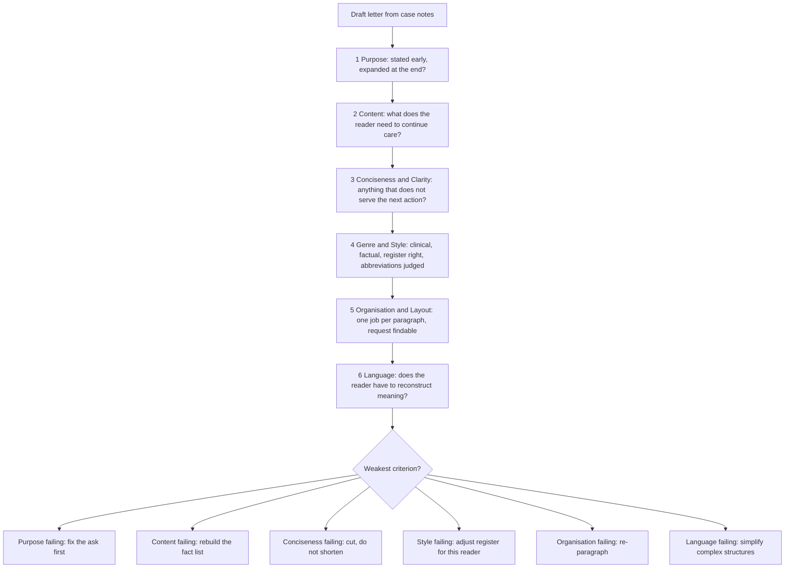

# The Six Writing Assessment Criteria

The OET Test Handbook 2026 states that the Writing sub-test is assessed using six criteria whose scores are combined and converted to the 500 scale. It does not print the criteria in the handbook section most candidates read, which is why so many people write a perfectly fluent letter and wonder where the marks went: they were writing against their own sense of good writing rather than against the descriptors. The criteria are published separately by OET, with band descriptors for each, and this topic is those six criteria and what each one actually looks for.

The six are **Purpose**, **Content**, **Conciseness and Clarity**, **Genre and Style**, **Organisation and Layout**, and **Language**. Purpose is scored on bands 0 to 3; the other five on bands 0 to 7. Two assessors mark each script and the marks are double-marked, and OET states plainly that assessors do not count how many mistakes you make — they assess how closely the response matches the criteria. So a letter with eight spelling errors that reads clearly may outscore a letter with two errors and a paragraph that buries the request.

Two consequences follow, and they are the whole reason this topic is worth an hour of study. First, the criteria are a checklist you can mark yourself against, which turns "is this good writing?" into six answerable questions. Second, the criteria are not independent: the same missing sentence costs you marks under Content, under Conciseness and Clarity and under Organisation and Layout at once. A candidate who understands only Language will lose far more marks than they realise.

### 🟢 Lite — Quick Review (1h–1d)

**The six, in the order OET publishes them, with the question each one asks.**

| # | Criterion | The question it asks | Band range |
|---|---|---|---|
| 1 | Purpose | Is the reason for the letter apparent immediately, and developed later? | 0–3 |
| 2 | Content | Is all the key information included, accurately, and suited to what the reader needs to continue care? | 0–7 |
| 3 | Conciseness and Clarity | Is irrelevant information left out, and is the case summarised effectively? | 0–7 |
| 4 | Genre and Style | Is the register, tone and use of abbreviations right for this document and this reader? | 0–7 |
| 5 | Organisation and Layout | Is it logically structured and laid out so the reader can retrieve what they need? | 0–7 |
| 6 | Language | Is the language accurate enough to communicate the necessary information? | 0–7 |

**What the top band looks like, in the criteria's own terms.**

- Purpose is immediately apparent and sufficiently expanded as required.
- Content is appropriate to the intended reader and addresses what is needed to continue care, with no important detail missing, and the content from the case notes is accurately represented.
- The length of the document is appropriate to the case and reader, with no irrelevant information, summarised effectively and presented clearly.
- The writing is clinical and factual, appropriate to genre and reader, with technical language, abbreviations and polite language used appropriately for the document and the recipient.
- Organisation and paragraphing are appropriate, logical and clear, key information is highlighted, sub-sections are well organised, and the document is well laid out.
- Language features are accurate and do not interfere with meaning.

**The three that decide most scripts.** Content, Conciseness and Clarity, and Language. Content is where marks are lost by leaving something out; Conciseness is where they are lost by writing everything in; Language is where they are lost by errors that make the reader work.

**Traps that cost marks.**

- Treating the criteria as six separate boxes, when one flaw usually appears in three of them at once.
- Writing a fluent, well-organised letter that is missing the one piece of information the reader needs to continue care.
- Summarising in the sense of shortening rather than in the sense of selecting what matters.
- Using abbreviations as shorthand for a reader who does not share your discipline.
- Copying the case notes in the order they were written, which the assessors name as a specific failure under Organisation.
- Judging your own writing by whether it sounds good rather than by the six questions above.

**Memory anchors.**

- **P-C-C-G-O-L** — Purpose, Content, Conciseness and Clarity, Genre and Style, Organisation and Layout, Language.
- **Purpose first, Content second.** Content is where the marks live.
- **Two assessors, one band per criterion.** Write to the band, not to the letter grade.
- **Do not count errors.** Assessors judge whether the language helps or hinders retrieval.

**Where this tier takes you next.**

- [the Writing task and its five reading minutes](/notes/oet/writing/wr-001/)
- [purpose, audience and register](/notes/oet/writing/wr-002/)
- [the OET exam hub](/exams/oet/)

### 🟡 Standard — Full Coverage (1–2d)

#### Purpose (bands 0–3)

The criterion description is short: it helps the reader get a quick and precise sense of what is asked of them. OET's own framing of why it exists is worth holding on to — because of time constraints, health professionals need to understand the purpose behind a written handover document very quickly and efficiently.

The band descriptors are specific about what earns the top band. At band 3, "Purpose of document is immediately apparent and sufficiently expanded as required". At band 2, it is "apparent but not sufficiently highlighted or expanded". At band 1, it is "not immediately apparent and may show very limited expansion". At band 0, it is "partially obscured/unclear and/or misunderstood".

Two mechanics sit inside that. **Introduced early.** The purpose belongs in the first two or three lines, not in a paragraph at the end that the reader has to find. **Expanded later.** OET's criterion description says the purpose "should be introduced early in the document and then clearly expanded on later (often near the end of the document)". A referral letter that opens "I am writing to refer this patient" and then never says what is being asked for has stated a purpose and not expanded it. The closing paragraph is where the ask is made concrete, and that is where the band 3 candidate puts it.

The most common way to lose Purpose marks is not a bad opening sentence. It is a letter with two purposes, where the reader has to work out which one is the real one. One ask per letter, stated early and specified late.

#### Content (bands 0–7)

Content is the criterion that decides most scripts, and it has three parts: all key information is included; information is accurately represented; and it is appropriate to the reader and their knowledge of the case.

**"All key information is included"** sounds obvious until you notice that the band 7 descriptor is not "everything is included" but "content is appropriate to intended reader and addresses what is needed to continue care (key information is included; no important details missing)". The test is not completeness in the abstract. It is: can this reader continue the care from what I have written? That reframing kills the two classic errors. Missing the current medication list fails Content because the reader cannot prescribe safely. Including the entire childhood vaccination history does not add Content, it dilutes it, and the dilution is marked under Conciseness.

**"Accurately represented"** is where case notes become dangerous. A letter that upgrades "declined further imaging" into "refused treatment" has misrepresented the notes, and a letter that turns a suspected diagnosis into a confirmed one has done the same. Do not sharpen the clinical content when you summarise it. If the notes say the pain is "consistent with", the letter says the pain is consistent with, not that the patient has.

**Audience awareness** is the third part and the one that connects this criterion to everything else. What does this reader already know, and what do they need in order to act? The same set of facts, written for a ward pharmacist and written for a consultant who has never met the patient, have different content: one needs the drug, dose, timing and indication; the other needs the problem, the timeline and the request.

#### Conciseness and Clarity (bands 0–7)

This criterion considers irrelevant information, and how effectively the case is summarised. At band 7, "length of document is appropriate to case and reader (no irrelevant information included); information is summarised effectively and presented clearly". At band 3, "inclusion of some irrelevant information distracts from overall clarity of document; attempt to summarise only partially successful".

The word that does the work here is *summarised*. Shortening is not summarising. Cutting the patient history from four paragraphs to two is shortening. Summarising is selecting the information the reader needs to continue care, in the order they need it, and discarding the rest. A candidate who transcribes the notes in a different order has neither shortened nor summarised; they have relocated the notes, and the assessors name exactly this under Organisation and Layout as "heavy reliance on case note structure".

Practical test: **could the reader act on this paragraph without looking at the notes?** If the answer is no, the paragraph is too thin. If the reader would not need the paragraph at all, it is too heavy. Both are marked.

#### Genre and Style (bands 0–7)

At band 7: "Writing is clinical/factual and appropriate to genre and reader (discipline and knowledge); technical language, abbreviations and polite language are used appropriately for document and recipient". At band 3: "Writing is at times inappropriate to the document or target reader; over-reliance on technical language and abbreviations may distract reader".

Three components, and the third is the one that catches experienced candidates.

**Clinical and factual.** Not personal, not emotional, not conversational. "The patient was very anxious about the scan and I did my best to reassure her" is not clinical; "The patient expressed anxiety about the scan and declined to proceed without a further explanation" is. Note the difference: the second keeps the information and drops the voice.

**Register and tone appropriate to the document.** A referral letter, a discharge summary and a care instruction are different genres, and the tone follows the genre and the relationship with the reader.

**Abbreviations used appropriately for the recipient.** OET's criterion description is explicit here: the use of abbreviations "should not be overdone thereby assuming common prior knowledge". If you are writing to a colleague in the same discipline, judicious use of abbreviations and technical terms is entirely appropriate. If you are writing to a colleague in a different discipline, or writing from a specialist to a general practitioner, "more explanation and less shorthand would be desirable". And if the target readership includes the patient, the information must be worded appropriately, with medical jargon minimised.

That last clause is worth flagging because the handbook's own description of the task says you write to a health professional caring for the patient, and sometimes the case notes point at a reader who is closer to the patient than to the clinic. Read the notes for the audience, and remember that the criterion is written to reward adjusting the register downward when the reader is not a clinician.

#### Organisation and Layout (bands 0–7)

At band 7: "Organisation and paragraphing are appropriate, logical and clear; key information is highlighted and sub-sections are well organised; document is well laid out". At band 3: "Organisation and paragraphing are not always logical, creating strain for the reader; key information may not be highlighted; layout is mostly appropriate with some lapses". At band 1: "Organisation not logical, putting strain on the reader; or heavy reliance on case note structure; key information is not well highlighted and the layout may not be appropriate".

**Paragraphing.** One paragraph, one job. A referral letter typically runs to four paragraphs: who this is and why you are writing; what has happened and what the findings are; what you have done so far; what you are asking for and by when. Each does one thing, and a reader can find any of them by turning to the paragraph.

**Sub-sections.** Where a letter carries more than one strand — medications, allergies, test results — a labelled structure is better than a run of prose, because the assessors' band 7 explicitly rewards sub-sections that are well organised.

**Highlighting.** Key information is highlighted. In practice this means short, labelled items rather than a wall of text: allergies on their own line, current medications as a list, the request at the end of the letter in its own sentence.

**Layout.** Addresses, headings, spacing and paragraph breaks. A letter that is a solid block of text with no breaks is hard to retrieve information from, and this criterion is about the reader retrieving information, not about looking elegant.

**The case-note structure trap.** Copying the order of the notes is the single most reliable way to lose this criterion, because the notes are written in the order things happened to the patient, not in the order the reader needs them.

#### Language (bands 0–7)

At band 7: "Language features (spelling/punctuation/vocabulary/grammar/sentence structure) are accurate and do not interfere with meaning". At band 5, "minor slips in language generally do not interfere with meaning". At band 3, "inaccuracies in language, in particular in complex structures, cause minor strain for the reader but do not interfere with meaning". At band 1, "inaccuracies in language cause considerable strain for the reader and may interfere with meaning".

The gradient is not about how many mistakes you make. It is about **how much work the reader has to do**. The same number of errors costs you less if they are in short simple sentences and more if they are in long complex ones, because a reader decoding a complex structure with errors in it has to reconstruct the meaning. A comma splice inside a twenty-word sentence causes more strain than a missing full stop after a six-word one.

OET's own description of this criterion is about professional concern rather than linguistic pride: health professionals care about language features only to the extent that they help or obstruct the retrieval of information. So the target is not perfect English. It is English that lets a tired colleague read a handover at the end of a shift and understand it first time.

#### Worked example: diagnosing a weak letter

**The draft.** "Dear Dr Okafor, I am writing to you in my capacity as a ward sister to bring to your attention the case of the above named patient, who has been experiencing some episodes of dizziness and has been feeling unwell since her admission last Tuesday, and who has also mentioned feeling nauseous, and the bloods taken yesterday were also somewhat abnormal. The patient is a 74-year-old female who takes various medications including something for her blood pressure and also a tablet for her diabetes and also paracetamol as and when required. Kindly could you please review her at your convenience. Thank you very much indeed for your kind attention. Yours sincerely."

**Marked against the criteria.**

- **Purpose (band 1–2).** The purpose is present — a review — but it is not stated until the final third of the letter, and it is buried inside a politeness construction. Band 2: apparent but not sufficiently highlighted.
- **Content (band 2–3).** The reader cannot continue the care. What were the abnormal bloods? Which medication is the blood-pressure one? Is the dizziness postural? What did "feeling unwell" mean? The band 1 descriptor reads: "Content does not provide intended reader sufficient information about the case and what is needed to continue care; key information is missing or inaccurate." The missing medication names are the worst of it, because the reader is being asked to review a patient whose drugs they cannot read.
- **Conciseness and Clarity (band 1–2).** The notes have been reformulated into one long sentence with no structure, and "some episodes of dizziness" and "feeling unwell" add nothing. Clarity is obscured by unnecessary detail and a failed summary.
- **Genre and Style (band 2–3).** "In my capacity as a ward sister", "at your convenience" and "thank you very much indeed for your kind attention" are a register for a stranger, not for a colleague asked to review a patient on their own ward. The padronising language also drifts from clinical and factual.
- **Organisation and Layout (band 2–3).** A single block of text with no paragraph breaks. The reader must read the whole thing to find the medications, the findings or the request.
- **Language (band 4–5).** The errors are numerous and they are concentrated in complex structures — "I am writing to you in my capacity as a ward sister to bring to your attention the case of the above named patient, who has been experiencing" — where they force the reader to reconstruct meaning. Several are visible in a single sentence.

**The same letter, rewritten.** "Dear Dr Okafor, I am referring Mrs A B (74, MRN 442190), who was admitted on Tuesday, for review of persistent dizziness and abnormal blood results.

Since admission she has had three episodes of dizziness on standing and has felt nauseous on waking. Her bloods from yesterday showed a haemoglobin of 9.8 g/dL. Her current medicines are amlodipine 5 mg once daily, metformin 500 mg twice daily, paracetamol as required, and she is allergic to penicillin.

She has been reassured and has mobilised with assistance, but the dizziness continues. I would be grateful if you could review her and advise whether she should be investigated further.

Yours sincerely,"

**The same content, re-marked.** Purpose is in line one and expanded in the closing sentence, so band 3. Content gives the reader the identifiers, the timeline, the finding, the medicines and the request, so band 6–7. Conciseness: three paragraphs, each with one job, nothing that does not serve the reader, band 6. Genre and Style: clinical, factual, professional register with a colleague, band 6–7. Organisation and Layout: four labelled paragraphs with the request in its own sentence, band 6–7. Language: short sentences, one place where the abbreviation is defined, band 6–7.

The two letters contain almost the same clinical information. The first scores in the twos and threes, the second in the sixes and sevens, and the difference is almost entirely in how the criteria were applied.

### 🔴 Deep — Mastery (3–5d)

#### The criteria are a lattice, not a list

The six criteria are scored separately, but they are not independent, and knowing how they connect tells you where to spend your revision time. A single flaw propagates.

| The flaw | Content | Conciseness | Organisation | Language |
|---|---|---|---|---|
| Missing the medication names | Fails — reader cannot continue care safely | — | Worsens — key information not retrievable | — |
| Copying the notes verbatim | Passes | Fails — no summarising | Fails — case-note structure | Passes |
| One 90-word sentence | Passes | Passes | Fails — strain | Fails — complex structure, errors cost more |
| Heavy abbreviation | Passes | Passes | Passes | Fails — reader strain |
| Request only in the last line | Weakens | — | Weakens | — |

Two of those rows carry the most useful lesson. Copying the notes passes Content and Language while failing two other criteria, so a candidate who reads only the Content band descriptor will think a transcribed letter is fine. And the long-sentence row shows why Language and Organisation failures arrive together: the same structure causes both.

#### Purpose is a gate, not a sixth criterion

Purpose is scored on a shorter scale than the other five, and that reflects how the band descriptors are written: at band 0 the purpose is "partially obscured/unclear and/or misunderstood". A letter whose purpose is misunderstood is not a letter that lost a few marks on one criterion — it is a letter the reader cannot use, and the other five criteria are being scored against a document that does not do its job. So Purpose is worth checking first in self-marking, even though it is worth the fewest bands.

**The diagnostic question.** Cover the last third of your letter and read only the first third. Can you say, in one sentence, what you want the reader to do? If not, Purpose is failing, and fixing it usually fixes other criteria at the same time, because a letter with no clear ask tends to have no clear structure.

#### A self-marking protocol that produces useful feedback

The reason candidates cannot self-mark is that they read their own letter for overall impression, and the overall impression is what they set out to produce rather than what they produced. The protocol below forces the six questions apart.

**Step 1 — Mark Content alone.** Read only the case notes and the letter, and list the facts a reader needs to continue care. Compare against the letter. Do not judge the writing. This produces the list of omissions, which is usually the longest list.

**Step 2 — Mark Purpose alone.** Cover the end of the letter. Can you state the purpose from the opening three lines? Then read the end and check the ask is specified there.

**Step 3 — Mark Conciseness alone.** Highlight every sentence in the letter that does not serve the reader's next action. Count them. Now count the sentences in the notes that you did not use, and check that the drop was deliberate rather than accidental.

**Step 4 — Mark Genre and Style alone.** Ask three separate questions: is it clinical and factual; is the register right for this reader and this document; are the abbreviations ones this reader would use without explanation?

**Step 5 — Mark Organisation alone.** Look at the letter as a layout, not as sentences. Could a reader find the allergies, the current medicines and the request without reading the whole letter? Are there exactly three or four paragraphs, each doing one job?

**Step 6 — Mark Language alone.** Read only for whether the reader has to stop and reconstruct meaning. Do not count errors.

**Step 7 — Only now, mark the whole letter.** And compare the six marks against the weakest criterion. That is where next week's practice goes.

**Time it.** Twenty minutes per letter, five minutes per criterion. A letter marked in three minutes tells you what you already felt.

#### The band scale, and what the mid bands mean

The published descriptors are cumulative, and the middle of the scale is where most scripts sit. Reading the bands helps you see what improvement looks like.

For Purpose: band 3 is "immediately apparent and sufficiently expanded as required"; band 2 is "apparent but not sufficiently highlighted or expanded"; band 1 is "not immediately apparent and may show very limited expansion"; band 0 is "partially obscured/unclear". For the five criteria scored 0–7: band 7 is clean performance with no lapses; band 6 "shares features of bands 5 and 7"; band 5 is a competent performance with "occasional, minor inappropriacies" or "minor inconsistencies"; band 4 "shares features of bands 3 and 5"; band 3 is a partial performance where some key information may be missing or the summary is only partially successful; band 2 "shares features of bands 1 and 3"; band 1 is a weak performance where key information is missing or inaccurate and the writing causes strain; band 0 is below band 1.

The practical reading: **band 5 is competent and band 7 is clean.** The difference between them is not brilliance, it is the absence of lapses. Most candidates lose bands 6 and 7 through small, fixable things — one stray inconsistency in register, one paragraph that overlaps another, one abbreviation used where the reader would not know it. These are much easier to fix than the difference between band 3 and band 5, and they are where the marginal marks are.

#### Fitting the criteria to the forty writing minutes

The handbook gives the Writing sub-test 45 minutes in total, made up of 5 minutes of reading time and 40 minutes of writing time. The criteria structure suggests how to spend those forty minutes.

- **Planning: five to seven minutes.** Write the purpose in a single sentence at the top of the page. Write the reader's role next to it. List the four or five facts that reader must have to continue care, from the case notes. Draft the four paragraph headings. This is the five reading minutes plus two, and it is where Content marks are protected — you cannot include what you did not identify.
- **Drafting: twenty-five minutes.** Write in paragraphs, not in sentences. Keep the request visible in the closing paragraph as you write.
- **Checking: eight to ten minutes.** Check the six criteria in order. Content first (is anything missing?), then Purpose (is the ask stated and specified?), then the register, then the organisation, then the language read for strain.

The task instructions give a word range, commonly 180 to 200 words, and OET states that there is no automatic penalty for writing over or under it. So the word count is a guide to proportion, not a scored trap; the scored trap is irrelevance. But it is a useful guide, because a 400-word letter to a colleague is almost always a letter that has not been summarised, and the surplus will be marked under Conciseness.

#### Common mistakes

- Writing against your own sense of good writing instead of against the six criteria.
- Assuming Language is the criterion that matters most, because it is the most visible.
- Reading the notes in order and writing them in that order, which fails Conciseness and Organisation while passing Content.
- Summarising by shortening rather than by selecting.
- Over-using abbreviations with a reader who does not share your discipline, which the criterion descriptor names explicitly.
- Losing Purpose marks by burying the ask in a politeness construction.
- Writing two purposes and expecting the reader to choose.
- Leaving a fact out of the letter because it seemed obvious — obvious to you, not to the reader who has never met the patient.
- Marking your own work in one pass, so one strong impression colours all six criteria.
- Chasing band 7 on Language while leaving a key clinical fact out of the letter.

> ⚠️ **Examiner Trap.** The most common way to lose marks on this sub-test is not a language error at all. It is a fluent, well-organised, correctly register-ed letter that omits the medication the reader needs to prescribe safely, or that buries the request. Both failures are invisible to the writer and obvious to an assessor working down a criterion list. Mark against the criteria, not against your own reading.

#### Memory anchors

- **P-C-C-G-O-L** — Purpose, Content, Conciseness and Clarity, Genre and Style, Organisation and Layout, Language.
- **Content is the criterion that decides most scripts.** Find the omissions first.
- **Purpose: early then late.** State it in the opening, specify it in the close.
- **Summarise, do not shorten.** Select what the reader needs to continue care.
- **Band 7 versus band 5 is lapses, not brilliance.** The marginal marks are in the small inconsistencies.
- **Assessors do not count errors.** They judge whether the reader has to work.

#### ⚡ Quick Exam Checklist

- The six criteria known by name and in order: Purpose, Content, Conciseness and Clarity, Genre and Style, Organisation and Layout, Language
- Purpose scored on bands 0 to 3, the other five on bands 0 to 7
- Purpose introduced in the opening lines and expanded in the closing paragraph
- Content tested as "can this reader continue the care from what I have written?"
- Case notes represented accurately, with hedges and uncertainties preserved
- Facts selected for the reader's next action, not for completeness
- No irrelevant material: background the reader already holds left out
- Clinical and factual voice, with the information kept and the personality dropped
- Abbreviations used only where this reader would use them without explanation
- Four paragraphs, one job each: who and why, what has happened, what has been done, what is asked for and by when
- Key items presented so they can be found without reading the whole letter
- Language read for strain rather than counted for errors
- Complex structures simplified, since errors inside them cost the most
- Self-marking done criterion by criterion, in order, with the weakest criterion chosen for next practice
- Purpose checked before anything else when the letter reads as though it works
- Word range treated as a guide to proportion rather than a scored limit
- The forty writing minutes budgeted: plan, draft, then check against the six criteria

**Where this tier takes you next.**

- [the Writing task and its five reading minutes](/notes/oet/writing/wr-001/)
- [purpose, audience and register](/notes/oet/writing/wr-002/)
- [all Writing and Speaking notes](/notes/oet/writing/)

## Internal links

- [OET exam hub](/exams/oet/) — the four sub-tests, the 0 to 500 scale, the grade bands and the regulators that accept the result.
- [The Writing Task: A Profession-Specific Letter](/notes/oet/writing/wr-001/) — the 45-minute task these criteria are applied to.
- [Purpose, Audience and Register](/notes/oet/writing/wr-002/) — where the Purpose and Genre and Style criteria are won before the first sentence is written.
- [Listening](/notes/oet/listening/) — the sub-test that is identical for every profession.

The fact that the Writing sub-test is assessed using six criteria whose scores are combined and converted to the 500 scale comes from the official OET Test Handbook 2026 (https://cdn-aus.aglty.io/oet/pdf-files/OET%20Test%20Handbook%202026.pdf). The names of the six criteria, their band ranges and the band descriptors quoted on this page come from OET's published Writing assessment criteria and level descriptors (https://cdn-aus.aglty.io/oet/pdf-files/Writing%20assessment%20criteria.pdf) and from OET's explanation of the criteria (https://oet.com/post/study-skills-assessment-criteria), both retrieved on 24 October 2026. The 45 minutes made up of 5 minutes reading time and 40 minutes writing time, and the fact that Writing is tailored to the candidate's profession while Listening and Reading are the same for everyone, are from the handbook. The weight on this page is StudyRoadmap's own prioritisation.

---

## Continue your study

- **[View this topic in your OET (Occupational English Test) roadmap](/roadmap/?exam=oet&duration=1mo)** — see where this topic sits in your personalised plan
- **[Build a quick revision plan](/roadmap/?exam=oet&duration=1d)** — 1-day sprint covering the highest-weight topics
- **[OET (Occupational English Test) exam overview](/exams/oet/)** — pattern, eligibility, and syllabus
- **[All Writing and Speaking notes](/notes/oet/writing/)** — browse sibling topics in this subject
