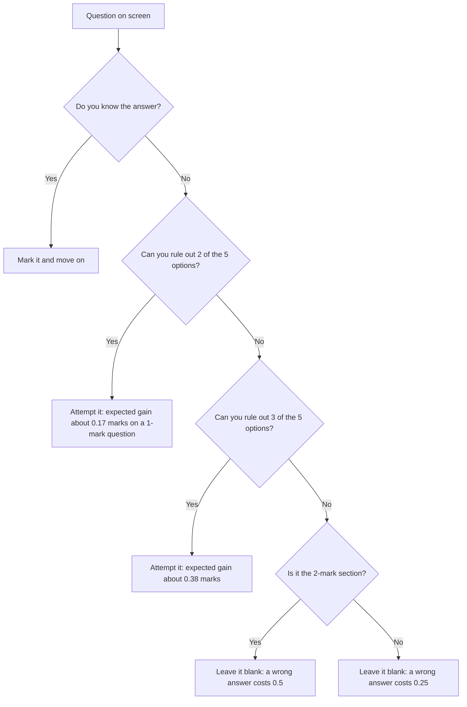

# Negative Marking in SBI Clerk: What a Wrong Answer Costs You

### 🟢 Lite — Quick Review (1h–1d)
> Rapid summary for last-minute revision before your exam.

SBI Clerk deducts **one-fourth of the mark assigned to the question** for every wrong answer, in both the Prelims and the Mains. Every Prelims question carries 1 mark, so a wrong answer there costs **0.25**. In the Mains, Reasoning Ability & Computer Aptitude is the only 2-mark section (50 questions, 60 marks), so a wrong answer there costs **0.5**. Every other Mains section is 1-mark, so a wrong answer costs **0.25**. An unattempted question costs nothing.

- **The rule:** one-fourth of the mark assigned to that question.
- **Prelims:** 100 one-mark questions for 100 marks in 1 hour → 0.25 per wrong answer.
- **Mains:** 190 questions for 200 marks in 2 hours 40 minutes → 0.25 per wrong answer, except Reasoning Ability & Computer Aptitude at 0.5.
- **Five options per question**, both stages, both online.
- **A blank costs 0.** Only a marked-but-wrong answer costs you.
- **No qualifying minimum** is prescribed for a section or for the aggregate, and section-wise marks are not maintained. Negative marking never disqualifies you by itself; it only lowers your aggregate.
- **Only the Mains builds the merit list.** Prelims qualifies you for Mains.
- **Break-even on a guess is 1 in 5.** With five options, a blind guess has an expected score of zero.
- **Official source:** SBI advertisement CRPD/CR/2026-27/17. Current openings: https://sbi.bank.in/web/careers/current-openings.

| Where you are | Section | Marks per question | A wrong answer costs |
| --- | --- | --- | --- |
| Prelims | English Language (30 Q, 20 min) | 1 | 0.25 |
| Prelims | Numerical Ability (35 Q, 20 min) | 1 | 0.25 |
| Prelims | Reasoning Ability (35 Q, 35 marks, 20 min) | 1 | 0.25 |
| Mains | General/Financial Awareness (50 Q, 35 min) | 1 | 0.25 |
| Mains | General English (40 Q, 35 min) | 1 | 0.25 |
| Mains | Quantitative Aptitude (50 Q, 45 min) | 1 | 0.25 |
| Mains | Reasoning Ability & Computer Aptitude (50 Q, 45 min) | 2 | 0.50 |

Score in one line: **score = (correct × mark) − (wrong × mark ÷ 4)**.

### 🟡 Standard — Regular Study (2d–2mo)
> Standard content for students with a few days to months.

#### The rule in the official wording

The exam data for SBI Clerk states the marking rule in a single sentence: both stages are objective and online with five options per question, and **negative marking of one-fourth of the mark assigned to a question**. That last clause is the entire rule, and it is proportional rather than flat. The deduction is tied to the mark of the particular question you got wrong, so the same question type costs twice as much in a 2-mark section as in a 1-mark section.

The same official record notes that Reasoning Ability & Computer Aptitude is the only 2-mark section, worth 60 marks, while every remaining item is worth a single mark. That is why a wrong answer costs **half a mark in that section and a quarter mark elsewhere**, and why an unattempted question costs nothing at all. Advertisement CRPD/CR/2026-27/17 is the notification the current recruitment is issued under, and the same advertisement sets the eligibility band, the degree requirement and the local-language condition.

Two further facts from that record change how you should treat the penalty. No minimum qualifying marks are prescribed for an individual section or for the aggregate, and section-wise marks are not maintained. The Main Examination is the only stage counted for the final merit list. Since the Clerk cadre has no descriptive paper, every mark in that merit list comes from these objective papers, which is exactly why the marking rule deserves your attention rather than a passing glance.

#### Computing the cost of a wrong answer

Start from the formula and the section you are in:

**Score = (correct answers × marks per question) − (wrong answers × marks per question ÷ 4)**

Worked example 1, Prelims Reasoning Ability (35 questions, 1 mark each): you answer 24 correctly, 8 wrongly and leave 3 blank. Score = 24 × 1 − 8 × 0.25 = 24 − 2 = **22 out of 35**. Those 8 wrong answers cost you the same as two of the 24 you got right.

Worked example 2, Mains General/Financial Awareness (50 questions, 1 mark each): 35 correct, 12 wrong, 3 blank. Score = 35 − 12 × 0.25 = 35 − 3 = **32 out of 50**. Notice that the 3 blanks subtract nothing at all.

Worked example 3, Mains Reasoning Ability & Computer Aptitude (50 questions, 2 marks each): 38 correct, 9 wrong, 3 blank. Score = 38 × 2 − 9 × 0.5 = 76 − 4.5 = **71.5 out of 60 questions' worth of marks**. Nine wrong answers here cost 4.5 marks, the same damage as 18 wrong answers in a 1-mark section.

Worked example 4, same accuracy, different section: 40 correct and 10 wrong out of 50 questions gives 80% accuracy in both cases. In a 1-mark section you score 40 − 2.5 = **37.5 out of 50**. In the 2-mark section you score 80 − 5 = **75 out of 100**. Identical accuracy, twice the punishment for the errors, because the penalty is proportional to the mark.

#### Why an unattempted question is not a wrong answer

A blank is scored as zero and is never reduced. The deduction applies only to a response you marked and got wrong. So there is no situation in which leaving a question blank is worse than leaving it wrong, and no situation in which a "safe" guess protects you.

The only reason to mark an option is that you think it is better than zero in expectation. With five options and a quarter deduction, that test is simple. If you have no idea and pick at random, you are right one time in five. A right answer on a 1-mark question gives you +1 and a wrong one gives you −0.25, so the expected score of a blind guess is (1/5 × 1) − (4/5 × 0.25) = 0.20 − 0.20 = **zero**. On a 2-mark question it is (1/5 × 2) − (4/5 × 0.5) = 0.40 − 0.40 = **zero** as well. Blanking scores zero too, so a blind guess buys you nothing but the risk of a worse display when you were going to get it right anyway.

Where guessing does pay is when you can throw out options. The break-even point is a one-in-five chance, because the penalty is one-fourth of the mark in every section. Any option you can pick with more than a 20% chance of being right beats leaving the question blank.

#### How the penalty behaves on the 2-mark section

Reasoning Ability & Computer Aptitude is the one place where the rate changes: 50 questions worth 60 marks, so each wrong answer takes **0.5** instead of 0.25. The proportional structure is identical in both kinds of section, which means the break-even chance stays at one in five, but the absolute cost doubles. Ten careless wrong answers in this section erase 5 marks from a pool of 60, which is the same damage as 20 wrong answers in General English.

The practical lesson is not to use 0.25 as a mental rate for the whole paper. Keep two numbers in your head, 0.25 and 0.5, and check which section the clock is on before you decide whether to attempt.

#### What the penalty does to a section score sheet

| Section type | Marks on offer | 5 wrong answers cost | 10 wrong answers cost |
| --- | --- | --- | --- |
| Any 1-mark section | Section's own total | 1.25 | 2.5 |
| Reasoning Ability & Computer Aptitude (2-mark) | 60 | 2.5 | 5 |

Read across the row and the lesson is plain: the penalty is not dramatic on a single question, and that is exactly why it goes unnoticed. It is a quarter mark here, a quarter mark there, and by the end of a section you have quietly given up two or three marks you had already earned.

### 🔴 Extended — Mastery (3mo+)
> Comprehensive coverage for students on a longer study timeline.

#### Expected score of a guess, option by option

The table below assumes five options and a quarter deduction. The right-hand columns are the expected marks per question if you attempt it with that much information. These are averages, not guarantees.

| Options eliminated | Chance of being right | EV on a 1-mark question | EV on a 2-mark question |
| --- | --- | --- | --- |
| 0 (blind guess) | 1 in 5 | 0.00 | 0.00 |
| 1 | 1 in 4 | +0.06 | +0.13 |
| 2 | 1 in 3 | +0.17 | +0.33 |
| 3 | 1 in 2 | +0.38 | +0.75 |
| 4 (one option left) | certain | +1.00 | +2.00 |

Read the first row carefully. A blind guess on a five-option question is worth exactly nothing in expectation, in a 1-mark section and in a 2-mark section alike, because the penalty is proportional to the mark. That is the single most useful fact for a candidate who guesses randomly on whatever is left at the end of a section: the guesses do not raise your score and they do not lower it either, but the clock they consume comes out of questions you could have answered.

#### Reading a mock score honestly

A mock result printed as "42 out of 50" is usually the count of correct answers, which hides the penalty. Recompute it before you draw any conclusion:

1. Count correct, wrong and blank separately, per section.
2. Apply the formula to each section: correct × mark − wrong × (mark ÷ 4).
3. Note the section. A Prelims score is a practice of speed and accuracy; it does not enter the merit list, so use it to find weak areas rather than to measure yourself against a cut-off.
4. Compare accuracy, not attempts. The exam's own preparation guidance says to track accuracy above attempts, and the marking rule is why.

A useful diagnostic: compare two mocks with the same number of correct answers. If one scored lower, the difference came from wrong answers, and the section with the largest gap is where your guessing is bleeding marks.

#### Adjusting a mock-test strategy around the penalty

- **Set an attempt threshold per section.** Attempt a question when you can eliminate at least two of the five options. In the 2-mark section, hold a higher bar, three eliminated options, because each error there costs double in absolute marks.
- **Budget the last minutes of each section for review, not for new attempts.** Every section is separately timed: 20 minutes each in the Prelims, 35, 35, 45 and 45 minutes in the Mains. Two or three minutes spent re-reading marked answers is worth more than two or three minutes of blind guessing on fresh questions.
- **Never re-shuffle a marked answer on a hunch.** Changing a correct answer to a different option converts a guaranteed mark into a coin flip that costs 0.25 or 0.5 when it lands wrong. A change is only rational if you have a specific reason to believe the first choice was wrong.
- **Let the weak section lose time, not marks.** Because the penalty is the same everywhere except the 2-mark section, the section you rush is exactly the one where your errors pile up. If General Awareness is weak, give it its 35 minutes but attempt fewer questions; you will score less than a candidate who attempts everything, and you will not be the one paying 0.25 per mistake across 50 questions.
- **Treat the Prelims as a rehearsal with the same rules.** The Prelims has no qualifying minimum, so no penalty there can disqualify you, but the habits you build there carry into the Mains, which is the only stage counted for the final merit list.

#### Should you attempt this question?

A blank is always worth zero, so the decision tree never ends in a loss. Only the marked answer carries risk, and the penalty decides how much.

#### Common mistakes

- **Using a flat 0.25 for the whole paper.** Reasoning Ability & Computer Aptitude in the Mains is 2-mark, so each wrong answer there costs 0.5. Applying 0.25 understates the damage by half.
- **Treating a blank as a penalty.** Unattempted questions cost nothing, and the penalty applies only to wrong answers.
- **Believing a wrong answer can disqualify you.** No sectional or aggregate qualifying minimum is prescribed, and section-wise marks are not maintained in either phase. The penalty lowers your aggregate; it does not gate you.
- **Guessing on everything left over.** With five options and a quarter deduction, a blind guess has an expected score of zero in every section. The guesses add nothing and take time from questions you can answer.
- **Re-shuffling answers in the final minute.** Each unthinking change risks 0.25 or 0.5 and cannot raise a correct answer.
- **Assuming Prelims marks count toward the merit list.** They do not; the Main Examination alone is counted.
- **Reading a mock score as a correct-answer count.** Always recompute with the formula before you judge the attempt.

#### Flashcard-ready facts

- Negative marking: **one-fourth of the mark assigned to the question**, in both Prelims and Mains.
- Five options per question; both stages objective and online.
- Prelims: 100 one-mark questions, 100 marks, 1 hour, sections timed separately at 20 minutes each. Wrong answer = **0.25**.
- Mains: 190 questions for 200 marks in 2 hours 40 minutes. Sections timed at 35, 35, 45 and 45 minutes. Wrong answer = **0.25**, except Reasoning Ability & Computer Aptitude (50 questions, 60 marks, 2 marks each) where it is **0.5**.
- Unattempted: **0**.
- No sectional or aggregate qualifying minimum; section-wise marks are not maintained; only the Main counts for merit.
- No descriptive paper in the Clerk cadre; a local-language test follows selection.
- Break-even hit rate on a guess: **1 in 5**, in 1-mark and 2-mark sections alike.
- Formula: **score = correct × mark − wrong × (mark ÷ 4)**.
- Current advertisement reference: **CRPD/CR/2026-27/17**.

---

## Continue your study

- **[View this topic in your SBI Clerk roadmap](/roadmap/?exam=sbi-clerk&duration=1mo)** — see where "Negative Marking in SBI Clerk: What a Wrong Answer Costs You" fits in your personalised plan
- **[Build a quick revision plan](/roadmap/?exam=sbi-clerk&duration=1d)** — 1-day sprint covering highest-weight topics
- **[SBI Clerk exam overview](/exams/sbi-clerk/)** — pattern, eligibility, and syllabus
- **[All General Awareness notes](/notes/sbi-clerk/general-awareness/)** — browse sibling topics in this subject

---
*Content adapted based on your selected roadmap duration. Switch tiers using the selector above.*
