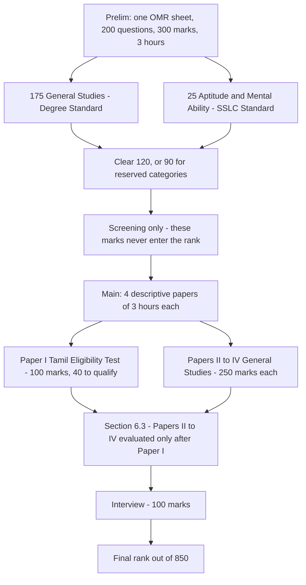

# TNPSC Group 1 Prelims: Time, Marks and Answering Rules

### 🟢 Lite — Quick Review (1h–1d)
> The TNPSC Group 1 preliminary is one OMR sheet, 200 questions, 300 marks, three hours, and a wrong answer costs you nothing.

The preliminary is a single OMR-based objective paper with a **3-hour** time limit: **200 questions** carrying **300 marks**, split into **175 questions in General Studies (Degree Standard)** and **25 questions in the Aptitude and Mental Ability Test (SSLC Standard)**. There is **no negative marking**. A wrong answer costs no marks. The only deductions the notification fixes are clerical, and they add up to 3 marks in a paper worth 300, so the answer to "how much does a wrong answer cost" is zero.

| Preliminary fact | Value |
| --- | --- |
| Papers | One objective OMR sheet |
| Duration | 3 hours |
| Questions | 200 |
| Marks | 300 |
| Section A | General Studies (Degree Standard), 175 questions |
| Section B | Aptitude and Mental Ability Test (SSLC Standard), 25 questions |
| Negative marking | None. A wrong answer costs no marks |
| Minimum qualifying marks | 90 for SC, SC(A), ST, MBC/DC, BC(OBCM), BCM; 120 for all others |
| Role of the stage | Screening only. Preliminary marks are not counted in the final total |

**The three clerical deductions** (itemised in section 1.11.3 of Advertisement No. 736):

| What goes wrong | Deduction |
| --- | --- |
| Register number written incorrectly, where the OMR answer sheet is non-personalised | 2 marks |
| A question's answer bubble left blank | 0.5 mark each |
| Left thumb impression not affixed at Part I of page 1 | 0.5 mark |

**The one number to hold on to:** 3 hours is 180 minutes, and 180 minutes over 200 questions is **54 seconds a question**. That is the real budget, and it is tight.

---

### 🟡 Standard — Regular Study (2d–2mo)
> The paper mechanics that decide whether you clear the bar, and what the paper is actually for.

#### The Paper at a Glance

The preliminary is not a scored competition. It is a filter with a cut-off. Advertisement No. 736 (Notification No. 05/2026, dated 23 June 2026) prescribes no negative marking for a wrong answer, so the only way to lose marks is to leave an answer wrong, and the only deductions are the three clerical ones above.

The Commission's own Scheme of Examination labels both preliminary sections "Qualifying" in nature, which is the same message the notification sends: this paper decides whether you proceed, not where you rank.

#### What Three Hours Over 200 Questions Actually Feels Like

54 seconds is not a reading budget, it is a recognition budget. A question you know in 15 seconds is worth protecting; a question that takes 40 seconds to understand and another 20 to decide is already a net loss at this pace.

Two numbers frame the paper:

- **180 minutes** total, working time only, on one physical OMR sheet.
- **200 questions**, of which 175 test General Studies at Degree Standard and 25 test Aptitude and Mental Ability at SSLC Standard.

If you give the 25 aptitude questions 40 minutes, that is 96 seconds each, and the remaining 140 minutes spread over 175 General Studies questions gives you 48 seconds each. If you give aptitude 30 minutes, you are at 72 seconds each there and 51 seconds each on General Studies. There is no official split of the clock, and no rule about which section to do first, so the split is your decision, but it has to be a decision you make before the exam rather than in the middle of it.

#### Running Out of Time: What It Costs

With no negative marking, running out of time is not a scoring disaster the way it is in an exam that deducts marks for errors. Three things follow.

1. **A wrong answer costs exactly zero.** Guessing on the last question cannot lower your score. There is no arithmetic reason to leave a bubble blank because you are unsure.
2. **An unanswered question forfeits the marks you would have scored.** That is the real cost of the clock, and it is the only scoring cost.
3. **A blank bubble is not free either.** Section 1.11.3 records a 0.5-mark deduction for a question whose answer bubble is left blank, so the last fifteen minutes should be spent filling every remaining bubble with a considered guess rather than leaving it empty. Read that clause yourself in the notification before you plan around it, because it is the one entry whose per-question wording decides how expensive a blank really is.

The practical habit: reserve the final 15 minutes of the 180 for a clean sweep of every bubble you have not darkened. Under no-negative-marking rules, a sweep can only help.

#### The Three Clerical Deductions in Full

| Deduction | Trigger | Cost |
| --- | --- | --- |
| Register number | Written incorrectly, where the OMR answer sheet is non-personalised | 2 marks |
| Blank answer bubble | A question's answer bubble left blank | 0.5 mark each |
| Thumb impression | Left thumb impression not affixed at Part I of page 1 | 0.5 mark |

Two marks for the register number is the largest single item, and it is the one you control entirely, because it is written before the paper starts and checked by nobody. Write it once, slowly. The thumb impression is a five-second job at Part I of page 1, and it is worth half a mark to the whole paper.

Note the shape of these three: none of them is a penalty for knowing less. They are penalties for paperwork. That is why they sit in a separate clause from any marking rule, and why a candidate who blanks 40 bubbles has created a much larger exposure than one who filled them all.

#### OMR Mechanics That Can Void a Sheet

Section 1.11.1.8 to 1.11.1.12 of the notification deal with the question-booklet-number bubble on the answer sheet. If that bubble is unshaded, out of range, or wrongly darkened, the **entire OMR answer sheet is invalidated**. It is not a five-mark penalty and it is not a per-question loss. Two hundred correct answers do not save a sheet that fails its booklet-number check, so this is the single most expensive mistake available to you and it costs about 90 seconds to avoid.

The other rule in the same family: shading more than one bubble for a question leaves that answer unevaluated. You cannot rescue a mis-shaded bubble by adding a second mark. Corrections have to happen as you go.

#### What the Preliminary Decides, and What It Leaves to the Main

The preliminary decides one thing: whether you are allowed to sit the Main. Minimum qualifying marks are **90** for SC, SC(A), ST, MBC/DC, BC(OBCM) and BCM candidates and **120 for all others**, and the preliminary is a screening test only, its marks are not counted in the final total.

Everything that produces a rank happens later, in the Main Written Examination and the interview:

| Stage | What it is |
| --- | --- |
| Paper I | Mandatory Tamil Eligibility Test, 100 marks, minimum 40 qualifying |
| Papers II–IV | General Studies (Degree Standard), 250 marks each |
| Qualifying for Papers II–IV | 225 for SC, SC(A), ST, MBC/DC, BC(OBCM) and BCM; 300 for all others |
| Interview | 100 marks |
| Final rank | Determined out of 850 marks, with the 100-mark oral interview |

Section 6.3 of the notification is not a penalty clause, and candidates often misread it as one. What it states is that Papers II–IV are evaluated only after a candidate qualifies in Paper I, the Main's Tamil Eligibility Test. Appearance in all the Main papers and the interview is compulsory.

---

### 🔴 Extended — Deep Study (3mo+)
> Where every number comes from, and how to read a preliminary result without fooling yourself.

#### The Notification Behind Every Number

Every figure in this note traces to one live document: **Advertisement No. 736 (Notification No. 05/2026, dated 23 June 2026)**, recruiting **26 posts** in revenue administration, labour and co-operative registration. The Commission publishes it at https://tnpsc.gov.in, and the Scheme of Examination page there sets out the same structure in table form: the Combined Civil Services (Preliminary) Examination for Group I as one paper with 175 General Studies (Degree Standard) questions and 25 Aptitude and Mental Ability (SSLC Standard) questions, 200 in total; the Main as four descriptive papers of 3 hours each with a 100-mark Tamil Eligibility Test and three 250-mark General Studies papers, and a final total of 850 marks counting Papers II, III, IV and the interview.

The preliminary is where the clocks run; the Main is where the marks are.

#### Marks, Weight and Where the 300 Sits

300 marks across 200 questions is an average of 1.5 marks a question. Treat that as an average for pacing rather than a rule about any single question: our exam data records the paper total and the question total but does not itemise a per-question weighting for the two sections, so anyone who tells you that every question in this paper is worth one mark, or that the aptitude section carries a specific weight, is asserting something the notification does not state in that form.

What is not in doubt is the shape of the split. Section A is 175 questions at Degree Standard, which is the degree-level General Studies that the Main's Papers II–IV are also built on. Section B is 25 questions at SSLC Standard, which is the same level as the Tamil Eligibility Test and the lower ladders of the other services. A candidate who reads the paper as "one long General Studies test" will meet the aptitude block as a surprise, and the aptitude block is the part most improved by timed practice.

#### Building a Paper Plan You Can Actually Hold

A plan is only useful if it survives contact with a bad hour, so build one out of checkpoints rather than intentions.

- **First pass, one sweep, no return.** Read and darken each answer as you meet it, in question order, at a target of roughly 45 seconds a question. Flag anything you are unsure of in your head and move on; do not stop.
- **Second pass, flagged questions only.** Whatever is left of the clock goes to the flagged ones. Under no negative marking, an unresolved question is worth more as a considered guess than as a blank.
- **Final 15 minutes, sweep.** Every bubble darkened, booklet number double-checked, register number and thumb impression confirmed.
- **Section order is yours.** Attempting the 25 aptitude questions first, while you are fresh, is defensible. Attempting General Studies first is equally defensible if that is where your accuracy is highest. Write the choice down before the exam, because deciding mid-paper is a waste of clock.

#### Why a Preliminary Score Is Not a Rank

The preliminary marks are not counted in the final total, so a score of 160 and a score of 121 are, in rank terms, identical once you are above the bar: both say you proceed, and nothing more. Two candidates can sit the same preliminary, clear it by very different margins, and arrive at the Main in exactly the same position, because the Main carries 850 marks of rank and the preliminary carries none.

Read a preliminary result in three parts: did you clear 120 (or 90), by how much, and what was your accuracy on the aptitude block versus General Studies. The first decides whether the next stage happens. The second tells you nothing about rank. The third tells you where to spend the next two months, because the 25 aptitude questions are a small, trainable slice of the paper, and a candidate who lost those 25 questions knows exactly which part of the syllabus to rebuild.

#### Tamil Is Not Optional

The eligibility conditions require adequate knowledge of Tamil: passing SSLC, HSC or a Degree with Tamil as one of the languages, having studied the High School Course in Tamil medium, or passing the TNPSC Second Class Language Test (Full Test) in Tamil. The Main reflects this with Paper I, the Mandatory Tamil Eligibility Test, at 100 marks with a minimum of 40 qualifying. Tamil is therefore both an entry condition and a paper in the Main, and the 40-mark floor on Paper I is a threshold to clear, not a source of rank.

#### Trap Table

| Trap | What a candidate assumes | What the notification says |
|---|---|---|
| "Wrong answers cost one-fourth" | Borrowed from another state's scheme | No negative marking; a wrong answer costs no marks |
| "Preliminary marks count toward the final total" | The 300 marks feed the rank | The preliminary is a screening test only; its marks are not counted |
| "Section 6.3 is a penalty clause" | A deduction for something | It states that Papers II–IV are evaluated only after qualifying in Paper I |
| "A booklet-number error costs five marks" | A per-question penalty | Sections 1.11.1.8 to 1.11.1.12 invalidate the entire OMR answer sheet |
| "The 300 marks are 200 one-mark questions" | Flat marking | 300 marks for 200 questions, with no per-question weighting itemised |
| "Blank bubbles are free" | No deduction for unattempted questions | Section 1.11.3 records 0.5 mark for a blank answer bubble |

#### Memory Anchors

- **180 minutes, 200 questions, 54 seconds each.** Say the clock out loud until it stops sounding generous.
- **Wrong answer, zero marks.** Blanks cost the question, not a penalty on top of it.
- **Three clerical deductions, one section number: 1.11.3.** Register number (2), blank bubble (0.5 each), thumb impression (0.5).
- **Booklet number is all or nothing.** 1.11.1.8 to 1.11.1.12 void the sheet, they do not dock it.
- **Preliminary clears, Main ranks.** 850 marks, and none of them come from the OMR sheet.

#### Practice Prompts

1. Write out the full preliminary structure from memory, then check it against the notification on https://tnpsc.gov.in: one paper, 200 questions, 300 marks, 3 hours, 175 plus 25, 90 and 120 as the qualifying bars. Note which number you got wrong and why.
2. Take a previous Group 1 preliminary paper and work it to a 45-second-per-question first pass. Count how many questions you left blank, and apply the 0.5-mark blank-bubble rule to that count to see what a rushed finish would cost you against a 120-mark bar.
3. Set a timer for 40 minutes and attempt only the 25-question aptitude block from a previous paper. Compare your accuracy with the same block inside a full 3-hour mock, and decide which order suits you.

---

## Continue your study

- **[View this topic in your TNPSC Group 1 roadmap](/roadmap/?exam=tnpsc&duration=1mo)** — see where this topic fits in your personalised plan
- **[Build a quick revision plan](/roadmap/?exam=tnpsc&duration=1d)** — 1-day sprint covering highest-weight topics
- **[TNPSC Group 1 exam overview](/exams/tnpsc/)** — pattern, eligibility, and syllabus
- **[All Politics notes](/notes/tnpsc/politics/)** — browse sibling topics in this subject
- **[Politics in the TNPSC Group 1 syllabus](/notes/tnpsc/politics/politi-001/)** — the constitutional half of the General Studies paper

*Content adapted based on your selected roadmap duration. Switch tiers using the selector above.*
