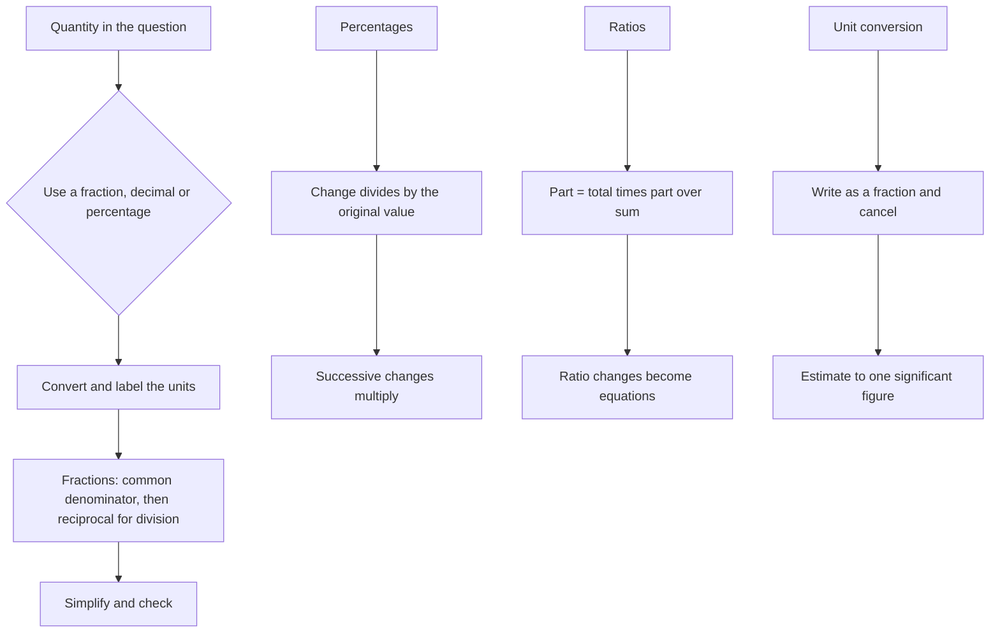

# Number Sense and Operations

Every other topic in the mathematics subtest rests on this one. Algebra asks you to solve for a quantity, geometry asks you to compute a length, statistics asks you to divide by a total, and a shaky arithmetic underneath cannot be rescued by good reasoning. The University of the Philippines publishes no mathematics syllabus for UPCAT, so the topic organisation below is StudyRoadmap's own; the arithmetic itself is not, and it is worth saying that a candidate who can execute the six operations here without errors has already removed a whole class of lost marks.

### 🟢 Lite — Quick Review (1h–1d)

**Fractions.** Convert to a common denominator before adding or subtracting, multiply and divide directly, then simplify.

- 3/8 + 1/6: the lowest common denominator of 8 and 6 is 24, so 9/24 + 4/24 = 13/24.
- 2/3 ÷ 4/5: multiply by the reciprocal, so 2/3 × 5/4 = 10/12 = 5/6.
- Mixed numbers convert first: 2 3/4 = 11/4. Order matters in subtraction: 1 − 2/3 is 1/3, not −1/3.

**Decimals and percentages.** Three equivalent forms, and the conversion is pure revision time.

| Fraction | Decimal | Percentage | Fraction | Decimal | Percentage |
|---|---|---|---|---|---|
| 1/2 | 0.5 | 50% | 1/5 | 0.2 | 20% |
| 1/4 | 0.25 | 25% | 1/8 | 0.125 | 12.5% |
| 3/4 | 0.75 | 75% | 1/3 | 0.333… | 33.3%… |

- 15% of 240 = 0.15 × 240 = 36.
- Percentage change: (new − old) ÷ old × 100. From 80 to 100 the change is 25%; from 100 to 80 it is −20%. The denominator is always the original value.
- Percentage difference between two figures uses the mean of the two as the denominator, which is what separates it from percentage change.
- "What percentage" questions: 45 is what percentage of 180? 45 ÷ 180 = 0.25 = 25%.

**Order of operations.** Brackets, then powers, then multiplication and division left to right, then addition and subtraction left to right. The sign traps sit in the minus and in the bracket: −3² = −9 while (−3)² = +9; 8 − 3 − 2 = 3, not 7; and −(2 + 3) = −5 while −2 + 3 = 1.

**Ratio and proportion.**

- Divide a quantity in a given ratio by adding the parts and allocating: 3:5 of 96 gives 96 × 3/8 = 36 and 96 × 5/8 = 60.
- Ratios of ratios multiply: if A is 3 times B and B is 2 times C, then A is 6 times C. The trap answer is 5C.
- Proportion: if 5 machines produce 300 units in 4 hours, one machine in one hour produces 15 units, so 12 machines in 6 hours produce 1,080.
- Rates: a unit rate converts to any other unit by multiplying by conversion factors until the unwanted unit cancels.

**Unit conversion.** Write the conversion as a fraction and cancel.

- Speed: 90 km/h = 90 × 1000/3600 m/s = 25 m/s. Multiply m/s by 3.6 to get km/h.
- Volume: 1 m³ = 1,000 litres, 1 litre = 1,000 cm³, so 1 m³ = 1,000,000 cm³.
- Mass: 1 kg = 1,000 g, 1 tonne = 1,000 kg. Time: 2.5 hours = 2 hours 30 minutes.

**Estimation.** Round each factor to one significant figure and multiply. 48 × 62 ≈ 50 × 60 = 3,000. If your exact answer lands near 3,000 you are on track; if it lands near 300, you dropped a factor of ten somewhere.

**Memorise for the Lite tier.**

- Common denominator before adding fractions; reciprocal when dividing.
- Percentage change divides by the original value.
- Minus applies to the whole term: −3² ≠ (−3)².
- Divide in a ratio by multiplying by each part over the total.
- Ratios of ratios multiply, they do not add.
- Check an answer by estimating to one significant figure.

### 🟡 Standard — Full Coverage (1–2d)

#### Worked example: successive percentage change

**The stem.** A shop raises a price by 20% and then cuts it by 20%. An item that cost 500 now sells for 480. A classmate says the price is back where it started because the increases and decreases cancel.

**The reasoning.** They cancel in percentage points, not in money. 500 × 1.20 = 600, and 600 × 0.80 = 480. The final price is 96% of the original, a 4% decrease. The base changed between the two operations: the 20% cut applied to 600, not to 500.

**The general rule.** Successive changes multiply: a rise of x% then a fall of y% gives a net multiplier of (1 + x/100)(1 − y/100). Equal rises and falls always leave the price below the start, and the gap widens as the percentage grows.

**The reverse question.** A price falls 20% and lands on 96. What was it before? Not 96 plus 20% of 96. Divide: 96 ÷ 0.8 = 120. The classic mistake is adding 20% of the new price to the new price, which gives 115.2 and is wrong.

#### Worked example: a ratio that changes

**The stem.** In a class the ratio of girls to boys is 4:3. If 8 more girls join, the ratio becomes 3:2. What were the original numbers of girls and boys?

**The reasoning.** Write the original counts as 4k and 3k. After the change the ratio is (4k + 8) : 3k = 3 : 2, so 2(4k + 8) = 9k, giving 8k + 16 = 9k and k = 16. Girls = 64, boys = 48, total 112. Check: after 8 girls join, 72 : 48 = 3 : 2, and 72/48 = 1.5 = 3/2.

**The method.** When a ratio changes, express the parts with a single variable first, then set the new ratio as an equation. Trying to adjust the ratio directly is where marks are lost.

#### Worked example: an error interval

**The stem.** A measurement is recorded as 3.456 to three decimal places. Give the error interval.

**The reasoning.** The true value lies between 3.4555 and 3.4565. For a value rounded to three decimal places, the interval runs from the last digit minus half a unit in the fourth place to the last digit plus half a unit, so the maximum absolute error is 0.0005 and the percentage error on a value near 3.456 is 0.0005 ÷ 3.456 × 100 ≈ 0.0145%.

**The trap.** Reporting the interval as 3.456 ± 0.0005 uses the right idea but must be written as 3.4555 ≤ x < 3.4565, because many schemes require the lower bound to be the smallest number that rounds up to the recorded value. That is why 3.4555 is the answer and 3.455 is not.

### 🔴 Deep — Mastery (3–5d)

**Percentages that mislead.** A vacancy rate falling from 20% to 15% is a fall of 5 percentage points and a relative fall of 25%, and the two must not be confused. A percentage of a percentage multiplies: if 40% of a class are girls and 25% of the girls wear glasses, then 10% of the class wears glasses, since 0.40 × 0.25 = 0.10. Repeated percentage change multiplies too, so a machine losing 20% of its value each year retains 0.8ⁿ of its original value, and after five years leaves 0.8⁵ = 0.32768, so just over a third. Straight-line depreciation gives a different and wrong answer, and the item wants you to say which model was used. A mean of means needs weights: if 60% of students scored 70 and 40% scored 90, the mean is 0.6 × 70 + 0.4 × 90 = 78, not the simple average of 80.

**Proportion across units.** Every proportion problem is a chain of ratios: to convert km per hour into metres per second, km/h × (1000 m / 1 km) × (1 h / 3600 s) = m/s, and writing the chain and cancelling units prevents the errors that follow a wrong choice of direction. Three classic rate families are speed = distance ÷ time, density = mass ÷ volume and pressure = force ÷ area. When two pipes fill a tank, their rates add: a pipe filling it in 4 hours and one in 6 hours give 1/4 and 1/6 tank per hour, so together they fill 5/12 of a tank per hour and the tank fills in 12/5 = 2.4 hours. The trap is to average the times and halve, which gives 2.5 hours.

**Error and estimation.** Absolute error is the size of the uncertainty in the units of the measurement; relative error is absolute error divided by the measured value, and it is the only version that can be compared across quantities. For addition and subtraction, absolute errors add, while for multiplication and division, relative errors add, so a product of two 2% measurements carries 4% relative error and a long chain of multiplications degrades in accuracy faster than a chain of additions. Multiplication and division are limited by the fewest significant figures in the data, while addition and subtraction are limited by the least precise decimal place, and mixing those rules is a standard error. Finally, check without a calculator: estimate to one significant figure, check the order of magnitude, substitute the answer back, and confirm that the answer is physically sensible, since a negative length or a probability above 1 signals the error.

**Common mistakes.** Averaging percentages without weights; applying a percentage change to the new value; adding a percentage decrease to a percentage increase; treating a ratio change as an arithmetic change to the parts; converting units at the end of a calculation rather than the start; dropping a negative when distributing a minus; and ignoring the request to round.

**Exam traps.** A question asking for the percentage of students preferring one option across two years tests whether you divide by the correct total for each year, since the class size changed. A speed in km/h with a distance in metres asks you to convert at the start. Percentage change from 40 to 50 and from 50 to 40 differ in size and sign, and reversing the subtraction gets the second one wrong. How much 20% of 30% of a number is has answer 6%, and adding the two percentages gives 50%. A sum of two measurements with different precisions is decided by decimal places, not by digit counts.

#### 🧠 Memory Anchors

- **Common denominator before adding; reciprocal when dividing.**
- **Percentage change divides by the original.**
- **Successive changes multiply: +20% then −20% is −4%.**
- **Ratio of ratios multiply.**
- **Convert units before calculating, and cancel them explicitly.**
- **Flashcard Q&A:**
  - *What is −3²?* → −9, because the minus applies to the whole term.
  - *A price falls 20% to 96. Original?* → 120, by dividing by 0.8.
  - *A is 3 times B and B is 2 times C. A is?* → 6 times C.
  - *What limits a product's significant figures?* → The fewest significant figures in the data.
  - *How do two pipe rates combine?* → Add them, then invert the sum for the time.

#### Internal links

- [UPCAT exam hub](/exams/upcat/) — the four official subtests and the five-hour sitting.
- [Algebra: Equations and Inequalities](/notes/upcat/mathematics/) — where these numbers become unknowns to solve for.
- [Geometry and Measurement](/notes/upcat/mathematics/) — the area, volume and ratio work that builds on unit conversion.

Everything on this page concerning UPCAT itself comes from the University of the Philippines Office of Admissions (https://upcat.up.edu.ph/htmls/aboutupcat.html, retrieved 9 October 2026). UP publishes no mathematics syllabus or per-subtest weightage for UPCAT; the weights here are StudyRoadmap's own prioritisation.

---

## Continue your study

- **[View this topic in your UPCAT (UP College Admission Test) roadmap](/roadmap/?exam=upcat&duration=1mo)** — see where this topic sits in your personalised plan
- **[Build a quick revision plan](/roadmap/?exam=upcat&duration=1d)** — 1-day sprint covering the highest-weight topics
- **[UPCAT (UP College Admission Test) exam overview](/exams/upcat/)** — pattern, eligibility, and syllabus
- **[All Mathematics notes](/notes/upcat/mathematics/)** — browse sibling topics in this subject
