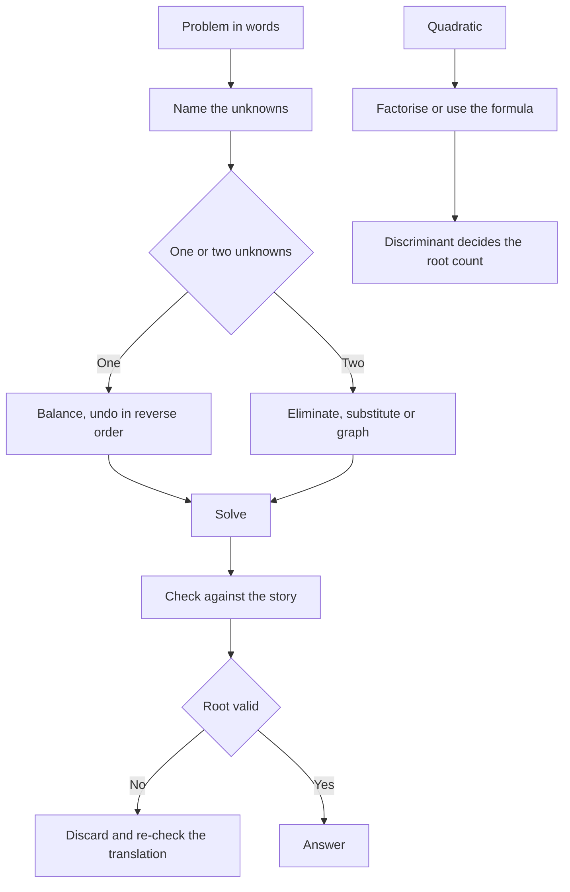

# Algebra: Equations and Inequalities

Algebra is where UPCAT mathematics stops being arithmetic and starts being reasoning. A numerical question asks you to compute; an algebra question asks you to decide what is unknown, write the relation that connects the quantities, and then solve it. Candidates who lose marks here rarely make arithmetic errors: they make translation errors, and they carry the wrong root into the answer. The habit that fixes both is to name the quantities, write the relation as an equation, solve, then check the solution against the story.

### 🟢 Lite — Quick Review (1h–1d)

**Expanding and collecting.** Brackets distribute: a(b + c) = ab + ac, and a minus in front of a bracket flips every sign inside, so −(x − 3) = −x + 3. Squares follow (a ± b)² = a² ± 2ab + b², and the middle term is the part candidates drop. Cubes follow (a + b)³ = a³ + 3a²b + 3ab² + b³. Collect like terms only: 3x² + 2x − x² + 5 = 2x² + 2x + 5.

**Solving linear equations.** Undo in reverse order: subtract, divide, subtract, divide. If the unknown appears on both sides, move the terms together first. 3x + 7 = 2x − 4 gives x = −11. To clear fractions, multiply through by the lowest common denominator: 2x/3 + 1 = 4 becomes 2x + 3 = 12, so x = 4.5. Never divide by an expression that could be zero.

**Index laws.**

| Law | Example | Law | Example |
|---|---|---|---|
| aᵐ × aⁿ = a^(m+n) | 2³ × 2⁴ = 2⁷ | a⁰ = 1 | 5⁰ = 1 |
| aᵐ ÷ aⁿ = a^(m−n) | 2⁶ ÷ 2² = 2⁴ | a⁻ⁿ = 1/aⁿ | 2⁻³ = 1/8 |
| (aᵐ)ⁿ = a^(mn) | (3²)³ = 3⁶ | a^(1/n) = ⁿ√a | 8^(1/3) = 2 |

**Simultaneous equations.** Elimination means lining the equations up so like terms are in columns, multiplying one or both until a variable matches, then adding to remove that variable or subtracting one from the other. Substitution means solving one equation for one variable and putting that into the other. Graphically, the solution is the point where the two lines cross.

Worked: 2x + 3y = 12 and x − y = 1. From the second, x = y + 1. Substituting gives 2(y + 1) + 3y = 12, so 5y = 10 and y = 2, giving x = 3. Check: 2(3) + 3(2) = 12 and 3 − 2 = 1.

**Quadratic equations.** Factorising means looking for two numbers that multiply to give the constant and add to give the coefficient of x: x² + 5x + 6 = 0 becomes (x + 2)(x + 3) = 0, so x = −2 or x = −3. Completing the square turns x² + 6x + 5 = 0 into (x + 3)² = 4, so x = −1 or x = −5. The quadratic formula covers everything: for ax² + bx + c = 0, x = [−b ± √(b² − 4ac)] / 2a, and for 3x² − 5x − 2 = 0 the discriminant is 25 + 24 = 49, so x = (5 ± 7)/6, giving x = 2 or x = −1/3.

**The discriminant decides the number of roots.** b² − 4ac above zero gives two distinct real roots, equal to zero gives one repeated root, and below zero gives no real roots. An item that asks whether a graph crosses the x-axis, touches it, or misses it is asking the same question.

**Inequalities.** Solve exactly as an equation, and if you multiply or divide by a negative number, reverse the inequality: −2x > 6 becomes x < −3. On a number line, use a closed dot for ≤ or ≥ and an open dot for < or >. "At least" means ≥, "more than" means >, and "between" excludes the endpoints unless the question says otherwise. A quadratic inequality uses a sign diagram: x² − 5x + 6 < 0 becomes (x − 2)(x − 3) < 0, and the parabola is negative between its roots, so 2 < x < 3.

**Translating words into expressions.**

| Statement | Expression |
|---|---|
| A number is 3 more than twice another | y = 2x + 3 |
| A number is 20% of another | y = 0.2x |
| The sum of two numbers is 40 | x + y = 40 |
| Twice the first is 5 more than the second | 2x = y + 5 |

**Rearranging formulae.** Keep the structure and move the subject to one side: V = πr²h gives h = V ÷ (πr²), and y = (3x + 4)/5 gives x = (5y − 4)/3.

**Memorise for the Lite tier.**

- A minus in front of a bracket flips every sign inside.
- (a + b)² = a² + 2ab + b², and the middle term is the one you drop.
- Dividing by a negative reverses the inequality.
- Discriminant above zero, at zero, below zero: two roots, one root, no real roots.
- Solve, then check the root against the story.
- Clear fractions before solving, and never divide by a possible zero.

### 🟡 Standard — Full Coverage (1–2d)

#### Worked example: simultaneous equations from a story

**The stem.** Two trays of fruit and three trays of vegetables cost 100 units. Three trays of fruit and two trays of vegetables cost 95 units. Find the cost of one tray of each.

**The reasoning.** Name the unknowns before writing anything: let x be the cost of a tray of fruit and y the cost of a tray of vegetables. Each fact becomes one equation, 2x + 3y = 100 and 3x + 2y = 95. Eliminate x by multiplying the first by 3 and the second by 2, giving 6x + 9y = 300 and 6x + 4y = 190. Subtracting gives 5y = 110, so y = 22, and substituting into the first equation gives 2x + 66 = 100, so x = 17.

**The check.** 2(17) + 3(22) = 100 and 3(17) + 2(22) = 95, so both original conditions hold.

**The trap.** Solving for x before reading the whole story, and using the price of the wrong item.

#### Worked example: choosing a quadratic method

**The stem.** Solve x² − 8x + 12 = 0, then find the roots of 5x² − 3x − 2 = 0.

**The reasoning.** The first factorises, because the numbers that multiply to 12 and add to −8 are −2 and −6, so (x − 2)(x − 6) = 0 and x = 2 or x = 6.

The second has no integer factorisation: the pairs of factors of 10 that add to −3 are 2 and −5, and that gives a middle term of −25x rather than −3x. So use the formula. The discriminant is 9 + 40 = 49, so x = (3 ± 7)/10, giving x = 1 or x = −0.4.

**The reasoning that earns the marks.** Look at the discriminant before you start hunting for factors. A perfect-square discriminant means the roots are rational and factorising will work; a discriminant that is not a square tells you to stop trying.

#### Worked example: an inequality with an integer answer

**The stem.** Find the greatest integer value of x that satisfies 2x + 1 < 9.

**The reasoning.** Subtract 1: 2x < 8. Divide by 2: x < 4. The greatest integer below 4 is 3, because 4 itself is excluded by the strict inequality. On a number line the boundary would be an open dot.

**The trap.** Answering 4. The inequality sign is strict, so the boundary value is not a solution. The same rule applies to compound questions, where the item wants both the interval and the count of integers inside it.

### 🔴 Deep — Mastery (3–5d)

**Quadratic functions as graphs.** A quadratic y = ax² + bx + c has an axis of symmetry at x = −b/2a, a vertex there, and x-intercepts where the value is zero. The discriminant decides the intercepts, the sign of a decides the direction, and the vertex form y = a(x − h)² + k reads the vertex straight off as (h, k). Converting between forms is worth practising: y = x² + 6x + 5 becomes y = (x + 3)² − 4, so the vertex sits at (−3, −4). Completing the square is also how you find a maximum: if a rectangle has a perimeter of 40 cm, the area A = x(20 − x) = 100 − (x − 10)², so the largest area is 100 cm² at a square, because a squared term is never negative.

**Sequences and series.** An arithmetic sequence has a constant difference d, an nth term of a + (n − 1)d and a sum of n terms of n/2 [2a + (n − 1)d]. A geometric sequence has a constant ratio r, an nth term of a·r^(n−1) and a sum of a(r^n − 1)/(r − 1). Special sequences to recognise: squares 1, 4, 9, 16; triangular numbers 1, 3, 6, 10; cubes 1, 8, 27, 64; and the Fibonacci sequence 1, 1, 2, 3, 5, 8, 13, where each term is the sum of the previous two. A constant first difference in a difference table signals an arithmetic sequence, and a constant second difference signals a quadratic sequence whose nth term can be written as an² + bn + c. Pairing terms from opposite ends confirms an arithmetic sum without more arithmetic.

**Algebraic proof.** Start from what you are given and work towards what you must show. Given a + b = 7 and ab = 12, show that a² + y² = 25: then a² + b² = (a + b)² − 2ab = 49 − 24 = 25. The same values can be attacked by computing x = 5 and y = 3 directly, which works until the given values are awkward, at which point the symmetric route is shorter. Two rules matter: you cannot square both sides of an equation and assume the reverse implication holds, and you cannot divide by an expression that could be zero, since that loses the case where it is zero.

**Inequalities and domains.** Sign diagrams handle any product or quotient of linear factors: mark the critical values, test the sign in each interval, and read off the solution. For a downward-opening parabola the signs reverse relative to the upward case, so sketching first removes the chance of getting it backwards. State the domain before the range: y = √(x − 3) has domain x ≥ 3, and 1/x needs x ≠ 0.

**Common mistakes.** Dropping the middle term when expanding a square; using the wrong sum formula for a geometric sequence; reversing an inequality only sometimes; answering a strict inequality with the boundary value; losing a solution by dividing by a zero in a quadratic; assuming the larger root is the wanted one when a length or an age cannot be negative; and forgetting to state units.

**Exam traps.** A question asking for the sum of the first twenty terms of an arithmetic sequence given the first three terms wants a and d read off, then the sum formula. A recurrence such as u_(n+1) = 2u_n + 3 is best built term by term with the working shown. A question asking how many integers satisfy an inequality wants the interval and the count. A graph of y = x² − 5x + 6 with a question about where the graph falls below the x-axis is answered by factorising for the roots 2 and 3, then stating 2 < x < 3. The line joining (2, 3) and (6, 11) has gradient (11 − 3)/(6 − 2) = 2, so the equation is y = 2x − 1.

#### 🧠 Memory Anchors

- **(a + b)² = a² + 2ab + b², and the middle term is the one you drop.**
- **Quadratic formula: [−b ± √(b² − 4ac)] / 2a.**
- **Discriminant: two roots, one root, no real roots.**
- **Dividing by a negative reverses the inequality.**
- **Arithmetic: a + (n−1)d and n/2 [2a + (n−1)d]. Geometric: a·r^(n−1) and a(r^n − 1)/(r − 1).**
- **Flashcard Q&A:**
  - *What is the nth term of an arithmetic sequence?* → a + (n−1)d.
  - *When do you use completing the square?* → When a question asks for a maximum, a minimum or a vertex.
  - *What does a constant second difference signal?* → A quadratic sequence.
  - *How do you clear fractions in an equation?* → Multiply through by the lowest common denominator.
  - *What does a closed dot on a number line mean?* → The boundary value is included.

#### Internal links

- [UPCAT exam hub](/exams/upcat/) — the four official subtests and the five-hour sitting.
- [Number Sense and Operations](/notes/upcat/mathematics/math-001/) — the arithmetic every equation here depends on.
- [Functions and Graphs](/notes/upcat/mathematics/math-003/) — where a solved root becomes a point on a graph.

Everything on this page concerning UPCAT itself comes from the University of the Philippines Office of Admissions (https://upcat.up.edu.ph/htmls/aboutupcat.html, retrieved 9 October 2026). UP publishes no mathematics syllabus or per-subtest weightage for UPCAT; the weights here are StudyRoadmap's own prioritisation.

---

## Continue your study

- **[View this topic in your UPCAT (UP College Admission Test) roadmap](/roadmap/?exam=upcat&duration=1mo)** — see where this topic sits in your personalised plan
- **[Build a quick revision plan](/roadmap/?exam=upcat&duration=1d)** — 1-day sprint covering the highest-weight topics
- **[UPCAT (UP College Admission Test) exam overview](/exams/upcat/)** — pattern, eligibility, and syllabus
- **[All Mathematics notes](/notes/upcat/mathematics/)** — browse sibling topics in this subject
