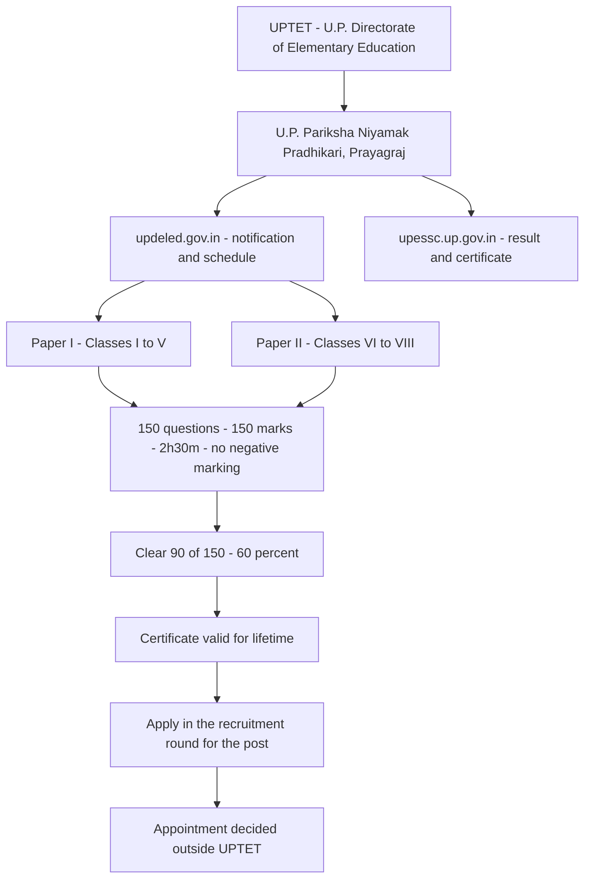

# UPTET: Who Conducts It, and How the Exam Runs

### 🟢 Lite — Quick Review (1h–1d)
> The short answer to "who conducts UPTET", and the numbers that decide whether you qualify on exam day.

UPTET is run by the **U.P. Directorate of Elementary Education**, whose office is the **U.P. Pariksha Niyamak Pradhikari, Prayagraj**. That office publishes the notification and the schedule on **updeled.gov.in**, and the result and the eligibility certificate appear on **upessc.up.gov.in**. Pages that name the **UP Basic Education Board (UPBEB)** as the conducting body are quoting an arrangement that has been superseded.

The test does not appoint anybody. It decides eligibility for teaching posts in government and aided schools across Uttar Pradesh, and the certificate it produces stays valid for life.

| Question | Answer |
| --- | --- |
| Who conducts UPTET | U.P. Directorate of Elementary Education (U.P. Pariksha Niyamak Pradhikari), Prayagraj |
| Where the notification and schedule live | updeled.gov.in |
| Where the result and certificate live | upessc.up.gov.in |
| Papers | Paper I for Classes I-V, Paper II for Classes VI-VIII |
| Each paper | 150 questions, 150 marks, 2 hours 30 minutes |
| Negative marking | None |
| Qualifying mark | 60% of 150 = 90; relaxations fixed per notification |
| Certificate validity | Lifetime |

#### The five facts that settle the question

- **Who:** U.P. Directorate of Elementary Education, working through the U.P. Pariksha Niyamak Pradhikari (PNP), Prayagraj.
- **Where the notice is published:** updeled.gov.in. The portal lists "U.P.Teacher Eligibility Test (UPTET)" under candidate services, and the UPTET page carries the schedule and the activity status for the cycle.
- **Where the result and certificate appear:** upessc.up.gov.in.
- **What the test is for:** eligibility for teaching posts in government and aided schools in UP. It is a filter, not an appointment.
- **What you get:** a certificate that is valid for lifetime.

#### Paper shape, side by side

| Section | Paper I (Classes I-V) | Paper II (Classes VI-VIII) |
| --- | --- | --- |
| Child Development & Pedagogy | 30 | 30 |
| Language I (Hindi) | 30 | 30 |
| Language II (English / Urdu / Sanskrit) | 30 | 30 |
| Subject block | Mathematics 30, Environmental Studies 30 | Science 30 and Social Studies 30, or Mathematics and Science 60 for Mathematics teachers |
| Total | 150 questions, 150 marks | 150 questions, 150 marks |
| Time allowed | 2 hours 30 minutes | 2 hours 30 minutes |

Social Studies appears only in Paper II, and only as **30 of the 150 marks**. The remaining 120 marks in that paper are pedagogy, two languages and science, so a Social Studies candidate is preparing for a subject paper that is one fifth of the paper.

#### One minute a question

150 minutes for 150 questions is **60 seconds a question**, and that budget covers the 30 Child Development and Pedagogy items as well. Both papers break into five blocks of 30 marks, so a paper with a subject block of 60 has one fewer block than it looks like.

#### Eligibility in four lines

- **Paper I:** Class XII or equivalent with at least 50% marks, plus appearing for or having completed the 2-year D.El.Ed/BTC or an equivalent qualification.
- **Paper II:** a bachelor's degree with 50% marks, plus the 2-year D.El.Ed/BTC or the 4-year B.El.Ed.
- **Mathematics teachers sitting Paper II:** B.Tech or B.E. in the relevant subject is also accepted.
- **Everyone:** candidates in the final year of D.El.Ed/BTC can also appear, and while the age limit varies by category, the exam itself carries no upper age limit.

---

### 🟡 Standard — Regular Study (2d–2mo)
> How the two portals fit together, what each paper asks, and how eligibility is actually decided.

#### Who conducts UPTET, and who appoints teachers on it

Two bodies are involved and students routinely merge them.

**The Directorate of Elementary Education** conducts the test. The office that signs and publishes the notice is the **U.P. Pariksha Niyamak Pradhikari, Prayagraj**, which is why the portal address reads that way and why the public contact address for the test sits under that office rather than under a board. The Directorate publishes notifications, the schedule, the activity status for the cycle and the application for the test.

**The State government** appoints teachers. The UPTET certificate is the eligibility condition for posts in government and aided schools across Uttar Pradesh, and the recruitment round that advertises a vacancy is a separate process with its own notice, its own application and its own merit list. Clearing UPTET does not put your name on a school payroll, and the honest way to describe it is: the test decides whether you may apply, the recruitment round decides whether you are selected.

That distinction is the single most expensive misunderstanding in this exam, and it is also the one that the official material warns about. The test is an eligibility test, not a job guarantee.

#### Two portals, two jobs

| Portal | What it carries | When you need it |
| --- | --- | --- |
| updeled.gov.in | Notifications, the schedule for the cycle, activity status, application links | Before you register, and again whenever you check whether the next cycle's notice is out |
| upessc.up.gov.in | The result and the eligibility certificate | After the exam |

Both are official. A page that mixes them is usually an aggregator, and aggregators are the reason the UPBEB attribution keeps spreading.

The portal's own contact block gives the help line for the test as **0532-2467504** and **0532-2466769**, with the email address **secretarypnp.up@gmail.com**, and the office address as U.P. Pariksha Niyamak Pradhikari, Prayagraj. When this note was written, the UPTET page on the portal showed the schedule activity as closed, which is what a between-cycle state looks like. Live dates, fees and centre cities come from the notice for the cycle you are sitting, never from a cached page.

#### What each paper asks

Paper I is for Classes I to V and Paper II is for Classes VI to VIII. Both carry 150 questions of 1 mark each, and both give you 2 hours 30 minutes.

The structure that surprises people is how little of either paper is subject content.

- **Paper I** is 30 Child Development and Pedagogy, 30 Hindi, 30 English/Urdu/Sanskrit, 30 Mathematics and 30 Environmental Studies.
- **Paper II** is 30 Child Development and Pedagogy, 30 Hindi, 30 Language II, and then either Science plus Social Studies (30 each) or, for Mathematics teachers, Mathematics and Science together for 60.

Two things follow for a Social Studies candidate. First, Social Studies is a Paper II subject only; if you are going for a primary post, your subject block is Mathematics and Environmental Studies instead. Second, even in Paper II, Social Studies is 30 marks out of 150, and Child Development and Pedagogy is 30 marks out of 150 in both papers. The pedagogy section is not a warm-up section. It is a fifth of the paper, and it is the part most often left to the last week.

The test also checks understanding of how children learn, teaching methods and assessment, not only subject facts, so a candidate who has revised only the syllabus content of their subject arrives with 30 marks unexplained.

#### The 90-mark arithmetic

The qualifying bar is 60% of 150, which is 90 marks. There is no negative marking, so every mark you get right is a mark you keep, and you can lose 60 marks and still qualify.

Because both papers split into blocks of 30, the bar has a clean shape: **18 out of 30 in three blocks** is exactly 90. That is arithmetic on the published 60% figure, not a separate rule about sections, but it is the most useful way to keep the bar in your head while you sit.

Worked example, Paper II for a Social Studies candidate:

| Block | Marks | Marks lost |
| --- | --- | --- |
| Child Development & Pedagogy | 24 | 6 |
| Hindi | 26 | 4 |
| Language II | 22 | 8 |
| Social Studies | 24 | 6 |
| Science | 18 | 12 |
| Total | 114 | 36 |

That is 114 out of 150, so 76%, comfortably above the bar. Now take the same candidate and imagine Science collapses to 4: the total becomes 100, still qualifying. Take Social Studies down to 10 as well: 86, and the candidate is out by four marks, on a paper where the loss was entirely in two blocks that together carry 60 marks.

The lesson is not that science and social studies are unimportant. It is that a 30-mark block can be the difference between a certificate and a re-attempt, because 30 marks is a third of the total loss budget of 60.

#### How eligibility is decided

There are two separate decisions, and candidates often run them together.

**Whether you may sit.** For Paper I, the qualification is Class XII or equivalent with at least 50% marks, combined with appearing for or having completed the 2-year D.El.Ed/BTC or an equivalent. For Paper II, it is a bachelor's degree with 50% marks combined with the 2-year D.El.Ed/BTC or the 4-year B.El.Ed. Mathematics teachers sitting Paper II may also qualify on B.Tech or B.E. in the relevant subject. Final-year D.El.Ed/BTC candidates can apply before the qualification is formally awarded.

**Whether you qualify.** That is the 90-mark bar in the paper above, with reserved-category relaxations fixed per notification. Read the relaxation list from the live notice for the cycle you are applying to. A relaxation table copied from an earlier cycle is exactly the kind of stale fact that gets people to the exam centre confident and unqualified.

On age: the limit varies by category, but there is no upper age limit attached to the exam itself.

#### What a UPTET certificate is not

It is not a job. It is not a vacancy. It does not expire. It is not the same thing as a recruitment result.

The certificate is the eligibility document that recruitment rounds ask for, and it is valid for life. That is why it is worth downloading and storing properly the day the result appears, and why a candidate who clears in one cycle should not sit again out of anxiety. The only reasons to reappear are a change in the level you want to teach at (Paper I to Paper II, or the Mathematics-teacher variant of Paper II) or a wish to improve a score for its own sake.

#### After the result

1. **Check the result on upessc.up.gov.in.** The result and the certificate are published there, not on the notification portal.
2. **Download the certificate and read every field on it.** Registration number, name, paper, category, and the marks. Errors in a name or category are cheap to fix at the office and expensive to carry into a recruitment application.
3. **Keep it as a PDF in two places.** It is valid for life, and it is the document every recruitment application will ask you to upload.
4. **Read the recruitment notice, not the TET notice, for vacancies.** The TET notice never carries post details. Vacancy counts, post names, subject requirements and application dates live in the recruitment notice of the body running that round.
5. **Keep the copy of the notification you applied under.** The relaxation rules, the paper combinations allowed and the fee belong to that cycle, and if anything is queried later, the notice is the reference that settles it.

#### Where candidates get the details wrong

| Claim you will meet online | What the current arrangement is |
| --- | --- |
| "UPBEB conducts UPTET" | Out of date. The notice is published by the U.P. Directorate of Elementary Education through the U.P. Pariksha Niyamak Pradhikari, Prayagraj |
| "The certificate expires after three years" | It does not. The certificate is valid for lifetime |
| "Clearing UPTET means you have a job" | No. UPTET is eligibility, not a job guarantee; the recruitment round comes after |
| "CTET books are the same as UPTET papers" | UPTET is a state test with its own paper structure. CTET material is practice, not a substitute for UPTET-specific preparation |
| "The qualifying percentage is the same every year" | 60% is the published bar, but reserved-category relaxations are fixed per notification. Read the current one |

---

### 🔴 Extended — Deep Study (3mo+)
> Where every number comes from, how to read the live notice for your cycle, and how to spend 150 minutes.

#### The source of every number on this page

| Fact used here | Where it comes from |
| --- | --- |
| Conducting body, both portal addresses, the UPBEB attribution being outdated | The UPTET exam data file for this site, and the official portal updeled.gov.in |
| Paper I and Paper II section split, 150 questions, 150 marks, 2 hours 30 minutes, no negative marking, 60% bar | The UPTET exam data file, which quotes the official notification on the portal |
| Class XII / bachelor's / D.El.Ed / BTC / B.El.Ed / B.Tech eligibility conditions, final-year rule, age position | The eligibility section of the same exam data file |
| Certificate validity for lifetime, TET as eligibility rather than a job guarantee | The description and the common-mistakes list in the same file |
| Help line numbers, email address, office address, portal navigation, "U.P.Teacher Eligibility Test (UPTET)" under candidate services | Read directly from updeled.gov.in |
| Fees, exam dates, centre cities, reserved-category relaxation percentages | Not stated in our data. Read them from the live notification for your cycle |

That last row is the honest limit of this note. Where a number would be a guess, there is a procedure instead of a figure.

#### Reading the live notice for your cycle

The notification on updeled.gov.in is a fixed document with the same headings every time. Extract these five things and you have everything you need:

1. **Which papers you may sit, and in which combination.** The notice states the paper combinations allowed for the cycle. Do not assume from an earlier cycle.
2. **The window and the fee.** Registration dates, the last date for fee payment, and the fee for each paper.
3. **The schedule.** Date, reporting time, and the city options for the centre.
4. **The relaxations.** The reserved-category qualifying percentages and the relaxation on the upper-age condition, if any, exactly as printed.
5. **The qualifying bar itself.** 60% is the standard, but read the sentence in the notice rather than assuming it, because the notice is what binds you on the day.

Keep the file. When the result arrives, the certificate is issued against the cycle you applied in, and the notice is the only document that defines what that cycle required.

#### The qualifying bar and the relaxations

60% of 150 is 90 marks. Two things about that sentence cause trouble.

First, "60%" is the general bar. The relaxations are not a footnote; for a large part of the candidate pool, the operative number is lower, and it is printed in the notification rather than in any general description of the exam. A candidate who plans on the general bar when a relaxation applies has left marks on the table; a candidate who plans on a relaxation that has not been granted this cycle has a plan that does not survive the result.

Second, both papers are 150 marks, so the same 90-mark number applies whether you sit Paper I or Paper II. Do not carry a 120 or a 100 from some other state's teacher test into this one.

#### Spending 150 minutes

There is no official section order or time split. What follows is arithmetic and strategy, not a rule, and you should test it in a mock before exam day.

With 60 seconds a question, the paper has 150 decision points. A workable allocation for Paper II looks like this:

| Block | Marks | Suggested minutes | Seconds a question |
| --- | --- | --- | --- |
| Child Development & Pedagogy | 30 | 30 | 60 |
| Hindi | 30 | 25 | 50 |
| Language II | 30 | 25 | 50 |
| Science | 30 | 35 | 70 |
| Social Studies | 30 | 35 | 70 |
| Total | 150 | 150 | 60 |

The reasoning is that the two language sections are the fastest for most candidates, so they bank time for the subject block, while the 60-mark subject block gets the largest share because it is the only place where content knowledge is being tested.

Two habits pay for themselves. First, answer every question, because with no negative marking a considered guess is never worse than a blank: an incorrect tick and an empty bubble both score zero, so the downside of guessing is the same as the downside of silence while the upside is 1 mark. Second, do the two language sections first if you are stronger there, not because anyone tells you to, but because in a test with no negative marking the fastest way to build a safety buffer is to bank the questions you are certain of.

#### What "no negative marking" really changes

It changes the final twenty minutes. In an exam with negative marking, a blank is the safe choice under uncertainty. Here there is no such decision to make, so the last twenty minutes should be spent closing every unfinished question, not on re-checking.

It also changes how you read a practice score. With no penalty, a score of 100 out of 150 means you got 100 right and 50 wrong or blank, and you cannot tell from the score alone which. In your mock analysis, split it: attempts, correct, incorrect, blank. The blank count is the number of marks you were choosing to leave on the table, and it is the number you can fix first.

#### Widely repeated claims, checked against the current arrangement

| Claim | Check |
| --- | --- |
| "UPTET is conducted by the UP Basic Education Board" | Superseded. The notice comes from the U.P. Directorate of Elementary Education (U.P. Pariksha Niyamak Pradhikari), Prayagraj |
| "The result comes on the same site as the notification" | Two sites. Notification on updeled.gov.in, result and certificate on upessc.up.gov.in |
| "The UPTET certificate has to be renewed" | No renewal. It is valid for lifetime |
| "Paper I and Paper II carry different numbers of questions" | Both carry 150 questions, 150 marks, 2 hours 30 minutes. What changes is the subject block |
| "There is negative marking for wrong answers" | None, in either paper |
| "You need to clear both papers" | The notification states which combinations a candidate may sit for the cycle. Read that line rather than assuming |
| "Social Studies carries as much weight as the subject block in Paper II" | Social Studies is 30 of 150 marks in Paper II, and appears nowhere in Paper I |

#### Memory Anchors

- **Directorate conducts, PNP publishes, government appoints.** Three verbs, three different things.
- **updeled for the notice, upessc for the result.** Two portals, do not swap them.
- **150 questions, 150 marks, 150 minutes.** Same number three times, which is why the pace is 60 seconds a question.
- **60% means 90.** Five blocks of 30, three blocks at 18 each and you are exactly on the bar.
- **No negative marking means guess on the last question.** A blank and a wrong answer both score zero.
- **Certificate for life, appointment later.** TET is eligibility, not a job.

#### Practice Prompts

1. Write the full Paper II structure from memory, then check it against the UPTET page on updeled.gov.in: 150 questions, 150 marks, 2 hours 30 minutes, 30 for Child Development and Pedagogy, 30 for Hindi, 30 for Language II, and the 30 plus 30 subject split. Note which number you got wrong.
2. Take a previous Paper II and mark every question you would leave blank, then answer all of them anyway. Work out the score you gave up by leaving them blank, and compare it with the 60-mark loss budget that the 90-mark bar allows you.
3. List the documents you would need to apply for a government school post once you have your certificate, and then list the ones that come from the UPTET notice as opposed to the recruitment notice. Only the second list comes from UPTET.

---

## Continue your study

- **[View this topic in your UPTET roadmap](/roadmap/?exam=uptet&duration=1mo)** — see where "UPTET: Who Conducts It, and How the Exam Runs" fits in your personalised plan
- **[Build a quick revision plan](/roadmap/?exam=uptet&duration=1d)** — 1-day sprint covering highest-weight topics
- **[UPTET exam overview](/exams/uptet/)** — pattern, eligibility, and syllabus
- **[All Social Studies notes](/notes/uptet/social/)** — browse sibling topics in this subject
- **[Social Issues and Social Justice in India](/notes/uptet/social/social-008/)** — a core Social Studies topic for Paper II

*Content adapted based on your selected roadmap duration. Switch tiers using the selector above.*
