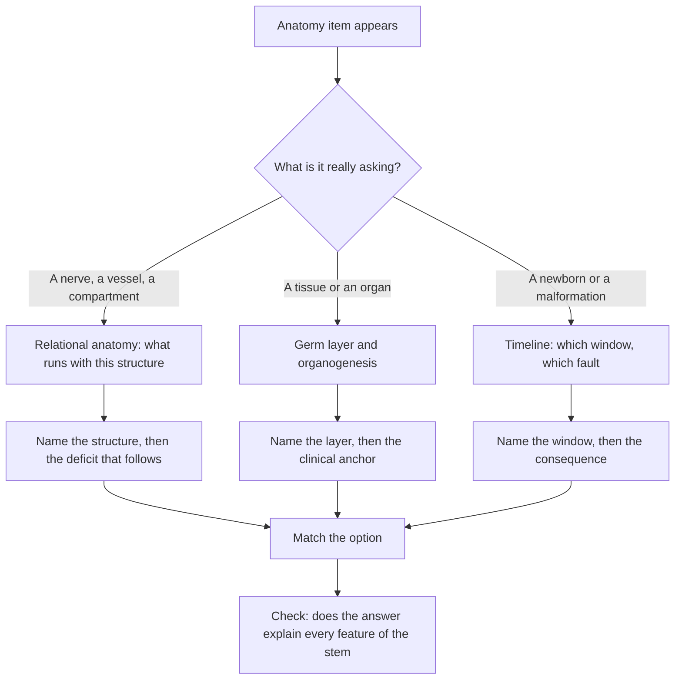

# Anatomy and Embryology

NBME describes Step 1 as assessing "your understanding of basic sciences crucial for practicing medicine", and the official site publishes no anatomy blueprint or sub-topic weightage. The structure below is StudyRoadmap's own organisation of the subject, and the priority given to it is ours.

Anatomy items here are not label recall. They are three questions wearing a coat: where is this structure, what sits next to it, and which developmental fault explains this patient.

### 🟢 Lite — Quick Review (1h–1d)

**Start by identifying which of three spines the item is testing.**

| Question shape | The spine you answer from |
|---|---|
| "Which nerve is injured?", "what is next to this vessel?" | Relational anatomy — what runs with the bone or the organ |
| "What is the embryological origin of this tissue?" | Germ layer and organogenesis |
| "This newborn has X" | The timeline and the fault that produces X |

**Germ layers and the derivatives that get asked.**

| Layer | Derivatives | Clinical anchor |
|---|---|---|
| Ectoderm | epidermis, hair, nails, lens, inner ear, neural tube, neural crest (dorsal root ganglia, sympathetic chain, adrenal medulla, melanocytes, craniofacial bone), posterior pituitary, ameloblasts | neural tube defects, neuroblastoma, Hirschsprung disease |
| Mesoderm | heart and great vessels, blood, bone, cartilage, skeletal muscle, kidneys, gonadal ridges, dermis | horseshoe kidney, ventricular septal defect, tetralogy of Fallot |
| Endoderm | epithelium of the gut and airway, liver, pancreas, thyroid follicular cells, parathyroids, thymic epithelium, bladder epithelium | diaphragmatic hernia, annular pancreas, thyroid agenesis |

**The timeline, compressed to what changes the patient.**

| Window | What happens | Fault and result |
|---|---|---|
| Week 1 | cleavage to morula, blastocyst, implantation | ectopic or failed implantation |
| Week 2 | bilaminar disc; amnion and chorion form | — |
| Week 3 | gastrulation gives the trilaminar disc; notochord appears; heart tube begins | failure of gastrulation; heart tube defects |
| Week 4 | neural folds close, somites appear, limb buds emerge, heart loops | cranial neuropore failure gives anencephaly |
| Weeks 5–8 | organogenesis, cardiac septation, neural tube closure completes | septal defects, spina bifida, transposition |
| Weeks 9–12 | palate fuses, external genitalia differentiate | cleft palate, hypospadias |

**The catalogue of faults worth carrying around.**

| Presentation | The fault behind it |
|---|---|
| Anencephaly | cranial neuropore failed to close, about day 24–26 |
| Spina bifida and myelomeningocele | caudal neuropore failed to close, about day 26–28; folate-sensitive, maternal serum alpha-fetoprotein rises |
| Ventricular septal defect | interventricular septum failed to form; the commonest congenital cardiac defect |
| Tetralogy of Fallot | conal septum displaced anterosuperiorly, so pulmonary stenosis, a septal defect, an overriding aorta and right ventricular hypertrophy travel together |
| Transposition of the great arteries | the aorticopulmonary septum failed to spiral |
| Persistent truncus arteriosus | neural crest migration failed, so the conus did not split; travels with 22q11.2 deletion |
| Coarctation of the aorta | narrowing at the ductus arteriosus; weak femoral pulses, and it travels with Turner syndrome |
| Hirschsprung disease | neural crest cells failed to migrate into the distal bowel, leaving it aganglionic |
| Posterior urethral valves | endodermal obstruction at the verumontanum, the commonest bladder outlet obstruction in male infants |
| Omphalocele versus gastroschisis | omphalocele is covered and chromosomal; gastroschisis is uncovered bowel beside the umbilicus |

**Memorise for the Lite tier:**
- Neural tube closes cranially first (about day 24–26), caudally later (about day 26–28).
- Somites come from paraxial mesoderm and form muscle, vertebrae and dermis.
- The diaphragm comes from four sources: septum transversum, pleuroperitoneal membranes, dorsal mesentery of the oesophagus and the body wall.
- Foregut, midgut and hindgut give the gut, and the midgut rotates 270° anticlockwise around the superior mesenteric artery.
- The ureteric bud comes from the mesonephric duct and makes the collecting system; the metanephric blastema makes the nephron.
- Arch nerves: first trigeminal, second facial, third glossopharyngeal, fourth and sixth vagus.
- The recurrent laryngeal nerve hooks under the aortic arch on the left and under the subclavian on the right.

### 🟡 Standard — Full Coverage (1–2d)

#### Worked example: bilious vomiting in a three-week-old

A three-week-old has had projectile vomiting for two days, and this morning it became bilious. A radiograph shows a gasless abdomen with dilated loops in the upper right quadrant. The infant is jaundiced and constipated.

The bilious colour is the finding that matters. It places the obstruction distal to the ampulla of Vater and rules out pyloric stenosis, which is the classic non-bilious vomiting of a four-week-old and sits proximal to the ampulla; pyloric stenosis also causes a hypochloremic metabolic alkalosis, which this infant does not have.

The fault is malrotation. The midgut herniates into the umbilical cord at about week 6 and returns while rotating 270° anticlockwise around the superior mesenteric artery. If the rotation is incomplete, the mesenteric root stays narrow and the bowel twists on it. The twist obstructs the bowel and compromises its blood supply, which is what turns a vomiting baby into a surgical emergency rather than a scheduled one. The right-quadrant gas and the jaundice fit the same picture, because the volvulus traps the duodenum and the biliary drainage with it.

**The trap.** Do not stop at "bilious vomiting means intestinal obstruction". The colour tells you where the obstruction is. The timeline, the mesenteric base and the blood supply tell you how fast you have to move.

#### Worked example: a newborn boy who cannot void

A newborn male dribbles urine, has a bladder you can feel through the abdominal wall, and has bilateral hydronephrosis. A voiding cystourethrogram shows a dilated posterior urethra.

This is posterior urethral valves, and the embryology settles it. The urethra develops from the endodermal urogenital sinus, and in the male the prostatic urethra sits between the ejaculatory ducts, so an abnormal mucosal fold at the verumontanum obstructs the bladder outlet. Because the obstruction is below the sphincter, the child dribbles rather than voiding in a strong stream. High pressure in the bladder then transmits back to the ureters and kidneys, which is why hydronephrosis and renal dysplasia are part of the picture. These valves are the commonest cause of bladder outlet obstruction in male infants; a female newborn with urinary obstruction has a different differential, centred on the urethra and the external genitalia.

#### Worked example: a child with a cardiac defect, a hypocalcaemic convulsion and an absent thymic shadow

A four-year-old presents with a seizure. Calcium is low, lymphocyte count is low, and the echocardiogram shows a truncus arteriosus. The face shows a cleft palate and a low-set ear.

Three systems have failed together, and one cause explains all of it: a deletion on chromosome 22 at 11q11–q11.2. The hypocalcaemia comes from the fourth pouch, which gives the superior parathyroids. The low lymphocyte count comes from the third pouch, which gives the thymus. The cardiac lesion comes from neural crest cells, which migrate into the conus and the aorticopulmonary septum; when they do not arrive, the truncus does not divide. Neural crest cells also build the craniofacial skeleton, which is why the face and palate are affected.

#### Relational anatomy: the nerve next to the bone

| Site | What travels with it | The deficit that follows |
|---|---|---|
| Surgical neck of the humerus | axillary nerve, posterior circumflex humeral artery | loss of shoulder abduction, deltoid wasting |
| Mid-shaft humerus | radial nerve in the spiral groove | wrist drop; the wrist extends only if the elbow is extended |
| Supracondylar humerus | brachial artery, median nerve | ischaemic hand, Volkmann contracture |
| Neck of the fibula | common peroneal nerve | foot drop, loss of eversion |
| Surgical neck of the scapula | suprascapular nerve | difficulty initiating abduction |
| Ulnar nerve at the elbow | passes behind the medial epicondyle | clawing of the ring and little fingers |

The cubital fossa reads medial to lateral as tendon, artery, nerve. The femoral triangle reads lateral to medial as nerve, artery, vein, empty space, lymphatics. The carotid sheath holds the vagus, the internal jugular vein and the common carotid artery. In the popliteal fossa the order from superficial to deep is tibial nerve, popliteal vein, popliteal artery.

#### The embryology of the gut

The foregut gives the pharynx, oesophagus, stomach, proximal duodenum, liver, gallbladder and pancreas. The midgut gives the distal duodenum, jejunum, ileum, caecum, appendix, ascending colon and proximal two-thirds of the transverse colon. The hindgut gives the distal third of the transverse colon, descending and sigmoid colon, rectum and upper anal canal. The midgut's blood supply follows that division: the superior mesenteric artery supplies everything from the distal duodenum to the proximal transverse colon, so an infarct of that artery spares the rectum.

Two faults get asked constantly. A persistent vitelline duct leaves a Meckel diverticulum, which sits about two feet from the ileocaecal valve and can contain gastric mucosa; the classic presentation is painless bleeding in a child, because acid from that mucosa digests the adjacent ileal mucosa. The other is Hirschsprung disease, where absent ganglion cells reflect failed neural crest migration, so the aganglionic segment cannot relax and the proximal colon dilates; the disease always starts at the anal canal and extends proximally in a continuous length, and it is associated with Down syndrome and with multiple endocrine neoplasia type 2.

#### Cross-sectional anatomy

Read orientation before content: by radiological convention the patient is viewed from the feet, so the left of the image is the patient's right and anterior structures sit at the top. On an abdominal slice the order from anterior to posterior is stomach or colon, then pancreas and its vessels, then aorta and vertebral body, then kidneys and posterior muscles, with the inferior vena cava to the patient's right of the aorta.

### 🔴 Deep — Mastery (3–5d)

#### Common mistakes

Learning anatomy as a list of structures rather than a list of relations. Almost every clinical anatomy item is a relation question.

Confusing the timing of neural tube closure. Cranial closure happens first, so anencephaly is a cranial neuropore failure and spina bifida a caudal one.

Treating every arch as having the same nerve. Each arch keeps its own nerve throughout life, so the second arch muscles are supplied by the facial nerve, not the trigeminal.

Putting the ureteric bud and the metanephric blastema the wrong way round. The bud makes the collecting system, the blastema makes the nephron.

Assuming the third pouch gives the inferior parathyroids and the fourth the superior. It is the other way round, and it is the most reversed fact in this topic.

#### Exam traps

The diaphragm has four embryological sources, and questions ask which failed. A posterolateral defect of the pleuroperitoneal membrane is a Bochdalek hernia, the common form, usually on the left; an anteromedial defect near the sternum is a Morgagni hernia, usually on the right. Either way the consequence is lung hypoplasia from abdominal contents crowding the chest.

A sac of bowel at the umbilical ring covered by a membrane is an omphalocele, the form associated with chromosomal abnormalities. Uncovered bowel beside a normal cord is gastroschisis, associated with a young maternal age and maternal smoking, and it carries a higher volvulus risk because no sac constrains the bowel.

The recurrent laryngeal nerve is the question behind hoarseness. It hooks under the aortic arch on the left and under the subclavian artery on the right, so a lesion above the arch affects both cords and one below it affects a single cord.

A testis came from the posterior abdominal wall, and so did an ovary. Testicular lymphatics follow the gonadal vessels to the para-aortic nodes while scrotal skin drains to the inguinal nodes, so scrotal skin cancer behaves like skin cancer and testicular cancer like an abdominal malignancy.

#### Integrated mini-cases

**Case one.** A mother takes valproate in the first trimester. The infant has a severe neural tube defect, a limb reduction anomaly and a cardiac septal defect. Name the two mechanisms. Valproate is a folate antagonist, so it produces the same neural tube defect as folate deficiency, and the limb reduction defect follows the thalidomide-style phocomelia pattern. Periconceptional folic acid reduces the recurrence risk.

**Case two.** A newborn girl has one perineal opening discharging both urine and stool, and imaging shows a common channel. What failed, and what else must be checked? The cloacal membrane failed to break down and the urogenital sinus failed to separate, leaving a persistent cloaca. The kidneys need separate assessment, because an obstructed outflow tract damages them before anyone notices.

#### 🧠 Memory Anchors

- **"Third pouch, inferior gland."** The third pouch gives the thymus and the inferior parathyroids; the fourth gives the superior parathyroids.
- **"TAN in the cubital fossa, VAN in the femoral triangle."** Tendon, artery, nerve at the elbow; nerve, artery, vein, empty space, lymphatics at the groin.
- **"Rule of 2s for Meckel's."** Two per cent of people, about two feet from the ileocaecal valve, about two inches long, two types of ectopic mucosa. It is a teaching aid, not a law.
- **Flashcard Q&A:**
  - *Caudal neuropore fails to close?* → Spina bifida, with maternal serum alpha-fetoprotein raised.
  - *Which nerve supplies the second arch muscles?* → The facial nerve, whatever the muscles have become.
  - *Ureteric bud forms?* → Collecting ducts, calyces, pelvis, ureter and part of the bladder trigone.
  - *Rectal cancer with periaortic nodes?* → The hindgut drainage pattern and the inferior mesenteric artery territory.

#### Internal links

- [USMLE exam hub](/exams/usmle/) — the three-step structure, sponsored by FSMB and NBME.
- [Biochemistry and Metabolism](/notes/usmle/step-1/s1-002/) — the metabolic side of the same Step 1 block.
- [Pathology: Systemic Disease](/notes/usmle/step-1/s1-005/) — where a developmental fault turns into a disease picture.

The description of Step 1 quoted here is the wording used by the FSMB and NBME (https://www.usmle.org/ and https://www.nbme.org/). This page states no item counts, timing, scoring scale, fees or test calendar, because none of those figures were verifiable from an official source at build time. The topic weights on this page are StudyRoadmap's own prioritisation, not an NBME blueprint.

---

## Continue your study

- **[View this topic in your USMLE (United States Medical Licensing Examination) roadmap](/roadmap/?exam=usmle&duration=1mo)** — see where this topic sits in your personalised plan
- **[Build a quick revision plan](/roadmap/?exam=usmle&duration=1d)** — 1-day sprint covering the highest-weight topics
- **[USMLE (United States Medical Licensing Examination) exam overview](/exams/usmle/)** — pattern, eligibility, and syllabus
- **[All Step 1 (Basic Sciences) notes](/notes/usmle/step-1/)** — browse sibling topics in this subject
