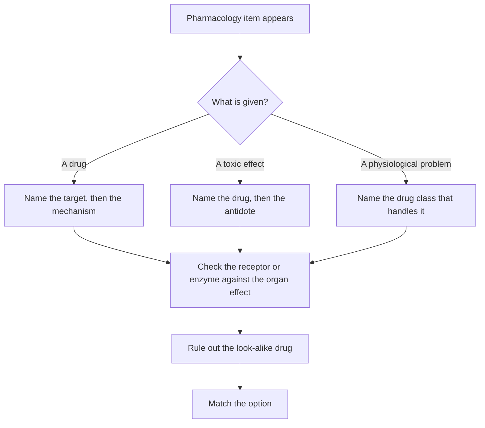

# Pharmacology

Pharmacology in this step is not a list of drugs. Almost every item is one of three shapes: a drug is given and you must name its target and its mechanism, a toxic effect is described and you must name the drug and its antidote, or a physiological change is presented and you must pick the drug class that handles it. The tables below are organised around those three shapes, because that is how the questions arrive.

NBME publishes no pharmacology blueprint or sub-topic weightage for Step 1, so the structure here is StudyRoadmap's own organisation of the subject.

### 🟢 Lite — Quick Review (1h–1d)

**The receptors. Learn the organ, not the receptor.**

| Receptor | Second messenger | What it does where it matters | Agonist | Antagonist |
|---|---|---|---|---|
| α1 | Gq | vascular smooth muscle constriction, mydriasis, bladder neck contraction | phenylephrine | prazosin, tamsulosin |
| α2 | Gi | blocks norepinephrine release presynaptically | clonidine | yohimbine |
| β1 | Gs | heart: rate, contractility, conduction | dobutamine, isoproterenol | metoprolol, atenolol |
| β2 | Gs | bronchial smooth muscle relaxation, uterine relaxation, liver glycogenolysis | salbutamol | propranolol |
| M3 | Gq | glandular secretion, smooth muscle contraction | pilocarpine | atropine |
| M2 | Gi | heart: rate and conduction fall | — | atropine |
| Nicotinic Nm | ion channel | neuromuscular junction | nicotine, succinylcholine | non-depolarising blockers |
| Nicotinic Nn | ion channel | autonomic ganglia | nicotine | hexamethonium |

**The drugs that carry their own antidote.**

| Drug or class | The toxic picture | The mechanism to say out loud | The fix |
|---|---|---|---|
| Organophosphate | cholinergic crisis: pinpoint pupils, sweating, salivation, bronchorrhoea, diarrhoea, bradycardia, fasciculations | irreversible acetylcholinesterase inhibition | pralidoxime, plus atropine and a benzodiazepine for seizures |
| Carbamate | the same picture, milder and shorter | reversible acetylcholinesterase inhibition | atropine alone |
| Opioid | depressed breathing, pinpoint pupils, coma | opioid receptor agonism | naloxone |
| Benzodiazepine | sedation, respiratory depression | GABA-A facilitation | flumazenil |
| Anticholinergic | dry skin, urinary retention, delirium, hyperthermia | muscarinic blockade | physostigmine |
| Acetaminophen | hepatic necrosis | NAPQI from cytochrome P450 | N-acetylcysteine |
| Iron | vomiting, abdominal pain, shock, metabolic acidosis | free iron damage to mucosa and liver | deferoxamine |
| Isoniazid | peripheral neuropathy | pyridoxine antagonism | pyridoxine |
| Methotrexate | marrow suppression, mucositis | folate antagonism | folinic acid |
| Warfarin | bleeding | vitamin K epoxide reductase inhibition | vitamin K with 4-factor prothrombin complex concentrate |
| Digoxin | nausea, yellow halos, arrhythmias | sodium-potassium ATPase inhibition | digoxin immune Fab |
| Local anaesthetic | perioral numbness, tinnitus, seizures, collapse | cardiotoxic blockade of fast sodium channels | 20% lipid emulsion |

**The drug classes whose side effect is the exam.**

| Class | The side effect that identifies it | The mechanism behind it |
|---|---|---|
| ACE inhibitor | dry cough, angioedema | bradykinin accumulates because ACE breaks it down |
| ARB | hyperkalemia, and no cough | less angiotensin II, so less aldosterone |
| Non-selective β-blocker | bronchospasm in an asthmatic | β2 blockade in bronchial muscle |
| Any β-blocker | masked hypoglycaemia | the tachycardia and tremor are the warning signs |
| Loop diuretic | hypokalaemia, hypocalcaemia, ototoxicity | sodium-potassium-chloride cotransport blocked in the thick ascending limb |
| Thiazide | hypokalaemia, hypercalcaemia, hyperuricaemia | sodium-chloride cotransport blocked in the distal tubule |
| Statin | myopathy, raised liver enzymes | reduced cholesterol synthesis in the liver |
| Metformin | gastrointestinal upset, lactic acidosis in the sick, B12 deficiency | reduced hepatic gluconeogenesis |
| Sulfonylurea | hypoglycaemia, weight gain | closes the beta-cell potassium channel |
| Digoxin | yellow halos, vomiting, bradyarrhythmias | raised intracellular calcium in the myocardium |
| Sulfonamide | haemolysis in G6PD deficiency | red cell fragility |
| Macrolide | QT prolongation, raised warfarin INR | inhibits cytochrome P450 |
| Fluoroquinolone | tendon rupture, QT prolongation | cartilage toxicity and channel effects |
| Aminoglycoside | ototoxicity, nephrotoxicity | binds the 30S subunit |
| Vancomycin | red infusion reaction | histamine release, so slow the infusion |
| Isoniazid | neuropathy without pyridoxine | antagonises vitamin B6 |
| Metronidazole | disulfiram reaction with alcohol | inhibits aldehyde dehydrogenase |
| Rifampicin | orange fluids, and it lowers the contraceptive pill | induces hepatic enzymes |
| Amiodarone | thyroid dysfunction, pulmonary fibrosis | inhibits iodine uptake and deiodination |
| Lithium | nephrogenic diabetes insipidus, tremor | handled by the kidney and the thyroid |
| Valproate, isotretinoin, thalidomide, warfarin | fetal malformation | teratogens, and the exam wants you to name them |

**Memorise for the Lite tier:**
- Organophosphate poisoning gets pralidoxime for the enzyme and atropine for the symptoms; pralidoxime cannot revive an enzyme that has aged.
- Physostigmine crosses the blood-brain barrier and atropine does not.
- Warfarin blocks factors II, VII, IX and X plus proteins C and S.
- Statins block HMG-CoA reductase; methotrexate and trimethoprim block dihydrofolate reductase.
- Vancomycin binds D-Ala-D-Ala; aminoglycosides bind the 30S subunit; macrolides bind 50S; fluoroquinolones block gyrase.
- Rifampicin induces cytochrome P450, so it lowers the level of the oral contraceptive, warfarin and protease inhibitors.
- Isoniazid needs pyridoxine; metronidazole and alcohol are a dangerous pair; local anaesthetic toxicity is treated with lipid emulsion.

### 🟡 Standard — Full Coverage (1–2d)

#### Worked example: the hypertensive patient with a cough

A 58-year-old with type 2 diabetes has been on lisinopril for three months. His blood pressure is now well controlled, but he has a persistent dry cough and last week his tongue and lip swelled enough to need emergency care.

The cough and the swelling have the same cause. Angiotensin-converting enzyme converts angiotensin I to angiotensin II, and it also breaks down bradykinin. Blocking the enzyme lowers angiotensin II, which is the desired effect on blood pressure, and it lets bradykinin accumulate. Bradykinin stimulates airway cough receptors and increases vascular permeability, so the same accumulation produces both the cough and the angioedema.

The follow-up is the safety question. This patient has diabetes, so renal artery stenosis is a realistic cause of his hypertension, and if both renal arteries were stenosed, glomerular filtration in both kidneys depends on angiotensin II constricting the efferent arteriole. An ACE inhibitor removes that support and filtration falls sharply. The same reasoning is why these drugs are avoided in bilateral renal artery stenosis and in pregnancy, where the fetal renin-angiotensin system maintains renal perfusion and drives lung maturation.

Two more points follow. If the cough is intolerable, switching to an ARB is the standard move, because the ARB blocks the angiotensin II receptor without touching bradykinin breakdown. And the angioedema does not resolve on stopping the drug in a predictable way, which is why it is a reason to switch rather than to reduce the dose.

#### Worked example: yellow halos and an irregular pulse

A 74-year-old with atrial fibrillation has had increasing nausea and has stopped eating. Over two evenings he notices that the lights around lamps look yellow. The pulse is slow and irregular, and the ECG shows an atrial tachycardia with block.

This is digoxin toxicity. Digoxin inhibits the sodium-potassium ATPase, so sodium accumulates inside the myocyte and the sodium-calcium exchanger has less gradient to work with, so calcium accumulates and contractility rises. That is the therapeutic action. The same drug slows the AV node and increases vagal tone, which is why it is used for rate control in atrial fibrillation.

Toxicity happens when the therapeutic range is exceeded, and this patient's state makes it much more likely. Low potassium makes the myocardium more sensitive to digoxin, and so does low magnesium, so a common precipitant is the start of a thiazide or a loop diuretic. An acute overdose is the opposite picture: potassium is often high, because the drug inhibits the pump in every cell and pushes potassium out. So the potassium level both predicts the toxicity and changes the treatment, because replacement is correct in the chronic case and wrong in the acute overdose.

The visual symptom is specific: xanthopsia, a yellow tint to vision. The arrhythmia is characteristic too, with atrial tachycardia with block and various degrees of AV block among the recognised patterns. Treatment in a sick patient is digoxin immune Fab.

#### Worked example: the farm worker who collapsed in the field

A 68-year-old sprayer is found confused in a field. His skin is wet with sweat, his pupils are pinpoint, his chest is full of bubbling secretions, and he has fasciculations. Blood pressure is low and heart rate is slow.

Every finding points the same way. Acetylcholinesterase is irreversibly inhibited by organophosphate, so acetylcholine accumulates at every cholinergic synapse: muscarinic effects give the salivation, lacrimation, urination, diarrhoea, bronchorrhoea, miosis and bradycardia, and nicotinic effects give the fasciculations. Organophosphate crosses skin and clothing, which is how an agricultural worker is exposed without noticing it.

Treatment has three parts and each does a different job. Atropine blocks muscarinic receptors and reverses most signs, but it does nothing to the nicotinic effects, so it does not stop the fasciculations or the seizures. Pralidoxime reactivates the enzyme, and it works only if the inhibited enzyme has not yet aged, which is why it is given early. A benzodiazepine controls seizures. Decontamination matters too, because the poison on the clothing keeps absorbing.

The distinction that earns the mark is the reversibility one. Carbamates also inhibit acetylcholinesterase, but reversibly and more weakly, so the enzyme recovers on its own and atropine is the whole treatment.

#### Kinetics and interactions

**Half-life** is t½ = 0.693 × Vd ÷ clearance, so a drug with a large volume of distribution has a long half-life even if it is cleared quickly. Lipophilic drugs distribute into fat and the central nervous system; hydrophilic drugs stay in the plasma.

**Zero-order kinetics** describe a constant amount eliminated per unit time, so doubling the dose doubles the concentration. Phenytoin, ethanol and aspirin at high dose behave this way, and phenytoin is the classic because the therapeutic window is narrow. Everything else is first-order.

**Induction and inhibition** of hepatic enzymes explain most interactions. Inducers are rifampicin, phenytoin, carbamazepine, phenobarbital and chronic alcohol; inhibitors are ciprofloxacin, erythromycin and clarithromycin, azole antifungals, cimetidine and grapefruit juice.

**Warfarin** blocks vitamin K epoxide reductase, so the vitamin K-dependent factors fall: the clotting factors II, VII, IX and X, and the anticoagulant proteins C and S. Protein C has the shortest half-life of the group, so its activity falls first, and for the first few days the patient is more prone to clotting than before the drug started. That is why a patient with an acute thrombosis needs heparin overlap, and why skin necrosis is a recognised complication in that window. The same drug raises the INR, so anything that induces or inhibits hepatic enzymes changes its effect, and anything that impairs platelet function or injures mucosa causes bleeding without moving the INR at all.

**Renal dosing** matters for digoxin, aminoglycosides, vancomycin and metformin. Creatinine clearance is estimated, and metformin is contraindicated below a filtration rate of 30 mL/min.

### 🔴 Deep — Mastery (3–5d)

#### Common mistakes

Attaching the side effect to the wrong receptor. A dry cough from an ACE inhibitor is bradykinin, not angiotensin II, and bronchospasm from a non-selective β-blocker is β2 blockade in bronchial muscle, not an allergy.

Forgetting that pralidoxime does not treat symptoms. It restores enzyme activity, atropine treats the muscarinic signs, and a benzodiazepine treats seizures. A patient with organophosphate poisoning needs all three.

Assuming digoxin toxicity implies a high potassium. Chronic toxicity comes with a low potassium, and the low potassium is what makes the heart sensitive.

Confusing the order of the third and fourth pharyngeal pouches. The third gives the thymus and the inferior parathyroids; the fourth gives the superior parathyroids.

Treating metronidazole and alcohol as a harmless combination. The drug inhibits the enzyme that clears acetaldehyde, and the reaction is flushing, tachycardia and vomiting. The same interaction applies to disulfiram.

Forgetting that rifampicin is an enzyme inducer. Its obvious features are the orange secretions; its clinically important effect is lowering the level of the oral contraceptive, warfarin, ciclosporin and protease inhibitors.

#### Exam traps

Isoproterenol raises the heart rate and lowers the diastolic pressure, because β2 vasodilation drops the systemic vascular resistance faster than β1 stimulation raises the output. It is a teaching agent, not a drug you give.

Metoprolol and atenolol are β1-selective, and atenolol is renally cleared while metoprolol is handled by the liver. Carvedilol and metoprolol succinate are the β-blockers with evidence in systolic heart failure.

Serotonin syndrome and neuroleptic malignant syndrome are different entities. Serotonin syndrome comes on fast, with clonus, hyperreflexia and dilated pupils. Neuroleptic malignant syndrome comes on over days, with lead-pipe rigidity, reduced reflexes and a high creatine kinase.

Local anaesthetics split into amide and ester by how they are metabolised. Amides go through hepatic cytochrome P450, esters through plasma pseudocholinesterase, and the ester breakdown product para-aminobenzoic acid causes the allergies and the methaemoglobinaemia.

#### Integrated mini-cases

**Case one.** A 22-year-old with first-degree syphilis is given benzathine penicillin and develops urticaria and wheeze within minutes. The next patient needs an antibiotic for a urinary infection. What is the safest choice? An immediate urticarial reaction with respiratory involvement is anaphylaxis, not a drug rash. Most patients with a penicillin allergy tolerate a cephalosporin, because the allergy is to the side chain and the cross-reaction rate between penicillins and cephalosporins is low. The alternatives are a fluoroquinolone or trimethoprim with sulfamethoxazole, depending on the organism and the local resistance pattern.

**Case two.** A patient on a proton pump inhibitor, clarithromycin and amiodarone develops muscle pain with dark urine and a raised creatine kinase. The mechanism runs through the cytochrome P450 system. Amiodarone inhibits the enzyme that metabolises clarithromycin, clarithromycin inhibits the enzyme that metabolises simvastatin, and the statin level rises until the muscle is damaged. The question is not which drug to stop first but how the interaction was assembled.

#### 🧠 Memory Anchors

- **"Physostigmine enters, atropine stays out."** Tertiary amine crosses into the brain, so it reverses a central anticholinergic delirium; quaternary ammonium stays in the periphery.
- **"Loop loses calcium, thiazide keeps it."** The thick ascending limb reabsorbs calcium and the distal tubule does not.
- **"Pralidoxime for the enzyme, atropine for the symptoms."** Both, because one does not do the other's job.
- **Flashcard Q&A:**
  - *ACE inhibitor cough mechanism?* → Bradykinin accumulation, because ACE breaks bradykinin down.
  - *Which antihypertensive does not cause cough?* → An angiotensin receptor blocker.
  - *Warfarin and a new antibiotic, and the INR rises?* → The antibiotic inhibits hepatic enzyme metabolism of warfarin.
  - *Rifampicin and the oral contraceptive?* → Enzyme induction lowers the contraceptive level.
  - *A patient on isoniazid with numb feet?* → Give pyridoxine.

#### Internal links

- [USMLE exam hub](/exams/usmle/) — the three-step structure, sponsored by FSMB and NBME.
- [Biochemistry and Metabolism](/notes/usmle/step-1/s1-002/) — the enzyme pathways several drug classes target.
- [Microbiology and Immunology](/notes/usmle/step-1/s1-007/) — the organisms behind the antimicrobial classes on this page.

The description of Step 1 quoted here is the wording used by the FSMB and NBME (https://www.usmle.org/ and https://www.nbme.org/). This page states no item counts, timing, scoring scale, fees or test calendar, because none of those figures were verifiable from an official source at build time. The topic weights on this page are StudyRoadmap's own prioritisation, not an NBME blueprint.

---

## Continue your study

- **[View this topic in your USMLE (United States Medical Licensing Examination) roadmap](/roadmap/?exam=usmle&duration=1mo)** — see where this topic sits in your personalised plan
- **[Build a quick revision plan](/roadmap/?exam=usmle&duration=1d)** — 1-day sprint covering the highest-weight topics
- **[USMLE (United States Medical Licensing Examination) exam overview](/exams/usmle/)** — pattern, eligibility, and syllabus
- **[All Step 1 (Basic Sciences) notes](/notes/usmle/step-1/)** — browse sibling topics in this subject
