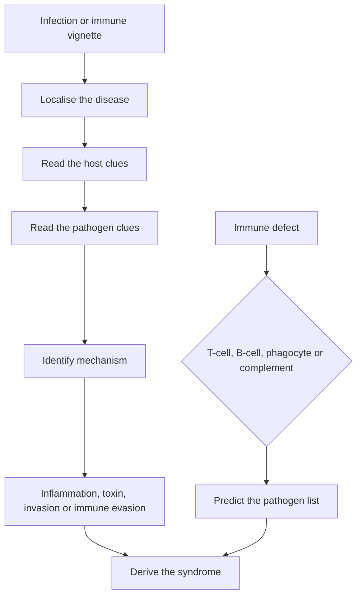

# Microbiology and Immunology

Microbiology and immunology items reward mechanism. A clinical vignette supplies the organism's reservoir, transmission, attachment, toxin, intracellular niche or immune defect. The task is to connect that clue to the disease, not to recite a list of species.

A useful framework has three layers. First identify the host response. Second identify how the organism evades or damages that response. Third connect the organism's biology to its clinical syndrome. An immunodeficient patient with a catalase-positive abscess, a child with a stiff neck and a CSF picture, and a patient with watery diarrhoea after rice all test the same reasoning chain at different levels.

### 🟢 Lite — Quick Review (1h–1d)

**Innate immunity.**

| Component | Recognition and action | Clinical correlate |
|---|---|---|
| Barriers | Skin, mucosa, cilia, low gastric pH, normal flora | Breaks in skin and mucosal disruption permit infection |
| Pattern-recognition receptors | Detect shared microbial structures such as lipopolysaccharide, flagellin and viral RNA | Toll-like receptors activate inflammatory genes |
| Neutrophils | Phagocytose bacteria and release reactive products | Acute bacterial infection; pus contains dead neutrophils |
| Macrophages | Phagocytose, present antigen and secrete cytokines | Chronic granulomatous disease results from defective NADPH oxidase |
| Natural killer cells | Kill infected or transformed cells without prior antigen-specific sensitization | Viral infection and malignancy |
| Dendritic cells | Capture antigen in tissue and present it in lymph nodes | Bridge between innate and adaptive immunity |
| Complement | Opsonize, lyse, recruit inflammatory cells and clear immune complexes | C3 deficiency impairs opsonization; terminal complement deficiency predisposes to Neisseria infection |

**Adaptive immunity.**

- **B cells** differentiate into plasma cells that secrete antibody and memory cells. Most antibodies are made by activated B cells that have received T-cell help.
- **T cells** include helper CD4 cells, cytotoxic CD8 cells, regulatory T cells and memory T cells.
- **MHC class I** is expressed on nearly all nucleated cells and presents endogenous peptides to CD8 cells. **MHC class II** is expressed mainly on professional antigen-presenting cells and presents exogenous peptides to CD4 cells.
- **CD4 cells** activate macrophages, B cells and cytotoxic T cells through cytokines and cell contact.
- **CD8 cells** kill infected cells through perforin, granzymes and Fas–Fas ligand.
- **Antibody functions:** neutralisation blocks attachment and toxins; opsonisation promotes phagocytosis; classical complement activation; agglutination; antibody-dependent cellular cytotoxicity.

**The five immunoglobulin classes.** IgM is the first antibody in a primary response and is a pentamer. IgG is the most abundant serum class, crosses the placenta and provides long-term protection. IgA guards mucosal surfaces and appears in secretions. IgE binds mast cells and basophils in type I hypersensitivity and parasite defence. IgD sits on naive B cells as an antigen receptor.

**Hypersensitivity reactions.**

| Type | Mechanism | Timing and examples |
|---|---|---|
| I, immediate | IgE cross-links mast-cell FcεRI, releasing histamine and leukotrienes | Anaphylaxis, allergic rhinitis, asthma, helminth response |
| II, antibody-mediated | IgM or IgG binds cell-surface antigen, causing complement injury, opsonisation or receptor dysfunction | Haemolytic anaemia, autoimmune thrombocytopenia, Goodpasture syndrome, Graves disease, myasthenia gravis, transfusion reactions |
| III, immune complex | Antigen-antibody complexes deposit in vessels and activate complement | Serum sickness, post-streptococcal glomerulonephritis, systemic lupus erythematosus |
| IV, delayed | Sensitised T cells release cytokines and cytotoxic activity | Contact dermatitis, tuberculin reaction, graft rejection, type I diabetes |

**Microbial patterns.**

- **Gram-positive bacteria** have a thick peptidoglycan layer, retain crystal violet and have no outer membrane. Staphylococci are catalase positive and cluster; streptococci are catalase negative and form chains.
- **Gram-negative bacteria** have a thin peptidoglycan layer, an outer membrane containing lipopolysaccharide, and a periplasmic space. Endotoxin activity comes from lipid A and can activate macrophages, cytokines and complement.
- **Anaerobes** grow without oxygen, produce gas, and are associated with dirty wounds, abscesses, oral flora and bowel perforation. Antibiotic aminoglycosides require oxygen-dependent bacterial uptake and fail against anaerobes.
- **Intracellular organisms** hide from antibody: *Mycobacterium tuberculosis*, *Legionella*, *Chlamydia*, *Rickettsia*, *Coxiella* and viruses. Cell-mediated immunity is therefore central.
- **Spore-forming organisms** include *Bacillus* and *Clostridium*. Spores resist heat and drying and persist in the environment.

**High-yield organisms and their clues.**

| Organism | Defining clue | Key mechanism or consequence |
|---|---|---|
| *Staphylococcus aureus* | Coagulase positive, catalase positive, grape-like clusters, golden pigment | Exotoxins, superantigen, toxic shock; abscesses, osteomyelitis, endocarditis |
| *Streptococcus pyogenes* | Group A beta-haemolytic streptococcus | M protein, streptolysin O and D; pharyngitis, erysipelas, necrotising fasciitis, rheumatic fever, post-streptococcal glomerulonephritis |
| *Streptococcus pneumoniae* | Alpha-haemolytic with optochin sensitivity and bile solubility | Capsule, pneumococcal pneumonia, meningitis, otitis |
| *Neisseria meningitidis* | Gram-negative diplococci, oxidase positive | Endotoxin, petechial rash, meningitis, Waterhouse-Friderichsen syndrome |
| *Haemophilus influenzae* | Small gram-negative coccobacilli; pleomorphic with satelliting Haemophilus | Type b capsule, epiglottitis, meningitis, otitis |
| *Legionella* | Weakly staining gram-negative bacillus; grows on iron-containing medium | Aerosol water systems, severe pneumonia, hyponatraemia, relative bradycardia |
| *Bordetella pertussis* | Whooping cough with lymphocytosis | Pertussis toxin increases cyclic AMP; paroxysmal cough and inspiratory whoop |
| *Bacillus anthracis* | Large boxcar gram-positive rods, woolly colonies | Edema toxin raises cyclic AMP; black eschar and painless ulcer |
| *Clostridium perfringens* | Gram-positive anaerobic rod, double haemolysis | Alpha toxin lecithinase causes myonecrosis and gas gangrene |
| *Clostridium botulinum* | Anaerobe in home-canned food | Botulinum toxin blocks acetylcholine release, producing flaccid paralysis |
| *Clostridium tetani* | Soil-contaminated puncture wound | Tetanospasmin blocks inhibitory GABA and glycine release, producing spasticity |
| *Escherichia coli* | Multiple distinct diarrhoeal syndromes | ETEC heat-labile toxin raises cyclic AMP; EHEC Shiga toxin causes haemorrhagic colitis and haemolytic uraemic syndrome; EIEC invades colonic epithelium |
| *Salmonella* | Fever, relative bradycardia, animal exposure | Intracellular survival in macrophages; typhoid involves ileal Peyer's patches |
| *Shigella* | Invasive dysentery in children | Intracellular spread; M and S antigens; reactive arthritis |
| *Vibrio cholerae* | Rice-water diarrhoea with massive fluid loss | Cholera toxin raises cyclic AMP through Gs; no invasion |
| *Campylobacter* | Undercooked poultry, inflammatory diarrhoea | Guillain-Barré and reactive arthritis |
| *Pseudomonas aeruginosa* | Hospital infection, blue-green pigment, grape-like odour | Exotoxin A, elastase; burns, cystic fibrosis, catheter infection |
| *Helicobacter pylori* | Gastric and duodenal ulcers | Urease, mucus-layer penetration, increased gastrin and decreased somatostatin |
| *Mycobacterium tuberculosis* | Chronic cough, night sweats, weight loss, upper-lobe cavitation | Intracellular survival, caseating granulomas, delayed hypersensitivity |
| *Clostridioides difficile* | Antibiotic-associated diarrhoea with pseudomembranes | Toxins A and B disrupt cytoskeletal actin, producing mucosal injury |

**Viral families and their clues.**

- **Herpesviruses** establish latency in neurons or lymphoid tissue. HSV causes painful vesicles and encephalitis; VZV causes shingles; CMV causes mononucleosis-like illness, retinitis and congenital disease; EBV is linked to Burkitt lymphoma, Hodgkin lymphoma and nasopharyngeal carcinoma.
- **Hepatitis viruses:** HAV is RNA, transmitted faecally and does not become chronic; HBV is DNA and can become chronic; HCV is RNA and frequently becomes chronic; HDV is defective RNA and requires HBV.
- **HIV** is a retrovirus that infects CD4 cells through CD4 and CCR5 or CXCR4. Its failure is driven by loss of cell-mediated immunity, and viral load and CD4 count guide prognosis.
- **Influenza** is a segmented RNA virus with haemagglutinin and neuraminidase; it causes abrupt fever, myalgia and airway disease. Antiviral combinations target neuraminidase or the viral cap-dependent endonuclease.
- **Measles** has a cephalocaudal rash, Koplik spots and giant-cell pneumonia; **rubella** causes milder disease but congenital deafness and cataracts; **mumps** causes parotid swelling, orchitis and pancreatitis.
- **Poliovirus** destroys anterior horn motor neurons, producing asymmetric flaccid paralysis; **rabies** causes encephalitis with hydrophobia and is prevented by post-exposure vaccine plus immunoglobulin.
- **Human papillomavirus** causes warts and cervical, anal and oropharyngeal cancers. HPV types are grouped as high-risk or low-risk.

**Fungal and parasitic disease.**

| Organism | Clue | Important distinction |
|---|---|---|
| *Candida albicans* | White plaques, invasive disease with catheters, transplant or pregnancy | Yeast and pseudohyphae; germ-tube positive |
| *Aspergillus* | Ring-enhancing lesion, endocarditis after valve surgery, allergic bronchopulmonary disease | Septate acute-angle hyphae; angioinvasive |
| *Histoplasma* | Ohio and Mississippi river valleys, bird and bat droppings, mediastinal lymphadenopathy | Small intracellular yeast in macrophages |
| *Coccidioides* | Southwestern United States, desert exposure | Spherules containing endospores; no culture in routine laboratory |
| *Cryptococcus neoformans* | Immunocompromised host, meningitis, pigeon droppings | Encapsulated yeast; India ink and cryptococcal antigen |
| *Pityriasis versicolor* | Hypopigmented or hyperpigmented trunk lesions | Malassezia, “spaghetti and meatballs” microscopy |
| *Plasmodium falciparum* | Periodic fever, thrombocytopenia, cerebral malaria | Ring forms, banana-shaped gametocytes; falciparum malaria is severe |
| *Giardia* | Foul greasy stool after water exposure | Trophozoite with two nuclei; cysts in stool |
| *Entamoeba histolytica* | Bloody diarrhoea and liver abscess | Flask-shaped ulcer, ingested red blood cells |
| *Toxoplasma gondii* | Ring-enhancing lesion, congenital disease, raw meat or cat faeces | Bradyzoite tissue cysts; tachyzoites multiply by endodyogeny |
| *Strongyloides stercoralis* | Recurrent abdominal pain and larva currens | Larvae in stool rather than eggs; can cause hyperinfection |

**Antimicrobial resistance.** Enzymatic drug destruction, target alteration, reduced permeability and active efflux are the main mechanisms. A plasmid can carry resistance genes between organisms. Extended-spectrum beta-lactamases and carbapenemases undermine beta-lactam therapy. MRSA carries an altered penicillin-binding protein, so beta-lactams other than ceftaroline do not bind it. Vancomycin resistance involves altered peptidoglycan precursors. HIV resistance emerges when adherence and viral suppression are poor. Appropriate de-escalation, culture before antibiotics when the patient is stable, and completion of an appropriate course reduce unnecessary selection.

**Memorise for the Lite tier.**

- Innate is rapid and pattern-based; adaptive is specific, clonal and remembers.
- MHC I presents to CD8; MHC II presents to CD4.
- IgM first, IgG long-term and placental, IgA mucosal, IgE allergy.
- Type I is IgE and immediate; type II targets cell surfaces; type III deposits complexes; type IV is T-cell mediated.
- Gram-negative endotoxin is lipid A; Gram-positive organisms have no outer membrane.
- Intracellular organisms require cell-mediated immunity.
- *Legionella* is weakly staining; *H influenzae* is pleomorphic; *S aureus* is coagulase positive.
- Cholera toxin and Bordetella toxin raise cyclic AMP; botulinum and tetanus toxins block neurotransmitter release.
- Intracellular bacteria hide from antibody; live intracellular organisms and T-cell responses matter.
- Vaccination creates memory; passive immunity gives immediate but temporary protection.

### 🟡 Standard — Full Coverage (1–2d)

#### Worked example: the child with a stiff neck

**The stem.** A child has fever, headache, neck stiffness, a non-blanching petechial rash and shock. The CSF is cloudy with many neutrophils.

**Reasoning.** The petechial rash plus meningeal signs points to meningococcal meningitis with meningococcemia. *Neisseria meningitidis* is a gram-negative diplococcus with an endotoxin-containing outer membrane. Its rapid growth across the vascular surface causes capillary injury, purpura and shock. This is a medical emergency: obtain blood cultures without delaying antibiotics, give immediate therapy and manage shock.

**Why not the alternatives.** *Streptococcus pneumoniae* also causes meningitis but lacks the characteristic petechial rash. *Haemophilus influenzae* type b causes meningitis in unvaccinated children but does not produce this purpuric pattern. A viral meningitis has a lymphocyte-predominant CSF and does not explain shock.

**What the stem teaches.** The organism is not named. A transmission clue and a rash pattern identify it. The mode of death is also mechanistically explained: endotoxin-driven inflammation and vascular leak cause shock.

#### Worked example: an abscess in a child with granulomatous disease

**The stem.** A boy has recurrent infections with catalase-positive organisms, including *S aureus* and *Serratia*. Granulomas form around infected sites.

**Reasoning.** Catalase-positive organisms break down their own hydrogen peroxide. Phagocytes need the respiratory burst to kill them. In chronic granulomatous disease, defective NADPH oxidase prevents that burst, so the organisms survive inside phagocytes. Failure to clear them produces granulomas.

The key is to connect the defect to the organisms. Catalase-negative organisms such as *Streptococcus pneumoniae* supply their own hydrogen peroxide, which the phagocyte's catalase destroys, protecting the organism. That is why catalase-positive organisms dominate the infection pattern.

**What the stem teaches.** The organisms are a phenotype. The host defect explains the list.

#### Worked example: a traveller with watery diarrhoea

**The stem.** A visitor to a region with unsafe drinking water develops profuse watery "rice-water" stool, vomiting and severe dehydration. There is no fever or blood.

**Reasoning.** *Vibrio cholerae* colonises the small intestine and releases cholera toxin. The toxin ADP-ribosylates the Gs alpha subunit, locking adenylate cyclase in the active state. Cyclic AMP rises, chloride and water follow into the intestinal lumen, and the patient loses fluid. The organism does not invade tissue, so blood and inflammatory cells are absent. Treatment centres on oral rehydration when the patient can drink, with intravenous fluids when shock prevents oral intake.

The same mechanism appears in enterotoxigenic *E coli* with its heat-labile toxin. The distinguishing feature is epidemiology and clinical severity, not the cellular pathway.

**What the stem teaches.** A non-inflammatory secretory diarrhoea points to a toxin that changes intestinal epithelial signalling. The absence of blood is evidence, not an omission.

#### Worked example: a child with fever and a bulging fontanelle

**The stem.** An infant has fever, poor feeding, irritability and a bulging fontanelle. CSF contains many neutrophils, low glucose relative to serum glucose and high protein.

**Reasoning.** This is bacterial meningitis. The age, bacteremia and raised intracranial pressure favour organisms such as *Streptococcus pneumoniae* or *Neisseria meningitidis*; in an unvaccinated infant, *Haemophilus influenzae* type b remains relevant. The CSF pattern distinguishes bacterial from viral meningitis: neutrophils, low glucose and high protein.

Management has two tracks that run in parallel. Empiric antibiotics begin without waiting for the full organism result, and dexamethasone is used with bacterial meningitis to reduce inflammatory injury. A lumbar puncture is deferred when raised intracranial pressure or cardiorespiratory instability makes it unsafe.

**What the stem teaches.** Identify the compartment, read the CSF as a pattern and connect the age to the likely organisms.

#### How to approach an organism question

1. **Localise the disease:** blood, lung, CSF, gut, skin, urinary tract or disseminated.
2. **Use the host clue:** age, immune status, exposure, vaccination, surgery, hospital stay and geography.
3. **Use the pathogen clue:** stain shape, culture feature, toxin, inclusion body or life cycle.
4. **Predict the mechanism:** invasion, toxin, intracellular survival, biofilm or immune evasion.
5. **Predict the consequence:** inflammation, tissue damage, obstruction, vascular injury or immune-mediated harm.

### 🔴 Deep — Mastery (3–5d)

#### Bacterial virulence, in mechanism

**Adherence** prevents removal by mucus and cilia. Pili in *Neisseria gonorrhoeae* and *E coli* attach to epithelium. **Capsules** such as those of *S pneumoniae*, *H influenzae* and *Neisseria* reduce phagocytosis. **Antigenic variation** changes surface structures during infection. *Neisseria* changes pili and IgA protease; *Borrelia* changes flagellar proteins; trypanosomes change variant surface glycoproteins.

**Exotoxins** are proteins secreted or released by bacteria and act at a distant site. They can destroy cells, alter signalling or disturb the nervous system. **Superantigens** bind MHC II and T-cell receptors outside the normal peptide groove, activating many T cells and causing cytokine storm. Toxic shock syndrome toxin from *S aureus* and streptococcal pyrogenic exotoxin from *Streptococcus pyogenes* are examples. **Endotoxin** is the lipid A portion of lipopolysaccharide and activates innate receptors, complement and inflammatory cytokines.

**Intracellular survival** blocks antibody-mediated clearance. *M tuberculosis* prevents phagolysosome fusion and survives in macrophages. *Salmonella* enters epithelial cells and uses a type III secretion system. *Chlamydia* is an obligate intracellular organism with elementary and reticulate bodies. *Legionella* manipulates host membranes after inhalation.

**Biofilms** are communities attached to a surface and enclosed in a shared matrix. They tolerate antibiotics poorly because the matrix limits penetration, cells enter slow-growing states and the community exchanges nutrients. Devices such as catheters and prosthetic valves create protected surfaces. Removing the device is part of treatment in several device-associated infections.

#### Viral life cycles and antiviral targets

Viruses lack independent energy production and depend on host machinery. Enveloped viruses enter through membrane fusion, while non-enveloped viruses enter through endocytosis and capsid disruption. The viral genome is replicated, assembled and released. **Nucleoside analogues** resemble nucleosides and terminate viral DNA or RNA synthesis. **Protease inhibitors** prevent polyprotein cleavage in HIV and hepatitis C. **Neuraminidase inhibitors** block release of influenza virions. **Interferon** induces host antiviral proteins. The immune response also contains infection through cytotoxic T cells and neutralising antibody.

A viral inclusion can narrow the diagnosis: multinucleated giant cells with intranuclear inclusions suggest herpesvirus, "owl's-eye" inclusions suggest CMV, and cytoplasmic inclusions in newborn cells suggest rabies. These clues are supportive rather than definitive, and the clinical context completes the diagnosis.

#### Immunodeficiency patterns

| Defect | Typical problem | Why |
|---|---|---|
| T-cell defect | Viral, fungal and opportunistic infection; weak delayed hypersensitivity | Cell-mediated immunity is lost |
| B-cell defect | Recurrent encapsulated bacterial and enteroviral infection | Poor opsonisation and memory |
| Combined defect | Bacterial, viral, fungal and parasitic infection from infancy | Both arms and their interactions fail |
| Complement deficiency | Recurrent Neisseria infection | Impaired killing and opsonisation |
| Terminal complement deficiency | Recurrent Neisseria infection | Failed membrane attack complex |
| C1 esterase inhibitor deficiency | Non-inflammatory angioedema | Unchecked bradykinin |
| Asplenia | Encapsulated organisms and severe babesiosis | Impaired clearance of opsonised organisms |
| Chronic granulomatous disease | Catalase-positive bacteria and fungi | Failed respiratory burst |
| HIV | Opportunistic infection and malignancy as cellular immunity declines | CD4 depletion disrupts immune coordination |

**Vaccination principles.** Live attenuated vaccines include measles, mumps, rubella, varicella, rotavirus, oral polio and intranasal influenza. Inactivated vaccines cannot replicate and are safer in immunocompromised hosts. **Subunit or conjugate** vaccines include hepatitis B and conjugated pneumococcal and meningococcal vaccines; conjugation converts a polysaccharide to a T-dependent antigen and improves immunogenicity in young children. **Toxoid** vaccines use detoxified toxin, as with tetanus and diphtheria. Passive immunity through immunoglobulin or antitoxin provides immediate protection without memory.

#### Common mistakes

**Choosing an antibiotic by Gram reaction alone.** Gram reaction is a starting point; site, host and resistance pattern refine the choice.

**Treating all Gram-negative bacilli as enteric organisms.** *Pseudomonas*, *Legionella*, *H influenzae* and *Acinetobacter* are not enteric flora.

**Calling encapsulated organisms harmless without host context.** *S pneumoniae* becomes a major pathogen with asplenia, CSF leak or cochlear implant.

**Confusing an endotoxin with an exotoxin.** Endotoxin is a structural Gram-negative molecule that triggers systemic inflammation. Exotoxin is a bacterial protein with a specific target.

**Assuming a positive serology proves active disease.** Many pathogens produce latent infection or past exposure. Active infection requires the right clinical context and, for several organisms, direct evidence.

**Forgetting that the immune defect names the pathogen.** Chronic granulomatous disease, asplenia, complement deficiency and HIV each produce characteristic organism lists.

#### Exam traps

A gram-positive cocci in clusters with catalase and coagulase positive is *S aureus*. A gram-positive cocci in chains that turns beta-haemolytic is *Streptococcus pyogenes* until another feature argues otherwise.

A gram-negative diplococcus with oxidase positive from urethral discharge is *Neisseria gonorrhoeae*. The same organism can cause disseminated arthritis-dermatitis syndrome, while meningococcal disease is linked to petechial rash.

A child with recurrent catalase-positive infections has a phagocyte respiratory-burst defect. A child with recurrent Neisseria has a complement defect.

An immunocompromised patient with headache and ring-enhancing brain lesions has several fungal and parasitic possibilities; the key alternatives are toxoplasmosis, primary CNS lymphoma and cryptococcosis. Histology or specific antigen testing distinguishes them.

A patient with a pet, watery diarrhoea and oocysts on stool has *Cryptosporidium*, which causes prolonged diarrhoea in immunocompromised hosts and is transmitted through chlorine-resistant oocysts.

#### 🧠 Memory Anchors

- **MHC I to CD8; MHC II to CD4.**
- **IgM first, IgG memory, IgA mucosa, IgE allergy.**
- **Lipid A is endotoxin; an exotoxin has a specific target.**
- **Catalase-positive organisms in CGD; Neisseria in terminal complement deficiency.**
- **Cholera and Bordetella raise cyclic AMP; Shiga blocks protein synthesis.**
- **Flashcard Q&A:**
  - *What links encapsulated bacteria to asplenia?* → Loss of splenic clearance of opsonised organisms.
  - *Which complement deficiency predisposes to Neisseria?* → Terminal complement deficiency.
  - *What is type II hypersensitivity?* → Antibody directed against a cell-surface antigen.
  - *Why do conjugate vaccines work better in infants?* → They convert polysaccharide to a T-dependent antigen.
  - *What is the key clue for Legionella?* → Weakly staining gram-negative bacillus with severe pneumonia.

#### Internal links

- [USMLE exam hub](/exams/usmle/) — the three-step structure, sponsored by FSMB and NBME.
- [Pharmacology](/notes/usmle/step-1/s1-006/) — the antimicrobial mechanisms and toxicities that follow from organism biology.
- [Biochemistry and Metabolism](/notes/usmle/step-1/s1-002/) — complement, cytokines and metabolic pathways used in immune responses.
- [Pathology: Systemic Disease](/notes/usmle/step-1/s1-005/) — the tissue patterns produced by infectious and inflammatory disease.

The description of Step 1 quoted here is the wording used by the FSMB and NBME (https://www.usmle.org/ and https://www.nbme.org/). This page states no item counts, timing, scoring scale, fees or test calendar, because those figures were not verifiable from an official source at build time. The topic weight is StudyRoadmap's own prioritisation, not an NBME blueprint.

---

## Continue your study

- **[View this topic in your USMLE (United States Medical Licensing Examination) roadmap](/roadmap/?exam=usmle&duration=1mo)** — see where this topic sits in your personalised plan
- **[Build a quick revision plan](/roadmap/?exam=usmle&duration=1d)** — 1-day sprint covering the highest-weight topics
- **[USMLE (United States Medical Licensing Examination) exam overview](/exams/usmle/)** — pattern, eligibility, and syllabus
- **[All Step 1 (Basic Sciences) notes](/notes/usmle/step-1/)** — browse sibling topics in this subject
