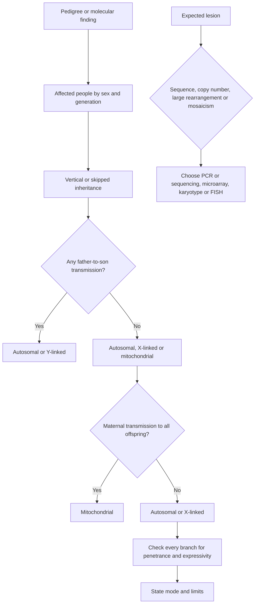

# Genetics and Molecular Biology

Genetics items test a chain: a molecular change alters a gene product, the altered product changes cell function, and the cell-level effect produces a clinical pattern. The chain can be broken at several points. A mutation can be harmless, a regulatory change can alter expression without changing the protein sequence, and a chromosome can be structurally abnormal even when every gene sequence is intact.

Pedigree analysis is the same skill in reverse. Use the family pattern to infer the mode of inheritance, then test that mode against every affected and unaffected person in the pedigree. Naming the pattern after spotting one feature is not enough.

### 🟢 Lite — Quick Review (1h–1d)

**DNA and chromosomes.**

- DNA forms a double helix with two antiparallel strands. Each strand has a sugar-phosphate backbone and bases paired across the interior.
- Adenine pairs with thymine through two hydrogen bonds; guanine pairs with cytosine through three. Chargaff's rules follow from this pairing.
- A nucleotide contains a phosphate, deoxyribose and a nitrogenous base. DNA strands run in opposite directions, with a free 5-prime phosphate at one end and a free 3-prime hydroxyl at the other.
- Eukaryotic DNA is packaged with histone proteins into nucleosomes and chromatin. Heterochromatin is condensed and has low transcription; euchromatin is open and transcriptionally active.
- A human somatic cell contains pairs of chromosomes. One X is present in both sexes; the Y determines testicular development through SRY and related pathways.

**DNA replication.** Replication is semiconservative: each daughter DNA molecule contains one parental and one new strand. It occurs during S phase. Helicase unwinds the duplex, and DNA polymerase extends DNA in the 5-prime to 3-prime direction while proofreading the new strand. The leading strand is continuous; the lagging strand is made as Okazaki fragments, which are joined by ligase. RNA primers initiate synthesis. Telomerase extends the ends of linear chromosomes and is active in germ cells, many stem cells and cancer cells.

**Central dogma and its exceptions.**

- DNA is transcribed into RNA by RNA polymerase.
- Messenger RNA is translated into protein by ribosomes.
- Reverse transcriptase copies RNA into DNA, as in retroviruses.
- Prions transmit misfolded protein without nucleic acid.

**Transcription in eukaryotes.** RNA polymerase II makes mRNA. A promoter recruits the transcription machinery, and enhancers and silencers regulate transcription through DNA looping. The primary transcript contains exons and introns. The spliceosome removes introns and joins exons; alternative splicing lets one gene make several proteins. A cap and poly-A tail protect mature mRNA and assist export and translation.

**Bacterial regulation.** Operons coordinate several genes under one promoter. The lac operon is induced when lactose is present and glucose is scarce; the trp operon is repressed when tryptophan is abundant. Induction and repression regulate the amount of protein made, whereas mutations in structural genes alter the protein itself.

**Mutation types.**

| Change | Consequence |
|---|---|
| Point substitution | One codon changes; silent, missense or nonsense |
| Frameshift from insertion or deletion | Reading frame changes, altering every downstream codon |
| Nonsense | Premature stop codon and truncated protein, often cleared by nonsense-mediated decay |
| Missense | One amino acid changes; conservative or non-conservative |
| Splice-site mutation | Aberrant splicing, exon skipping or frameshift |
| Regulatory mutation | Changes expression, timing or tissue specificity |
| Copy-number change | Deletion or duplication alters gene dosage |
| Recombination error | Translocation, inversion or other rearrangement |

**Inheritance patterns.**

| Pattern | Clues | Exceptions |
|---|---|---|
| Autosomal dominant | Vertical transmission, both sexes affected, father-to-son transmission possible | New mutation, reduced penetrance, variable expressivity |
| Autosomal recessive | Affected siblings with unaffected parents, equal sex distribution | Consanguinity raises likelihood |
| X-linked dominant | Affected males transmit to all daughters and no sons | X inactivation produces mosaic females |
| X-linked recessive | Affected males, no male-to-male transmission, carrier females | Skewed X inactivation changes severity |
| Y-linked | Only males affected, father to all sons | Restricted to male-specific genes |
| Mitochondrial | Maternal transmission to all offspring, variable expression | Heteroplasmy and threshold effect |
| Multifactorial | Variable pedigree pattern, environmental contribution | Recurrence risk differs by sex and severity |

**Non-Mendelian patterns.**

- **Incomplete penetrance:** a person carries the genotype but lacks the phenotype.
- **Variable expressivity:** the same genotype produces different severity or features.
- **Genomic imprinting:** expression depends on the parent of origin. Prader-Willi syndrome involves loss of expression of paternal genes at chromosome 15, while Angelman syndrome involves loss of maternal UBE3A expression in the same region.
- **X-inactivation:** one X chromosome in each female cell is largely inactivated. Skewed inactivation causes variable severity in X-linked disorders.
- **Mosaicism:** genetically distinct cell lines arise after a postzygotic mutation.
- **Anticipation:** a repeat-expansion disorder appears earlier or more severely in successive generations.
- **Epistasis:** one gene masks the expression of another, as in the Bombay blood phenotype and recessive epistasis in coat colour.
- **Pleiotropy:** one gene affects several traits, as in Marfan syndrome and phenylketonuria.
- **Variable expressivity, reduced penetrance and phenocopies** can all make a pedigree look less clean than the textbook pattern.

**Chromosomal abnormalities.**

| Abnormality | Pattern | Examples |
|---|---|---|
| Trisomy | Extra copy of a chromosome | Down syndrome, Edwards syndrome, Patau syndrome |
| Monosomy | Missing chromosome or sex chromosome | Turner syndrome |
| Polyploidy | Extra complete sets | Usually causes early pregnancy loss |
| Deletion | Missing chromosomal segment | Cri-du-chat syndrome from chromosome 5 deletion |
| Duplication | Extra segment | Produces increased gene dosage |
| Inversion | Segment reversed | Can disrupt a gene or alter gene position |
| Reciprocal translocation | Exchange between chromosomes | Balanced carrier may be healthy but at risk of unbalanced offspring |
| Robertsonian translocation | Fusion of acrocentric chromosomes | Can cause familial Down syndrome or recurrent miscarriage |
| Ring chromosome | Ends join to form a ring | Loss of terminal material and abnormal centromere function |

**Diagnostic methods.**

| Method | Detects | Limitation |
|---|---|---|
| PCR | A specific DNA sequence, including point mutations | Needs a known sequence and primer design |
| Sanger sequencing | Base order in a selected region | Does not detect every structural or copy-number change |
| Next-generation sequencing | Broad sequence variants, sometimes large panels or genomes | Variants of uncertain significance and difficult interpretation |
| Karyotype | Large chromosomal abnormalities | Resolution misses small deletions and sequence variants |
| Fluorescence in situ hybridisation | A targeted chromosomal locus or rearrangement | Does not survey the whole genome |
| Chromosomal microarray | Small deletions and duplications | Cannot detect balanced rearrangements or most point mutations |
| Multiplex ligation-dependent probe amplification | Copy-number changes in selected genes | Targeted rather than genome-wide |

**Applications.** Molecular testing supports carrier screening, prenatal diagnosis, tumour profiling, pharmacogenomics and cascade testing of relatives. Cell-free fetal DNA screening in maternal blood has high screening performance for common trisomies but remains a screening test, so a positive result needs diagnostic confirmation. Chorionic villus sampling and amniocentesis obtain fetal cells for chromosome or DNA analysis.

**Memorise for the Lite tier.**

- Replication is semiconservative; DNA polymerase works 5-prime to 3-prime.
- Leading strand is continuous; lagging strand uses Okazaki fragments.
- RNA polymerase II makes mRNA; splicing joins exons.
- Dominant traits appear in successive generations; recessive traits skip generations.
- No male-to-male transmission suggests X-linked or mitochondrial rather than autosomal inheritance.
- Imprinting depends on parent of origin; anticipation involves repeat expansion.
- Karyotype sees large changes; microarray sees small copy-number changes; sequencing sees sequence variants.
- A positive screening test requires confirmatory testing.

### 🟡 Standard — Full Coverage (1–2d)

#### Worked example: the pedigree that points to X-linked recessive inheritance

**The pedigree.** A woman has three sons. Two have muscle weakness and high creatine kinase; the third is healthy. The woman's brother has the same muscle problem. The maternal grandfather was unaffected. A daughter of an affected man has no symptoms.

**Reasoning.** The affected brothers share a mother, and the maternal uncle is affected even though the maternal grandfather is not. This is compatible with an X-linked recessive allele carried by the mother. The unaffected son is expected because each son has an independent chance of inheriting the maternal X. The daughter of an affected man receives his affected X, but a clinically unaffected carrier daughter is expected because she receives a normal X from her mother.

A Duchenne muscular dystrophy pedigree fits: an X-linked recessive mutation in dystrophin causes absent or defective dystrophin, failure of the muscle membrane and muscle-cell injury during contraction. The clue is not simply "affected males". It is the combination of affected maternal relatives, no affected father-to-son transmission, and the expectation of a carrier daughter.

**The test.** Every person in the pedigree should fit the proposed model. If the affected man had an affected son with an unaffected mother and no carrier history, the model would fail. If an affected daughter had an unaffected father, a different explanation would be needed.

#### Worked example: a trinucleotide repeat and anticipation

**The family.** An affected grandfather developed symptoms in his thirties and died after several psychiatric and motor symptoms. His son has earlier onset and a more progressive course; the grandson has earlier onset still.

**Reasoning.** This is anticipation, characteristic of repeat-expansion disorders such as Huntington disease, fragile X syndrome, myotonic dystrophy and some spinocerebellar ataxias. During transmission, the repeat can expand. An expanded CAG repeat in the *HTT* gene causes Huntington disease and is autosomal dominant. Earlier onset, greater severity and a larger repeat are linked.

**The mechanism.** The repeated sequence produces an abnormal protein with toxic gain of function, and anticipation is related to instability of the repeat during transmission. The item often asks why earlier generations show more severe disease: the molecular mechanism is instability and expansion, not simple accumulation of environmental exposure.

#### Worked example: choosing the correct test

**Scenario one.** A child has global developmental delay, minor dysmorphic features and an unknown exon deletion. Chromosomal microarray is appropriate because it detects small deletions and duplications across the genome. Standard karyotyping misses changes below its resolution.

**Scenario two.** A family wants to know whether a relative carries a known familial pathogenic variant. PCR amplification followed by Sanger sequencing is targeted and appropriate. If the family has many affected relatives with a suspected single-gene cause, cascade testing checks the known variant in each relative.

**Scenario three.** A stillborn infant has an unexpected chromosome arrangement. Karyotyping can visualise large gains, losses and rearrangements. Amniocentesis with karyotype or microarray can clarify the fetal genome, while a maternal cell-free DNA screen would not diagnose the structural arrangement.

**The principle.** Test choice follows the expected lesion. Sequence variant, copy-number variant, balanced rearrangement and mosaicism require different methods.

#### Worked example: genomic imprinting

A neonate has severe hypotonia, poor feeding, hypogonadism and a behaviour pattern later described as hyperphagia. The father had a similar childhood history. Molecular analysis shows deletion of part of chromosome 15.

**Reasoning.** The phenotype is Prader-Willi syndrome. The deleted region contains several genes that are expressed from the paternal copy and silenced on the maternal copy. Loss of the paternal active genes produces the syndrome. In contrast, loss of maternal *UBE3A* expression in the same region causes Angelman syndrome, with severe developmental impairment, absent speech and a characteristic happy affect and ataxia. Parent of origin decides which syndrome appears.

This is a high-yield trap: the deletion is in the same chromosomal region, but the phenotype changes with parental origin.

#### Molecular consequences of common mutation types

A splice-site mutation can create an aberrant spliceosome site, skip an exon or introduce a frameshift. A nonsense mutation can produce a truncated protein and trigger nonsense-mediated mRNA decay, so the effective result is loss of function. A missense mutation in a conserved residue can disrupt folding or active-site geometry, while a conservative substitution leaves the protein's function intact.

**Loss of function** reduces the activity or quantity of a gene product. It is the mechanism behind many recessive disorders. **Gain of function** produces excessive or new activity and is common in oncogenes and repeat-expansion disorders. **Dominant negative** proteins interfere with the normal protein from the other allele, as in some collagen and transcription-factor disorders. **Haploinsufficiency** occurs when one functional copy cannot supply enough product.

### 🔴 Deep — Mastery (3–5d)

#### Reading a pedigree as a constraint system

Work in a fixed order.

1. **List affected people by generation, sex and age.**
2. **Look for transmission:** vertical, skipped, maternal, paternal or sex-linked.
3. **Assess outsiders:** an affected parent with an unaffected outsider suggests dominant inheritance; two unaffected parents with affected children suggests recessive inheritance.
4. **Check every branch:** male-to-male transmission rules out X-linked inheritance; an affected daughter of an unaffected father argues against X-linked recessive inheritance; no affected line argues against a fully penetrant dominant allele.
5. **Adjust for penetrance, expressivity and phenocopies.**
6. **State the mode and its limits.** For example: "X-linked recessive with carrier females unaffected by lyonisation."

**Autosomal recessive reasoning.** Affected people born to unaffected parents point to recessive inheritance. The number of affected siblings and the sex distribution support it. Consanguinity increases the chance that both parents carry the same allele. The recurrence risk for two carriers is one quarter for each pregnancy, independent of sex, with multiple affected outcomes possible because each pregnancy is an independent event.

**Autosomal dominant reasoning.** Vertical transmission and both sexes affected support dominance. Male-to-female and male-to-male transmission both occur. A child with the phenotype but no affected parent suggests a new mutation, germline mosaicism or reduced penetrance. Variable severity does not rule out dominance; it suggests variable expressivity.

**X-linked dominant reasoning.** An affected father transmits to all daughters and no sons. An affected heterozygous mother transmits to half of children of either sex. Variable expression in females arises from X inactivation.

**Mitochondrial reasoning.** An affected mother transmits to all offspring, while an affected father transmits to none. Variable severity among siblings reflects heteroplasmy, the coexistence of normal and mutant mitochondrial DNA, and the threshold effect. A tissue with high energy demand can show disease first.

#### Genetics in cancer and precision medicine

**Oncogenes** act through gain of function and require one altered allele. Examples include *RAS* and *MYC*. **Tumour suppressor genes** act through loss of function, and the classic two-hit model explains why both alleles often need to be disabled. *RB1*, *TP53* and APC are examples. DNA repair genes such as *BRCA1* and *BRCA2* act as tumour suppressors through maintenance of genome integrity.

Somatic mutations accumulate in the tumour; germline variants are present throughout the body. A family history can point to inherited susceptibility, while tumour sequencing identifies acquired resistance. Targeted therapy depends on a driver alteration rather than on the tumour's tissue of origin alone.

Pharmacogenomics links genotype to drug exposure or response. Rapid acetylation by *NAT2* increases toxicity from isoniazid in slow acetylators. *CYP2C19* genotype alters activation of clopidogrel and some antidepressants. *TPMT* and *NUDT15* status guides mercaptopurine dosing. *HLA-B* alleles influence severe hypersensitivity with carbamazepine and abacavir. These are applied genetics: the genotype changes the probability of an outcome, so the result belongs in a prescribing decision.

#### Common mistakes

**Calling a dominant trait more common or more severe.** Dominance describes the phenotype in a heterozygote, not frequency or severity.

**Assuming unaffected means no carrier allele.** Reduced penetrance, variable expressivity and phenocopies break this assumption.

**Treating all dominant disorders as the same mechanism.** Dominance can result from haploinsufficiency, gain of function, dominant-negative action or mosaicism.

**Choosing PCR for every genetic diagnosis.** PCR amplifies a selected sequence. It misses the lesion when the wrong sequence is targeted.

**Calling a cell-free DNA result diagnostic.** Prenatal screening changes probability; chorionic villus sampling or amniocentesis provides diagnosis.

**Confusing gene position with expression.** A deletion of a paternal gene can produce a different syndrome from the identical maternal deletion because of imprinting.

**Treating negative genetic results as exclusion.** Test sensitivity, variant classification, mosaicism and structural limitations determine what a negative result means.

#### Exam traps

A pedigree shows affected fathers with affected sons. The proposed X-linked recessive explanation fails because fathers transmit their Y chromosome to sons.

A child has features of Prader-Willi syndrome, but the father has no similar history and molecular analysis shows a maternal deletion. The parental origin points to Angelman syndrome instead.

A family with early-onset breast cancer includes a pathogenic *BRCA1* variant. The correct follow-up is targeted testing of relatives for the familial variant, not a broad panel unrelated to the known cause.

A patient with intellectual disability, marfanoid habitus and a normal karyotype has a suspected copy-number variant. Microarray or targeted deletion testing is more useful than repeating karyotype.

A newborn has an unbalanced Robertsonian translocation. The parent is a balanced carrier and clinically unaffected. The risk to future pregnancies depends on the parental sex and chromosome involved, not on the child's symptoms.

#### 🧠 Memory Anchors

- **DNA polymerase: 5-prime to 3-prime; leading continuous, lagging discontinuous.**
- **RNA polymerase II makes mRNA; spliceosome joins exons.**
- **Dominant means expressed in a heterozygote, not common or severe.**
- **No male-to-male transmission points away from X linkage.**
- **Parent of origin decides several chromosome 15 syndromes.**
- **PCR targets sequence; microarray targets copy number; karyotype targets large changes.**
- **Flashcard Q&A:**
  - *What does anticipation suggest?* → Repeat-expansion disorder.
  - *What is mosaicism?* → Distinct cell lines from a postzygotic event.
  - *Which test detects a small deletion?* → Chromosomal microarray.
  - *Why is screening not diagnosis?* → It estimates probability rather than directly establishing the fetal genotype.
  - *What is dominant negative?* → The mutant protein interferes with the product of the normal allele.

#### Internal links

- [USMLE exam hub](/exams/usmle/) — the three-step structure, sponsored by FSMB and NBME.
- [Microbiology and Immunology](/notes/usmle/step-1/s1-007/) — the molecular mechanisms of pathogens and host responses.
- [Pathology: Systemic Disease](/notes/usmle/step-1/s1-005/) — the tissue consequences of inherited and acquired disease.
- [Epidemiology and Biostatistics](/notes/usmle/step-1/s1-010/) — interpreting penetrance, recurrence and population data.

The description of Step 1 quoted here is the wording used by the FSMB and NBME (https://www.usmle.org/ and https://www.nbme.org/). This page states no item counts, timing, scoring scale, fees or test calendar, because those figures were not verifiable from an official source at build time. The topic weight is StudyRoadmap's own prioritisation, not an NBME blueprint.

---

## Continue your study

- **[View this topic in your USMLE (United States Medical Licensing Examination) roadmap](/roadmap/?exam=usmle&duration=1mo)** — see where this topic sits in your personalised plan
- **[Build a quick revision plan](/roadmap/?exam=usmle&duration=1d)** — 1-day sprint covering the highest-weight topics
- **[USMLE (United States Medical Licensing Examination) exam overview](/exams/usmle/)** — pattern, eligibility, and syllabus
- **[All Step 1 (Basic Sciences) notes](/notes/usmle/step-1/)** — browse sibling topics in this subject
