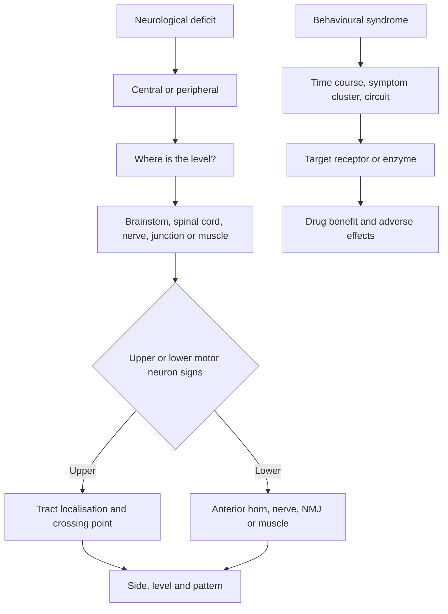

# Neuroscience and Behaviour

Neuroanatomy items become manageable when the question is converted into a map problem. Where is the lesion? What pathway or nucleus is affected? What deficit would that produce? A lesion above a crossing point gives a different pattern from one below it.

The behavioural disorders add a second layer. Symptoms are not explained by one neurotransmitter in isolation. Schizophrenia involves dysregulation of several systems, and the treatment tells you which receptor or enzyme the clinician is targeting. Depression and anxiety involve circuits, stress systems, sleep and memory as well as monoamine transmission.

### 🟢 Lite — Quick Review (1h–1d)

**The neuron and its action potential.**

- The soma contains the nucleus and organelles. Dendrites receive input; the axon carries output.
- Myelin is produced by oligodendrocytes in the central nervous system and Schwann cells in the peripheral nervous system. It insulates axons and increases conduction speed.
- Nodes of Ranvier contain voltage-gated sodium channels, and action potentials jump from node to node through saltatory conduction.
- At rest, neurons are relatively negative inside because potassium leaks out and sodium-potassium ATPase maintains gradients.
- Threshold depolarisation opens voltage-gated sodium channels. Sodium enters and the membrane depolarises.
- Sodium channels inactivate and voltage-gated potassium channels open. Potassium leaves, repolarising the cell.
- The action potential is all-or-none and propagates without decrement. The firing frequency, not the amplitude, carries information about stimulus strength.

**Synaptic transmission.** An electrical synapse uses gap junctions. A chemical synapse releases neurotransmitter from vesicles. Presynaptic calcium entry triggers exocytosis, and the transmitter binds postsynaptic receptors. Excitatory neurotransmitters include glutamate and acetylcholine at some synapses; inhibitory neurotransmitters include gamma-aminobutyric acid and glycine. Acetylcholine is excitatory at the neuromuscular junction and inhibitory at some cardiac targets. Receptor action decides the effect.

| Neurotransmitter or receptor | Main clinical links |
|---|---|
| Glutamate | Major excitatory transmitter; NMDA and AMPA receptors; excitotoxicity with excessive stimulation |
| GABA | Major inhibitory transmitter; benzodiazepines enhance GABA-A signalling; flumazenil blocks the benzodiazepine site |
| Dopamine | Movement, reward, motivation; D2 blockade causes antipsychotic effects and EPS; loss in substantia nigra causes Parkinson disease |
| Serotonin | Mood, sleep, appetite, nausea; serotonin syndrome with excess serotonergic activity |
| Norepinephrine | Arousal, attention, vascular tone; withdrawal causes headache and autonomic symptoms |
| Acetylcholine | Memory, attention, muscle contraction, parasympathetic effects; anticholinergics cause delirium, dry mouth and urinary retention |
| Substance P | Pain and itch transmission |
| Endorphins | Endogenous opioid analgesia and reward |
| Histamine | Wakefulness, allergy; sedating antihistamines cross into the brain and impair attention |

**Central and peripheral organisation.**

- The **central nervous system** contains the brain and spinal cord. The **peripheral nervous system** contains cranial and spinal nerves plus ganglia.
- The autonomic nervous system has sympathetic and parasympathetic divisions. Most organs receive both, with one dominant at rest.
- Sympathetic postganglionic neurons release norepinephrine, except for eccrine sweat glands, which use acetylcholine; parasympathetic postganglionic neurons release acetylcholine. All preganglionic neurons release acetylcholine.
- The adrenal medulla is modified sympathetic tissue and releases epinephrine and norepinephrine into blood.
- The enteric nervous system controls gut motility and secretion.

**Meninges and cerebrospinal fluid.** The dura is tough outer protection, the arachnoid is a delicate middle layer, and the pia adheres to the brain. Subarachnoid space contains CSF. CSF is produced by the choroid plexus and circulates through the ventricles and around the brain and spinal cord. Meningitis produces inflammation in the meninges and CSF.

**Major cerebral regions.**

| Region | Function | Lesion pattern |
|---|---|---|
| Frontal lobe | Executive function, motor cortex, speech production, personality, working memory | Contralateral weakness, Broca aphasia, disinhibition, impaired planning |
| Parietal lobe | Somatosensation, spatial attention, integration | Contralateral sensory loss, neglect, astereognosis |
| Temporal lobe | Auditory cortex, memory, language comprehension, olfaction | Wernicke aphasia, memory impairment, superior quadrantanopia |
| Occipital lobe | Visual cortex | Contralateral visual-field loss |
| Limbic system | Emotion, memory, motivation, autonomic response | Memory disturbance, emotional and behavioural change |
| Basal ganglia | Initiation and modulation of movement | Parkinsonism, chorea, dystonia, ballism |
| Cerebellum | Coordination, timing, motor learning | Ipsilateral ataxia, dysmetria, intention tremor, nystagmus |

**Brainstem and cranial nerves.**

| Level | Key nuclei and functions | Cranial nerves |
|---|---|---|
| Midbrain | Reticular activating system, substantia nigra, red nucleus, periaqueductal grey | III oculomotor, IV trochlear |
| Pons | Corticobulbar nuclei, respiratory centres, middle cerebellar peduncles | V trigeminal, VI abducens, VII facial, VIII vestibulocochlear |
| Medulla | Cardiorespiratory centres, nuclei of IX–XII | IX glossopharyngeal, X vagus, XI accessory, XII hypoglossal |

**Spinal cord tracts.**

- The **corticospinal tract** controls voluntary movement. Fibres cross in the lower medulla, so a lesion above the medulla causes contralateral weakness; a spinal cord lesion below the crossing causes ipsilateral weakness.
- The **dorsal columns** carry vibration, fine touch and proprioception. They cross in the medulla, so a spinal lesion produces ipsilateral loss below the lesion.
- The **spinothalamic tract** carries pain and temperature. Fibres cross within the spinal cord soon after entry, so a spinal lesion produces contralateral loss below the lesion.
- A hemicord lesion produces an **ipsilateral motor and dorsal-column deficit with contralateral pain and temperature loss** below the lesion.

**Limbic and circuit systems.** The hippocampus is central to forming new declarative memories and is vulnerable to hypoxia, seizures and alcohol. The amygdala assigns emotional significance and supports fear learning. The mammillary bodies and fornix participate in memory circuits and are affected in thiamine deficiency. The hypothalamus regulates temperature, hunger, thirst, circadian rhythm, autonomic output and pituitary function. The nucleus accumbens and mesolimbic dopamine pathway participate in reward and motivation.

**Cerebellar circuits.** Purkinje cells are inhibitory and project from the cerebellar cortex to deep nuclei. The lateral cerebellum controls ipsilateral limb movement. The vermis controls trunk and gait. The flocculonodular lobe contributes to balance and eye movements. Alcohol impairs the anterior superior vermis, which explains truncal ataxia and gait instability.

**Basal ganglia circuits.** The direct pathway facilitates selected movement, while the indirect pathway suppresses unwanted movement. Loss of dopamine-producing neurons in the substantia nigra pars compacta weakens the direct pathway and produces Parkinson disease. Huntington disease involves degeneration of striatal neurons with chorea and psychiatric symptoms.

#### Common clinical localisations

- **Broca aphasia:** nonfluent speech with preserved comprehension and impaired repetition; dominant inferior frontal gyrus.
- **Wernicke aphasia:** fluent but meaningless speech, impaired comprehension and repetition; dominant posterior superior temporal gyrus.
- **Conduction aphasia:** poor repetition with relatively preserved comprehension and fluency; arcuate fasciculus.
- **Prosopagnosia:** impaired recognition of faces, usually bilateral occipitotemporal injury.
- **Alexia without agraphia:** loss of reading with preserved writing after dominant occipital and splenium injury.
- **Neglect:** failure to attend to one side, usually left hemispatial neglect after right parietal injury.
- **Internuclear ophthalmoplegia:** impaired adduction of the affected eye with abducting nystagmus; a medial longitudinal fasciculus lesion, classically multiple sclerosis.
- **Hyperacusis and facial weakness in Bell palsy:** a peripheral facial nerve lesion.
- **Vertigo, tinnitus and hearing loss:** vestibulocochlear involvement; the direction of nystagmus and the effect on symptoms help separate central from peripheral causes.

**Memorise for the Lite tier.**

- Sodium depolarises the neuron; potassium repolarises it.
- Saltatory conduction occurs at nodes of Ranvier.
- Glutamate is excitatory; GABA is inhibitory.
- Prevertebral ganglia are sympathetic, postganglionic are parasympathetic.
- Sympathetic postganglionic fibres release norepinephrine; parasympathetic fibres release acetylcholine.
- Dorsal columns and corticospinal fibres cross in the medulla; spinothalamic fibres cross in the spinal cord.
- Cerebellar signs are ipsilateral.
- Parkinsonism reflects loss of substantia nigra dopamine; chorea reflects striatal degeneration.
- Confusion, dysarthria and ataxia suggest brainstem; aphasia and neglect suggest cerebral hemisphere.

### 🟡 Standard — Full Coverage (1–2d)

#### Worked example: localising a lesion from a neurological deficit

**The stem.** A patient has marked weakness of the right arm and leg, sparing the face. Pain and temperature sensation are lost on the left side of the body below the neck, while vibration and proprioception are preserved on the right. A magnetic resonance image shows a lesion in the left cervical spinal cord.

**Reasoning.** Right-sided motor loss means the corticospinal tract above the medullary crossing is affected. Left-sided pain and temperature loss means the spinothalamic tract has been damaged after its fibres crossed in the spinal cord. Right-sided preservation of vibration and proprioception means the right dorsal column is intact, consistent with a left-sided lesion before the dorsal columns cross in the medulla.

The motor loss sparing the face also supports a spinal lesion: the face is represented in the contralateral motor cortex and cranial motor nuclei, above the cervical cord. The syndrome is a left hemicord lesion, classically Brown-Sequard pattern.

**Why the tract map matters.** If the lesion were in the left medulla above the pyramidal decussation, motor loss would affect the right face, arm and leg. If it were below the decussation, motor loss would be ipsilateral to the lesion. If it were in the right spinal cord, motor and dorsal-column losses would be right-sided and pain-temperature loss left-sided. Each alternative changes one component.

#### Worked example: the syndrome with two names

**The stem.** A young adult has painful tingling in the lower limbs, blurred vision, and episodes of neurological symptoms separated in time and location. Examination shows hyperreflexia and an eye that fails to adduct during lateral gaze, with nystagmus of the other eye.

**Reasoning.** Dissemination in time and space plus upper motor neuron signs suggests multiple sclerosis. Internuclear ophthalmoplegia results from a lesion of the medial longitudinal fasciculus and is a classic clue. The disease involves immune-mediated demyelination in the central nervous system, with relapses and remissions.

The differential includes a tumour, vascular lesions and infection, but the relapsing pattern and characteristic eye sign support demyelination. MRI shows lesions disseminated in space and time, and oligoclonal bands in CSF support the diagnosis. Acute treatment uses corticosteroids; long-term disease-modifying therapy reduces relapse.

**Why one clue matters.** The eye movement finding localises the lesion more precisely than the list of symptoms. Localisation is often the item's purpose.

#### Worked example: Parkinson disease and the treatment clue

**The stem.** An older adult has a shuffling gait, reduced arm swing, resting tremor, rigidity and difficulty initiating movement. Cognition is relatively preserved early.

**Reasoning.** This is Parkinson disease. Loss of dopaminergic neurons in the substantia nigra pars compacta reduces stimulation of the direct basal ganglia pathway, increasing the indirect pathway's suppression of movement. The symptoms are asymmetric early and include bradykinesia, rigidity and resting tremor; postural instability appears later.

Levodopa crosses the blood-brain barrier and is converted to dopamine. Carbidopa inhibits peripheral aromatic L-amino acid decarboxylase, increasing the amount reaching the brain. Dopamine agonists, monoamine oxidase B inhibitors and levodopa have different roles in early and advanced disease. Deep brain stimulation of the subthalamic nucleus or globus pallidus is used for advanced motor complications.

**The pharmacology clue.** A drug that causes a "dancing" movement or severe rigidity after years of levodopa points to levodopa-induced dyskinesia and motor fluctuations. An antipsychotic with strong D2 blockade can also cause parkinsonism.

#### Worked example: delirium and the anticholinergic burden

**The stem.** An older adult in hospital becomes acutely confused, with visual hallucinations, dry mouth, urinary retention and constipation. Medication review shows an anticholinergic drug was started.

**Reasoning.** Acute onset and fluctuating attention point to delirium rather than dementia. Anticholinergic blockade removes central cholinergic signalling involved in attention and memory and also causes peripheral antimuscarinic effects. Reducing the anticholinergic burden, treating the underlying illness and reviewing medication are central steps.

This example shows why "confusion" needs more than a diagnosis. Time course, attention, fluctuation and medication exposure distinguish delirium from dementia and from a primary psychiatric disorder.

### 🔴 Deep — Mastery (3–5d)

#### Neurotransmission and psychiatric treatment

**Schizophrenia.** Positive symptoms include hallucinations, delusions and disorganisation. Negative symptoms include avolition, alogia and flat affect. Cognitive symptoms include impaired attention and working memory. Dopamine D2 receptor blockade reduces positive symptoms. Antipsychotics also block histamine, muscarinic and alpha-adrenergic receptors, producing sedation, anticholinergic effects, orthostatic hypotension and weight gain. Hyperprolactinaemia follows from blockade of tuberoinfundibular dopamine. Second-generation antipsychotics have lower D2 affinity at usual doses but still cause metabolic effects and can prolong the QT interval. Clozapine is reserved for treatment-resistant psychosis because of agranulocytosis and myocarditis risk and requires blood monitoring.

**Major depressive disorder.** Symptoms include low mood or anhedonia with changes in sleep, appetite, energy, concentration, psychomotor speed, guilt or suicidality. Psychomotor retardation and insomnia are classic; hyperphagia and hypersomnia point toward an atypical pattern. SSRIs block serotonin uptake and are common first-line choices. MAO inhibitors inhibit breakdown of monoamines and have food and drug interactions. Bupropion inhibits norepinephrine and dopamine reuptake and has low sexual adverse effects. Lithium treats mania and augments antidepressants; it requires renal clearance, has a narrow therapeutic index and can cause nephrogenic diabetes insipidus and thyroid dysfunction. Valproate is an alternative mood stabiliser and blocks voltage-gated sodium channels. Electroconvulsive therapy is effective for severe or treatment-resistant depression and catatonia.

**Bipolar disorder.** Mania involves elevated or irritable mood with increased energy, reduced sleep need, pressured speech, grandiosity, impulsivity and impaired judgement. Depressive episodes also occur. Mood stabilisers include lithium, valproate, carbamazepine and atypical antipsychotics.

**Anxiety and obsessive-compulsive disorders.** Benzodiazepines enhance GABA-A receptor effects and act rapidly, but they cause sedation, dependence and falls. Buspirone is a nonbenzodiazepine treatment for generalised anxiety. SSRIs are first-line for panic disorder and obsessive-compulsive disorder, and a higher therapeutic dose is often needed in obsessive-compulsive disorder. Exposure and response prevention is an evidence-based psychological treatment for obsessive-compulsive disorder.

**Substance use.** Alcohol depresses central nervous system activity and causes withdrawal with tremor, seizures and delirium tremens. Benzodiazepines and barbiturates share cross-tolerance. Opioids act on mu receptors and cause respiratory depression, miosis and dependence. Naloxone reverses opioid toxicity. Cocaine blocks norepinephrine, dopamine and serotonin reuptake, producing sympathomimetic toxicity. Withdrawal from cocaine is mainly fatigue and depression. Stimulants can cause psychosis and hyperthermia. Treatment combines pharmacotherapy, behavioural support and management of complications.

#### Common mistakes

**Assigning every neurological symptom to a cortical lobe.** Brainstem, cerebellar, spinal cord and peripheral lesions produce recognisable patterns.

**Assuming weakness means motor cortex.** Weakness can arise from the corticospinal tract, anterior horn cell, peripheral nerve, neuromuscular junction or muscle.

**Ignoring the side of crossing.** Dorsal columns and corticospinal tracts cross in the medulla; spinothalamic fibres cross in the spinal cord.

**Calling all ataxia cerebellar.** Sensory ataxia worsens with eyes closed, while cerebellar ataxia persists with eyes open and produces dysmetria and intention tremor.

**Treating hallucinations as proof of psychosis.** Delirium, substance intoxication and withdrawal, sensory impairment and some neurological conditions produce hallucinations.

**Calling dementia a diagnosis of exclusion alone.** Dementia requires cognitive decline that interferes with daily function and evaluation for reversible causes, but the pattern and time course guide the cause.

**Confusing serotonin syndrome with neuroleptic malignant syndrome.** Serotonin syndrome begins quickly with clonus, hyperreflexia and agitation. Neuroleptic malignant syndrome develops over days with lead-pipe rigidity, reduced reflexes, fever and a high creatine kinase.

#### Exam traps

A patient has a right-sided hearing loss and vertigo after a pontine lesion. A central vestibular lesion can produce vertical nystagmus and does not cause hearing loss, whereas peripheral vestibular and cochlear involvement does.

A patient with Wernicke aphasia has fluent speech that contains few meaningful words. The lesion is in the dominant posterior temporal region, not the motor cortex.

A patient with a pituitary lesion has bitemporal hemianopia. The optic chiasm contains crossing nasal retinal fibres.

A patient with a unilateral cerebellar stroke has ipsilateral limb dysmetria because cerebellar pathways cross in the midbrain and control the opposite cerebral motor cortex.

A child with a motor neuron disease has weakness, fasciculations and absent reflexes. Anterior horn cell disease produces lower motor neuron signs; corticospinal tract disease produces spasticity and hyperreflexia.

#### 🧠 Memory Anchors

- **Sodium in, potassium out.**
- **Dorsal column and corticospinal cross in medulla; spinothalamic crosses in cord.**
- **Cerebellar signs are ipsilateral.**
- **Schizophrenia: D2 blockade; depression: serotonin and monoamine systems; mania: mood stabiliser.**
- **Serotonin syndrome has clonus and hyperreflexia; NMS has rigidity and reduced reflexes.**
- **Flashcard Q&A:**
  - *What are the nodes of Ranvier?* → Unmyelinated sites with voltage-gated sodium channels.
  - *Which neurotransmitter is the main excitatory transmitter?* → Glutamate.
  - *Where does the corticospinal tract cross?* → Lower medulla.
  - *Which lobe causes neglect?* → Right parietal.
  - *What distinguishes delirium from dementia?* → Acute fluctuating attention in delirium.

#### Internal links

- [USMLE exam hub](/exams/usmle/) — the three-step structure, sponsored by FSMB and NBME.
- [Anatomy and Embryology](/notes/usmle/step-1/s1-003/) — the structural relationships that determine lesion signs.
- [Pharmacology](/notes/usmle/step-1/s1-006/) — the receptor and drug mechanisms behind psychiatric treatment.
- [Pathology: Systemic Disease](/notes/usmle/step-1/s1-005/) — the vascular, inflammatory and degenerative pathology seen here.

The description of Step 1 quoted here is the wording used by the FSMB and NBME (https://www.usmle.org/ and https://www.nbme.org/). This page states no item counts, timing, scoring scale, fees or test calendar, because those figures were not verifiable from an official source at build time. The topic weight is StudyRoadmap's own prioritisation, not an NBME blueprint.

---

## Continue your study

- **[View this topic in your USMLE (United States Medical Licensing Examination) roadmap](/roadmap/?exam=usmle&duration=1mo)** — see where this topic sits in your personalised plan
- **[Build a quick revision plan](/roadmap/?exam=usmle&duration=1d)** — 1-day sprint covering the highest-weight topics
- **[USMLE (United States Medical Licensing Examination) exam overview](/exams/usmle/)** — pattern, eligibility, and syllabus
- **[All Step 1 (Basic Sciences) notes](/notes/usmle/step-1/)** — browse sibling topics in this subject
