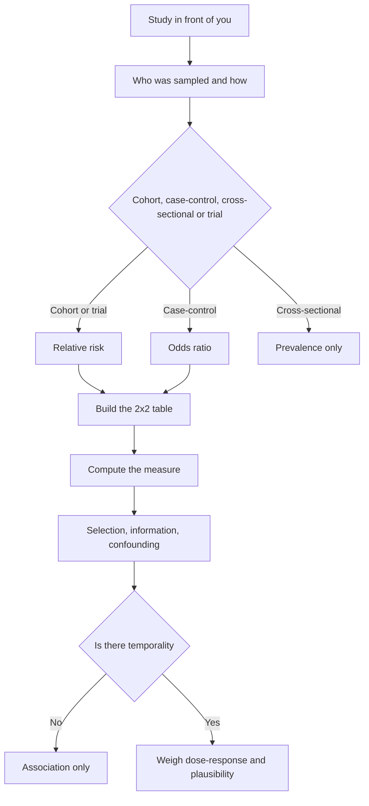

# Epidemiology and Biostatistics

Step 1 items rarely ask you to recite a definition. They hand you a study and ask what it can support: which design this is, what the relative risk means, which bias would plausibly distort the answer. The skill being tested is reading a study design backwards from its numbers, and it rests on three pieces of bookkeeping: denominators, ratios, and what a confidence interval is doing when it brackets an estimate.

### 🟢 Lite — Quick Review (1h–1d)

**Frequency measures: the denominator is the trap.**

- **Prevalence** = existing cases ÷ population. **Incidence** = new cases ÷ population at risk, over a stated period. Incidence density uses person-time, which handles late entry and early loss.
- **Attack rate** = cases ÷ exposed people in an outbreak window. **Case fatality rate** = deaths ÷ cases.

Worked: a town of 100,000 has 2,000 people with asthma, and 400 of the 98,000 others develop it next year. Prevalence is 2%, cumulative incidence ≈ 0.41%, and case fatality 4% if 20 of 500 cases die. Prevalence says nothing about how fast disease spreads; case fatality says nothing about how common it is.

**The 2×2 table behind every association measure.** Arrange it as exposed or not exposed against disease or no disease, and call the cells a, b, c, d in that order.

- **Risk in exposed** = a/(a+b); **risk in unexposed** = c/(c+d).
- **Relative risk** = [a/(a+b)] ÷ [c/(c+d)]. Above 1 raises risk, below 1 protects.
- **Odds ratio** = (a×d)/(b×c), a good proxy for relative risk when the outcome is rare.
- **Attributable risk** = a/(a+b) − c/(c+d): extra cases per 100 exposed people.

Worked: 500 exposed workers, 40 develop disease; 500 unexposed, 10 develop it. Relative risk = 4, attributable risk = 6 percentage points, odds ratio = 4.26. "Four times the risk" and "six extra cases per hundred exposed" are different claims.

**Design fixes which measure you can compute.**

| Design | Direction | Measure | Weakness |
|---|---|---|---|
| Cohort | exposure → outcome | incidence, relative risk | slow, costly, loss to follow-up |
| Case-control | outcome → exposure | odds ratio | no direct incidence, recall bias |
| Cross-sectional | one time point | prevalence | no temporal sequence |
| Randomised trial | investigator assigns exposure | relative risk | cost, ethics, limited generalisability |

**Bias and confounding.**

- **Selection bias**: the compared groups differ in ways that matter beyond the exposure. Sampling problems, differential loss to follow-up and the healthy worker effect land here.
- **Information bias**: exposure or outcome is measured differently between groups. Recall bias and differential surveillance are the textbook forms.
- **Confounding**: a third factor ties to both exposure and outcome and sits off the causal path, manufacturing an association that is not there.
- **Effect modification**: the exposure effect genuinely differs across levels of a third variable. A real finding you report, not an artefact you adjust away.

A confounder meets three tests: tied to the exposure, tied to the outcome independently of the exposure, and not a consequence of the exposure. Age, smoking and socioeconomic position fill that role.

**Statistics that turn up in stems.**

- A **confidence interval** gives plausible values for the population parameter. The central limit theorem is why a mean can carry one even when the underlying values are skewed. A 95% interval means the method captures the true value in 95 of 100 repetitions, not that there is a 95% chance the true value sits inside it.
- A **p-value** is the probability of data as extreme as this, given the null holds. It is not the probability that the null is true, and it shrinks with sample size, so a trivial effect in a huge trial can clear 0.05.
- **Type I error** is the false positive, **Type II error** the false negative, and **power** = 1 − Type II error. Statistical significance and clinical significance are separate questions.
- **Sensitivity** = TP/(TP+FN) and **specificity** = TN/(TN+FP). **Positive predictive value** = TP/(TP+FP) and **negative predictive value** = TN/(TN+FN). Both predictive values move with prevalence, so the same test behaves differently in different populations.

**Memorise for the Lite tier.**

- Prevalence counts existing cases; incidence counts new ones.
- Cohort gives relative risk; case-control gives odds ratio.
- Relative risk of 4 on a baseline of 2% means 8%, and the attributable risk is the 6-point gap.
- A confounder needs all three criteria; effect modification is a genuine finding.
- A confidence interval describes precision, not probability.
- Type I error is the false positive; power equals 1 minus the Type II error rate.
- Predictive value falls as prevalence falls.

### 🟡 Standard — Full Coverage (1–2d)

#### Worked example: a cohort study with the wrong number in the conclusion

**The stem.** A factory employs 2,000 workers followed for ten years. Of the 800 exposed to asbestos dust, 300 develop lung disease; of the 1,200 unexposed, 90 do. The authors conclude that asbestos tripled lung disease risk.

**The arithmetic.** Risk in the exposed group is 300/800 = 37.5%, and in the unexposed group 90/1,200 = 7.5%. The relative risk is 5, not 3.

**The deeper question.** Even with the right arithmetic, the study supports association more strongly than causation. Temporality holds by design. Now look for confounding: which variable would you examine first? Age, because older workers get assigned to dusty jobs and develop lung disease at a higher rate. Then check dose-response and biological plausibility in the form of asbestos fibres retained in lung tissue. The bias the item wants is loss to follow-up: if exposed workers with early disease left the factory, the measured relative risk falls toward 1, so ask which way each bias pushes the result.

#### Worked example: the case-control study that cannot produce a risk

**The stem.** Two hundred children with a congenital heart defect and two hundred controls without it are recruited. 120 of the cases took a new antiemetic in the first trimester; 60 of the controls did. The odds ratio computes to 3.5, and a colleague concludes the drug raises the risk of the defect three and a half times.

**Why that fails.** You sampled on outcome, so the 200 and 200 were fixed by the investigators. Incidence cannot be computed, and neither can the risk in exposed children, because the number of exposed children in the source population is unknown. The odds ratio tracks the relative risk only when the outcome is rare, so with a common birth defect the gap between the two can be wide. The bias to name is recall bias: a mother of an affected child searches her memory harder for medication use than a mother of a healthy child does, with maternal age confounding underneath.

#### Worked example: a screening test in a low-prevalence population

**The stem.** A test with sensitivity 90% and specificity 95% is used on 10,000 people in a population where the condition affects 1 in 100. What does a positive result tell the clinician?

**The arithmetic.** 100 people have the disease: 90 test positive, 10 test negative. The other 9,900 include 495 false positives. The positive predictive value is 90/585 ≈ 15%, so 495 of 585 positive results are false.

**What the item is testing.** Base-rate neglect. The test performs exactly as its sensitivity and specificity promise, and the poor predictive value comes from the prevalence in the population being screened. Re-testing positives with a more specific test changes predictive value far more than repeating the same test, and screening a higher-risk population raises predictive value without changing the test. As prevalence rises, positive predictive value rises and negative predictive value falls, so a test that performs well in a specialist clinic can perform badly in the community.

### 🔴 Deep — Mastery (3–5d)

**Causal reasoning.** The question behind every causal claim is what would have happened to these people had they not been exposed. A single person cannot be in both groups, so the answer must be estimated from a comparison group, and every imperfection in that comparison threatens the estimate. Randomisation tries to make the groups exchangeable; observational designs never achieve that automatically, which is why adjustment and sensitivity analysis matter.

**Directed acyclic graphs.** A DAG encodes the assumed causal structure with arrows and no cycles. Confounders are common causes with paths into both exposure and outcome. A mediator sits on the path between exposure and outcome, and adjusting for one answers a different question from adjusting for a confounder. A collider is a common effect of exposure and outcome, and conditioning on one creates a spurious association.

**Biases that need naming precisely.**

- **Confounding by indication**: sicker patients get the drug, so the treated group looks worse without the drug doing anything.
- **Immortal time bias**: a subject must survive a period to enter the exposed group, and that survival carries prognosis.
- **Detection bias**: the outcome is looked for harder in one group, which matters in registries and chart reviews.
- **Lead-time bias**: screening detects disease earlier, so survival from diagnosis looks longer while the date of death is unchanged.
- **Simpson's paradox**: a trend present in every subgroup reverses when the groups are pooled.

**Advanced statistics.**

- **Cox proportional hazards** compares instantaneous event rates while allowing for right-censoring. A hazard ratio is not a risk ratio, and the two diverge when events are common.
- **Power** depends on the effect size you want to detect, the alpha level, the baseline event rate and the outcome variance. A non-significant result from an underpowered study is not evidence of no effect.
- **Intention-to-treat** keeps participants in their randomised groups regardless of adherence, which preserves randomisation. Per-protocol analysis reintroduces confounding, because adherers differ from non-adherers.
- **Meta-analysis**: fixed-effect models assume one true effect, random-effects models allow the true effect to vary between studies. Heterogeneity is assessed with the I² statistic.

**Bradford Hill criteria.** Temporality comes first and is the only necessary condition. Strength, consistency, specificity, biological gradient, plausibility, coherence, experiment and analogy each add support, and none proves causation alone.

**Common mistakes.** Treating prevalence and incidence as interchangeable; computing a risk ratio from a case-control table; reading a p-value as the probability that a hypothesis is false; adjusting for a mediator, which removes the effect of the exposure rather than removing bias.

**Exam traps.** Blinding protects the participant and the outcome assessor but not the treating clinician. An odds ratio of 4 for a rare outcome approximates relative risk, and for a common outcome it overstates it. Rising incidence with falling mortality points at overdiagnosis and lead-time bias.

#### 🧠 Memory Anchors

- **Prevalence = existing; incidence = new.**
- **Cohort → relative risk; case-control → odds ratio.**
- **Three confounder criteria: tied to exposure, tied to outcome, not downstream of exposure.**
- **A confidence interval describes precision. Type I = false positive; power = 1 − Type II.**
- **Flashcard Q&A:**
  - *Which measure can a case-control study not produce?* → Incidence or risk.
  - *Why does predictive value fall in a low-prevalence population?* → False positives outnumber true positives.
  - *What separates confounding from effect modification?* → One is an artefact to adjust away, the other a real difference in effect.
  - *Which is the only necessary Bradford Hill criterion?* → Temporality.

#### Internal links

- [USMLE exam hub](/exams/usmle/) — the three-step structure, sponsored by FSMB and NBME.
- [Public Health and Prevention](/notes/usmle/step-1/s1-011/) — screening criteria, immunisation and disease control that consume this epidemiology.
- [Microbiology and Immunology](/notes/usmle/step-1/s1-007/) — the pathogens and immune mechanisms behind the infectious disease epidemiology here.

The Step 1 description quoted on this page is the wording used by the FSMB and NBME (https://www.usmle.org/ and https://www.nbme.org/). No item counts, timing, scoring scale, fees or test calendar appear here, because those figures were not verifiable from an official source at build time.

---

## Continue your study

- **[View this topic in your USMLE (United States Medical Licensing Examination) roadmap](/roadmap/?exam=usmle&duration=1mo)** — see where this topic sits in your personalised plan
- **[Build a quick revision plan](/roadmap/?exam=usmle&duration=1d)** — 1-day sprint covering the highest-weight topics
- **[USMLE (United States Medical Licensing Examination) exam overview](/exams/usmle/)** — pattern, eligibility, and syllabus
- **[All Step 1 (Basic Sciences) notes](/notes/usmle/step-1/)** — browse sibling topics in this subject
