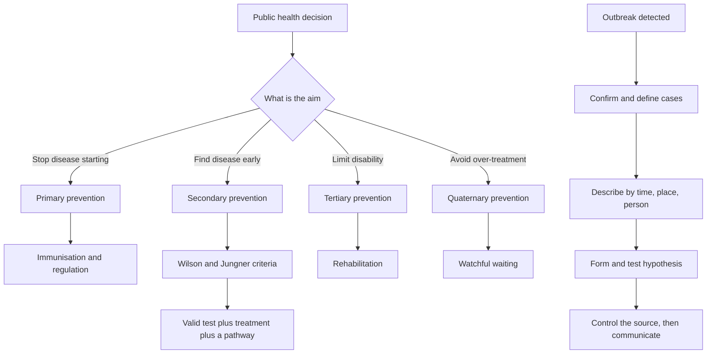

# Public Health and Prevention

Public health items test the principle behind a programme rather than its logistics: who to screen, when to stop screening, which vaccine goes into which arm, how to contain an outbreak. The examinable core is a small set of decision rules with memorable names, and prevention happens at three distinct points in the disease process, each needing a different tool.

### 🟢 Lite — Quick Review (1h–1d)

**Levels of prevention.**

| Level | Target | Tools | Example |
|---|---|---|---|
| Primary | Disease has not started | immunisation, risk-factor modification, regulation | measles vaccine, smoking bans |
| Secondary | Disease started, no symptoms yet | screening, early detection | mammography, cervical screening |
| Tertiary | Disease established | treatment, rehabilitation | physiotherapy after stroke |
| Quaternary | Avoid harm from over-treatment | watchful waiting, de-implementation | stopping a statin at the end of life |

**The Wilson and Jungner criteria for a screening programme.** The condition is an important health problem; the natural history is understood; a recognised test exists; the test is acceptable; there is an agreed treatment; the test is valid; the treatment improves outcomes; the cost is balanced against the alternative; the process is continuous; and the whole thing has been tested in practice. Two consequences follow: a test must be valid and the treatment must work, or screening only generates anxiety, and a programme needs the infrastructure to find, treat and follow people, which is why screening without a treatment pathway does not improve outcomes.

**Screening programmes worth knowing by target.**

| Condition | Method | Who |
|---|---|---|
| Cervical cancer | cytology or HPV testing | people with a cervix in the screening age range |
| Breast cancer | mammography | women in the screening age range |
| Colorectal cancer | stool testing or colonoscopy | adults in the screening age range |
| Hypertension | blood pressure measurement | adults, repeated at intervals |
| Osteoporosis | bone mineral density | postmenopausal women, older men |
| Newborn conditions | heel prick and hearing screen | every newborn |

Blood pressure screening has the highest yield in medicine, because treatment prevents stroke. Lung cancer screening by low-dose CT applies to heavy smokers inside a defined age window and requires a structured quit programme alongside it.

**Immunisation principles.**

- Vaccine types: live attenuated, inactivated whole organism, toxoid, subunit or protein, conjugate polysaccharide, viral vector and nucleic acid.
- Live vaccines cannot be given in pregnancy or in significant immunosuppression. Live vaccines given on the same day interfere, so they are separated by an interval, while inactivated vaccines can be given together.
- A second dose given too early does not count, because the first dose primed rather than completed the response. Catch-up schedules compress the intervals for children who started late.
- Herd immunity depends on coverage above a threshold that shifts with the transmissibility of the organism and with the duration of immunity.
- Adverse events: anaphylaxis is rare and managed with adrenaline, syncope after injection is a recognised event in adolescents, and vaccine injury is compensated through a no-fault scheme where one exists.

**Communicable disease control.**

- **Isolation** separates a person who is already ill. **Quarantine** restricts the contacts of an exposed but not yet ill person.
- A **case definition** fixes who counts as a case, so that the number means the same thing on every day of an outbreak.
- The sequence in an outbreak investigation: confirm the outbreak exists and the diagnosis is right; define cases and find the source; describe the outbreak by time, place and person; determine who is at risk; test hypotheses; control the outbreak; communicate findings; monitor.
- **Notifiable diseases** go to public health authorities, which direct control measures. Standard precautions apply to every patient, contact precautions add gown and gloves, droplet precautions add a surgical mask, and airborne precautions need a negative-pressure room and a fit-tested respirator.
- Water, sanitation and hygiene, vector control and food safety remove the reservoir rather than treating the cases.

**Memorise for the Lite tier.**

- Primary prevents onset, secondary detects early, tertiary limits disability, quaternary prevents over-treatment.
- Wilson and Jungner require a valid test and an agreed effective treatment.
- Live vaccine: never in pregnancy, never in significant immunosuppression.
- Isolation for the ill, quarantine for the exposed contacts, timed by incubation period.
- Outbreak work: confirm, define cases, describe by time place person, hypothesise, control, communicate.
- Hypertension screening has the highest yield because treatment prevents stroke.

### 🟡 Standard — Full Coverage (1–2d)

#### Worked example: designing a screening programme

**The situation.** A health ministry wants to screen a population for atrial fibrillation using a single-lead ECG patch worn for seven days. The condition causes stroke, the natural history is understood, an effective treatment exists, and a valid test is available. What else must be checked before launch?

**The analysis.** Run the Wilson and Jungner criteria against the proposal. The condition matters, the test is valid and treatment works, so what remains are the criteria that bite in practice. Is the test acceptable? A patch worn for a week causes skin irritation and anxiety, and uptake data matter more than theoretical accuracy. Is the cost balanced? A seven-day patch for every adult is expensive, and the ministry needs the cost per stroke prevented to compare against treating hypertension, which is cheaper and prevents more strokes. Is the process continuous? Screening that finds atrial fibrillation and sends people back to general practice without a referral pathway, a treatment protocol and a follow-up plan generates lost cases.

#### Worked example: an outbreak on a college campus

**The situation.** Over ten days, 23 students in one dormitory develop vomiting and diarrhoea. The health service wants to declare the outbreak over and issue a notice.

**The analysis.** Confirm the diagnosis first, since twenty-three cases of viral gastroenteritis and twenty-three cases of a different illness lead to different control measures. Then fix a case definition: a student in the affected dormitory with vomiting or diarrhoea with onset between the specified dates, so the count is comparable across days and across the people counting.

Describe the outbreak by time, place and person. The curve tells you whether this is a common-source exposure, where cases cluster after a single contaminated meal, or person-to-person transmission, where the curve shows successive waves. Here the clustering within one dormitory points to a shared exposure, so the hypothesis is food or water in the dormitory kitchen, and the next step is testing it by comparing what ill students ate with what well students ate and checking kitchen and refrigeration records.

Control follows the hypothesis. A contaminated water supply means shutting the supply and issuing boiled water; a food handler means excluding the handler and inspecting the kitchen; person-to-person spread means emphasising hand hygiene and cohorting the ill. The communication plan is not an afterthought: a notice naming a specific building, a specific date range and a specific set of symptoms reaches more students than a general advisory.

#### Worked example: separating isolation from quarantine

**The situation.** A student has confirmed chickenpox and shares a house with four others. Two housemates had contact with him two days before the rash appeared. Which housemates must stay away from classes, and for how long?

**The analysis.** The ill student is isolated until lesions have crusted. The four housemates are quarantined, not isolated, because they are exposed but not yet ill. The interval is driven by the incubation period of the organism, and for chickenpox that runs between ten and twenty-one days, so quarantine extends to twenty-one days after the last exposure. If a contact develops the rash, that person moves from quarantine to isolation. The reasoning generalises: isolation length follows the period of communicability, and quarantine length follows the incubation period plus the window in which a person could still be infectious without symptoms.

### 🔴 Deep — Mastery (3–5d)

**Programme outcomes and failures.** Coverage above the herd immunity threshold reduces transmission and protects the people who cannot be vaccinated, but the threshold rises with the basic reproduction number and falls when immunity wanes, and it is reached only when the vaccine reduces infection and onward transmission, not merely severe disease. That is the argument for high, equitable coverage rather than pockets of high coverage. A programme can fail through supply interruption, cold-chain breakdown, records that cannot be followed up, records that duplicate doses, or outreach that misses specific communities, and each failure produces the same clinical outcome: an immunity gap. A coverage figure alone is a weak measure of performance, because it says nothing on whether the doses reached the right children, on time, with a valid cold chain.

**Screening in depth.** The performance measures of a programme are participation, interval cancer (the number of cancers diagnosed between a screen and the next one, and the clearest signal that disease is being missed), and adequacy of follow-up, since a programme with high participation and no follow-up converts untreated disease into anxiety. The harms run the other way: overdiagnosis identifies disease that would never cause symptoms, lead-time bias flatters survival without changing the date of death, and length bias favours screening that catches slow-growing disease. A programme stops when the balance shifts, as routine mammography screening did in the United Kingdom after the 1987/88 national review and the controversy over how large the reduction in mortality really was.

**Antimicrobial resistance and One Health.** Resistance arises from selection pressure, and every antibiotic course exerts it. The drivers are agricultural use, over-the-counter availability in a number of countries, poor infection control, and the absence of diagnostics that spare a patient an unnecessary prescription. The responses are stewardship programmes that restrict broad-spectrum agents, hospital infection control, vaccine development, and surveillance that tracks resistance patterns. This is a One Health problem, since resistant organisms and resistant genes move between humans, animals and the environment, and emerging pathogens cross species in the same way. Wastewater sampling, genomic sequencing of pathogens and integrated human and veterinary data now detect outbreaks earlier than clinical presentation alone would allow.

**Health systems and safety.** A country with enough doctors concentrated in cities can lack them where the need is highest, so task shifting moves appropriate work to trained non-specialists and community health workers extend reach into remote communities. Disability-adjusted life years combine years of life lost through premature death with years lived with disability weighted by severity, and they let a ministry compare a road safety intervention with a vaccination programme on one scale. Social determinants shape disease rates so strongly that clinical interventions inherit the pattern of inequality in the population they serve, and programmes requiring people to attend appointments, pay fees or navigate complex systems widen gaps rather than narrow them.

**Common mistakes.** Confusing isolation with quarantine; giving a live vaccine to a pregnant patient or to a patient on chemotherapy; screening without a treatment plan; treating herd immunity as a fixed number; assuming high coverage means a working programme; and reading an outbreak curve as a diagnosis.

**Exam traps.** A programme screening for a condition with no effective treatment fails Wilson and Jungner on treatment and outcome. Two live vaccines given on the same day are fine, but separated by a month if they are not. Quarantine becomes isolation if symptoms appear. A new vaccine with high uptake in one region and low uptake in another depends on the lowest-coverage group, not the national mean. Rising incidence with falling mortality points at overdiagnosis and lead-time bias.

#### 🧠 Memory Anchors

- **Primary, secondary, tertiary, quaternary: onset, early detection, disability, over-treatment.**
- **Wilson and Jungner: valid test, agreed treatment, working programme.**
- **Live vaccine: no pregnancy, no severe immunosuppression.**
- **Isolation for the ill; quarantine for exposed contacts, timed by incubation.**
- **Outbreak: confirm, define cases, describe, hypothesise, control, communicate.**
- **Flashcard Q&A:**
  - *Which screening programme has the highest yield?* → Blood pressure measurement, because treatment prevents stroke.
  - *What does interval cancer tell you?* → The programme missed disease between screens.
  - *How long is quarantine timed by?* → The incubation period.
  - *What is the risk of overdiagnosis?* → Treating disease that would never cause harm.

#### Internal links

- [USMLE exam hub](/exams/usmle/) — the three-step structure, sponsored by FSMB and NBME.
- [Epidemiology and Biostatistics](/notes/usmle/step-1/s1-010/) — the test statistics and study designs behind every screening decision here.
- [Microbiology and Immunology](/notes/usmle/step-1/s1-007/) — the organisms, immune responses and antimicrobials that these programmes target.

The Step 1 description quoted on this page is the wording used by the FSMB and NBME (https://www.usmle.org/ and https://www.nbme.org/). No item counts, timing, scoring scale, fees or test calendar appear here, because those figures were not verifiable from an official source at build time.

---

## Continue your study

- **[View this topic in your USMLE (United States Medical Licensing Examination) roadmap](/roadmap/?exam=usmle&duration=1mo)** — see where this topic sits in your personalised plan
- **[Build a quick revision plan](/roadmap/?exam=usmle&duration=1d)** — 1-day sprint covering the highest-weight topics
- **[USMLE (United States Medical Licensing Examination) exam overview](/exams/usmle/)** — pattern, eligibility, and syllabus
- **[All Step 1 (Basic Sciences) notes](/notes/usmle/step-1/)** — browse sibling topics in this subject
