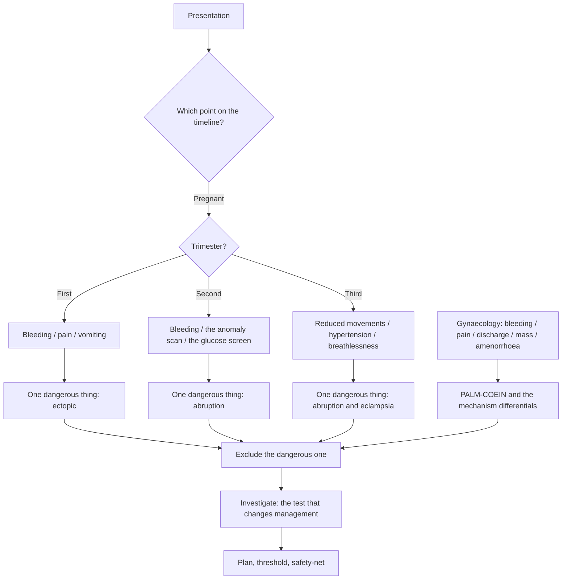

# Obstetrics and Gynaecology

Step 2 CK "evaluates your clinical knowledge and ability to apply medical concepts in patient care". Obstetrics and gynaecology is where that ability is tested under two kinds of pressure at once: the pressure of time in pregnancy, where the same symptom means something different in each trimester and the management changes at a specific gestational age, and the pressure of incomplete information in gynaecology, where most presentations are a symptom rather than a diagnosis.

The two halves behave differently and should be studied differently. **Obstetrics is a timeline.** A patient is located at a point on it, and the correct action is a function of that point: the same abdominal pain is a different emergency at 8 weeks and a different one at 38 weeks. **Gynaecology is a differential built from one symptom.** Bleeding, pain, discharge, a mass and amenorrhoea account for most of what you will be asked, and each has a short list of causes ordered by probability, a short list ordered by danger, and an investigation sequence that depends on age and on whether pregnancy is possible.

Both halves reward the same habit: before naming a diagnosis, name the one diagnosis in that differential that would change management if you missed it. In obstetrics that diagnosis is often time-critical and the clock is visible on the chart. In gynaecology it is often the one that everyone forgets — malignancy, ectopic pregnancy, torsion — because the common causes are so much more common.

### 🟢 Lite — Quick Review (1h–1d)

**The obstetric timeline.** Pre-conception, antenatal, first trimester, second trimester, third trimester, labour, delivery, postpartum. For every presentation, the first question is *which point on this line is the patient at?* Gestational age is the single most useful number in the stem.

| Trimester | The presentations that define it | The danger that hides there |
|---|---|---|
| First (to 13+6 weeks) | Nausea and vomiting, vaginal bleeding, pelvic pain | Ectopic pregnancy, molar pregnancy, septic abortion |
| Second (14–27+6 weeks) | Bleeding, the anomaly scan, the glucose screen, the growth scan | Placental abruption, pre-eclampsia, fetal anomaly |
| Third (28 weeks to term) | Reduced fetal movements, raised blood pressure, swelling, breathlessness, bleeding | Abruptio placentae, eclampsia, pulmonary embolism, uterine rupture |
| Labour and birth | Contractions, bleeding, fetal distress, the urge to push | Uterine rupture, cord prolapse, postpartum haemorrhage, amniotic fluid embolism |
| Postpartum | Bleeding, fever, pain, low mood, breathlessness | Haemorrhage, puerperal sepsis, eclampsia, thromboembolism |

**The gynaecology five.** Every gynaecology question is one of these: abnormal bleeding, pelvic pain, abnormal discharge, a pelvic mass, or a problem with periods or fertility. Learn the differential for each.

**Definitions that decide the answer.**

- Amenorrhoea is conventionally no menstruation for three months or more in an adult; primary amenorrhoea is no menarche by age 15 or within three years of thelarche.
- Preterm birth is delivery before 37 completed weeks; post-term is 42 weeks or more.
- Pre-eclampsia is hypertension after 20 weeks with proteinuria or with end-organ dysfunction — thrombocytopenia, abnormal liver enzymes, raised creatinine, pulmonary oedema, or cerebral and visual symptoms. The severity features that force escalation are severe hypertension, symptoms, or the laboratory abnormalities.
- The cause of primary postpartum haemorrhage is remembered as the four Ts: tone, trauma, tissue, thrombin.
- Abnormal uterine bleeding is classified by PALM-COEIN: polyp, adenomyosis, leiomyoma, malignancy and hyperplasia, coagulopathy, ovulatory dysfunction, endometrial, not-typical, iatrogenic.

**The must-not-miss list, one per presentation.**

| Presentation | The one that must not be missed |
|---|---|
| Bleeding in early pregnancy | Ectopic pregnancy, and ruptured ectopic until proven otherwise |
| Bleeding in late pregnancy | Placental abruption, placenta praevia, vasa previa |
| Abdominal pain in early pregnancy | Ruptured ectopic; appendicitis and ovarian torsion are the mimics |
| Hypertension in pregnancy | Eclampsia, and the HELLP variant |
| Reduced fetal movements | Acute abruption and fetal compromise |
| Heavy menstrual bleeding | Endometrial hyperplasia and carcinoma, and a bleeding disorder |
| Pelvic pain with a mass | Ovarian torsion, and malignancy |
| Postpartum bleeding | Atony, retained products and trauma, in that order of frequency |
| A pregnant patient with breathlessness | Pulmonary embolism and amniotic fluid embolism |

**Traps that cost marks.**

- Treating every pregnancy symptom as a normal pregnancy symptom.
- Ordering a pregnancy test last rather than first.
- Calling a first-trimester bleed a threatened miscarriage without excluding ectopic.
- Starting an anti-inflammatory or an anticoagulant without asking what the pregnancy is doing.
- Reading a positive pregnancy test as a confirmed intrauterine pregnancy.
- Prescribing a teratogenic drug without checking the gestation age and the drug.
- Missing the ectopic in a woman whose bleeding is described as "just a period".
- Attributing heavy menstrual bleeding to fibroids without checking the bleeding pattern and the haemoglobin.

**Where this tier takes you next.**

- [Step 2 CK internal medicine](/notes/usmle/step-2-ck/s2-001/)
- [medicine by presentation](/notes/usmle/step-2-ck/s2-002/)
- [diagnostic testing and imaging](/notes/usmle/step-2-ck/)

### 🟡 Standard — Full Coverage (1–2d)

#### Antenatal care: the visits, the risk, the screens

Antenatal care is three streams running in parallel: a schedule of clinical reviews, a risk assessment that determines how often those reviews happen and which extra tests are offered, and a set of screening and diagnostic tests with their own gestation windows.

**Booking.** The first visit establishes the gestational age, the due date, the blood group and antibody screen, and the baseline bloods — full blood count, blood group and screen, and tests for HIV, hepatitis B, hepatitis C and syphilis. It also takes the risk history: previous obstetric history, medical and surgical history, family history, medication, and the social history including smoking, alcohol and domestic abuse. A high-risk result at booking changes the schedule, the screening plan and the place of birth, and the item that tests this usually gives a risk factor and asks what it changes.

**Screening is not diagnosis.** This distinction is worth marks on its own, because several exam items are built on it.

- The **combined test** uses ultrasound nuchal translucency plus maternal serum markers and is offered in the first trimester, in the window from 11 weeks to 13 weeks and 6 days.
- **Non-invasive prenatal testing** is a screening test for the common trisomies, available from about 10 weeks, with a high detection rate and a low false-positive rate, and it is still a screening test that can produce a false positive.
- The **anomaly scan** is an ultrasound examination of fetal anatomy, offered at 18 weeks to 20 weeks and 6 days.
- **Diagnostic** testing — chorionic villus sampling in the first trimester and amniocentesis from 15 weeks — is invasive and carries a procedure-related risk, which is why it follows a screening result rather than replacing it.

**Gestational diabetes** is screened for at 24 to 28 weeks with a 75 g oral glucose tolerance test, and the thresholds are different from the diagnostic criteria used in a non-pregnant patient, because the pregnant physiology has a lower renal threshold for glucose. Management escalates from diet and exercise to metformin or insulin, and the delivery timing changes with the control achieved. A diabetic pregnancy also changes the fetal surveillance, because poor control in the first trimester is associated with congenital malformation while poor control later is associated with macrosomia, polyhydramnios and shoulder dystocia.

#### The presentations of pregnancy

**Nausea and vomiting.** Common, but the question is always whether this is normal. Hyperemesis is defined by weight loss of more than 5% from the pre-pregnancy weight, dehydration and ketonuria. Management is stepped: dietary measures and ginger; pyridoxine; antihistamines; then an antiemetic such as ondansetron; then intravenous fluids for the dehydrated patient. Two safety points are examined repeatedly: give thiamine before glucose-containing fluids in a patient with prolonged vomiting, because of the risk of Wernicke's encephalopathy, and consider the effect of any drug on the fetus.

**Bleeding in the first trimester.** Classify by what the scan shows and what the cervix is doing: a viable intrauterine pregnancy with a closed cervix and no products passing is a threatened miscarriage, which is managed with reassurance and follow-up; an open cervix with products passing is an inevitable miscarriage; retained products with bleeding is an incomplete miscarriage; a normal uterus with a positive pregnancy test and pain is an ectopic pregnancy until proved otherwise; a very high hCG with a "snowstorm" appearance on ultrasound is a molar pregnancy, which needs the pregnancy terminated and follow-up of hCG because of the risk of persistent trophoblastic disease. Every bleeding episode in early pregnancy needs a pregnancy test, an ultrasound and a blood group and antibody screen if the blood group is rhesus negative, because anti-D prophylaxis depends on it.

**Bleeding in the second and third trimesters.** Two presentations, two mechanisms, and the discriminating features are physical findings that you must ask about.

| Feature | Placental praevia | Placental abruption |
|---|---|---|
| Pain | Absent | Present |
| Blood | Bright red, external | Dark, often concealed |
| Uterus | Soft, relaxed, high lie, hard to palpate the presenting part | Tense, tender, board-like |
| Fetal state | Usually normal | Often distressed |
| Risk factors | Previous caesarean, multiple pregnancy | Hypertension, trauma, cocaine, previous abruption |

**Vasa previa** is the third one to remember: painless bleeding after the membranes rupture accompanied by fetal bradycardia, because the fetal blood is being lost. The response is immediate, and it is the reason anyone who ruptures membranes in a patient with a known placenta praevia is frightened.

**Hypertension in pregnancy.** Work down a tree: chronic hypertension predating pregnancy or diagnosed before 20 weeks; gestational hypertension after 20 weeks without the other features; pre-eclampsia with hypertension plus proteinuria or end-organ dysfunction; eclampsia when a convulsion occurs; and HELLP with haemolysis, elevated liver enzymes and a low platelet count. Management has three parts: antihypertensive treatment for severe hypertension, magnesium sulfate for seizure prophylaxis where it is indicated, and delivery as the definitive treatment when the pregnancy has reached term. The timing of delivery is the decision the item is really testing. Recognising the HELLP variant matters because it can present with abdominal pain and a high liver enzyme count rather than with hypertension and proteinuria, and it can deteriorate before the blood pressure looks alarming.

**Reduced fetal movements.** This is a presentation, not a symptom to be reassured about. After 28 weeks, a change in the pattern of movement — fewer movements, a different pattern, movements that have changed character — means urgent assessment with a cardiotocograph and ultrasound growth and liquor assessment, and the causes to exclude are acute abruption, fetal growth restriction, oligohydramnios and, less commonly, an infection. Reassurance without assessment is the classic exam error.

#### Labour and the postpartum period

Labour is staged by dilatation: the first stage from the start of regular contractions to full dilatation; the second from full dilatation to the birth of the baby; the third from the birth of the baby to the birth of the placenta. The partograph records progress against time and is used to detect abnormal labour. The indications for operative delivery that you should be able to name are fetal compromise, an obstructed labour with a malposition, and a situation where continuing would be riskier than delivery.

**Postpartum haemorrhage** is a clinical diagnosis managed as an emergency, and the four Ts give the order of the search: tone (uterine atony — the commonest, treated with uterine massage and uterotonics), trauma (genital tract injury), tissue (retained placenta or products), thrombin (coagulopathy, including disseminated intravascular coagulation and the coagulopathy of massive haemorrhage). The examination sequence is in that order, and the fluid and blood products run alongside it.

**Puerperal sepsis** is the other postpartum emergency, and the presentation may be non-specific: fever, an offensive lochia, uterine tenderness, and a tachycardia that is out of proportion to the fever. **Postpartum eclampsia** is the one that catches people, because it can occur in the days after delivery, with or without preceding hypertension.

#### Gynaecology

**Abnormal uterine bleeding.** Use PALM-COEIN to organise it, then test the woman before you test the uterus. The investigations start with a pregnancy test, a full blood count, and thyroid function; the hormonal investigations depend on the pattern of bleeding; and the ultrasound decides whether the uterus is structural, and whether the endometrium needs sampling. Endometrial sampling is indicated when the woman is at increased risk of hyperplasia and cancer — abnormal cycles, obesity, diabetes, polycystic ovary syndrome, tamoxifen use, or a family history suggesting a hereditary cancer syndrome. The management of heavy bleeding follows the cause, and the options range from tranexamic acid and the combined oral contraceptive through the levonorgestrel intrauterine system to hysteroscopy and endometrial ablation, with hysterectomy reserved for cases that do not respond.

**Pelvic pain.** The differential splits by timing: acute pain (ectopic pregnancy, torsion, ruptured cyst, appendicitis, PID, ureteric colic) and chronic pain (endometriosis, adenomyosis, fibroids, adhesions, pelvic inflammatory sequelae). Two discriminators matter more than the rest. Cyclical pain in a woman who has not had a pregnancy or the contraceptive pill suggests endometriosis, which is a clinical diagnosis supported by imaging and response to treatment, and is often missed for years. Acute unilateral pain with a tender mass in a woman with a known ovarian cyst suggests torsion, which is a time-critical diagnosis.

**Discharge.** The four characters that separate the common causes: bacterial vaginosis is a thin, grey discharge with an offensive or fishy odour and a raised vaginal pH; candidiasis is thick, white, curdy discharge with intense itching; trichomoniasis is a frothy, yellow-green discharge with unpleasant odour and motile flagellates on microscopy; and cervicitis, usually chlamydia or gonorrhoea, produces mucopurulent discharge and is frequently asymptomatic.

**Masses.** A fibroid is a smooth, mobile, firm uterine mass with a heavy bleeding pattern and bulk symptoms. An ovarian cyst is assessed on ultrasound by whether it is simple or complex, its size and its vascularity, and the two questions that follow are torsion and malignancy. Ovarian cancer has no population screening programme for average-risk women in most national programmes, so a marker such as CA125 is not a screening test; the value of a marker is in the context of an already suspicious mass and in follow-up.

**Amenorrhoea and fertility.** Always exclude pregnancy. Primary amenorrhoea needs a look at the breast (oestrogen present or not) and the uterus (present or absent) before any hormonal test, because that single pair of findings separates the causes into the outflow tract, the gonads and the hypothalamic-pituitary axis. In secondary amenorrhoea, the prolactin concentration comes before any gonadotropin, because a raised prolactin suppresses the axis and is treatable.

### 🔴 Deep — Mastery (3–5d)

#### One dangerous thing per presentation: the drill

Take any O&G presentation you meet and force yourself to answer this before you answer anything else: *if I am wrong about the common cause, what am I wrong about, and what does it cost the patient?* Practised daily, this becomes automatic in the exam and it is the single highest-yield habit in this topic, because the common causes are easy and the dangerous one is the reason the item exists.

| Presentation | The common answer you will reach for | The one that must not be missed | What it costs |
|---|---|---|---|
| Bleeding at 9 weeks | Threatened miscarriage | Ectopic pregnancy | A ruptured ectopic kills the patient |
| Bleeding at 34 weeks | Placental praevia | Concealed abruption | Rapid fetal exsanguination |
| Pelvic pain at 7 weeks | Ectopic | Ruptured ectopic and torsion of the opposite ovary | Death or loss of the ovary |
| Headache at 28 weeks, BP 165/105 | Pre-eclampsia | Eclampsia, and the HELLP variant without severe hypertension | Seizure, stroke, abruption, stillbirth |
| Reduced movements at 35 weeks | Fetal growth restriction | Acute abruption | Fetal death within hours |
| Heavy bleeding at 51 | Endometrial hyperplasia | Endometrial carcinoma | Missed curable cancer |
| Postpartum bleeding at 2 hours | Atony | Retained products and trauma | Ongoing haemorrhage into shock |
| Postpartum fever at day 3 | Endometritis | Puerperal sepsis | Septic shock |
| Breathlessness at 26 weeks | Anxiety | Pulmonary embolism | Maternal death |

#### Pregnancy changes the normal ranges

Much of what looks abnormal on a pregnancy chart is physiological, and the reverse is also true: a value that is mildly abnormal outside pregnancy can be dangerous inside it. Knowing which is which is a cheap way to avoid both over-testing and missing.

- **Haemoglobin falls** because of plasma volume expansion, and the usual cut-offs for anaemia are lower in pregnancy; a haemoglobin that looks mildly anaemic in a non-pregnant patient may be at the lower limit of normal for a pregnant one.
- **Glucose may appear in the urine** because of the lowered renal threshold, which is why the glucose tolerance test thresholds in pregnancy are lower than the diagnostic ones used outside pregnancy.
- **Alkaline phosphatase rises** from placental production, so an isolated rise in the third trimester is not the same as a rise in the first.
- **The symphysis pubis and the pelvic ligaments soften** with relaxin, which is why pelvic instability and symphysis pain occur, and why the measurement of fetal descent is different.
- **Breathlessness and fatigue** are normal from the increased blood volume and cardiac output, and dyspnoea at rest or with a raised respiratory rate is not.
- **Thyroid requirements rise**, and the thyroid function tests must be interpreted against trimester-specific ranges, because the binding proteins change.

#### How the discrimination actually works

Three filters decide almost every O&G item, and they are applied in this order.

**Pre-test probability from the demographics.** Age, parity, previous obstetric history, body mass index, cycle regularity, sexual history and smoking. An item that gives you the age and the parity has already given you the most likely answer for a large share of the marks.

**Pattern recognition of the presentation.** The tempo, the character of the pain, the character of the bleeding, the associated symptoms and the examination findings. A bright red painless bleed in a patient with a previous caesarean and a high lie is a different condition from a dark painful bleed with a tender tense uterus.

**The discriminating feature.** The one finding that separates the top two candidates. This is the piece the item is built around, and it is usually given in the stem rather than in the examination findings. So read the stem twice before you start reasoning, and look specifically for the detail that only one diagnosis explains. A pulse of 110 in a first-trimester bleed points to blood loss or rupture. A positive pregnancy test with an empty uterus on ultrasound points to ectopic. An elevated CA125 with a complex mass points to malignancy rather than to a benign cyst.

#### The safety-net conversation in obstetrics

Every antenatal and postnatal contact ends with safety-netting, and the content of that conversation depends on the risk you have just assessed.

- **Bleeding in pregnancy**: what amount counts as more than expected, what pain should trigger a return, and that she should be reviewed rather than telephoned. Give the number, the action and the timing.
- **Raised blood pressure or a headache**: the specific neurological symptoms — severe headache, visual disturbance, epigastric pain, vomiting, shortness of breath — that mean she must be seen immediately, not booked.
- **Reduced fetal movements**: the counting method she should use, what counts as a change from her own normal pattern, and that she should not wait for the next day.
- **Postpartum**: the signs of infection and haemorrhage, the mood and bonding questions that everyone asks and no one asks well, and the practicalities of follow-up.

#### Common mistakes

- Attributing a symptom to pregnancy without a gestation date attached to it.
- Failing to exclude ectopic before calling an early bleed a miscarriage.
- Treating a raised blood pressure in pregnancy as gestational hypertension without checking proteinuria, bloods and symptoms.
- Not distinguishing praevia from abruption by asking about pain.
- Giving an anti-inflammatory or an anticoagulant without establishing the pregnancy status and the gestation age.
- Missing the HELLP variant because the blood pressure is not severely raised.
- Calling heavy menstrual bleeding normal without checking a haemoglobin and a pregnancy test.
- Managing dysfunctional bleeding without an ultrasound, and without considering endometrial sampling risk factors.
- Reassuring reduced fetal movements without a cardiotocograph and an ultrasound.
- Forgetting that a temperature and a tachycardia in the postpartum patient may be sepsis rather than a normal postpartum change.

> ⚠️ **Examiner Trap.** The obstetric distractor is rarely a wrong fact. It is a correct fact applied at the wrong gestation: a management that is right at 28 weeks and wrong at 38 weeks, or a drug that is safe in the first trimester and teratogenic later, or a delivery decision made on the wrong side of 34 weeks. Read the gestation age first, every time.

#### Memory anchors

- **PALM-COEIN** — the nine categories of abnormal uterine bleeding, in the order a differential should be built.
- **The four Ts** — tone, trauma, tissue, thrombin, in the order you search for the cause of postpartum haemorrhage.
- **One dangerous thing** — every presentation has one; name it before you name the common one.
- **Gestation first** — the timeline is the answer to most obstetric items.
- **Screening is not diagnosis** — combined test and NIPT screen; chorionic villus sampling and amniocentesis diagnose.
- **Pre-eclampsia** — hypertension after 20 weeks with proteinuria or end-organ dysfunction; the severe features escalate it.
- **MOV** — the pelvic mass triad: fibroid, cyst, malignancy, with torsion as the acute overlay.

#### ⚡ Quick Exam Checklist

- Gestational age identified before any other reasoning
- Pregnancy test considered first in any woman of reproductive age
- Ectopic excluded before any bleeding in early pregnancy is called a miscarriage
- Trimester-specific causes of bleeding, pain and hypertension recalled separately
- Pre-eclampsia assessed for severe features and for the HELLP variant
- Praevia distinguished from abruption by pain, blood colour and uterine tone
- Reduced fetal movements treated as a presentation needing assessment, not a symptom needing reassurance
- Hyperemesis distinguished from normal nausea by weight loss, dehydration and ketonuria
- Drug safety checked against gestation age for every prescription
- PALM-COEIN used to structure abnormal uterine bleeding
- Pregnancy test, haemoglobin, thyroid and ultrasound before attributing bleeding to a benign cause
- Endometrial sampling considered when risk factors for hyperplasia and cancer are present
- Pelvic mass assessed for torsion and for malignancy, not only for size
- Postpartum haemorrhage searched in the four-T order while resuscitating
- Postpartum fever and tachycardia treated as sepsis until proven otherwise
- Safety-net given at every antenatal and postnatal contact, with symptom, action and timing

**Where this tier takes you next.**

- [Step 2 CK internal medicine](/notes/usmle/step-2-ck/s2-001/)
- [diagnostic testing and imaging](/notes/usmle/step-2-ck/)
- [the USMLE exam hub](/exams/usmle/)

## Internal links

- [USMLE exam hub](/exams/usmle/) — the three steps and what each one assesses.
- [Medicine by Presentation](/notes/usmle/step-2-ck/s2-002/) — the presentation-led approach this topic is built on.
- [Diagnostic Testing and Imaging](/notes/usmle/step-2-ck/) — choosing and interpreting the investigations an obstetric or gynaecological pathway needs.
- [Ethics, Law and Communication](/notes/usmle/step-2-ck/) — the consent and confidentiality decisions that run alongside the clinical ones.

What Step 2 CK assesses is quoted from the FSMB/NBME USMLE site (https://www.usmle.org/, retrieved 24 October 2026). Item counts, timing, the scoring scale, fees and the testing calendar are not stated here because they were not verifiable at build time. Gestational ages, clinical thresholds and the PALM-COEIN classification are subject-matter facts from standard obstetric and gynaecological practice rather than examination claims. The topic weight is StudyRoadmap's own prioritisation, not an NBME blueprint.

---

## Continue your study

- **[View this topic in your USMLE (United States Medical Licensing Examination) roadmap](/roadmap/?exam=usmle&duration=1mo)** — see where this topic sits in your personalised plan
- **[Build a quick revision plan](/roadmap/?exam=usmle&duration=1d)** — 1-day sprint covering the highest-weight topics
- **[USMLE (United States Medical Licensing Examination) exam overview](/exams/usmle/)** — pattern, eligibility, and syllabus
- **[All Step 2 CK (Clinical Knowledge) notes](/notes/usmle/step-2-ck/)** — browse sibling topics in this subject
