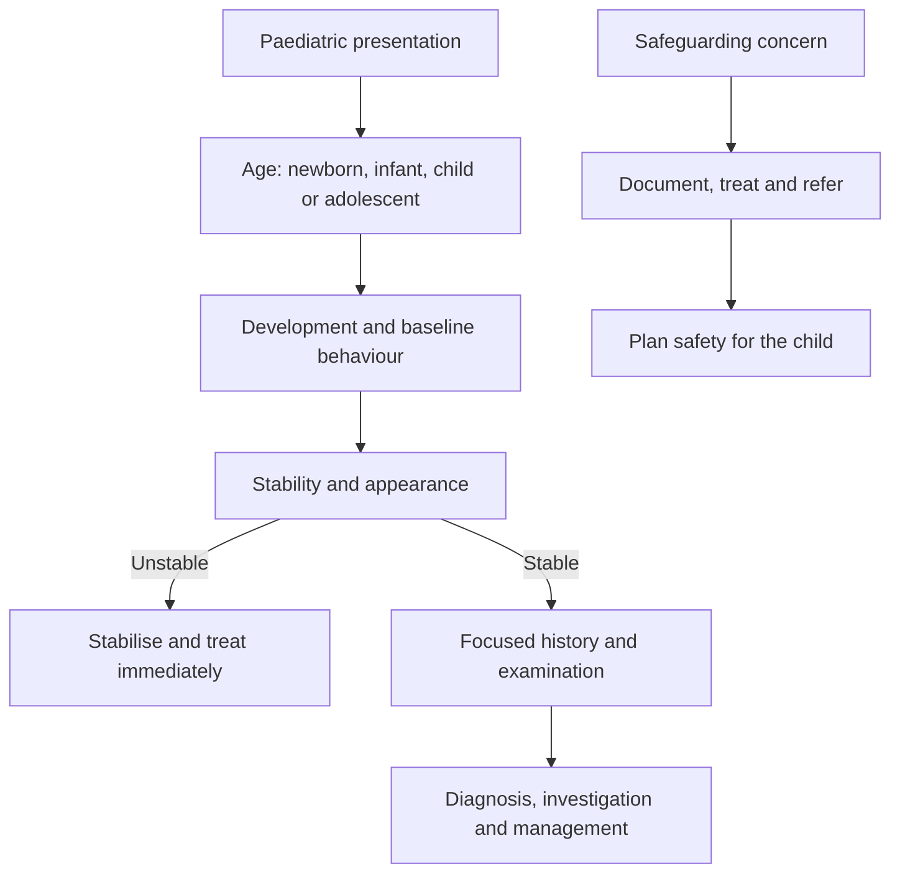

# Paediatrics

Paediatric questions are not adult questions with smaller numbers. A child's physiology changes with age, the range of normal findings is wide, and nonverbal children communicate through observation rather than a symptom history. The same fever means a different set of causes in a neonate, an infant and an older child.

The safe approach is to place the child on three axes before choosing a diagnosis: age, development and physiological stability. Age narrows the pathogen list and the differential. Development changes what can be assessed and how behaviour is interpreted. Stability decides whether assessment or immediate stabilisation comes first.

### 🟢 Lite — Quick Review (1h–1d)

**The age map.**

| Period | Defining vulnerability | Problems that need immediate attention |
|---|---|---|
| Newborn | Transition from fetal circulation, immature thermoregulation, limited reserve, immature immune system | Sepsis, respiratory distress, hypoglycaemia, jaundice, congenital anomaly, birth injury |
| Young infant | Fever becomes concerning, dehydration develops quickly, immune response remains immature | Meningitis, pneumonia, urinary infection, metabolic disease, non-accidental injury |
| Toddler and preschool child | Language and mobility bring new exposures and behaviour | Viral illness, otitis, asthma, gastroenteritis, foreign body, intussusception, abuse |
| School-age child | Longer history, clearer symptoms, broader differential | Asthma, diabetes, infection, migraine, inflammatory disease |
| Adolescent | Puberty, identity, peer context, risk behaviours | Mental health, substance use, pregnancy, sexually transmitted infection, eating disorder |

**Neonatal assessment.**

- **Apgar** scores Appearance, Pulse, Grimace, Activity and Reflex irritability at one and five minutes. It describes the newborn's condition and response to resuscitation; it does not predict long-term neurologic outcome.
- **The newborn transition** requires warm, dry, positioned airway support as needed, assessment of breathing and heart rate, and support of perfusion. A heart rate below 60 with poor response to ventilation requires effective compressions and epinephrine in resuscitation.
- **Newborn lungs** are fluid-filled at birth, and surfactant lowers surface tension. Preterm infants have insufficient surfactant, producing respiratory distress syndrome with ground-glass opacities and air bronchograms.
- **Thermoregulation** is immature. Cold and heat stress both cause problems, and hypothermia can obscure the signs of sepsis.
- **Hypoglycaemia** is common in preterm infants, infants of diabetic mothers, and infants exposed to perinatal stress. It is prevented with feeding and treated promptly with dextrose.

**Neonatal jaundice.** Physiologic jaundice begins after the first day, peaks around the third to fifth day in term infants and later in preterm infants, and reflects increased bilirubin production plus immature hepatic conjugation. Pathological features include jaundice in the first day, rapid rise, jaundice extending to the palms and soles, conjugated hyperbilirubinaemia, or neurological signs. High unconjugated bilirubin can cause acute bilirubin encephalopathy and kernicterus. Conjugated jaundice signals cholestasis, biliary atresia, infection or metabolic disease. Direct antiglobulin testing, blood groups and haemolysis help determine the cause.

**Developmental milestones.** Development proceeds predictably but not at the same pace in every child. Gross motor skills progress from head control to sitting, crawling and walking; fine motor skills progress from grasping to releasing and manipulating objects. Language advances from cooing to babbling, single words and phrases. Social development progresses through attachment, stranger anxiety and increasing independence. A **regression** — loss of a previously acquired skill — is more concerning than a delayed milestone. It points to regression, metabolic disease, hearing loss, autism spectrum disorder, or central nervous system disease.

**Fever by age.**

- **Neonate:** fever or hypothermia requires a full sepsis evaluation and empiric treatment.
- **Young infant:** serious bacterial infection includes meningitis, pneumonia and urinary tract infection.
- **Older infant and child:** common causes are viral, with urinary infection, pneumonia and serious bacterial infection still requiring attention when the child looks unwell.

**The appearance of the ill child.** A toxic appearance, altered mental state, respiratory distress, poor perfusion, a non-blanching rash, neck stiffness or dehydration changes the pathway. A normal appearance with a reassuring examination supports a focused evaluation.

**Airway and respiratory problems.**

| Condition | Clinical pattern | Management principle |
|---|---|---|
| Viral croup | Barky cough, hoarse voice, inspiratory stridor, worse at night | Assess severity; dexamethasone and observation for mild disease, nebulised epinephrine plus observation for moderate or severe disease |
| Epiglottitis | Drooling, severe throat pain, tripod posture, muffled voice; child avoids examination | Keep airway protected; immediate specialist and antibiotic care; do not force oral examination |
| Bronchiolitis | Young infant, rhinorrhoea, cough, wheeze, feeding difficulty | Supportive care, hydration and oxygen when needed; bronchodilators and antibiotics are not routine |
| Asthma | Recurrent wheeze, cough, exertional limitation, response to bronchodilator | Assess severity and use inhaled bronchodilator with corticosteroid for persistent disease |
| Pneumonia | Fever, tachypnoea, cough, focal findings in older child; increased work of breathing in infant | Diagnose severity and cause; treat bacterial and viral disease differently |
| Foreign body | Sudden cough, wheeze or unilateral findings after aspiration history | Bronchoscopy when the history and examination suggest a retained object |

A croup score based on stridor at rest, recession, mental state, hydration and oxygenation helps standardise severity. Clinical appearance and resource setting determine the pathway.

**Gastrointestinal and abdominal problems.**

- **Gastroenteritis** causes vomiting, diarrhoea and dehydration. Oral rehydration is preferred in a child who can drink; intravenous isotonic fluid is needed for shock, severe dehydration or inability to take oral fluid.
- **Pyloric stenosis** presents in the first weeks of life with projectile non-bilious vomiting, hungry after vomiting, visible peristalsis and a palpable olive. Hypochloraemic hypokalaemic metabolic alkalosis is characteristic.
- **Intussusception** presents with episodic severe colicky pain, vomiting, currant-jelly stool and a sausage-shaped mass. Abdominal ultrasound is the first study. Air or contrast enema is both diagnostic and therapeutic when the bowel is intact; perforation or peritonitis requires surgery.
- **Hirschsprung disease** presents with delayed meconium passage, abdominal distension and chronic constipation. Aganglionosis of the distal bowel causes a transition zone and functional obstruction.
- **Necrotising enterocolitis** occurs in preterm infants after feeding and intestinal injury. Abdominal distension, feeding intolerance, bloody stool and pneumatosis intestinalis on radiograph define the condition. Bowel perforation and necrosis drive surgical management.
- **Gastrointestinal obstruction** in a newborn, particularly failure to pass meconium, demands evaluation for Hirschsprung disease, meconium ileus, atresia and malrotation.

**Fluid and electrolyte disorders.** Dehydration severity comes from clinical signs rather than weight alone: reduced urine output, poor skin perfusion, lethargy, sunken eyes and poor capillary refill. Gastrointestinal losses produce hypochloraemic, hypokalaemic metabolic alkalosis. Diarrhea with renal or adrenal disease produces normal anion gap metabolic acidosis. Diabetic ketoacidosis adds a high anion gap.

**Urinary infection and glomerular disease.** A urinary tract infection in a febrile young child needs urine sampling before antibiotics when that does not delay treatment. Vesicoureteric reflux and abnormal renal development raise the risk of recurrent infection and scarring. **Nephritic syndrome** produces haematuria, proteinuria, hypertension, oedema and reduced renal function. **Nephrotic syndrome** produces heavy proteinuria, hypoalbuminaemia, oedema and hyperlipidaemia. The complements are C3, C4 and CH50. Post-streptococcal glomerulonephritis has low C3 with recovery, while lupus nephritis often has low C3 and C4.

**Immunisation.** Vaccination begins in infancy and follows a national schedule. Live vaccines include measles-containing vaccine, varicella, rotavirus and oral polio; they are avoided in severe immunosuppression. Inactivated vaccines are safe in immunocompromised patients. A valid dose is defined by age and minimum interval, and the record needs review during every encounter. Catch-up schedules do not restart the series. The goal is protection for the child and community.

**Child abuse and neglect.** Concerning findings include bruises away from typical accidental sites, patterned burns, fractures not consistent with the stated history, delay in seeking care, failure to thrive, poor hygiene, recurrent unexplained presentations and caregiver behaviour that raises concern. The response is medical stabilisation, documentation, safeguarding referral and evaluation of siblings. Bruising in a non-mobile infant has particular significance because the child cannot produce the injury by accidental movement.

**Memorise for the Lite tier.**

- Neonatal sepsis and meningitis need immediate treatment.
- Apgar describes newborn status, not long-term outcome.
- Jaundice in the first day is pathological; palm and sole jaundice is pathological; direct hyperbilirubinaemia needs cholestasis investigation.
- Loss of a acquired skill means regression.
- Stridor with barking cough is croup; drooling with tripod posture is epiglottitis.
- Young infant with fever: meningitis, pneumonia and urinary infection must be covered.
- Bilious vomiting in a newborn is surgical until proved otherwise.
- Intussusception: colicky pain, vomiting, currant-jelly stool, sausage mass.
- Dehydration is clinical; shock changes the treatment pathway.
- Immunisation records need age- and interval-based review.

### 🟡 Standard — Full Coverage (1–2d)

#### Worked example: the febrile neonate

**The stem.** A two-week-old infant has a rectal temperature of 38.4 degrees Celsius, poor feeding, increased sleepiness and fewer wet diapers. There is no focal skin or lung finding.

**Reasoning.** A febrile neonate has a high risk of serious bacterial infection. The absence of a focal source does not lower that concern enough to avoid a full evaluation. Initial management includes blood and urine cultures, a complete blood count with differential and inflammatory markers, a lumbar puncture if the infant is stable enough for it, and empiric antibiotics.

If the infant appears toxic or haemodynamically unstable, stabilisation comes before the complete diagnostic sequence: airway and breathing support, vascular access, fluid resuscitation when perfusion is poor and empiric antibiotics without delay. Urinary infection is common in this age group, and meningitis and pneumonia are also possible. Observation without treatment is not appropriate for a febrile neonate.

**What the stem teaches.** Age changes the threshold for action. The same fever in an older child starts a selective evaluation; in this infant it starts a sepsis pathway.

#### Worked example: the child with stridor

**The stem.** A two-year-old has fever, a barking cough, hoarse voice and inspiratory stridor at rest. The child is alert, working hard to breathe and has stridor with agitation.

**Reasoning.** The pattern is viral croup. The child's mental state, work of breathing and oxygenation determine severity. A child who remains calm with mild stridor can often be managed with dexamethasone and observation. Stridor at rest, marked recession or poor feeding supports nebulised epinephrine followed by observation for rebound. Severe obstruction, exhaustion or hypoxaemia requires airway support and escalation.

The competing diagnosis is epiglottitis, but drooling, severe throat pain, a toxic appearance and a hot, muffled voice point away from croup. The examination of the throat in suspected epiglottitis risks precipitating obstruction, so the airway specialist manages that child rather than an eager oral examination.

**What the stem teaches.** The diagnosis and the severity are separate decisions. Recognising croup without assessing severity does not answer the management question.

#### Worked example: the infant with vomiting and weight loss

**The stem.** A six-week-old infant has forceful vomiting after feeds, remains hungry immediately afterwards, has visible gastric peristalsis and passes little urine. Serum chloride and potassium are low, and the bicarbonate is high.

**Reasoning.** Pyloric stenosis causes gastric outlet obstruction. The metabolic alkalosis results from vomiting gastric hydrogen and chloride, with volume contraction increasing bicarbonate reabsorption and potassium loss. The infant needs correction of dehydration and electrolyte abnormalities before surgery, because uncorrected alkalosis increases anaesthetic and postoperative complications. Definitive treatment is pyloromyotomy.

**What the stem teaches.** The metabolic result follows from the anatomy. A quick reader identifies pyloric stenosis; the complete answer explains why the electrolytes are abnormal and why correction comes first.

#### Worked example: the child with colicky pain and blood in the stool

**The stem.** A nine-month-old has episodes of intense crying with knees drawn up, several episodes of vomiting and stool mixed with blood and mucus. An abdominal mass is felt in the right upper quadrant.

**Reasoning.** The combination is intussusception: a proximal segment of bowel telescopes into the distal segment. The inflamed trapped bowel produces colicky pain, vomiting, bleeding and a mass. Ultrasound is the first imaging study. If imaging shows no perforation or peritonitis, an air or contrast enema can reduce the intussusception while confirming the diagnosis. Surgery is needed when enema reduction fails or when perforation, peritonitis or instability is present.

**The developmental link.** Infancy is the peak period for intussusception, and lymphoid hyperplasia after a viral infection is a common lead point. Older children with intussusception need assessment for a pathological lead point.

**What the stem teaches.** Recognise the symptom cluster and move toward reduction; the timing of severe pain and the presence of shock change urgency.

#### Worked example: child with an unexpected developmental loss

**The stem.** A previously healthy four-year-old has stopped speaking in sentences, no longer interacts with family and has lost toilet skills over several weeks. Parents report that he was walking normally last month.

**Reasoning.** Developmental regression is a red flag. The differential includes regression after a metabolic or endocrine illness, an intracranial lesion, an epileptic encephalopathy such as Landau-Kleffner syndrome, an infection, autism spectrum disorder with regression, and psychosocial neglect. History, neurologic examination, hearing assessment, metabolic testing and imaging guide the evaluation.

The exact pattern matters. Loss of language alone points more toward a language or epileptic disorder; loss of motor skills plus cognition points more toward a neurodegenerative or metabolic process. Global regression with poor autonomic stability raises concern for a metabolic emergency.

**What the stem teaches.** Do not schedule another developmental visit and wait. Regression needs an active diagnostic and safeguarding assessment.

### 🔴 Deep — Mastery (3–5d)

#### Paediatric vital signs and examination

Children compensate well until decompensation is abrupt. Tachypnoea is an early respiratory sign and becomes a late sign of respiratory failure when effort disappears. Similarly, a child with warm peripheries and a thready pulse is more concerning than one with cool peripheries because compensatory vasoconstriction has failed. Capillary refill, mental state, urine output and pulse quality give more information than a single blood pressure.

The respiratory examination in a child includes work of breathing, breath sounds, wheeze, stridor and air entry. The abdomen examination includes the presence of bowel sounds, tenderness, masses and the fontanelle in infants. The skin examination looks for rash morphology, petechiae, purpura and bruises. A child who appears well can still have serious illness, and a child who appears toxic has a compressed differential.

#### Birth and the first days

Congenital heart disease can present in the first days because ductal dependence is essential for some lesions. A newborn with cyanosis, a harsh systolic murmur or signs of heart failure needs urgent assessment. Pulse oximetry screening detects critical congenital heart disease, and poor feeding, sweating with feeds and failure to thrive in infancy suggest a ductal-dependent lesion.

Congenital infection patterns depend on timing. Infection early in pregnancy can cause structural malformation; later infection affects growth and organ function. **Congenital rubella** classically causes cataracts, deafness and patent ductus arteriosus, with "blueberry muffin" purpuric skin lesions. **Congenital CMV** causes hearing loss, chorioretinitis and intracranial calcification. **Toxoplasmosis** causes hydrocephalus, chorioretinitis and diffuse intracranial calcification. Neonatal herpes often presents with vesicles, eye disease or disseminated infection, and untreated neonatal disease has high mortality.

**Fetal alcohol syndrome** includes growth restriction, characteristic facial features and central nervous system abnormalities. **Down syndrome** features hypotonia, intellectual disability and characteristic facial morphology; associated issues include duodenal atresia, cardiac defects, hypothyroidism and atlantoaxial instability.

#### Immunisation decisions

The medical record answers three questions for each vaccine: is the child old enough, has the minimum interval passed, and is there a contraindication? Live vaccines are contraindicated in severe immunosuppression and can be given after immune reconstitution with appropriate specialist guidance. Injectable inactivated vaccines remain available in immunocompromised households. A missed opportunity occurs when a vaccine is available but not given; accurate records and standing orders reduce it.

After an immunisation, observe for immediate allergic reactions and advise about delayed fever or local symptoms. A live vaccine given by mistake to a severely immunocompromised child requires specialist assessment. This topic links directly to immunology: the vaccine type determines the risk, not merely the disease prevented.

#### Safeguarding

Non-accidental injury is a diagnosis to consider whenever the history and findings do not fit. Record the caregiver's account precisely, including the exact words used. Document body findings with a body map, and record the developmental level and the mechanism proposed. Consider medical causes such as osteogenesis imperfecta, bleeding disorders, dermatitis artefacta and metabolic bone disease when the history is unusual.

A child who remains in a dangerous environment needs a safeguarding plan even when the immediate injury is minor. Medical staff treat injury, document findings and communicate risk to the appropriate safeguarding and social-care systems. The physician's role is not to investigate every family member in the emergency department; it is to make a safe plan for the child and to ensure the information needed for that plan reaches the team that owns it.

#### Common mistakes

**Reassuring a febrile neonate because no source is found.** The absence of a source is the reason for the full sepsis pathway.

**Forcing a throat examination in suspected epiglottitis.** The airway risk outweighs the diagnostic gain.

**Treating all stridor as croup.** Foreign body, epiglottitis and bacterial tracheitis have different pathways.

**Using adult heart and respiratory thresholds for children.** Age and size change normal values, and clinical appearance remains central.

**Attributing regression to delayed development.** Regression is a symptom requiring investigation.

**Interpreting a clean urinalysis as excluding urinary infection in a young infant.** Contamination and incomplete collection make interpretation difficult, and a febrile infant needs urine obtained by an appropriate method.

**Giving a live vaccine during severe immunosuppression.** The vaccine type and immune status decide safety.

#### Exam traps

A child with fever, neck stiffness and a non-blanching rash needs meningitis and meningococcemia covered without waiting for every diagnostic test.

A child with inspiratory stridor, drooling and a toxic appearance has a threatened airway. The first priority is airway expertise, not a throat examination.

An infant with projectile non-bilious vomiting and alkalosis has pyloric stenosis, and the immediate management issue is fluid and electrolyte correction.

A child with episodic crying, vomiting and currant-jelly stool has intussusception, and the next management question is whether reduction or surgery is appropriate.

A child with nephrotic-range proteinuria, oedema and hypoalbuminaemia has nephrotic syndrome; a child with haematuria, hypertension and reduced renal function has nephritic syndrome. Do not reverse the labels.

#### 🧠 Memory Anchors

- **Febrile neonate: sepsis pathway.**
- **Regression is a red flag.**
- **Croup: barky cough and stridor; epiglottitis: drooling and tripod posture.**
- **Bilateral oedema with proteinuria and hypoalbuminaemia is nephrotic; haematuria and hypertension point to nephritic.**
- **Projectile non-bilious vomiting plus alkalosis: pyloric stenosis.**
- **Colicky pain, vomiting and currant-jelly stool: intussusception.**
- **Flashcard Q&A:**
  - *What does Apgar describe?* → Newborn status and response to resuscitation.
  - *When is neonatal jaundice pathological?* → First day, rapid rise, palm or sole involvement, conjugated, or neurological signs.
  - *What is first-line treatment for mild croup?* → Dexamethasone and observation.
  - *What is the immediate treatment for pyloric stenosis?* → Correct dehydration and electrolytes before surgery.
  - *What is the first imaging test for intussusception?* → Abdominal ultrasound.

#### Internal links

- [USMLE exam hub](/exams/usmle/) — the three-step structure, sponsored by FSMB and NBME.
- [Medicine by Presentation](/notes/usmle/step-2-ck/s2-002/) — the same stability-first approach used for adult presentations.
- [Preventive Medicine in Practice](/notes/usmle/step-2-ck/s2-007/) — immunisation, screening and prevention applied to children.
- [Ethics, Law and Communication](/notes/usmle/step-2-ck/s2-008/) — consent, assent, confidentiality and safeguarding communication.

The description of Step 2 CK quoted here is the wording used by the FSMB and NBME (https://www.usmle.org/ and https://www.nbme.org/). This page states no item counts, timing, the scoring scale, fees or the testing calendar, because those figures were not verifiable at build time. Clinical ages, physiological values and management principles are subject-matter facts from standard paediatric practice. The topic weight is StudyRoadmap's own prioritisation, not an NBME blueprint.

---

## Continue your study

- **[View this topic in your USMLE (United States Medical Licensing Examination) roadmap](/roadmap/?exam=usmle&duration=1mo)** — see where this topic sits in your personalised plan
- **[Build a quick revision plan](/roadmap/?exam=usmle&duration=1d)** — 1-day sprint covering the highest-weight topics
- **[USMLE (United States Medical Licensing Examination) exam overview](/exams/usmle/)** — pattern, eligibility, and syllabus
- **[All Step 2 CK (Clinical Knowledge) notes](/notes/usmle/step-2-ck/)** — browse sibling topics in this subject
