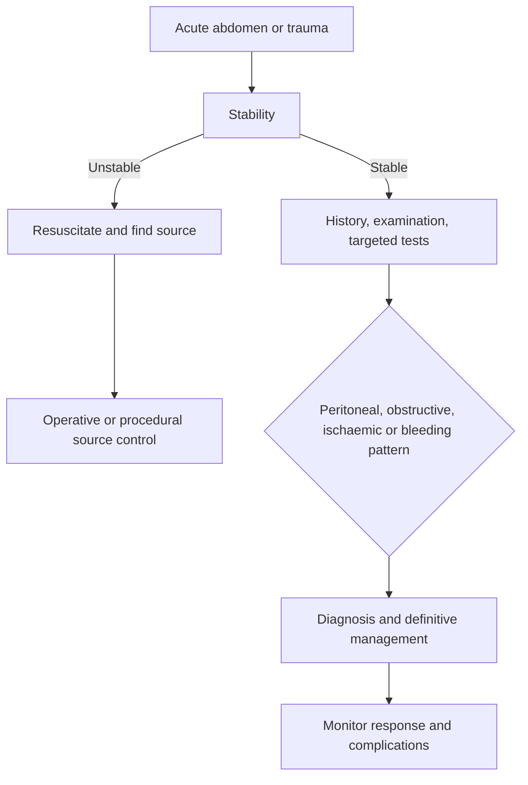

# Surgery and Perioperative Care

Surgical questions ask two questions that are easy to confuse. First, what is causing the abdominal or traumatic problem? Second, what does the patient need now? The diagnosis explains the syndrome; the management answers whether the patient needs an operation, antibiotics, fluids, source control or a period of observation.

Perioperative care adds a third layer: the operation changes the patient's physiology, and postoperative deterioration can come from the operation, the anaesthesia, the original disease or a complication that was present before surgery. A postoperative patient with tachycardia and low blood pressure needs the same disciplined response as a medical patient: assess perfusion and find the cause, not assume that everything is postoperative ileus.

### 🟢 Lite — Quick Review (1h–1d)

**The acute abdomen: a symptom framework.**

| Finding | Points toward | Urgent alternative to exclude |
|---|---|---|
| Sudden severe pain | Perforation, torsion, vascular occlusion, ruptured ectopic | Mesenteric ischaemia |
| Colicky pain with vomiting | Obstruction | Strangulated hernia or volvulus |
| Right lower quadrant pain | Appendicitis, Crohn disease, ovarian torsion, ectopic | Ectopic pregnancy and torsion |
| Right upper quadrant pain | Cholecystitis, biliary colic, hepatitis | Ascending cholangitis |
| Epigastric pain radiating to back | Pancreatitis, peptic ulcer, myocardial ischaemia | Aortic dissection and myocardial infarction |
| Left lower quadrant pain and fever | Diverticulitis, constipation, colitis | Perforated cancer |
| Diffuse tenderness with guarding | Peritonitis from perforation, ischaemia or inflammation | Mesenteric ischaemia |
| Pain out of proportion to examination | Early ischaemia | Mesenteric ischaemia |

**Peritonism.** Localised guarding and rebound suggest inflammation near the organ. Diffuse rigidity suggests contamination throughout the peritoneum. Rigidity in a patient with a distended tympanitic abdomen and no previous surgery suggests perforation or obstruction. An elderly or immunosuppressed patient can have an advanced abdominal process with little tenderness, so examination findings must be interpreted against the whole picture.

**The common acute surgical diagnoses.**

- **Appendicitis** begins with periumbilical visceral pain and migrates to the right lower quadrant as the inflamed serosa irritates the parietal peritoneum. Anorexia, nausea and fever support it. The location can vary with pregnancy or a mobile caecum. Local guarding, a positive psoas or obturator sign and pain at the point of maximal tenderness support the diagnosis. Complicated appendicitis can perforate and form an abscess.
- **Acute cholecystitis** produces persistent right upper quadrant or epigastric pain, often after a fatty meal, with fever, leukocytosis and a positive Murphy sign. Ultrasound shows gallstones, wall thickening, pericholecystic fluid and a sonographic Murphy sign.
- **Choledocholithiasis** presents with biliary pain and jaundice. Fever plus jaundice plus hypotension is Charcot triad and indicates acute ascending cholangitis. It needs biliary decompression in addition to antibiotics.
- **Acute pancreatitis** produces severe epigastric pain radiating to the back, nausea and vomiting. Diagnosis rests on characteristic pain plus elevated lipase or amylase. Gallstones and alcohol are the main causes. Severe pancreatitis includes systemic inflammatory response, organ failure and necrosis.
- **Small bowel obstruction** causes colicky pain, vomiting, distension and absolute constipation. High obstruction produces early frequent vomiting; distal obstruction produces marked distension and late vomiting. Hernia, adhesions and malignancy are common causes. Ischaemia, strangulation and a closed loop are surgical emergencies.
- **Large bowel obstruction** is less likely to produce early vomiting. Competent ileocecal valves can produce massive distension; incompetent valves allow reflux into the small bowel. Left-sided cancer is a frequent cause, and right-sided lesions present later with anaemia or altered bowel habit.
- **Perforated viscus** causes abrupt pain, board-like rigidity and free intraperitoneal air on imaging. A perforated ulcer can produce referred shoulder pain from diaphragmatic irritation.
- **Diverticulitis** causes left lower quadrant pain, fever and leukocytosis, often with altered bowel habit. CT is the preferred test in a complicated presentation.
- **Incarcerated hernia** has a tender, irreducible swelling and obstructive symptoms. A hernia that is irreducible, painful or has compromised blood flow requires emergency assessment rather than manual reduction.
- **Ovarian torsion** causes sudden unilateral pelvic pain, nausea and vomiting. An adnexal mass and abnormal Doppler findings support the diagnosis, and the ovary has a limited blood supply, so delay matters.
- **Testicular torsion** causes sudden severe unilateral scrotal pain and vomiting. The affected testis lies high and horizontal. Surgical exploration is urgent because prolonged ischaemia damages the testis.
- **Ruptured ectopic pregnancy** causes pelvic pain, vaginal bleeding and haemodynamic compromise. Pregnancy testing and pelvic imaging guide diagnosis.

**The acute abdomen: the examination sequence.**

1. **Inspect** for distension, masses, scars, hernia and bruising.
2. **Auscultate** for bowel sounds and bruits.
3. **Percuss** for tympany, dullness, shifting dullness and bowel sounds over the abdomen.
4. **Palpate** for tenderness, guarding, rebound, masses and signs such as Murphy, psoas and Rovsing.
5. **Examine the pelvis and rectum** when indicated.
6. **Check the groin, scrotum and external genitalia** when the pain is lower abdominal.
7. **Consider pregnancy** in every patient of reproductive potential.

Pain out of proportion to the examination, hypotension, metabolic acidosis and blood in the stool point toward mesenteric ischaemia. A patient with atrial fibrillation or atherosclerotic disease has a reason for an arterial embolus or thrombosis. Pain with a tender irreducible hernia, or a sudden severe pain with vomiting and distension, points toward strangulation.

**Perioperative assessment.**

- **History:** diagnosis and planned procedure, airway and aspiration risk, cardiac and pulmonary disease, renal function, bleeding and thromboembolic history, medications, allergies, pregnancy status and fasting status.
- **Examination:** airway and mouth, heart, lungs, pulses, neurological status, spine, infection sites and surgical field.
- **Investigation:** guided by the proposed operation and comorbidity. Testing should change management, not form a ritual panel.
- **Risk assessment:** functional capacity, cardiopulmonary reserve, sepsis, volume status and frailty affect the plan.
- **Optimisation:** treat dehydration, anaemia, hyperglycaemia, infection and active smoking before elective surgery when time allows. Continue appropriate antihypertensives and bronchodilators, and hold drugs with specific perioperative hazards under an agreed plan.
- **Consent and planning:** explain the procedure, material risks, alternatives, blood loss, anaesthesia and expected recovery. The plan includes analgesia, antiemetics, venous thromboembolism prophylaxis, antibiotic prophylaxis and postoperative destination.

**Antibiotic prophylaxis.** Clean procedures require prophylaxis against surgical-site infection when the wound class or the patient's risk warrants it. Clean-contaminated and contaminated procedures need coverage of skin and gastrointestinal flora. Dirty or infected procedures require treatment directed at the organisms already present. Prophylaxis is not a substitute for good tissue handling, haemostasis and source control.

**Fluid and electrolyte care.** Patients lose fluid to the third space, bowel lumen, bleeding and insensible losses. Assess volume status clinically and replace deficits with balanced isotonic fluid while monitoring electrolytes and urine output. Potassium, magnesium and phosphate need replacement when losses are substantial. Transfusion decisions follow haemodynamic and clinical needs, not a single haemoglobin number in a stable patient.

**Postoperative complications.**

| Timing or system | Complication | Key clue |
|---|---|---|
| Early | Haemorrhage | Tachycardia, falling blood pressure, wound swelling, drain output |
| Early | Respiratory depression or aspiration | Sedation plus airway compromise |
| First days | Atelectasis and pneumonia | Low-grade fever, reduced breath sounds, hypoxia |
| First days | Urinary retention or infection | Pain, suprapubic distension, cloudy urine |
| First days | Ileus or obstruction | Absent or high-pitched bowel sounds, distension, vomiting |
| Any time | Surgical-site infection | Erythema, warmth, swelling, purulent drainage, dehiscence |
| Any time | Anastomotic leak | Tachycardia, fever, abdominal pain, drainage change |
| Any time | Venous thromboembolism | Unilateral swelling, pleuritic pain, dyspnoea |
| Any time | Acute kidney injury | Reduced urine output and rising creatinine |
| Older patients | Delirium | Acute change in attention and awareness |
| Limb or compartment | Compartment syndrome | Severe pain, tense compartment, pain with passive stretch, pulselessness late |

A postoperative chest radiograph with an elevated hemidiaphragm, reduced expansion and linear atelectasis supports atelectasis. Persistent fever, worsening tenderness, leukocytosis and a change in drain output point toward a leak or intra-abdominal infection.

**Sepsis and source control.** Sepsis is life-threatening organ dysfunction caused by a dysregulated host response to infection. Management runs in parallel: cultures and source identification when this does not delay treatment, broad antimicrobials, fluids when hypoperfusion is present, vasopressors for persistent hypotension after fluid resuscitation, and drainage or removal of an infected source when the source is accessible. Antibiotics do not replace drainage of an obstructed, infarcted or walled-off infection.

**Trauma.** The primary survey follows airway with cervical-spine protection, breathing, circulation with haemorrhage control, disability and neurological status, and exposure with prevention of hypothermia. A patient whose airway is obstructed or who is apnoeic needs an immediate airway intervention, not a long history. Life-threatening haemorrhage is addressed during the primary survey.

| Shock pattern | Typical findings | Mechanism |
|---|---|---|
| Hypovolaemic | Low JVP, cool peripheries, tachycardia | Blood or fluid loss |
| Distributive | Warm peripheries early, low systemic vascular resistance | Sepsis, anaphylaxis, neurogenic injury |
| Cardiogenic | Raised JVP, pulmonary oedema | Pump failure |
| Obstructive | Raised JVP, unequal breath sounds, tension pneumothorax or tamponade | Impaired filling or thoracic obstruction |

Focused ultrasound can identify free intraperitoneal fluid, pericardial fluid and thoracic pathology in unstable trauma. A negative scan does not exclude injury, and a positive scan in an unstable patient supports immediate operative control. Damage-control surgery limits the initial operation to bleeding control, infection control and temporary closure when physiological reserve is limited.

**Burns.** Burn depth affects management. Superficial burns are erythematous and blanch; partial-thickness burns are blistered and painful; full-thickness burns are white or leathery and less sensitive. Burn size, depth, location and the patient's airway and fluid needs determine care. Airway assessment comes first when there is facial, oral or inhalational injury. Fluid resuscitation uses a calculated burn-area estimate and titrates to urine output.

**Memorise for the Lite tier.**

- Peritonism means inflammation of the peritoneum; find the source and assess sepsis.
- Pain out of proportion to examination suggests ischaemia.
- Obstruction is colicky pain, vomiting, distension and absolute constipation; peritonitis changes the pathway.
- Right lower quadrant pain is appendicitis until torsion or ectopic is excluded in the relevant patient.
- Charcot triad is cholangitis and requires drainage.
- Primary trauma survey: airway, breathing, circulation, disability, exposure.
- Clean versus contaminated operation changes antibiotic strategy.
- Postoperative sepsis needs source control, not antibiotics alone.
- Compartment syndrome is a clinical diagnosis; pulselessness is late.

### 🟡 Standard — Full Coverage (1–2d)

#### Worked example: sudden severe abdominal pain

**The stem.** An older adult develops sudden severe abdominal pain out of proportion to a benign abdominal examination. The pain is diffuse. Bowel sounds are absent. The patient has atrial fibrillation and is hypotensive with an elevated lactate.

**Reasoning.** The mismatch between severe pain and a quiet examination, combined with atrial fibrillation, points to acute mesenteric ischaemia from an arterial embolus. The early peritoneal signs can be mild because the infarcted bowel has not yet caused widespread contamination. Shock and lactate support a threatened bowel and systemic hypoperfusion.

**Management.** Immediate resuscitation and vascular assessment are paired with urgent surgical review. CT angiography helps define the vascular lesion in a stable patient, but a deteriorating patient with peritonitis needs operative exploration without a delay that increases infarction. Antibiotics and supportive care run alongside the decision. The key error is treating the initial absence of guarding as reassurance.

**What the stem teaches.** A single examination finding does not exclude a surgical abdomen. The tempo, the mismatch between pain and signs, and the risk factor change the urgency.

#### Worked example: right upper quadrant pain with jaundice and fever

**The stem.** An older adult has right upper quadrant pain, fever and jaundice. Blood pressure is low and the patient is confused.

**Reasoning.** Fever, jaundice and right upper quadrant pain form Charcot triad and indicate acute ascending cholangitis, usually from an obstructing stone in the common bile duct. Hypotension and confusion add shock and altered mental status, marking severe disease with organ dysfunction.

**Management.** Resuscitation, broad-spectrum antibiotics and urgent biliary decompression are required. Endoscopic retrograde cholangiopancreatography with stone extraction or stent placement is the usual initial drainage route. Antibiotics alone do not relieve the obstructed infected system.

**What the stem teaches.** Cholecystitis and cholangitis are different problems. The addition of jaundice and systemic dysfunction points to the duct and changes the need for drainage.

#### Worked example: the postoperative patient who becomes septic

**The stem.** Two days after a colorectal operation, the patient has a temperature of 38.8 degrees Celsius, tachycardia and worsening abdominal pain. The wound is erythematous and the white cell count is rising.

**Reasoning.** New fever and tachycardia after surgery suggest infection rather than expected postoperative pain. The abdominal source is most concerning because of the operation and the changing pain. Assessment includes examination of the wound, abdomen, drains and chest, cultures, imaging and review of the operation and drug chart. An anastomotic leak or intra-abdominal abscess needs source control.

A superficial wound infection can cause fever and tenderness, but the worsening abdominal pain and systemic illness raise the threshold for investigating a deeper problem. Antibiotics without imaging or drainage are incomplete when a collection exists.

**What the stem teaches.** Postoperative fever is a diagnostic problem. The time since the operation and the trajectory narrow the causes, and the abdomen must not be dismissed as a routine source of surgical-site infection.

#### Worked example: an irreducible groin swelling

**The stem.** An older adult has a groin swelling that became painful over several hours. It cannot be reduced and the overlying skin is discoloured. The patient has vomiting and abdominal distension.

**Reasoning.** This is an incarcerated hernia with a threatened blood supply. Obstructive symptoms support a hernia causing bowel obstruction. The irreducibility, tenderness and skin change suggest ischaemia. Manual reduction is contraindicated, and urgent surgical assessment is required. Resuscitation, analgesia, nasogastric decompression when appropriate and antibiotics for suspected bowel ischaemia occur alongside preparation for surgery.

**What the stem teaches.** Not every obstructed hernia is a routine elective repair. The distinction between reducible, incarcerated, obstructed and strangulated determines the pathway.

### 🔴 Deep — Mastery (3–5d)

#### Reading the surgical abdomen as a physiology problem

The examination can be organised by the consequences of the suspected process.

**Peritoneal irritation:** guarding, rebound and rigidity arise from inflammation of the parietal peritoneum. Movement and coughing increase the pain. The location of maximal tenderness helps localise the source, but a perforated viscus can produce diffuse findings and an inflammatory process can produce early local ones.

**Obstruction:** colicky pain reflects bowel contraction against a blockage; vomiting depends on the level; distension depends on gas and fluid accumulation; absolute constipation is more reliable when the obstruction is complete. High small bowel obstruction gives early vomiting of gastric contents and little distension. Distal small bowel obstruction gives feculent vomiting and marked distension. Large bowel obstruction produces distension and later vomiting. Peristalsis becomes high-pitched in early obstruction and absent when ischaemia or advanced ileus develops.

**Ischaemia:** severe pain early, tenderness that arrives later, metabolic acidosis, rising lactate and haemodynamic instability. The bowel becomes gangrenous before peritonitis is obvious, so waiting for rigidity is dangerous.

**Bleeding:** pain with shock can come from rupture of a viscus or aneurysm. Pregnancy testing matters in reproductive-age patients because rupture of an ectopic pregnancy can present with haemoperitoneum and no vaginal bleeding.

**Infection:** fever, leukocytosis and localised tenderness. The source can be luminal perforation, an infected obstructed organ, postoperative collection or systemic infection.

#### The perioperative checklist as clinical reasoning

A safe plan is not a list of tasks. It is a series of decisions.

**What is the operation and what does it require?** The anticipated blood loss, duration, position, fluid shifts, bowel handling and risk of infection determine preparation and postoperative destination.

**Which conditions can be optimised now?** Anaemia, volume depletion, electrolyte disturbance, poor glycaemic control, active infection, smoking and respiratory disease affect immediate risk. Emergency surgery proceeds in parallel with resuscitation when delay causes harm.

**Which medications continue, stop or adjust?** Anticoagulants and antiplatelets affect bleeding; insulin and oral agents affect glucose; antihypertensives affect induction; some drugs and supplements alter bleeding or drug metabolism. The decision belongs to the team and is documented.

**How will complications be prevented and detected?** Smoking cessation, lung expansion, early mobilisation, glycaemic control, wound care and venous thromboembolism prophylaxis reduce risk. The postoperative plan must state what is monitored, how often and what threshold triggers escalation.

**How will pain and nausea be managed?** Use multimodal analgesia, with opioids at the lowest effective dose and bowel regimen when opioids are used. Regional techniques improve pain in suitable operations. Untreated pain prevents coughing, deep breathing and mobilisation.

#### Postoperative fever by timing

**In the first day:** atelectasis, pain-related hypoventilation, aspiration and existing infection are common. Examine the chest and review lung expansion, oxygenation, temperature and fluid balance.

**Around the second or third day:** wound infection, urinary infection, pneumonia, atelectasis and early anastomotic problems enter the differential. The operation and the trend of symptoms guide the search.

**Later:** deep surgical-site infection, intra-abdominal abscess, anastomotic leak, line infection, antibiotic-associated diarrhoea and thromboembolism become more relevant. A persistent or recurrent fever requires a deliberate review rather than repeated blind imaging.

**Never dismiss an abnormal vital sign.** Tachycardia is a marker of occult stress. In the postoperative patient it can signal bleeding, sepsis, hypoxia, hypovolaemia, pain, pulmonary embolism or a urinary problem. The examination and trend identify the source.

#### Common mistakes

**Ordering a CT before stabilising an unstable patient.** Resuscitation and bedside assessment come first; imaging waits when the patient cannot tolerate it.

**Treating a normal early abdominal examination as proof of no surgical disease.** Peritoneal signs arrive late in ischaemia and perforation.

**Using antibiotics without source control for an obstructed or necrotic infection.** Antibiotics do not drain an abscess, relieve an obstruction or remove dead bowel.

**Assuming every postoperative vomiting is ileus.** Electrolyte disturbance, obstruction, ileus, medication, raised intra-abdominal pressure and gastric outlet obstruction are alternatives.

**Calling any painful surgical wound a superficial infection.** Deeper infection and anastomotic leak need urgent investigation.

**Waiting for pulses in compartment syndrome.** Pain with passive stretch and tense compartments are early findings; pulselessness is late.

**Underestimating postoperative urinary retention.** Pain, agitation and postoperative confusion can all result from a full bladder.

#### Exam traps

A patient with sudden severe pain and a quiet abdomen with atrial fibrillation has mesenteric ischaemia until proved otherwise.

A patient with fever, jaundice and hypotension has acute cholangitis and needs biliary drainage.

A patient with a tender irreducible inguinal swelling and obstruction has an incarcerated hernia and needs urgent surgical review.

A postoperative patient with tachycardia, fever and worsening pain needs an anastomotic leak or intra-abdominal infection considered.

A trauma patient with a tension pneumothorax needs immediate decompression; ventilation with positive pressure before decompression can worsen shock.

A burn patient with facial singeing and soot near the mouth needs an airway plan before transfer and large-bore access.

#### 🧠 Memory Anchors

- **Peritonism, obstruction, ischaemia, bleeding, infection.**
- **Pain out of proportion means ischaemia until excluded.**
- **Charcot triad means cholangitis and drainage.**
- **ABCDE is the trauma primary survey.**
- **Sepsis needs antimicrobials plus source control.**
- **Postoperative fever needs a cause and a trajectory.**
- **Flashcard Q&A:**
  - *What causes Charcot triad?* → Ascending cholangitis from duct obstruction.
  - *What is the first treatment step in an unstable trauma patient?* → Address airway and breathing while controlling haemorrhage.
  - *When is a hernia dangerous?* → When irreducible, incarcerated, obstructed or strangulated.
  - *What is the earliest sign of compartment syndrome?* → Pain with passive stretch in a tense compartment.
  - *Why does acute mesenteric ischaemia need speed?* → Pain appears before peritonitis, while bowel viability can still be saved.

#### Internal links

- [USMLE exam hub](/exams/usmle/) — the three-step structure, sponsored by FSMB and NBME.
- [Medicine by Presentation](/notes/usmle/step-2-ck/s2-002/) — the common abdominal complaints and their dangerous alternatives.
- [Diagnostic Testing and Imaging](/notes/usmle/step-2-ck/s2-009/) — choosing bedside ultrasound, CT and laboratory tests.
- [Emergency and Critical Care](/notes/usmle/step-3/s3-004/) — the resuscitation principles applied to unstable patients.

The description of Step 2 CK quoted here is the wording used by the FSMB and NBME (https://www.usmle.org/ and https://www.nbme.org/). This page states no item counts, timing, the scoring scale, fees or the testing calendar, because those figures were not verifiable at build time. The topic weight is StudyRoadmap's own prioritisation, not an NBME blueprint.

---

## Continue your study

- **[View this topic in your USMLE (United States Medical Licensing Examination) roadmap](/roadmap/?exam=usmle&duration=1mo)** — see where this topic sits in your personalised plan
- **[Build a quick revision plan](/roadmap/?exam=usmle&duration=1d)** — 1-day sprint covering the highest-weight topics
- **[USMLE (United States Medical Licensing Examination) exam overview](/exams/usmle/)** — pattern, eligibility, and syllabus
- **[All Step 2 CK (Clinical Knowledge) notes](/notes/usmle/step-2-ck/)** — browse sibling topics in this subject
